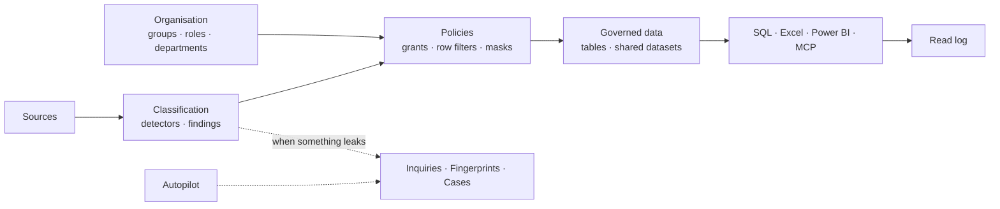

<div align="center">
  

# Classifyre

## Open-Source Data Access Governance

**Your access rules, enforced on every query.**

[](https://github.com/classifyre/classifyre/actions/workflows/ci.yml)
[](https://github.com/classifyre/classifyre/releases/latest)
[](LICENSE)
[](https://docs.classifyre.com/)

Open-source data access governance you run yourself. Classifyre enforces who sees which tables, rows and columns across 40+ systems, **masks personal data inside the query**, and logs every read.

Departments, roles and locations from your directory decide what each person sees; personal data stays masked until someone is cleared for it; teams build data products on top and use them in SQL, Excel, Power BI and AI agents. Nothing leaves your servers. All of it is Apache-2.0, including SSO, roles, row filters and masking.

[Documentation](https://docs.classifyre.com/) · [Live Showcase](https://showcase.classifyre.com/)

</div>

---

## What Classifyre does

Classifyre is the one governed way into your organisation's data. Five promises, each with the feature that proves it:

| Promise                                        | What it means                                                                                                                                                                                                                                               | Docs                                                                       |
| ---------------------------------------------- | ----------------------------------------------------------------------------------------------------------------------------------------------------------------------------------------------------------------------------------------------------------- | -------------------------------------------------------------------------- |
| **Access follows your organisation**           | Groups from Entra ID, Active Directory, Okta or any OIDC/SAML directory decide which sources, tables, rows and columns a person sees. Grants with end dates, row filters per group, access requests decided by owners. SSO and roles included.              | [Access](https://docs.classifyre.com/access/)                              |
| **Sensitive data is masked by default**        | Classification decides what is personal (41 PII types incl. AT/DE/CH identifiers, 27 secret patterns, custom detectors). Masks apply inside the query (redacted, last four, hashed, empty, hidden), so `WHERE`, `JOIN` and `GROUP BY` cannot see past them. | [Query data & masking](https://docs.classifyre.com/data-query/)            |
| **Teams build data products on governed data** | Shared datasets join sources live, with an owning group and readers per group; the masks of every input travel with them as a floor. Owners, stewards, quality rules, ODCS contracts.                                                                       | [Shared datasets](https://docs.classifyre.com/data-query/#shared-datasets) |
| **People use it in the tools they have**       | A SQL page, exports, and a PostgreSQL-protocol endpoint for Power BI, Excel, Tableau and DBeaver on personal, expiring connections, plus AI agents over MCP that read as the person who connected them.                                                     | [SQL connections](https://docs.classifyre.com/sql-connections/)            |
| **Every read is on record, nothing leaves**    | Every read, per table and person, with the channel used. Runs as one Docker image or a Helm chart on your own infrastructure, offline if you like.                                                                                                          | [Roles](https://docs.classifyre.com/access/roles/)                         |

Underneath: 40+ [sources](https://docs.classifyre.com/sources/) read in place (databases, lakehouses, storage, collaboration tools, content platforms; image OCR and audio/video transcription run automatically), [detectors](https://docs.classifyre.com/detectors/) from a regex to an LLM, and [findings](https://docs.classifyre.com/detectors/findings/) with severity, confidence and a lifecycle across scans.

### When something leaks

Findings also feed an investigation layer for the cases that need a human to dig in:

| Capability             | What it means                                                                                                                     | Docs                                                                          |
| ---------------------- | --------------------------------------------------------------------------------------------------------------------------------- | ----------------------------------------------------------------------------- |
| **Inquiries**          | Saved questions that keep surfacing matching findings, scan after scan.                                                           | [Inquiries](https://docs.classifyre.com/flow/investigations/inquiry/)         |
| **Fingerprints**       | Deterministic duplicate and similarity detection that links the same entity across systems into clusters.                         | [Fingerprints](https://docs.classifyre.com/flow/investigations/fingerprints/) |
| **Cases & hypotheses** | Workspaces that collect evidence, weigh competing explanations, and reach a conclusion.                                           | [Cases](https://docs.classifyre.com/flow/investigations/cases/)               |
| **Autopilot**          | AI agents that open inquiries, maintain fingerprints, build cases, and draft hypotheses after every scan — explaining every move. | [Autopilot](https://docs.classifyre.com/flow/investigations/autopilot/)       |

## How it all connects



1. **Connect and classify.** A scan reads each source in place into **assets**; **detectors** raise **findings**, and the classification decides what is protected.
2. **Organise.** Groups from your directory get **grants**, **row filters** and, where needed, clear reading of personal columns, each with an end date if you like.
3. **Protect.** Personal columns are **masked inside the query** for everyone not cleared to read them, workspace admins included.
4. **Build.** Teams share **datasets** that join sources live; the masks of every input travel with them.
5. **Use.** People read the data through the SQL page, exports, a PostgreSQL endpoint or MCP, always through their own grants and masks.
6. **Audit.** **Every read is logged**, per table and person.
7. **Investigate (optional).** When something does leak, **inquiries**, **fingerprints** and **cases** turn findings into an investigation, with **Autopilot** doing the legwork.

The end-to-end journey is documented in [Flow](https://docs.classifyre.com/flow/).

---

## Try it locally

Run the production Helm chart locally on k3d with Skaffold:

```bash
./scripts/dev/create-cluster.sh
./scripts/dev/start.sh
```

The first start takes several minutes (image pulls, dependency install, and the
identity server's one-time setup). The web app is not deployed in the cluster;
in a second terminal run it on your machine against the stack:

```bash
./scripts/dev/web-iam.sh
```

Then open [http://localhost:3000](http://localhost:3000). The API is on
<http://localhost:8811>. To open the app from another device on the same wifi,
run `bun run web:dev:lan` instead. Details:
[`scripts/dev/README.md`](scripts/dev/README.md).

### Or just run the image

To try Classifyre without a cluster, the all-in-one image carries the whole
stack — API, web UI, scan workers and PostgreSQL — in one container:

```bash
docker run -d --name classifyre \
  -p 3000:3000 --shm-size=1g \
  -v classifyre-pgdata:/var/lib/postgresql/data \
  -v classifyre-data:/var/lib/classifyre \
  -v classifyre-uv-cache:/cache/uv \
  classifyre/all-in-one:latest
```

See [`docker/README.md`](docker/README.md) for configuration, external
databases, object storage and resource tuning.

## Production deployment

Deploy to Kubernetes with the official Helm chart. See the production deployment guide for values, secrets management, external PostgreSQL, RBAC, HPA, and PDB configuration.

```bash
helm install classifyre \
  oci://registry-1.docker.io/classifyre/classifyre-core
```

> Full guide: [docs.classifyre.com/deployment/kubernetes](https://docs.classifyre.com/deployment/kubernetes/)
>
> Chart README — every value, the sizing rules, and the production checklist: [helm/classifyre/README.md](https://github.com/classifyre/classifyre/blob/main/helm/classifyre/README.md)

---

## Architecture

Classifyre is a distributed, decoupled platform: a **Web UI** and **API/Orchestrator** form the core stack, while an ephemeral **CLI Runner** does the extraction and detection. It relies on standard external infrastructure (PostgreSQL, optional S3) you can bring your own instances of. See the [platform components](https://docs.classifyre.com/deployment/) overview.

### Repository layout

This is a [Turborepo](https://turbo.build/) monorepo managed with [bun](https://bun.sh/).

| Path               | Stack                 | Purpose                                                                      |
| ------------------ | --------------------- | ---------------------------------------------------------------------------- |
| `apps/web`         | Next.js 16 · React 19 | The product Web UI                                                           |
| `apps/api`         | NestJS · Fastify      | API, orchestrator, and the Autopilot harness                                 |
| `apps/cli`         | Python · `uv`         | The scan runner (extraction + detection)                                     |
| `apps/docs`        | Nextra                | The documentation site ([docs.classifyre.com](https://docs.classifyre.com/)) |
| `apps/blog`        | Next.js               | The marketing site ([classifyre.com](https://classifyre.com/))               |
| `packages/schemas` | JSON Schema           | Shared source/detector schemas (cross-language)                              |
| `packages/ui`      | shadcn/ui             | Shared UI components                                                         |

### Development

```bash
bun install      # install workspace dependencies
bun dev          # run all apps in dev mode
bun build        # build all apps and packages
bun lint         # lint every workspace
```

Target a single app with a Turborepo filter, e.g. `bun --filter web dev` or `bun --filter api test`.

For a production-like Kubernetes development loop with k3d, Skaffold, Helm,
source mounts, and container-native hot reload, see
[`docs/development/skaffold.md`](docs/development/skaffold.md).

---

## Contributing

1. Fork and create a feature branch from `develop`
2. Follow the code style: `bun lint` must pass, TypeScript strict mode, Python mypy strict
3. Add tests alongside implementation (`.spec.ts` for API, pytest for CLI)
4. Run `bun build` from root to verify all apps compile before opening a PR
5. Target `develop`; `main` is the release branch

For larger changes, open an issue first to align on approach. Plugin architecture guidance is in `docs/architecture/PLUGIN_SYSTEM.md`.
