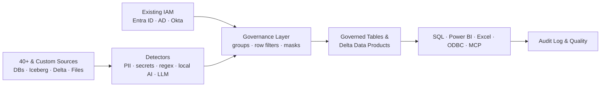

<div align="center">
  

# Classifyre

## Self-Hosted Open-Source Data Governance Platform

**Find it. Govern it. Use it safely.**

[](https://github.com/classifyre/classifyre/actions/workflows/ci.yml)
[](https://github.com/classifyre/classifyre/releases/latest)
[](LICENSE)
[](https://docs.classifyre.com/)

Classifyre connects directly to your existing databases, lakehouses (Iceberg, Delta, Parquet), file stores, and identity directory — governing data from source to consumption without migration. **Discover and classify sensitive data in place, enforce live masking and access controls across SQL, Power BI, Excel, and AI agents, publish trusted data products with built-in quality checks and usage tracking, and resolve data leaks as auditable cases** — on your own infrastructure.

100% Apache-2.0 open source — including SSO, access control, row and column masking, browser SQL workbench, BI/ODBC/MCP connections, scheduled quality checks, usage analytics, shared data products, and leak case management. Built in Austria to European privacy and security standards, deployed worldwide on Docker, Kubernetes, and OpenShift.

[Website](https://www.classifyre.com/) · [Documentation](https://docs.classifyre.com/) · [Live Showcase](https://showcase.classifyre.com/) · [Support & Tailoring](https://www.classifyre.com/support/)

</div>

---

## What Classifyre does

Classifyre integrates cleanly between your existing data estate and the tools your teams already use — without replacing your ETL, IAM, or BI stack:

| Capability                                       | What it does                                                                                                                                                                                                                                | Docs                                                                       |
| ------------------------------------------------ | ------------------------------------------------------------------------------------------------------------------------------------------------------------------------------------------------------------------------------------------- | -------------------------------------------------------------------------- |
| **Connect & detect**                             | Connect 41 built-in sources (PostgreSQL, MySQL, Databricks, ODBC, Iceberg, Delta, Parquet, S3/Azure/GCS, Confluence, Jira) plus a custom connector SDK in place. Built-in PII & secret packs plus custom business detectors from regex and Python to local CPU AI extraction models and private LLMs. | [Sources](https://docs.classifyre.com/sources/) · [Detectors](https://docs.classifyre.com/detectors/) |
| **Govern by organisation**                       | Sync groups from Entra ID, Active Directory, Okta, or any OIDC/SAML directory. Assign owners, stewards, expiring grants, owner-approved access requests, and row-level filters per department or region.                                     | [Access](https://docs.classifyre.com/access/)                              |
| **Multi-level column & row masking**             | Mask sensitive columns as redacted, last four, deterministic hashed pseudonymisation (joins and counts still work), empty, or hidden — enforced inside the query engine on original tables and shared datasets. Admins never get clear data by default. | [Query data & masking](https://docs.classifyre.com/data-query/)            |
| **Governed SQL, Power BI, Excel & ODBC**         | PostgreSQL-compatible TLS endpoint with personal, expiring, revocable connections for Power BI, Excel, Tableau, DBeaver, and ODBC clients, plus AI agents over MCP inheriting the user's own permissions.                                     | [SQL connections](https://docs.classifyre.com/sql-connections/)            |
| **Dataset requests & Delta-backed data products** | Business users request combined datasets in plain language or via structured workflows; owners approve and publish live or Delta-backed shared data products (external Delta Sharing protocol planned for 2027) whose inherited source masks act as a strict floor. | [Shared datasets](https://docs.classifyre.com/data-query/#shared-datasets) |
| **Data quality, usage & audit trail** | Scheduled quality checks (missing/null/invalid values, duplicates, freshness, detector findings, custom SQL) with Draft → Certified lifecycle and auto-opened findings on failure, live usage & export analytics by tool, before/after policy change diffs, and open data contract (ODCS) import/export. | [Deployment](https://docs.classifyre.com/deployment/) |

Need commercial support? We offer **annual maintenance & security-patch subscriptions** (from €20,000/yr with SLA, hardened builds, compliance packs, and optional **dedicated single-tenant hosting** — never multi-tenant SaaS) alongside scoped implementation projects (fixed-scope Governance Pilots €18k–€25k, IAM & organisational-structure mapping, custom source ingestion, billable EDI requests, or custom detectors). Contact [contact@classifyre.com](mailto:contact@classifyre.com) or view indicative plans at [classifyre.com/support](https://www.classifyre.com/support/).

### Incident response (optional)

When sensitive data or credentials leak, the same connectors and findings also power structured incident response:

| Capability             | What it means                                                                                                                     | Docs                                                                          |
| ---------------------- | --------------------------------------------------------------------------------------------------------------------------------- | ----------------------------------------------------------------------------- |
| **Inquiries**          | Saved questions that keep surfacing matching findings across scans.                                                               | [Inquiries](https://docs.classifyre.com/investigations/inquiry/)              |
| **Fingerprints**       | Deterministic duplicate and similarity detection that links the same file or entity across systems.                               | [Fingerprints](https://docs.classifyre.com/duplicates/)                       |
| **Cases & hypotheses** | Structured workspaces to collect evidence, weigh competing explanations, and record conclusions.                                  | [Cases](https://docs.classifyre.com/investigations/cases/)                    |
| **Autopilot**          | Supervised agents that maintain fingerprints and draft case summaries between scans — logging every step.                         | [Autopilot](https://docs.classifyre.com/investigations/autopilot/)            |

## How it connects



1. **Connect & detect.** Read existing sources in place and classify personal data, secrets, and business-specific rules.
2. **Govern.** Map directory groups to workspaces, sources, tables, row filters, and time-limited grants.
3. **Mask.** Enforce multi-level column masking and row filtering inside the query engine — across both source tables and shared datasets.
4. **Query.** Connect Power BI, Excel, Tableau, ODBC clients, SQL workbench, or MCP agents over personal, expiring credentials. In production, revoke direct analyst and shared BI logins on the underlying database and restrict network reachability to Classifyre's service principal so every BI, SQL, and AI query passes exclusively through Classifyre's TLS gateway.
5. **Request & share.** Let business users request new datasets in plain language; owners approve and publish governed live or Delta data products.
6. **Audit.** Track every read, export, permission change, and quality check in one verifiable trail.

The full walkthrough is documented in [How Classifyre Works](https://docs.classifyre.com/how-it-works/).

---

## Try it locally

Run the production Helm chart locally on k3d with Skaffold:

```bash
./scripts/dev/create-cluster.sh
./scripts/dev/start.sh
```

The first start takes several minutes (image pulls, dependency install, and the
identity server's one-time setup). The web app is not deployed in the cluster;
in a second terminal run it on your machine against the stack:

```bash
./scripts/dev/web-iam.sh
```

Then open [http://localhost:3000](http://localhost:3000). The API is on
<http://localhost:8811>. To open the app from another device on the same wifi,
run `bun run web:dev:lan` instead. Details:
[`scripts/dev/README.md`](scripts/dev/README.md).

### Or just run the image

To try Classifyre without a cluster, the all-in-one image carries the whole
stack — API, web UI, scan workers and PostgreSQL — in one container:

```bash
docker run -d --name classifyre \
  -p 3000:3000 --shm-size=1g \
  -v classifyre-pgdata:/var/lib/postgresql/data \
  -v classifyre-data:/var/lib/classifyre \
  -v classifyre-uv-cache:/cache/uv \
  classifyre/all-in-one:latest
```

See [`docker/README.md`](docker/README.md) for configuration, external
databases, object storage and resource tuning.

## Production deployment

Deploy to Kubernetes with the official Helm chart. See the production deployment guide for values, secrets management, external PostgreSQL, RBAC, HPA, and PDB configuration.

```bash
helm install classifyre \
  oci://registry-1.docker.io/classifyre/classifyre-core
```

> Full guide: [docs.classifyre.com/deployment/kubernetes](https://docs.classifyre.com/deployment/kubernetes/)
>
> Chart README — every value, the sizing rules, and the production checklist: [helm/classifyre/README.md](https://github.com/classifyre/classifyre/blob/main/helm/classifyre/README.md)

---

## Architecture

Classifyre is a distributed, decoupled platform: a **Web UI** and **API/Orchestrator** form the core stack, while an ephemeral **CLI Runner** does the extraction and detection. It relies on standard external infrastructure (PostgreSQL, optional S3) you can bring your own instances of. See the [platform components](https://docs.classifyre.com/deployment/) overview.

### Repository layout

This is a [Turborepo](https://turbo.build/) monorepo managed with [bun](https://bun.sh/).

| Path               | Stack                 | Purpose                                                                      |
| ------------------ | --------------------- | ---------------------------------------------------------------------------- |
| `apps/web`         | Next.js 16 · React 19 | The product Web UI                                                           |
| `apps/api`         | NestJS · Fastify      | API, orchestrator, and the Autopilot harness                                 |
| `apps/cli`         | Python · `uv`         | The scan runner (extraction + detection)                                     |
| `apps/docs`        | Nextra                | The documentation site ([docs.classifyre.com](https://docs.classifyre.com/)) |
| `apps/blog`        | Next.js               | The marketing site ([classifyre.com](https://classifyre.com/))               |
| `packages/schemas` | JSON Schema           | Shared source/detector schemas (cross-language)                              |
| `packages/ui`      | shadcn/ui             | Shared UI components                                                         |

### Development

```bash
bun install      # install workspace dependencies
bun dev          # run all apps in dev mode
bun build        # build all apps and packages
bun lint         # lint every workspace
```

Target a single app with a Turborepo filter, e.g. `bun --filter web dev` or `bun --filter api test`.

For a production-like Kubernetes development loop with k3d, Skaffold, Helm,
source mounts, and container-native hot reload, see
[`docs/development/skaffold.md`](docs/development/skaffold.md).

---

## Contributing

1. Fork and create a feature branch from `develop`
2. Follow the code style: `bun lint` must pass, TypeScript strict mode, Python mypy strict
3. Add tests alongside implementation (`.spec.ts` for API, pytest for CLI)
4. Run `bun build` from root to verify all apps compile before opening a PR
5. Target `develop`; `main` is the release branch

For larger changes, open an issue first to align on approach. Plugin architecture guidance is in `docs/architecture/PLUGIN_SYSTEM.md`.
