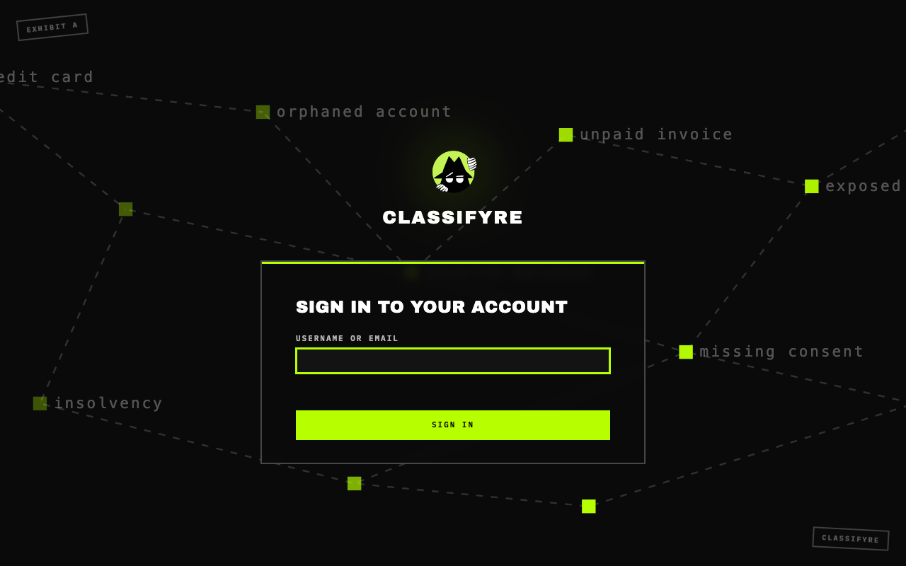
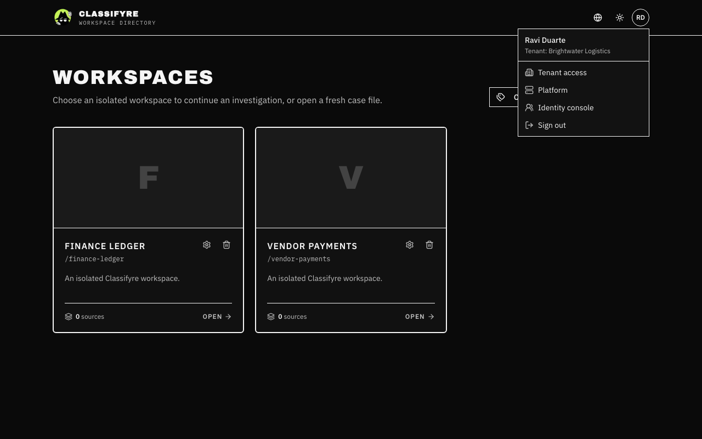
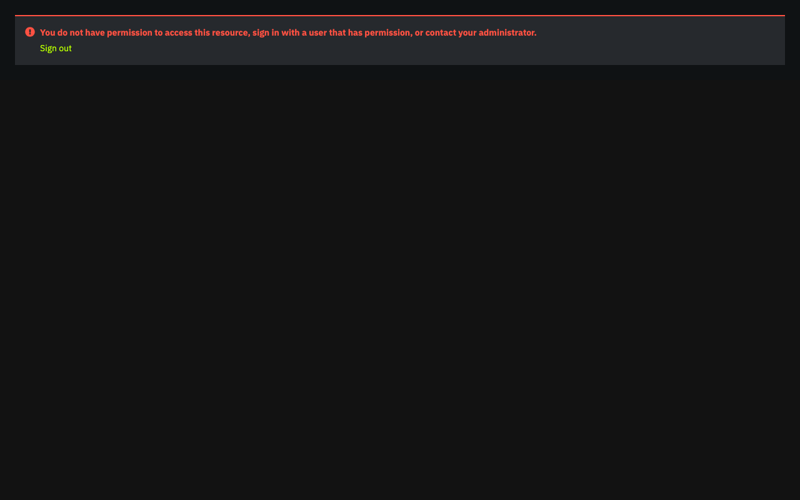
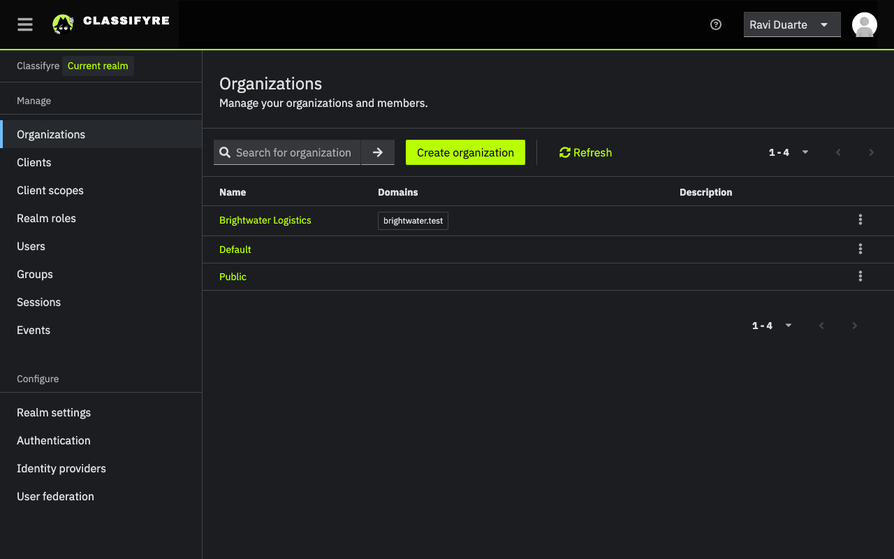
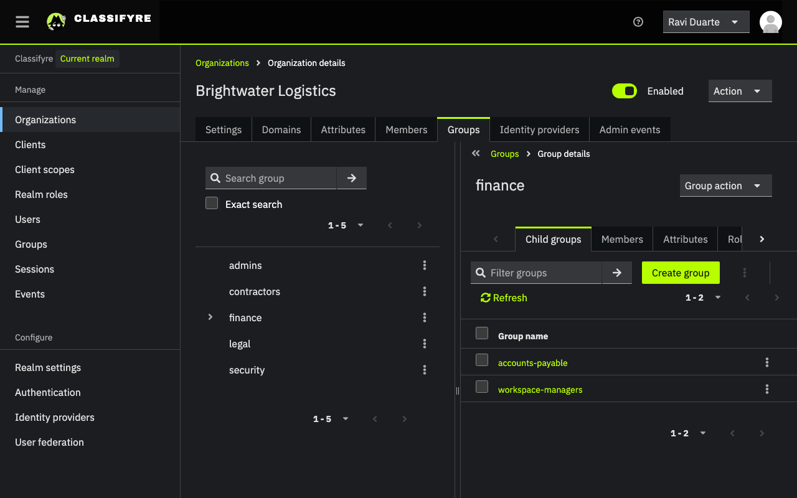
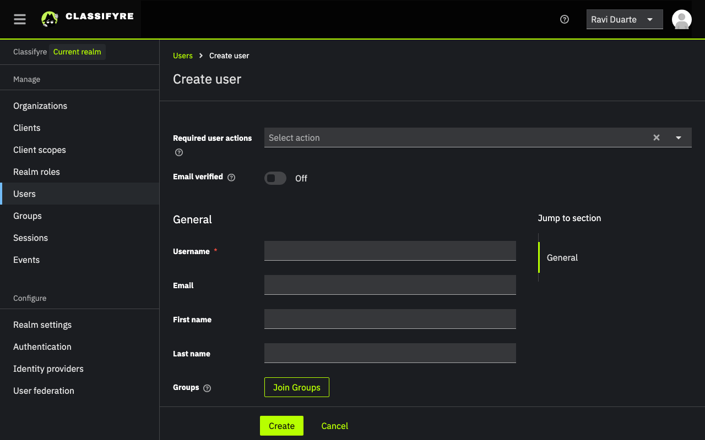
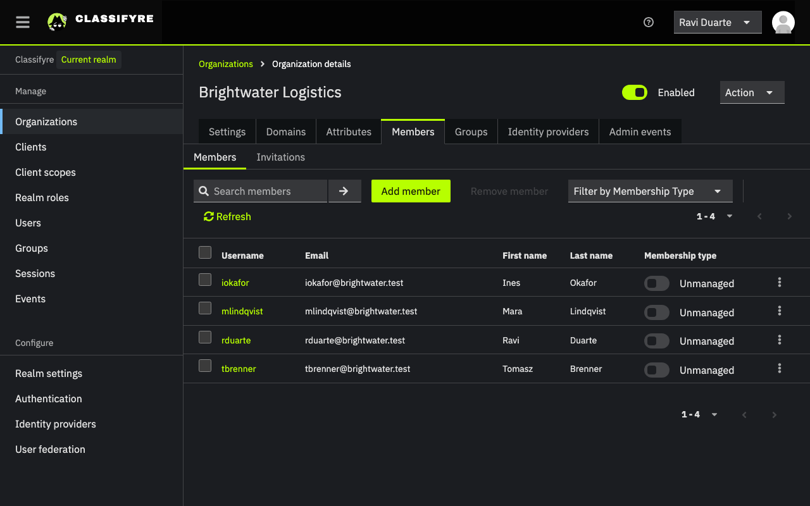
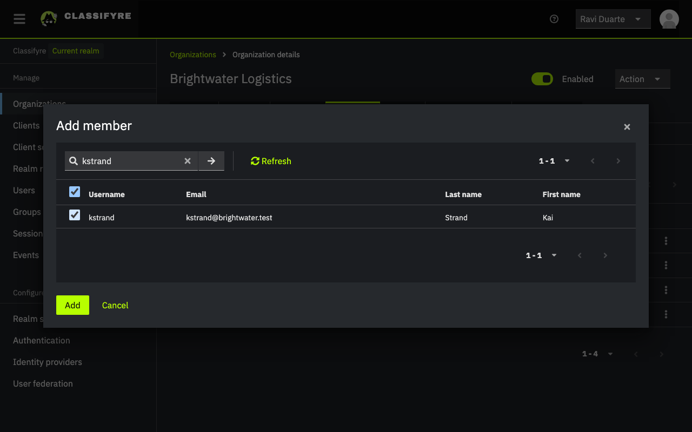
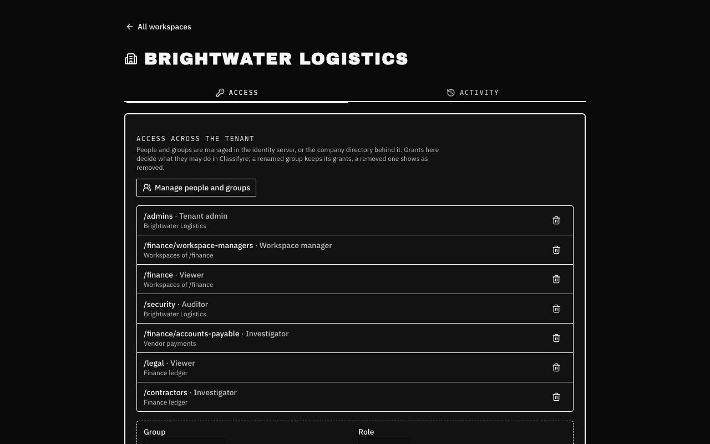
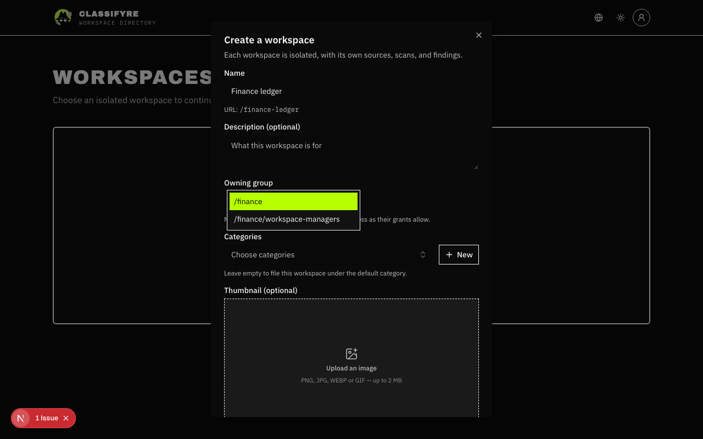

import { Callout, Steps } from "nextra/components";

# Getting started with sign-in

This page takes a fresh Helm install from its first sign-in to a second
person working in a workspace. It assumes the chart's defaults: release and
namespace `classifyre`, sign-in on, the first tenant `default`. For what the
words mean, see the [Overview](/access/).

<Steps>

### Find the first password

The chart creates one account: the first tenant admin, `admin`
(`iam.bootstrap.admin.username`). It is also an **operator**, the person who
runs the installation. Its temporary password is in a Secret:

```bash
kubectl -n classifyre get secret classifyre-iam \
  -o jsonpath='{.data.bootstrap-admin-password}' | base64 -d
```

That Secret also holds `admin-password`. That one belongs to the identity
server's own `admin` in its master realm, which cannot sign in to
Classifyre; you only need it for [break-glass work](/access/operations/#the-identity-servers-own-console).

### Sign in

Open Classifyre (`iam.appUrl`, for example `https://classifyre.example.com`).
The sign-in page asks for the username first, then the password.



Sign in as `admin` with the temporary password. The identity server then asks
you to choose a new password, and your name and email: fill them in, they are
how you appear in timelines. You land on the workspace list of the tenant
_Default_, empty for now.

### Open the identity console

People, groups and tenants are made in the identity server's console. As an
operator you find it in the account menu (top right) as **Identity console**,
or on the **Platform** and **Tenant access** pages. It opens in a new tab,
already signed in, at `<appUrl>/iam/admin/classifyre/console/`.



The console only opens for operators: anyone else who finds the address is
refused there.



Everything Classifyre uses is under **Organizations**. Each organization is a
tenant; open yours (_Default_ on a fresh install).



### Make groups

In the organization, open **Groups**. It already has `admins`: its members are
tenant admins. Make a group per department with **Create group**, and teams
inside them with **Child groups → Create group**:



<Callout type="warning">
  Make groups inside the organization (**Organizations → yours → Groups**).
  Groups under the console's top-level **Groups** menu belong to no tenant,
  and Classifyre ignores them.
</Callout>

### Add a person

1. **Users → Add user**: username, email, first and last name, then
   **Create**. Leave **Join Groups** alone: it offers the realm's own groups,
   not the organization's.

   

2. On the new user, **Credentials → Set password**, with **Temporary** on, so
   they choose their own at first sign-in. Send them the address and the
   temporary password the way you share secrets.
3. **Organizations → yours → Members → Add member**, tick them, **Add**.
   Without this they are in no tenant and see a page saying so.

   

   

4. **Organizations → yours → Groups → a group → Members → Add member**, for
   each group they belong to.

With a company directory connected, people and their groups arrive from
there instead; see
[Connecting a company directory](/access/operations/#connecting-a-company-directory).

### Give the group access

Back in Classifyre, decide what the group may do. Either:

- **For the whole tenant**, or for every workspace a group owns: account menu
  → **Tenant access**, pick the group, the role and where it applies.
- **For one workspace**: open the workspace, **Settings → Access**.



Every new workspace is owned by a group, chosen when it is made; only groups
you belong to and may create workspaces for are offered.



The person signs in and sees what their groups' grants allow, within a
minute of any change.

</Steps>

## Next

- Set up departments, teams, readers and contractors:
  [Organizing people](/access/organizing/).
- See every role and what it allows: [Roles and rights](/access/roles/).
- Connect your company directory, add tenants, make one public:
  [Running Sign-in](/access/operations/).

<Callout type="info">
  The identity console can do much more than Classifyre needs: clients,
  authentication flows, realm settings. Leave those as the chart set them; the
  chart sets them again on every upgrade.
</Callout>
