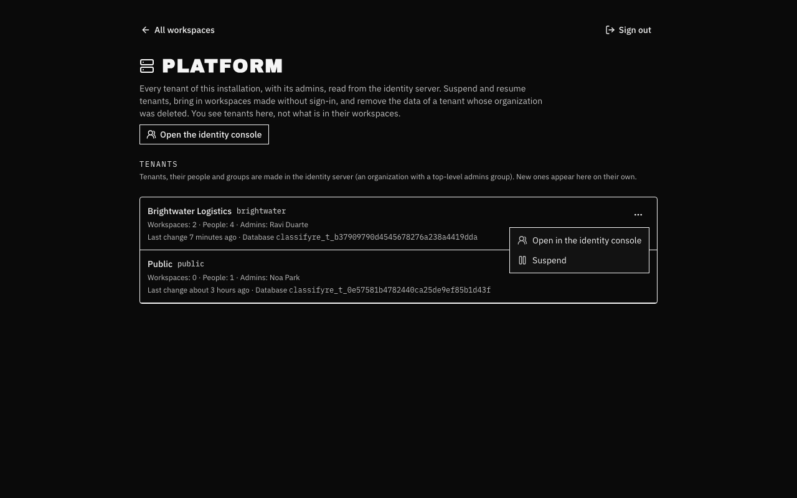
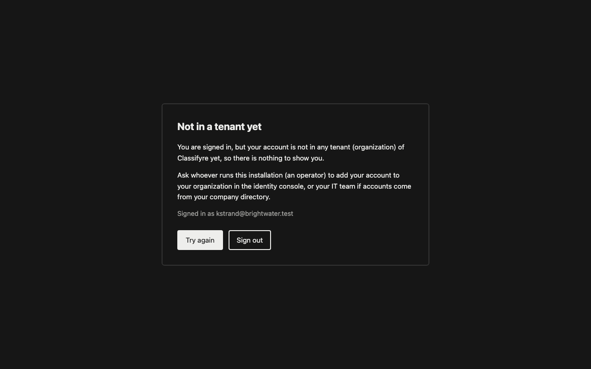

import { Callout } from "nextra/components";

# Running Sign-in

This page is for the people who run Classifyre on Kubernetes. Installing it is
covered under [Kubernetes → Sign-in](/deployment/kubernetes/#sign-in); what
signed-in people can do is under [Access & Sign-in](/access/).

The Helm chart runs an identity server next to Classifyre (named `iam` in the
chart). It keeps **who people are**: accounts, tenants and groups. Classifyre
keeps **what they may do**: grants. You manage people in the identity server,
or in the company directory it is connected to, and access in Classifyre.

---

## The identity console

People, groups and tenants are managed in the identity server's console. For
the `classifyre` realm it is served through the web app, like sign-in itself,
at `<appUrl>/iam/admin/classifyre/console/` (`iam.realmConsole`, on by
default). Operators open it from Classifyre: **Identity console** in the
account menu, **Open the identity console** on the Platform page, **Open in
the identity console** on a tenant there, and **Manage people and groups** on
Tenant access. They are already signed in.



What operators may do there comes from their realm role
`classifyre-operator`: the chart gives it every right in the `classifyre`
realm except **impersonation**, so an operator manages people, groups,
organizations and company directories, but never signs in as someone else.
Anyone else who finds the address is refused by the console itself.

<Callout type="warning">
  Whoever manages accounts can also reset someone's password and sign in as
  them. Give `classifyre-operator` only to the people who run the
  installation. The identity server records every change made in its console:
  **Events → Admin events**, and on each organization its **Admin events**
  tab.
</Callout>

With `iam.realmConsole: false` the console is not reachable through the web
app at all; use the break-glass console below.

### The identity server's own console

The identity server also has its own administrator, `admin` in its **master**
realm, which can change every realm. It is never reachable from outside the
cluster unless `iam.exposeAdminConsole` is on. Use it only when no operator
can sign in, with a port-forward:

```bash
kubectl -n classifyre port-forward svc/classifyre-iam 8080
```

Then open [localhost:8080/iam/admin](http://localhost:8080/iam/admin/) and sign
in as `admin`, with the password from:

```bash
kubectl -n classifyre get secret classifyre-iam \
  -o jsonpath='{.data.admin-password}' | base64 -d
```

Work in the **classifyre** realm. Leave the `master` realm alone.

### The look

The sign-in pages, the identity console and everyone's account page wear
Classifyre's look (`iam.theme: classifyre`): the chart mounts the theme as
plain files from a ConfigMap into the stock identity server image, which is
never rebuilt. Set `iam.theme: ""` to keep the identity server's own look.
A changed theme reaches browsers at once: its files are asked for under the
theme's hash, while the identity server keeps the old ones cached for 30
days.

---

## Tenants and groups

A tenant is an **organization** in the identity server. The chart creates the
first one (`iam.bootstrap.tenant`, default `default`) with a group `admins`
whose members are tenant admins.

**Tenants, their people and groups are managed in the identity server**: by
an operator in its console, or by the company directory connected to it (see
[below](#connecting-a-company-directory)). Classifyre only reads them: its
service account in the `classifyre` realm has `view-users` and
`view-organizations`, nothing that changes anything. In Classifyre, tenant
admins decide what groups may do (grants, on the Tenant access page), and
operators see tenants on the **Platform** page (`/platform`, see
[below](#the-platform-page)). A tenant admin of one tenant never sees another
tenant, and the Tenant access page shows only the tenant you signed in to.

To add a tenant, create an **organization** in the console (its alias is the
tenant's), give it a top-level group named exactly `admins`, and add its
first admin to that group. To add someone to a tenant, make them a member of
the organization and of its groups; [Getting started](/access/getting-started/#add-a-person)
shows each step. Changes count within a minute.

A new organization is listed on the Platform page on its own. Its `admins`
group becomes tenant admin once; if a tenant admin later takes that away, it
stays away.

Do not delete an organization you want to keep (see
[When things change in the identity server](#when-things-change-in-the-identity-server)).

Groups are nested: being in `/finance/ap-team` counts as being in `/finance`.
How to lay them out for a company is on
[Organizing people](/access/organizing/).

Roles and what they allow (capabilities such as managing sources or access)
are not in the identity server at all. They live in Classifyre.

---

## When things change in the identity server

Classifyre has no callbacks from the identity server. It reads it, keeps
answers for a minute, and checks every signed-in request against them. So
every change below counts **within a minute**, and nothing in Classifyre
needs to be told.

| In the identity server                     | In Classifyre                                                                                                                                       |
| ------------------------------------------ | --------------------------------------------------------------------------------------------------------------------------------------------------- |
| A group is **renamed**                     | Nothing changes: grants point at the group's id. The new name shows everywhere.                                                                     |
| A group is **moved** under another parent  | Its people now count as being in the new parent and no longer in the old one: they gain and lose those grants.                                     |
| A group is **deleted**                     | Its grants show as **Removed group** and give nobody anything until a tenant admin removes them. Workspaces it owned stay, reached by tenant-wide grants. |
| A person is **removed from a group**       | They lose that group's access, and so do their MCP agents.                                                                                          |
| A person is **disabled** or **deleted**    | They and every MCP token they made are refused. See [Off-boarding](#off-boarding-someone-urgently).                                                 |
| A person is in **no organization**         | They see _Not in a tenant yet_ after signing in.                                                                                                    |
| A person is in **several organizations**   | They choose one at sign-in and switch under **Switch tenant**; they work in one at a time.                                                         |
| An organization's `admins` group is missing or renamed | The tenant shows a warning on the Platform page. Existing grants keep working; a new `admins` group gets Tenant admin only if the tenant never had it. |
| A group is made under the realm's **Groups** menu | Ignored: it belongs to no tenant.                                                                                                       |
| An organization is **deleted**             | Its people are refused and its workspaces stay closed. The Platform page marks the tenant; **Remove tenant data** deletes it for good.             |
| It is made again **under the same alias**  | Still closed: the new organization is not the old tenant, so nobody inherits its workspaces by accident. Only a backup of the identity server's database brings the old organization back. |



**Suspending** a tenant is done in Classifyre, on the
[Platform page](#the-platform-page): its people and their MCP agents are
refused within a minute with a page saying so, its data is kept and its
scheduled scans keep running, and **Resume** opens it again. Suspend rather
than delete when in doubt.

---

## Connecting a company directory

Instead of managing accounts by hand, connect the identity server to your
company's directory (Entra ID, Okta, any OIDC or SAML provider, or LDAP):

- Add it under **Identity providers** in the `classifyre` realm and link it to
  the tenant's organization, so people of that company land in the right
  tenant.
- Map the directory's groups to **organization groups** with group mappers,
  and set their **sync mode to Force**. With the default, someone removed from
  a group in the directory keeps the matching group in the identity server for
  as long as the account exists.
- Turn on **Trust email** and automatic account linking only for your own
  company's directory, never for one you do not control: a forged email address
  would otherwise take over an account.
- Entra ID sends group ids, not names, and leaves groups out of the token when a
  person is in more than about 200. Send only the groups assigned to the
  application, or use app roles, and keep a list of which id is which group.

Changes in the directory reach Classifyre when the person signs in next, and
group changes within a minute after that.

---

## The Platform page

The Platform page is for **operators**: people with the realm role
`classifyre-operator`. The chart gives it to its first admin
(`iam.bootstrap.admin.operator`, on by default) when it creates that account.
Give it to others in the console under **Users → the person → Role mapping →
Assign role → Filter by realm roles**, and take it away the same way; a
change counts within a minute. On an install whose first admin was created
before the Platform page existed, give the role to that admin the same way.

An operator does not need to be in any tenant. Signed in without one, they
land on the Platform page; one who is also in a tenant finds **Platform** in
the account menu. What they can do there:

| Action                  | What happens                                                                                                                                                                                         |
| ----------------------- | ---------------------------------------------------------------------------------------------------------------------------------------------------------------------------------------------------- |
| **Bring in workspaces** | Copies workspaces made without sign-in into the tenant's database, owned by its `admins` group. The originals stay. The same as `workspaces copy --to-tenant` below.                                |
| **Suspend / Resume**    | A suspended tenant's people, and the MCP agents they created, are refused within a minute, with a page that says the tenant is suspended. Its data is kept and its scheduled scans keep running.     |
| **Remove tenant data**  | Only for a tenant whose organization was deleted in the identity server, and after its alias is typed. Its workspaces, their database and its grants are deleted. Cannot be undone.                 |

Tenants, their admins and members are not made here: create the organization
and its `admins` group in the console (see [Tenants and groups](#tenants-and-groups)),
and the page lists it on its own.

A deleted tenant stays listed as deleted: its activity is kept, and its
alias is never given out again, so nobody inherits its history.

Operators see tenants, their admins and counts, **never what is inside their
workspaces**. To look inside one, an operator needs a role in that tenant,
given by its tenant admins like anyone else's. Everything an operator
does to a tenant is in that tenant's **Activity**, under the operator's
name.

The page lists a tenant with a warning when its organization was deleted or
replaced in the console, or when it has no top-level `admins` group (fix
those in the console), and when its database could not be upgraded (see
[Backups and upgrades](#backups-and-upgrades)). It also shows each tenant's
database, once its first workspace made one.


---

## The public tenant

To let people browse one tenant without signing in, as on a public showcase,
turn on a public tenant:

```yaml
iam:
  public:
    enabled: true
    tenant: public # its alias; can be the first tenant, iam.bootstrap.tenant.alias
    name: Public # display name when the setup job creates it
```

- The realm setup job creates its organization with an empty top-level
  `admins` group when it does not exist. Add its editors to that group in the
  console; the group gets Tenant admin the first time one of them signs in,
  as in every tenant. When the public tenant is the first tenant, the first
  admin edits it from the start.
- Visitors hold the **Visitor** role on that tenant and nothing else: the read
  capabilities of a Viewer without `access.view` (who has access) and without
  MCP tokens, and no tenant capabilities. It is never offered when giving
  access and cannot be granted.
- A request with no credentials at all is a visitor. A request with a bad or
  expired sign-in still answers _sign in again_, so a session is renewed, never
  quietly dropped to a visitor.
- Signed-in people work in their own tenant only, as without a public tenant.
- **Suspend** the public tenant on the [Platform page](#the-platform-page) to
  close it at once: visitors are sent to sign in again until it is resumed.
- `frontend.sitemap.enabled` is allowed with sign-in only together with a
  public tenant, and the sitemap then lists only its workspaces.
- **Demo mode** (`api.env.DEMO_MODE: "true"`) still makes everything read-only
  for everyone without the bypass key, editors included. Use it for a public
  showcase whose content operators load with the bypass key; leave it off when
  the public tenant's editors work in the app.

To publish workspaces that were made without sign-in, copy them into the
public tenant once (see [Turning sign-in on for an existing
install](#turning-sign-in-on-for-an-existing-install)):

```bash
kubectl -n classifyre exec deploy/classifyre-api -- \
  node dist/src/admin.js workspaces copy --to-tenant public --all
```

The all-in-one Docker image has no sign-in and no identity server, on
purpose: everyone who reaches it uses every workspace, as if everything were
public.

---

## Where the data is

With sign-in, every tenant has a **database of its own**, so it can be
backed up, restored, moved and deleted on its own, and a mistake in one
place never shows one tenant another's data:

| Database                           | Holds                                                                                                      |
| ---------------------------------- | ---------------------------------------------------------------------------------------------------------- |
| `classifyre` (`postgres.*.database`) | Everything made **without** sign-in. Used only while sign-in is off.                                       |
| `classifyre_control` (`iam.controlDatabase`) | Tenants, their grants, people and activity, and the list of every tenant's workspaces. No workspace data. |
| `classifyre_t_<tenant id>`         | One tenant's workspaces, made on its first workspace. Logged in with its own role, which opens no other database. |

The database user of the chart needs `CREATEDB` and `CREATEROLE` for this,
and new databases need the `vector` extension: the embedded PostgreSQL has
both. On an external server, use a user with those rights and install
`vector` in `template1` if that user is not a superuser. With CloudNativePG
the chart gives the application role both rights and installs `vector` in
`template1` when a cluster is first created; on an existing cluster do both
by hand.

The tenant roles' passwords are made from the `tenant-database-key` of the
`classifyre-iam` Secret, and set again at every start: replacing the key and
restarting the API rotates them all.

---

## Turning sign-in on or off

Sign-in on and sign-in off use different databases, so switching it never
opens a tenant's data to everyone:

- **Sign-in off** uses only `classifyre`: the workspaces made without
  sign-in. Tenants' workspaces are not there at all.
- **Sign-in on** uses only the control database and the tenants' databases.
  Workspaces made without sign-in stay out of sight until an operator copies
  them into a tenant.

Every database records what it is, and the API refuses to start on the wrong
one, with a message that names what it found.

### Turning sign-in on for an existing install

Upgrade with `iam.enabled: true`. Once the API is up, the first tenant
exists; copy the existing workspaces into it, with **Bring in workspaces** on
the [Platform page](#the-platform-page) or from an API pod:

```bash
kubectl -n classifyre exec deploy/classifyre-api -- \
  node dist/src/admin.js workspaces list
kubectl -n classifyre exec deploy/classifyre-api -- \
  node dist/src/admin.js workspaces copy --to-tenant default --all
```

`default` is the first tenant's alias (`iam.bootstrap.tenant`); any other
tenant can be named once one of its members has signed in. Name workspaces
instead of `--all` to copy only some. What happens:

- Each workspace is copied with all its data into the tenant's database, as
  a new workspace (links that name the old one's id do not follow),
  owned by the tenant's `admins` group, or by the group you pass with
  `--owner-group <group id>`; its admins hand out access from there. Large
  workspaces take a while: the command prints each table as it goes.
- The originals stay in `classifyre`, where sign-in off still finds them.
  Delete them there once you are satisfied, with sign-in off.
- Categories stay behind: the copies are filed under _General_ until a tenant
  admin files them again.
- Queued background jobs are not copied; schedules are made again when the
  copy's workers start.
- Names people typed in are kept on existing records. New changes are
  attributed to the signed-in person; a typed-in name is ignored.
- MCP tokens created before have no owner and stop working. People create new
  ones after signing in; those act for them.
- A sitemap is no longer allowed (`frontend.sitemap.enabled` must be off).

Running API pods show a copy within a minute, and each one is in the
tenant's **Activity**.

### Installs that had sign-in on before tenants had their own databases

Then the tenants and their workspaces are still in `classifyre`. After the
upgrade the API starts on an empty control database, and sign-in off shows
none of the tenants' workspaces either (it logs how many it hides). Move them
once:

```bash
kubectl -n classifyre exec deploy/classifyre-api -- \
  node dist/src/admin.js tenants split --keep-source
```

It copies the tenants, their grants, people and activity to the control
database and each tenant's workspaces, soft-deleted ones too, to the tenant's
database, checking every table's row count. If it stops halfway, run it
again: what was copied is skipped. With `--keep-source` the originals stay
in `classifyre`; run it again without it to remove them once the tenants look
right. Workspaces made without sign-in are never touched.

### Copying a workspace out of a tenant

To make a tenant's workspace reachable without sign-in, copy it to
`classifyre`:

```bash
kubectl -n classifyre exec deploy/classifyre-api -- \
  node dist/src/admin.js workspaces copy --to-local finance-ledger
```

The tenant keeps its own. A workspace reaches another tenant only through
`classifyre`, never directly: copying it out and then in is two deliberate
actions, each in the tenant's activity. Its address must be free in the
target; rename one of them first if it is not.

---

## Off-boarding someone urgently

1. In the identity server, **disable** the account (Users → the person →
   Enabled off) and use **Sign out** on its sessions.
2. Within a minute Classifyre stops accepting their requests and every MCP
   token they created, even though tokens already issued would otherwise be
   valid for up to five minutes.

Removing someone from a group works the same way, for that group's access
only.

---

## Rotating the chart's secrets

The chart generates the identity server's database password and the two client
secrets once, and keeps them across upgrades. To rotate one, delete its key
from the `classifyre-iam` Secret, run `helm upgrade` (the chart generates a new
value and the realm setup job applies it to the identity server), then restart
the API and web:

```bash
kubectl -n classifyre rollout restart deploy/classifyre-api deploy/classifyre-worker deploy/classifyre-web
```

Signed-in people are asked to sign in again.

The identity server's own `admin` password is different: it is only read on its
very first start. Change it in the console (master realm → Users → admin →
Credentials) and then put the same value under `admin-password` in the Secret,
so the realm setup job can still sign in.

---

## Backups and upgrades

<Callout type="warning">
  The identity server's state is the `iam` database. Back it up with the rest of
  PostgreSQL, and always before changing `iam.image.tag` across a minor version.
</Callout>

Back up `classifyre_control` together with the tenants' databases: the
control database is the list of their workspaces. One tenant's database can
be restored on its own.

At every start the API upgrades the control database, then each tenant's,
four at a time (`TENANT_MIGRATION_CONCURRENCY`). A tenant whose upgrade
fails is shown on the Platform page with the error, and its workspaces
answer _unavailable_ until the next start upgrades it; the other tenants
keep working.

- **Patch versions** (26.8.1 → 26.8.2) are routine.
- **Minor versions** (26.8 → 26.9) stop all of its pods while it migrates its
  database, and cannot be undone without the backup. Signing in is unavailable
  for a minute or two; people already signed in keep working.
- **Major versions** are never proposed automatically.

If the identity server is down, nobody can sign in. People already signed in
keep working with the access they had until their session needs renewing,
which happens every few minutes (`iam.accessTokenLifespanSeconds`, 5 minutes
by default). Scripts with long-lived tokens and MCP agents keep working for up
to 15 minutes; after that Classifyre refuses them rather than trust access it
can no longer check.
