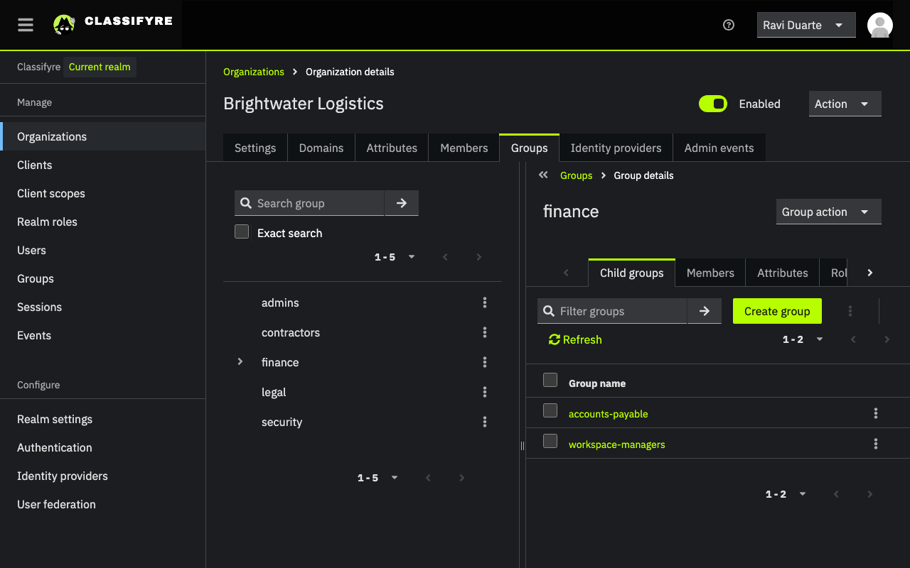
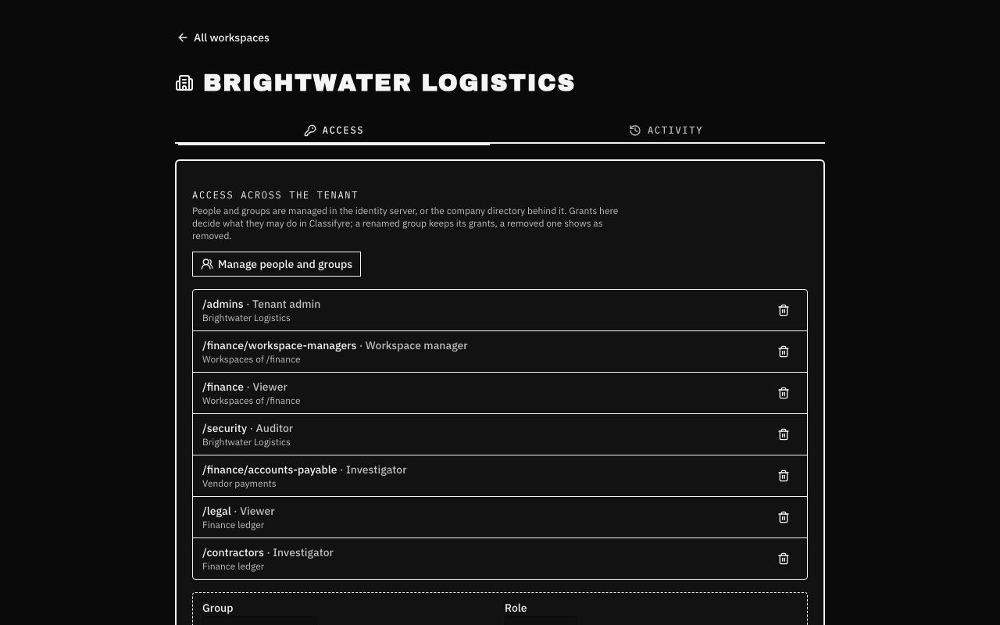
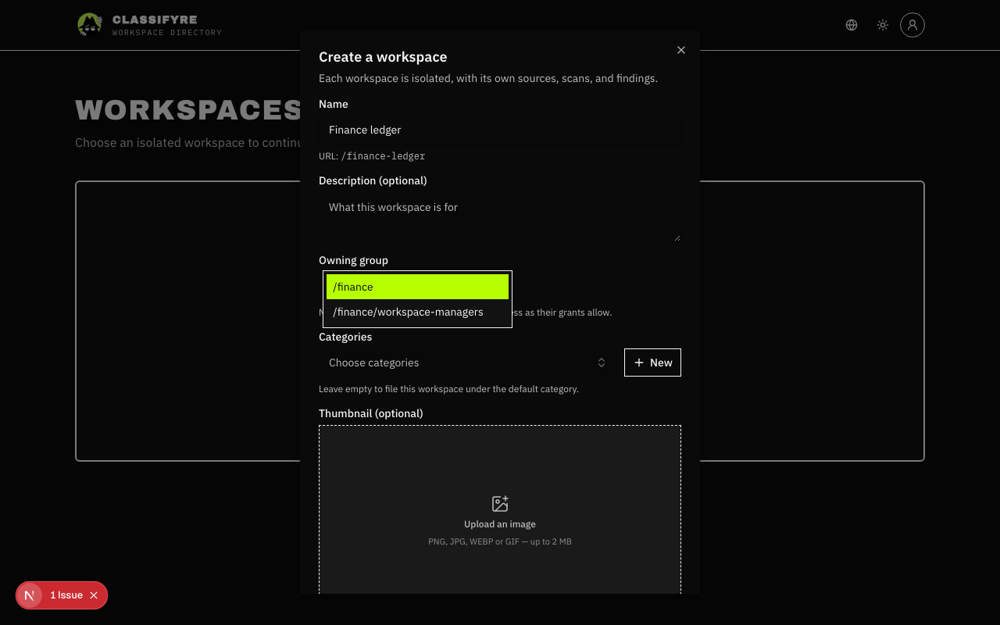
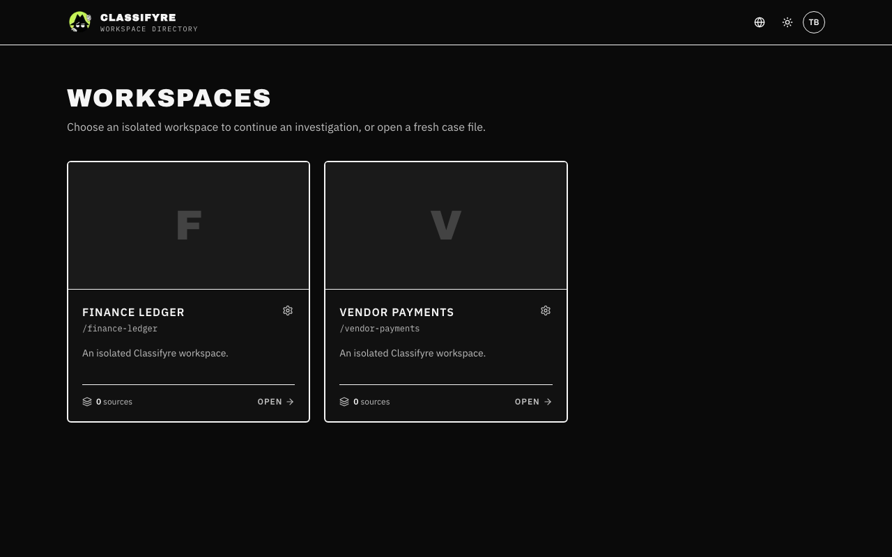
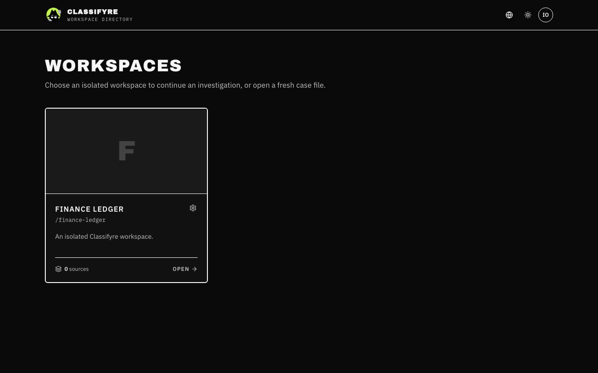
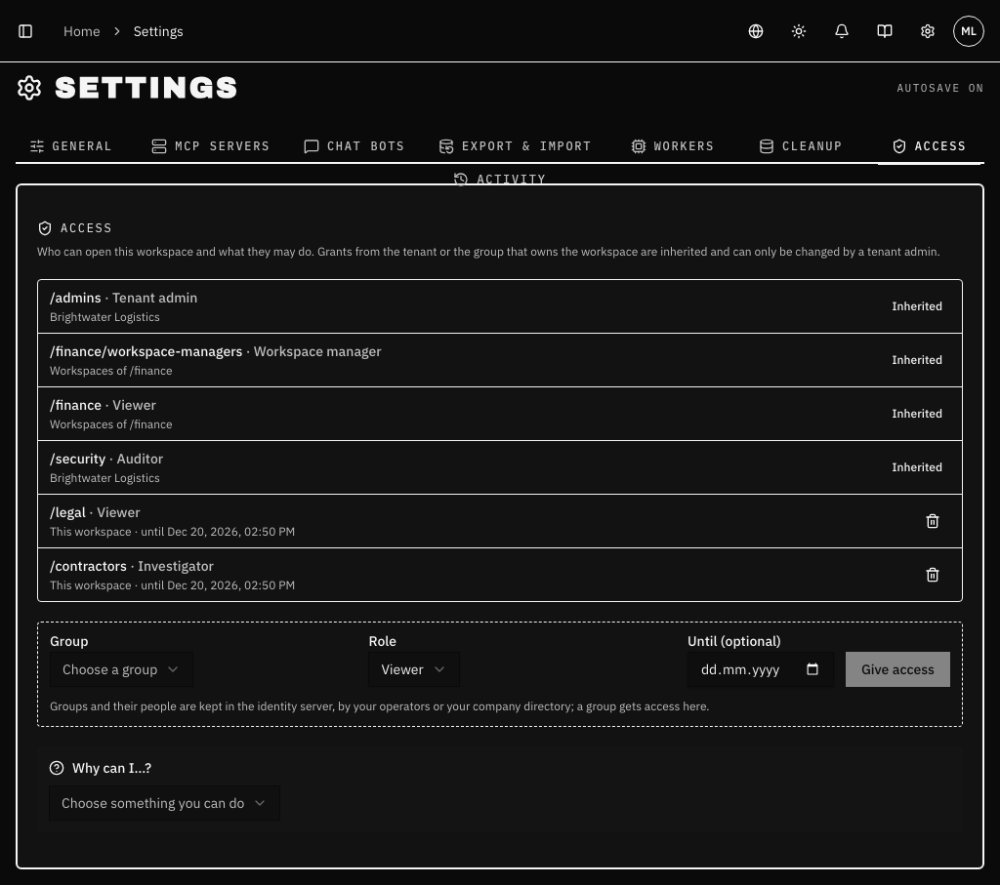
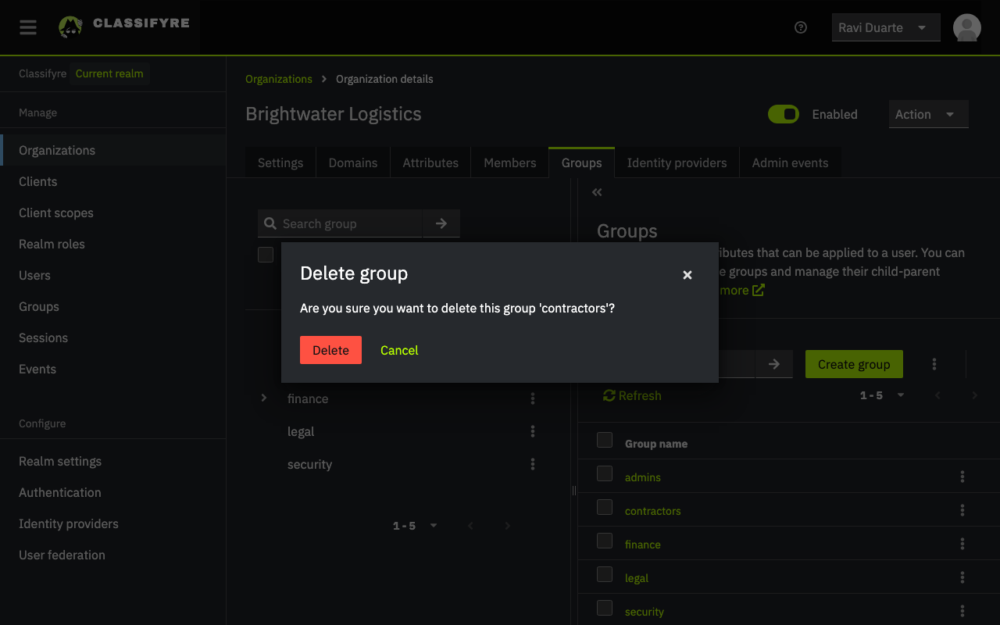
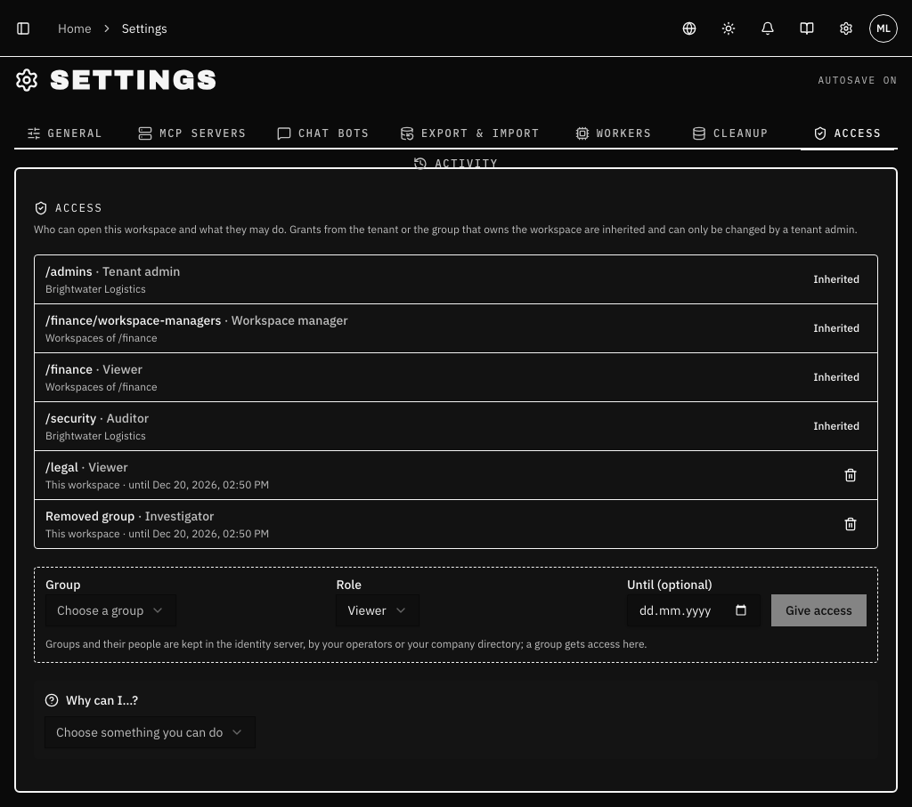

import { Callout } from "nextra/components";

# Organizing people with groups

Access in Classifyre always goes to **groups**, never to a person (see
[Access always goes to groups](/access/#access-always-goes-to-groups)). This
page sets up an example company that way, then shows how to handle the
everyday cases: someone new, someone who should see only one thing, someone
who needs more for a while, someone who leaves.

The company is _Brightwater Logistics_, a tenant of its own. Every name on
this page is invented.

---

## 1. Mirror the company in groups

Groups live in the identity server, in the tenant's organization
(**Identity console → Organizations → Brightwater Logistics → Groups**).
Make them the way the company is organized, plus a few groups that exist only
to hand out access:

```text
/admins                       tenant admins (made by the chart)
/finance                      the finance department
  /finance/accounts-payable     a team inside it
  /finance/workspace-managers   access group: may create finance's workspaces
/legal                        the legal department
/security                     the security team
/contractors                  access group: outside people, for a while
```



A person in a child group also counts as being in its parent: everyone in
`/finance/accounts-payable` is in `/finance` too. Put people in the **most
precise** group; they get the parent's access anyway.

| Person         | Group                          |
| -------------- | ------------------------------ |
| Ravi Duarte    | `/admins` (and an operator)    |
| Mara Lindqvist | `/finance/workspace-managers`  |
| Tomasz Brenner | `/finance/accounts-payable`    |
| Ines Okafor    | `/legal`                       |

---

## 2. Give the groups roles

A tenant admin gives the grants, on **Tenant access** (account menu) for
grants across the tenant or a group's workspaces, or in a workspace under
**Settings → Access** for that workspace only:



| Grant                                                     | Means                                                                      |
| --------------------------------------------------------- | -------------------------------------------------------------------------- |
| `/admins` · Tenant admin · whole tenant                   | Everything in the tenant. Given by the chart once.                         |
| `/finance/workspace-managers` · Workspace manager · workspaces of `/finance` | Mara creates finance's workspaces and administers each of them. |
| `/finance` · Viewer · workspaces of `/finance`            | All of finance reads every finance workspace, today's and future ones.     |
| `/security` · Auditor · whole tenant                      | The security team reads who has access and the tenant's activity, without seeing findings. |
| `/finance/accounts-payable` · Investigator · _Vendor payments_ | Payables works on cases and findings in that one workspace.            |
| `/legal` · Viewer · _Finance ledger_, until 20 Dec        | Legal reads one finance workspace, for a review that ends.                 |

"Workspaces of `/finance`" means every workspace **owned** by `/finance`.
When Mara creates a workspace she picks `/finance` as its owner, so it falls
under the grants above at once, with nobody adding anything:



---

## 3. What each person sees

Every person sees only the workspaces their groups reach, and only the
controls their roles allow.

Tomasz, in `/finance/accounts-payable`, reads both finance workspaces
(through `/finance`) and investigates in _Vendor payments_:



Ines, in `/legal`, sees only _Finance ledger_, and only until the grant ends:



In the workspace, **Settings → Access** lists every grant that reaches it.
Grants from the tenant or from the owning group are marked **Inherited** and
only a tenant admin changes them; grants on this workspace can be removed
here by its admins:



**Why can I…?** at the bottom picks one thing you can do and names the
grant that allows it.

---

## Isolate someone

To let someone see **one workspace and nothing else**, put them in a group
whose only grant is on that workspace, and in no other group of the tenant.
Ines above is exactly that: `/legal` has Viewer on _Finance ledger_ and
nothing else, so she sees one workspace, can read it, and changes nothing.

- Use a role no bigger than needed (Viewer to read, Investigator to work on
  cases, Source manager to run scans without seeing cases).
- Keep the person out of parent groups that carry other grants: someone in
  `/finance/anything` is also in `/finance`.

## Elevate someone, for a while

To give someone **more** for a while, do not change the group everyone is
in. Add them to a group made for the extra access, whose grant has an end
date:

1. In the identity console, make (or reuse) a group such as `/contractors`
   and add the person to it.
2. In the workspace's **Settings → Access**, give `/contractors` the role it
   needs, with **Until** set.
3. When the date passes, the grant stops counting, for everyone in the
   group. Remove the person from the group when they are done.

The same works without a date: to let Mara's colleague create finance
workspaces too, add them to `/finance/workspace-managers`. To take it back,
remove them from the group. Changes count within a minute.

## Someone new, someone who leaves

- **New:** an operator adds the person to the organization and to their
  groups (see [Getting started → Add a person](/access/getting-started/#add-a-person)),
  or your company directory does. They see what their groups reach at their
  first sign-in.
- **Changes team:** move them between groups in the identity server. Their
  access, and their MCP agents', follow within a minute.
- **Leaves:** disable the account in the identity server and sign out its
  sessions. Classifyre refuses them and every MCP token they made within a
  minute. See [Off-boarding](/access/operations/#off-boarding-someone-urgently).

---

## Things to know

- **Renaming a group keeps its access.** Grants point at the group itself,
  not its name: rename `/legal` to `/legal-and-compliance` and nothing
  changes.
- **Moving a group changes what it inherits.** Move `/finance/accounts-payable`
  under `/operations` and its people are no longer in `/finance`: they lose
  the finance Viewer grant, and gain whatever `/operations` has. Workspaces
  the group owns move with it: grants on "the workspaces of `/finance`" stop
  reaching them, grants on "the workspaces of `/operations`" start.
- **Deleting a group ends its access.** In the identity console:

  

  Its grants stay listed as **Removed group** and give nobody anything until
  a tenant admin removes them:

  

- **Do not delete a group that owns workspaces.** The workspaces keep working,
  but they lose their place in the tree: grants on the workspaces of the
  group's **parents** no longer reach them. Delete `/finance/accounts-payable`
  while it owns a workspace, and `/finance`'s Viewer and Workspace manager
  grants stop reaching that workspace; only tenant-wide grants (and grants on
  the workspace itself) still do. Rename or keep the group instead.
- **Only organization groups count.** Groups made under the identity
  console's own **Groups** menu belong to no tenant and are ignored.
- **A workspace's owner is fixed when it is made.** Choose the group that
  should own it for good, usually the department rather than a team.

<Callout type="info">
  Everything a tenant admin grants or removes, and every workspace created or
  deleted, is in **Tenant access → Activity**. Changes to people and groups
  are in the identity console under the organization's **Admin events**.
</Callout>
