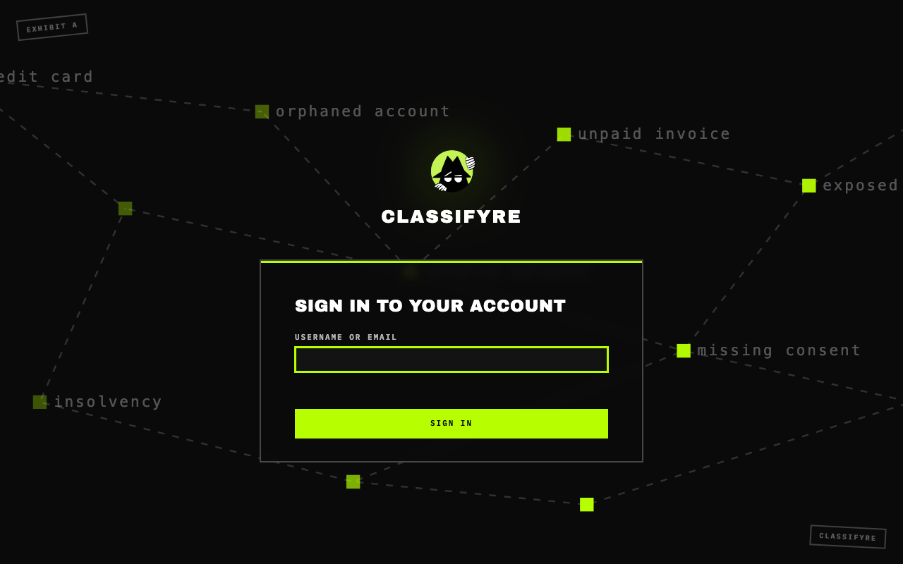
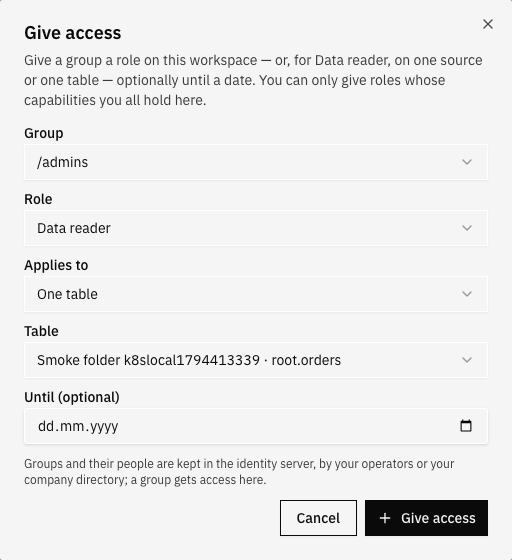
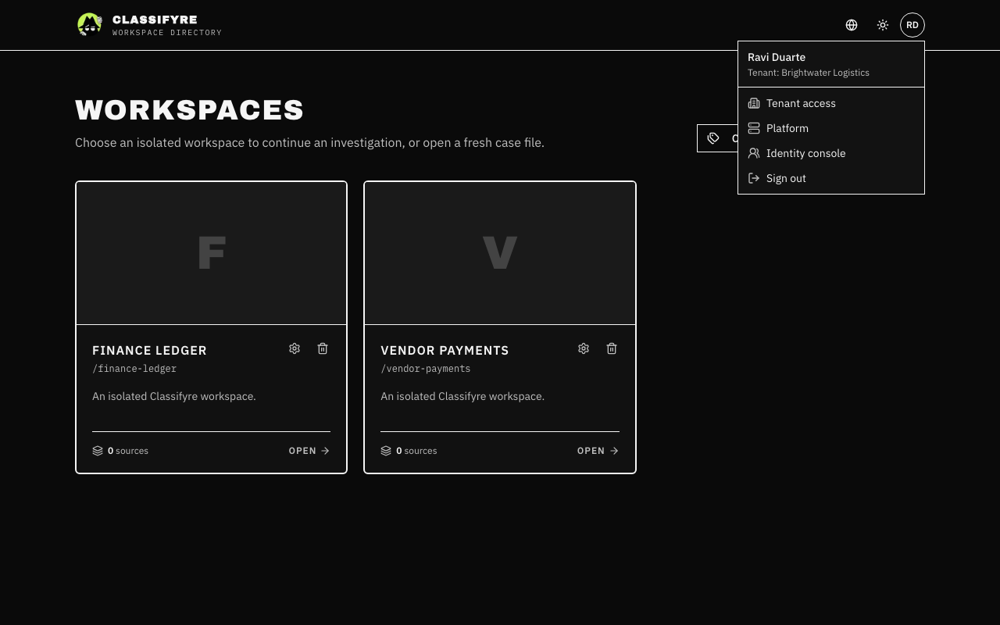
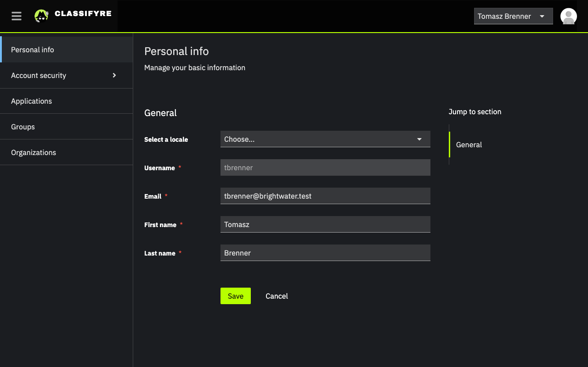
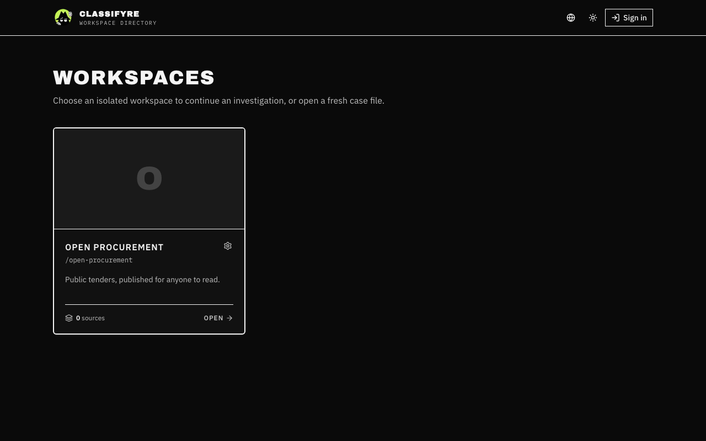

import { Callout } from "nextra/components";

# Access & Sign-in

<Callout type="info">
  Sign-in is always on, in the Helm chart and in the all-in-one Docker image
  alike. New here? Start with [Getting started](/access/getting-started/).
</Callout>

People sign in, and what they can see and change depends on the **groups**
they belong to. Every change carries the name of who made it.

Without signing in, people see only the [public
workspaces](#public-workspaces) of the installation's first tenant, read-only,
and are sent to sign in for anything else. Signed in, they see their own
tenant's workspaces: the ones their groups have access to, and its public ones.

### Where to go next

| You want to                                                     | Read                                                   |
| --------------------------------------------------------------- | ------------------------------------------------------ |
| Sign in the first time, find the first password, add people     | [Getting started](/access/getting-started/)            |
| Set up departments, teams, readers, contractors                 | [Organizing people](/access/organizing/)               |
| Know exactly what each role allows                              | [Roles and rights](/access/roles/)                     |
| Run it: tenants, company directories, public workspaces, upkeep | [Running Sign-in](/access/operations/)                 |

---

## Two places, two jobs

Sign-in is split between two systems, on purpose:

| Kept in the **identity server** (its console, or your company directory) | Kept in **Classifyre**                               |
| ------------------------------------------------------------------------ | ---------------------------------------------------- |
| Who people are: accounts, passwords, two-factor, sessions                | What they may do: roles and grants                    |
| Tenants (organizations) and who belongs to each                          | Which workspaces exist, and which group owns each one |
| Groups and subgroups, and who is in them                                 | The audit trail of every change                       |

Classifyre only **reads** the identity server, with a service account that
cannot change anything there. People and groups are made in the identity
server (or arrive from your company directory); Classifyre gives groups
access. Operators reach the identity server's console from Classifyre itself,
under **Identity console** in the account menu.

---

## The building blocks

| Term           | What it is                                                                                                                                  |
| -------------- | ------------------------------------------------------------------------------------------------------------------------------------------- |
| **Tenant**     | A company, or a department that runs as its own company. In the identity server it is an **organization**. Tenants never see each other.    |
| **Workspace**  | Where sources, findings and investigations live. A workspace belongs to exactly one tenant and is **owned by one group**.                     |
| **Group**      | People who belong together: a business unit (`/finance`), a team inside it (`/finance/accounts-payable`), or a group made only for access. |
| **Role**       | A named set of things a person may do, such as _Viewer_ or _Investigator_. See [Roles and rights](/access/roles/).                          |
| **Capability** | One thing Classifyre allows, such as `source.manage` or `case.edit`. A role is a list of capabilities.                                      |
| **Grant**      | Gives a group a role: on one workspace, on every workspace a group owns, or on the whole tenant — and Data reader also on one source or one table — optionally until a date. |

**Give access** opens the same dialog everywhere — Settings → Access, and a
source's or table's **Data** tab, where role and target are already set:

Groups nest: someone in `/finance/accounts-payable` also counts as being in
`/finance`, so a grant to `/finance` reaches them too.

---

## Access always goes to groups

In Classifyre you never give a role to a person. You give it to a **group**,
and you decide who has access by putting people in groups, in the identity
server. A group carries no rights by itself and a role never names a team;
a **grant** joins the two.

This keeps access readable and safe:

- **Who can do what is one list per workspace**, of groups, not hundreds of
  names. **Settings → Access** shows it, and **Why can I…?** names the grant
  behind any right.
- **Joining and leaving follow the directory.** Someone who changes team, or
  leaves, changes groups in one place; their access follows within a minute,
  including the MCP agents they created.
- **Access only adds up.** There are no rules that take something away: what
  you can do is the sum of your groups' grants.

So both "finance can read its workspaces" and "these five people manage
finance's workspaces" are grants, to different groups:

| To…                                                   | Put the person in a group…                     | …which has the grant                                     |
| ----------------------------------------------------- | ---------------------------------------------- | -------------------------------------------------------- |
| **Isolate** someone to one workspace                  | that has a grant on that workspace only        | e.g. `/legal` Viewer on _Finance ledger_                 |
| **Elevate** someone for a while                       | made for it, given a grant with an end date    | e.g. `/contractors` Investigator until 20 Dec            |
| Let someone **create** workspaces for their team      | an access group under the team                 | `/finance/workspace-managers` Workspace manager          |
| Take everything back                                  | –: remove them from the group                  | the grant stays for everyone else in it                  |

[Organizing people](/access/organizing/) walks through a whole company set
up this way.

<Callout type="info">
  There is no way around it: the screens offer only groups, and the API
  refuses a grant to one person. When one person needs something, make a
  group for it (even a group of one); it stays visible in the identity
  server, where people's access is reviewed.
</Callout>

---

## Signing in

Opening Classifyre takes you to its sign-in page. After
signing in you see only the workspaces you have access to; a workspace you
cannot see behaves as if it did not exist.

The sign-in page speaks English and German, like Classifyre. It opens in the
language of the page you came from (`/de/…` is German), else the one you
chose in Classifyre, else your browser's, and has a switch in its corner.
The identity server keeps the language you pick there on your account, for
its own pages and emails, such as a password reset.

Each person works in one tenant. Someone whose account is in no tenant yet
sees a page saying so, with **Try again** for once an operator has added
them. Someone in several tenants sees a page asking them to choose one, and
finds the others under **Switch tenant** in the account menu. When an
operator has suspended your tenant, a page says so; your data is kept.

Your name and tenant are in the account menu in the top-right corner, with
**Your account** and **Sign out**, and for the people allowed: **Tenant
access** (tenant admins), **Platform** and **Identity console** (operators).

Sessions renew themselves while you work; after a long break you are asked
to sign in again. Classifyre never shows your sign-in tokens to the page
itself: they live in cookies only the server can read.

### Your account

**Your account** in the account menu opens your own page in the identity
server, in Classifyre's look: your name and email, your password and
two-factor sign-in (**Account security**), the devices you are signed in on,
and the language of the sign-in pages. Classifyre keeps no profile of its
own; a new name shows in Classifyre at your next sign-in.

---

## Tenants: private and public

Every tenant is **private**: only its own members see it, with whatever their
groups' grants allow. Signed-in people only ever work in their own tenant;
tenants are kept in databases of their own, so one never shows another's
data.

### Public workspaces

A workspace can be made **public** under **Settings → Access → Public
workspace**, by someone allowed to publish it (Workspace admin, Tenant admin).
Public means **read-only** for everyone who has no grant on it:

- **Everyone of your tenant** can open and read it, without a grant. Their
  grants still decide whether they can change anything.
- **People who have not signed in** can read it too, when it is in the
  installation's **first tenant**. Opening Classifyre without signing in then
  lists those workspaces, with **Sign in** in the top-right corner and a
  **Public · read-only** badge. With nothing public, they are sent to sign
  in.
- **No other tenant ever sees it**, signed in or not, not even by its address.

- Visitors **read**: workspaces, sources and their scans, assets, findings,
  detectors, cases, inquiries, the glossary and entities. Anything more asks
  them to sign in.
- What happens behind the scenes stays closed to them, in the app and in the
  API alike:
  - **no activity** — not who changed or read what, not an item's
    **History** (`activity.view`);
  - **no settings** — not even the page; only how dates and language are
    shown (`settings.view`);
  - **no SQL** — the SQL page shows them what it can do, with an example
    query, but nothing runs: no tables to query, no runs, nothing saved;
  - **no source configuration** — they see a source's name, type and scans,
    never its connection, sampling, detectors or code;
  - **no detector definitions** — a custom detector's patterns, prompts or
    code (that needs **detector.manage**), and no AI providers;
  - no access list, no notifications, no MCP tokens, no changes.
- Members of the tenant reading a public workspace without a grant on it see
  it the same way.
- A public workspace never sends a visitor to the sign-in page by itself:
  what is closed to them simply is not shown, and **Sign in** stays in the
  header. Only a workspace that is not public asks them to sign in.
- Editors sign in and work in it as usual, with whatever their roles allow.
- Anything a crawler can reach is what a visitor can: the sitemap
  (`frontend.sitemap.enabled`) lists only the first tenant's public
  workspaces.
- Making it private again closes it at once. Both changes are in the
  tenant's activity.

---

## MCP tokens and agents

An MCP token acts **as the person who created it**. An agent using your token
can do what you can do in that workspace, and no more: if you can only read,
your agent can only read. When your groups change, your tokens follow; when
you leave, they stop working.

A token can still be narrowed further to a few tool groups when you create it
(see [MCP Server](/settings/mcp-server/)).

You see and revoke your own tokens; people allowed to manage every token of
the workspace see all of them.

---

## Notifications go to groups

A notification (a failed scan, a spike in findings, a first scan, …) is sent
to **groups**, not to everyone who can open the workspace:

- By default it goes to the group that **owns the workspace**, and so to
  everyone in it or in a group below it.
- Under **Settings → Access → Who gets notifications**, someone who can
  manage access picks other groups for each kind: Scans, Findings, Sources or
  System. A change applies to notifications made from then on; each one keeps
  the groups it was sent to.
- **Read**, **Important** and **Dismiss** are your own: marking something
  read does not mark it read for your colleagues.
- Holding a role is not enough: someone with access to the workspace but in
  none of the groups does not get its notifications. Visitors of a public
  workspace are in no group and get none, and see no bell.

See [Notifications](/notifications/) for what triggers them.

---

## Who changed what

Every change made in a workspace is recorded in its **audit trail**, whether it
came from the web app, the API or an agent through MCP. Each entry says:

- **who** made the change: the signed-in person, the MCP token an agent used,
  or the autopilot;
- **what** changed: the source, case, detector or other item, and the action;
- **which fields** were sent. Their values are never stored, so secrets and
  matched content stay out of the trail.

Reading is not recorded, with one exception: reading **table rows with SQL**.
Each table a query or an export read is recorded once, with who ran it, so a
table's, a source's and the SQL page's **Activity** show who read what (see
[SQL over your tables](/data-query#giving-access-where-the-data-is)). The work
scans report back is not recorded either.
The author is always the signed-in person (or the person an MCP token belongs
to): a request cannot name someone else.

### Where to see it

- **On an item.** Sources, inquiries, detectors, findings, glossary terms and
  the case file show who created the item and who changed it last. **History**
  opens every change to it, newest first.
- **For the whole workspace.** **Settings → Activity** lists every change in
  the workspace.
- **For the tenant.** **Tenant access → Activity** lists every grant given or
  removed and every workspace created or deleted, and what operators did to
  the tenant.
- **For data.** A table's or a source's **Data** tab, and the **SQL** page,
  have an **Activity** tab of their own: reads and exports of those tables and
  the data access given or removed on them.
- **Through the API.** `GET /<workspace>/audit-events`, filtered by item
  (`entityType`, `entityId`), by what it touched (`resource`: `data`,
  `source:<id>` or `asset:<id>`), by author (`actor`), `capability`,
  `operation` or free text (`search`), sorted (`sortBy`, `sortOrder`) and
  paged (`skip`, `limit`); and `GET /tenant/audit-events`.

Changes to people and groups are recorded by the identity server itself:
**Events** and the organization's **Admin events** in its console.
