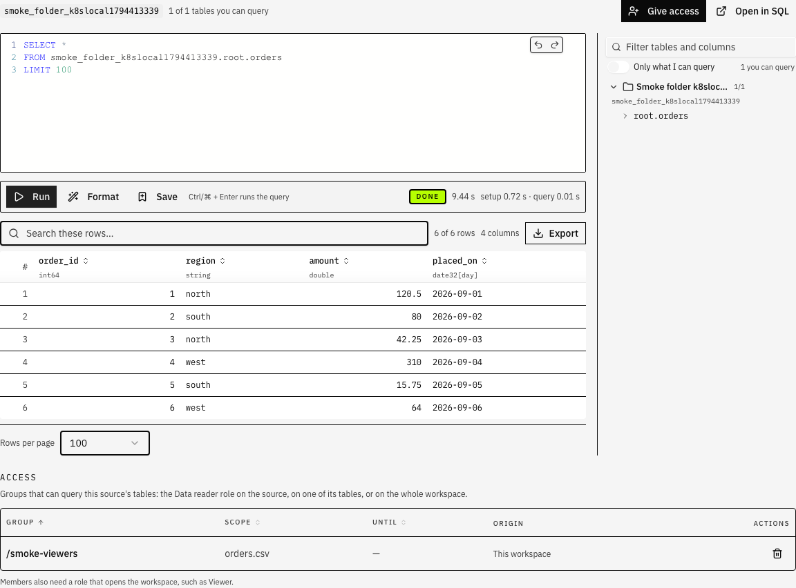
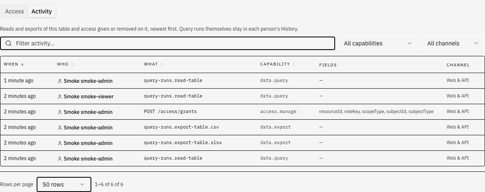

import { Callout, Steps } from "nextra/components"

# SQL over your tables

Classifyre already knows every table in a workspace — database tables, Delta and Iceberg tables in a lakehouse, Parquet and CSV files in a bucket — and what was found in them. With **SQL** you read the rows themselves, in three places:

- a table's **Data** tab, which starts with that table;
- a source's **Data** tab, with the source's tables listed beside the editor;
- the **SQL** page, to query and join tables of every source at once (who may query is managed in **Settings → Access** and on the Data tabs).

The SQL page works like a small IDE: the editor fills the space, and the **Tables**, **History** and **Saved** tabs sit beside it. A query can join tables of different sources.

Each query runs in its own short-lived worker, next to your scans, and only ever sees the tables you are allowed to read.

<Callout type="info">
There is nothing to switch on: who may query which table follows roles and grants. A workspace admin can query straight away; others need the **Data reader** role (see [Who may query what](#who-may-query-what)).
</Callout>

## What you can query

SQL runs on DuckDB, so a source is queryable when DuckDB has a built-in way to reach it. Scan a source first: SQL only knows the tables a scan found.

| Source | What becomes a table |
| --- | --- |
| PostgreSQL, MySQL | Every scanned table and view |
| Databricks | Every scanned Unity Catalog table stored as Delta (not views) — see [Databricks](#databricks) |
| ODBC | Every scanned table and view of any database that has an ODBC driver — see [ODBC](#odbc) |
| Iceberg REST catalogs, DuckLake | Every scanned table |
| S3-compatible storage, Azure Blob, Google Cloud Storage, Local folder | Delta and Iceberg tables, and the [files](#files-in-a-bucket-or-folder) below |

### Files in a bucket or folder

| Format | Extensions | Notes |
| --- | --- | --- |
| Parquet | `.parquet` | Reads only the columns and row groups a query needs. |
| CSV, TSV | `.csv`, `.tsv` | Header and column types are detected. |
| JSON Lines | `.jsonl`, `.ndjson` | One JSON object per line. |
| JSON | `.json` | A file holding an array of objects (or one object) is one row per object. |
| Avro | `.avro` | |
| Geospatial | `.geojson`, `.fgb` (FlatGeobuf), `.dbf` (the table of a shapefile) | One row per feature; the geometry column is WKT text, for example `POINT (1 2)`. |
| Delta, Iceberg tables | a table folder | Read as they are now, not as the last scan saw them. |

These are what DuckDB can read straight from a bucket without downloading the object. A file of another format is listed with the reason it cannot be queried yet:

| Format | Why not |
| --- | --- |
| Excel (`.xlsx`, `.xls`, `.ods`) | DuckDB's spreadsheet reader stalls on objects in a bucket, and a title row above the header costs it columns. |
| SQLite, GeoPackage (`.sqlite`, `.db`, `.gpkg`) | SQLite files can only be opened from a local disk. |
| DuckDB database files, ORC, Arrow IPC (`.arrow`), Vortex | Not readable from a bucket by the query engine yet. |
| Lance, Hudi and Paimon tables | Not supported yet. |
| Compressed files and archives (`.csv.gz`, `.zip`, `.tar.gz`) | Not unpacked for SQL; scans read what is inside them. |

Scans read all of these (see [File formats](/sources/file-formats/)); SQL is the narrower list.

### Databricks

A Databricks source is queried through Unity Catalog with the same credentials the scan uses (a personal access token, or the OAuth token of its service principal). DuckDB asks Unity Catalog for short-lived credentials to the table's files, so you do not give Classifyre any storage keys. Two things must be switched on in Databricks, otherwise a query answers that Databricks would not hand out storage credentials:

- an admin turns on **External data access** for the metastore, and
- the source's principal holds the **EXTERNAL USE SCHEMA** privilege on each schema you want to query.

Only Delta tables can be read. **Views** are listed but cannot be queried, because they have no files of their own; query the tables they read instead.

### ODBC

An [ODBC source](/sources/odbc/) is queried with DuckDB's official `odbc_scanner` extension, through the same connection string, user and password the scan uses. A table is read by the name the scan recorded for it, quoted the way the driver quotes names, so SQL Server, Oracle, DB2 and the like need nothing extra beyond the driver being installed where queries run.

An ODBC query is a plain `SELECT * FROM <table>` sent to the database; nothing a query filters, projects or aggregates is sent along. A `LIMIT` ends the read early, anything else reads the table once across the network. Query a large ODBC table with a `LIMIT`, or land it in a bucket first. Each read of a table opens its own connection to the database, and they close when the query ends.

### Sources that cannot be queried

DuckDB has no built-in connector for Snowflake, BigQuery, Redshift, Athena, Trino, Dremio, Hive, MongoDB, Elasticsearch, OpenSearch, Meilisearch, Neo4j or Kafka, so their tables are listed with the reason. SQL Server, Oracle and any other database with an ODBC driver can be reached through an [ODBC source](/sources/odbc/) instead. The same holds for sources of documents and messages (Confluence, Jira, SharePoint, Slack and the like): they have no tables. Use the source's own query tool, or land the data in a bucket as Parquet or Delta.

A MySQL source set to verify the server's certificate (**SSL mode** *Verify CA* or *Verify identity*) is queried the same way it is scanned: the query checks the server's certificate against the CA you stored on the source (or the system's trusted roots when there is none), and fails to connect if it does not match.

## Names

Every table has a name of three parts, `source.schema.table`, all lower case:

- **source** — the source's SQL name, made from its name the first time it is needed and kept when you rename the source, so saved queries keep working.
- **schema** — the database schema, the catalog namespace, or for a bucket the folders the table sits in.
- **table** — the table's name, or the file's name without its extension.

You never have to guess: the **Tables** tab beside the editor shows every name as nested sources → tables → columns.

- Click a table or column name to insert it where the cursor stands.
- A table's play button replaces the editor with a preview query over it (`SELECT * … LIMIT 100`).
- The copy button takes the full `source.schema.table` name for pasting elsewhere.
- The source row has its own copy button for the source name, and opens the source itself.

The editor completes names as you type: `source.` lists that source's schemas, `source.schema.` lists its tables (with access marks), and a column completes from the tables the query reads. Undo (Ctrl/Cmd+Z) and redo buttons sit above the editor, and every reopened query is one undo step.

```sql
SELECT c.region, count(*) AS orders, sum(o.amount) AS revenue
FROM shop_db.shop.customers AS c
JOIN shop_lake.shop.orders AS o ON o.customer_id = c.id
GROUP BY ALL
ORDER BY revenue DESC
```

That query joins a PostgreSQL table with a Delta table in a bucket. Any two tables you may read can be joined, from up to eight sources in one query.

## Running a query

<Steps>

### Write a SELECT

One statement, read-only. The dialect is DuckDB's, which is close to PostgreSQL: `GROUP BY ALL`, `EXCLUDE`, `QUALIFY`, window functions and the usual date, text and aggregate functions all work.

### Press **Run** (or Ctrl/⌘ + Enter)

The status moves from *Queued* to *Running* to *Done*. The time includes starting the worker and connecting to the sources. **Format** (Shift+Alt+F) tidies the SQL; **Save** names it under **Saved** for later.

### Read the result

The rows show in the table below the editor: search them, sort by any column header, page through them. The result holds at most the workspace's row limit (10,000 unless an admin changed it) and at most 32 MB; when it was cut, it says so above the table.

</Steps>

What a query cannot do, by design:

- change anything — no `INSERT`, `UPDATE`, `CREATE`, `COPY`, `ATTACH` or `SET`;
- read files or URLs directly (`read_csv('…')`, `'s3://…'`) or call table functions;
- reach a table you have no access to — it behaves as if it did not exist;
- run longer than the workspace's time limit (120 seconds unless changed).

## Your recent queries and saved queries

- **History** lists your recent runs, newest first. Opening one loads just its SQL back into the editor — never its old rows, which expire after a day and may be huge. Press **Run** again for fresh rows.
- **Saved** keeps the queries you named with **Save**, for you only: rename or delete them there, open one into the editor. A table grant that later disappears may refuse a query that used to run. Saving needs a sign-in: visitors of a [public workspace](/access#public-workspaces) can read its findings, but cannot run or save SQL.

## Export to Excel, CSV or Parquet

**Export** beside the result's search writes the **whole** result of the query as a file, not only the rows on screen: Excel (`.xlsx`), CSV, or Parquet for other data tools. It runs as a job of its own and the browser downloads the file when it is ready. It only shows once a run has rows on screen.

- An export holds up to the workspace's export limit (1,000,000 rows unless an admin changed it). Excel stops at 1,048,575 rows, the most one sheet holds. A cut export says so.
- Text longer than an Excel cell takes (32,767 characters) is cut in the Excel file only; lists, structs and other types Excel has no cell for are written as text.
- A file larger than 256 MB is refused: select fewer columns or rows, or use Parquet, which is far smaller.
- Exporting takes data out of the workspace, so it needs the right to export (**data.export**: workspace admins, tenant admins, workspace managers) on top of the right to read the table. A Data reader can query a table but not export it.

## Large tables

A query reads the table where it is — the database, the bucket, the catalog — and never copies it first. What that means for a table of hundreds of millions of rows:

| Query | What happens |
| --- | --- |
| `SELECT *` without a limit | Reading stops after the workspace's row limit; the result says it was cut. Fast at any size. |
| A filter, `LIMIT`, top N (`ORDER BY … LIMIT 10`) | Read in one pass; filters reach PostgreSQL and MySQL (not ODBC, see [ODBC](#odbc)), and Parquet, Delta and Iceberg skip files and row groups that cannot match. |
| Counts, sums, `GROUP BY` | The whole table is read once. Seconds per few tens of millions of rows from a bucket; from a database, every row crosses the network. |
| Sorting everything, a `GROUP BY` with millions of groups, a big join | Done in the worker's memory, and spilled to its disk when memory runs out, up to the spill limit (10 GiB by default). |
| Anything longer than the time limit | Stopped, with "timed out". |

Measured on the development stack, in a worker with 2 GiB of memory and one CPU, on a 60-million-row Parquet file of 2.5 GB: `SELECT *` (cut at 10,000 rows) 3 s, a full count and sum 6 s, top 20 by amount 7 s, a `GROUP BY` into 2 million groups 5 s, a `GROUP BY` into 60 million groups 51 s (spilled to disk). None ran out of memory.

Operators set the worker's size in the Helm chart (`api.cliJobs.query`: `memory`, `cpu`, `maxSpill`); the query engine gets 70 % of the memory and one thread per CPU.

## Who may query what

Reading rows is its own right, separate from seeing findings:

- **Workspace admins** (and tenant admins and workspace managers) can query every table of their workspaces.
- The **Data reader** role gives the right to others. Give it to a group on a whole workspace, on a group's workspaces — or on **one source** or **one table**. Members also need a role that opens the workspace, such as Viewer.
- **Data reader, unmasked** is the same, and also reads the columns governance masks or hides in clear (see [Masked and hidden columns](#masked-and-hidden-columns)).

People see tables they cannot query with a lock, so they know what exists and whom to ask.

### Asking for access

On a table's or a source's **Data** tab, someone who cannot query it presses **Request access**, and says:

- **for which group of theirs** — access is always given to groups, so everyone in the group they pick gets it. Someone in no group asks an admin to put them in one first;
- **which access** — Data reader, or Data reader, unmasked to read masked columns in clear (someone who already queries a table with masked columns sees **Ask to read in clear** instead);
- **for how many days** — 1 to 365, 90 by default;
- **why** — the person deciding reads this.

The request goes to the table's **owner** (its own, or its source's). With no owner it goes to the **stewards**; with neither, to the workspace's admins. They are notified, and decide on the table's **Governance** tab (step *Access*); admins also see every waiting request in **Settings → Access**.

**Approve** gives the named group the role on exactly that table or source until the end date — the decider can shorten it, or give Data reader where the unmasked role was asked for. **Decline** takes a note the requester reads. The requester is notified either way, and can withdraw a request still waiting. When the time is up the access ends by itself; to keep it, ask again.

The person deciding gives access as themselves, and never more than they have: an owner queries their table and reads it in clear, so they can give either role on it; an admin who does not read the table in clear can approve only Data reader. Nobody decides their own request. Requests, approvals and declines are recorded in the table's **Activity**.

### Giving access where the data is

The **Data reader** role is what opens SQL: whoever holds it on a table, a source or the workspace can query those tables. It is given in one dialog, the same everywhere — **Give access** in **Settings → Access**, on a source's **Data** tab and on a table's **Data** tab — with the same fields: the group, the role, what it applies to, and an optional end date.

| Where you press **Give access** | Role | Applies to |
| --- | --- | --- |
| **Settings → Access** | any role; Data reader can also be given on one source or one table | the whole workspace, or — for Data reader — a source or a table you pick |
| A source's **Data** tab | Data reader, or Data reader, unmasked | the whole source: every table in it (fixed) |
| A table's **Data** tab | Data reader, or Data reader, unmasked | this table (fixed) |

Below the result, people who can see who has access (**access.view**) see **Access**: the Data reader grants that reach the source or table — on it, on its tables or source, and wider ones — with their end dates. Grants made here can be removed with the bin button; inherited ones (from the tenant or an owning group) are changed in **Settings → Access**.

A table's tab also has **Activity**: reads and exports of that table, and access given or removed on it. Every query is recorded per table it read; the workspace's whole trail is in **Settings → Activity**.





<Callout type="warning">
Give the Data reader role as narrowly as the work needs: one table or one source rather than a whole workspace. Columns that hold personal data are masked for Data readers (below); give **Data reader, unmasked** only to groups that need the real values.
</Callout>

## Masked and hidden columns

A column of a table shows one of three ways to people who may query the table:

| Access | What they get |
| --- | --- |
| **Clear** | the values as they are |
| **Masked** | the column is there, its values replaced: *redacted* (`****`), *last four shown* (`••••1234`; values shorter than nine characters are redacted whole), *hashed* (16 hex characters, the same for equal values in the workspace, so masked columns still join and count distinct) or *empty* (`NULL`). Numbers and dates masked any way but *hashed* become `NULL`. Structs and lists keep their shape: each field and each element is masked as a column of its type would be (a hashed field joins with a hashed column of the same value); a map is masked whole. |
| **Hidden** | the column is not there: `SELECT *` leaves it out, naming it is an unknown column. A result says how many columns were hidden, never which. |

**By default it follows the column's classification** on the table's **Governance** tab (Columns): *personal* and *sensitive* data are masked, *secret* is hidden, the rest is clear. Classifications come from open findings (an email address found in the column makes it personal data, a key or token found there makes it a secret) or from a steward. The table's owner or a steward can set a column's access and how it is masked in the same dialog — *Follow the classification*, *Clear*, *Masked* or *Hidden* — and it applies to the next query.

**Who reads it in clear:**

- people with **Data reader, unmasked** on the table, its source or the workspace;
- the table's (or its source's) **owner and stewards**;
- tenant admins. Workspace admins do not, unless given Data reader, unmasked: like writing code, reading masked data is a decision of its own.

**Only someone who reads a table in clear can make it show more.** A workspace admin or curator who does not can make a column stricter (masked instead of clear, hidden instead of masked, a higher classification) and can name other people as owner or steward, but cannot make a column show more than it does, and cannot name themselves or a group of theirs owner or steward: those read the table in clear.

A table's **data contract** (Governance tab, ODCS v3.2) carries each column's access as custom properties of the column: `access` (`clear`, `mask`, `hide`), `maskKind` for a masked one and `accessFrom` (`steward`, or `classification` when it follows the classification). Applying a contract sets them, with the same rule as the dialog: a column it would make show more is skipped, with the reason, unless you read the table in clear.

If a table has columns its last scan did not record (renamed at the source since), those are hidden for anyone it masks columns for, until a new scan names them. Masks apply wherever the table is read — the SQL page, a Data tab, exports, [SQL connections](/sql-connections) — and to the whole query: a `WHERE`, `JOIN` or `GROUP BY` sees the masked values too, so a filter cannot reveal what the result hides. The SQL page marks masked columns in the table list, counts hidden ones, and says above a result which columns were masked for you.

<Callout type="info">
Masking protects what people see; it is not anonymisation. Someone who can read the other columns of a row may still work out who it is about.
</Callout>

## Filtered rows

A table can also show each reader only some of its rows — a region's office its region, a hospital ward its patients. Its owner or a steward turns this on in the table's **Governance** tab, step *Rows*:

- **Off** (the default): everyone who may query the table sees every row.
- **On**: a reader sees the rows that a rule for them selects, and **no row** without such a rule. A rule is for a group, or for everyone who may query the table, and names conditions a row must all meet: *column is one of …* or *is none of …*. A rule with no condition gives its group every row. Rules add up: someone in two groups sees the rows of both rules.

The table's **owner and stewards** (its own, or its source's) always see every row: they keep the rules. Nobody else is exempt — not admins, and not people with Data reader, unmasked: unmasking is about columns, not rows.

| Change | Who may make it |
| --- | --- |
| Turn filtering on, remove a rule | anyone who governs the table (owner, steward, or a role with *asset.govern*) |
| Turn filtering off, add a rule, widen or change a rule | only the owner or a steward: they see every row, and nobody gives more than they have |

Like masks, the filter is part of the table itself for the reader: it applies in the SQL page, a Data tab, exports, [SQL connections](/sql-connections) and AI agents, before any `WHERE`, `JOIN` or `GROUP BY` of the query, and on the real values even when the column is masked. The table list says *Rows filtered for you* with the rule's conditions, and so does a result. A condition on a column the table no longer has selects nothing; a value the column's type cannot hold matches nothing.

## AI agents (MCP)

An AI client connected to Classifyre's [MCP server](/settings/mcp-server) with your token can read tables for you, through the **Data** tool group:

- **`list_queryable_tables`** lists the tables you may query, named for SQL, with their columns as you see them — masked ones say how, hidden ones are counted, and a filtered table says which rows you read.
- **`query_data`** runs one `SELECT` and returns up to 500 rows (100 by default). It waits for the result, usually 10–30 seconds.

It is the SQL page's own path: your grants, masks, row filters, limits and per-table audit apply, and the reads show in **Activity** as yours, *via* the token. The agent never reads more than you could. Only a token of a signed-in person reads rows; agents running on their own (Autopilot) do not.

## Shared datasets

A **shared dataset** is a query you share with other groups as a dataset of its own: they read the result without any access to the tables behind it. Typical uses are an extract for another department, a reporting table for auditors, or the figures a partner needs — without handing over the raw tables.

It is a saved query, not a copy: every read runs its SQL live. Readers query it like any table, by its name `shared.<domain>.<name>`, on the SQL page, its **Data** tab, in exports, over [SQL connections](/sql-connections) (Power BI, Excel, DBeaver…) and through AI agents.

### Sharing one

1. Write the query on the **SQL** page and choose **Share as dataset**.
2. Give it a domain and a name (`shared.sales.orders_by_region`) and a description.
3. Pick its **owning group**, one of yours. The tables are read with that group's access, checked again on every read: if the group loses access to one of them, the dataset stops until it gets it back. You become its owner.
4. The sheet checks the query: which tables it reads and who answers for them, whether the owning group may read them, and for each column the classification it inherits.
5. Pick the groups that read it, as **Data reader** or **Data reader, unmasked**, and **Share**.

You may share a dataset with the **Dataset publisher** role (or a role above it, such as Workspace admin), or when you own or steward every table it reads. Either way you must be able to query those tables yourself.

### What it inherits, and what it adds

A shared dataset is an asset like any table, so it has its own owner, stewards, description, certification, quality checks, row filters, access requests, activity and lineage. On top of that, it inherits from the tables it reads, and the stricter rule always wins:

| | Inherited from the tables it reads | Its own |
| --- | --- | --- |
| Masks | The tables are read masked as the owning group reads them | Columns can be masked or hidden further |
| Classification | Each column is at least as strictly classified as the table columns it comes from | Can be raised, never lowered |
| Rows | The tables' row filters apply to the owning group | Its own row filters apply to readers |
| Access | The owning group must keep access to every table | Its readers need none |
| Owner | The tables' owners are told when their table is shared | Its own owner answers for it |

Nobody — not even a tenant admin — can make a column of a shared dataset show more than it inherits; the Columns step says *a shared dataset can make it stricter, never show more*. A column whose origin cannot be traced takes the strictest classification of all the tables it reads; name your columns explicitly to avoid that.

### Badges

- **Promoted**: its owner or a steward says it is ready to use.
- **Certified**: it went through governance (the lifecycle on its Governance tab).

### Owners of the tables it reads

When a table you own or steward is read by a new shared dataset, you get a notification. Its **Governance → Access** step lists the shared datasets that read it, with how often they were read, and **Block** stops one from reading your table until you lift the block; its owner is told. Reads through a shared dataset show in your table's Activity and Usage (*through shared datasets*).

### Its page

- **Definition**: the SQL, its columns with where each comes from and what it inherits, and every version. Its owner and stewards **Edit on the SQL page**; saving makes a new version.
- **Connections**: lineage from the tables it reads, down to each column.
- **Data**, **Governance**, **Activity**: as for any table.

All shared datasets are listed on the **Shared datasets** page. Everyone who can see assets finds them there; a locked one leads to **Request access**, which its owner decides.

## Settings

**Settings → General → SQL over tables**, for people who can change workspace settings:

| Setting | Default | |
| --- | --- | --- |
| Rows per result | 10,000 | 1 to 100,000 |
| Time limit | 120 s | 5 to 900 s, from starting the worker to the last row |
| Rows per export | 1,000,000 | 1 to 10,000,000; Excel files stop at 1,048,575 |

## Coming next

- Rows filtered by who the reader is (their own department or region from the directory), not only by the groups a rule names.
- Shared datasets refreshed on a schedule into storage of the workspace (Parquet, later Delta), and shared outside the organisation (partners, open data portals).
