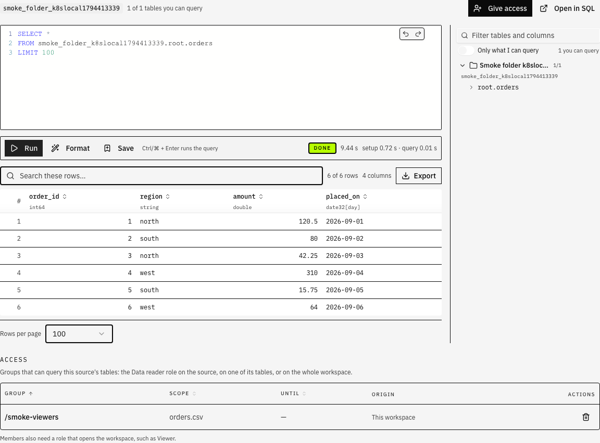
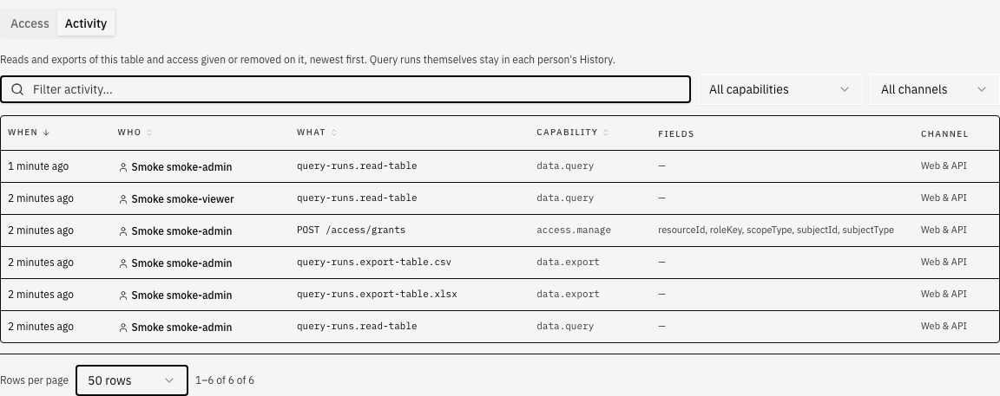

import { Callout, Steps } from "nextra/components"

# SQL over your tables

Classifyre already knows every table in a workspace — database tables, Delta and Iceberg tables in a lakehouse, Parquet and CSV files in a bucket — and what was found in them. With **SQL** you read the rows themselves, in three places:

- a table's **Data** tab, which starts with that table;
- a source's **Data** tab, with the source's tables listed beside the editor;
- the **SQL** page, to query and join tables of every source at once (who may query is managed in **Settings → Access** and on the Data tabs).

The SQL page works like a small IDE: the editor fills the space, and the **Tables**, **History** and **Saved** tabs sit beside it. A query can join tables of different sources.

Each query runs in its own short-lived worker, next to your scans, and only ever sees the tables you are allowed to read.

<Callout type="info">
There is nothing to switch on: who may query which table follows roles and grants. A workspace admin can query straight away; others need the **Data reader** role (see [Who may query what](#who-may-query-what)).
</Callout>

## What you can query

| Source | What becomes a table |
| --- | --- |
| PostgreSQL, MySQL | Every scanned table and view |
| Iceberg REST catalogs, DuckLake | Every scanned table |
| S3-compatible storage, Azure Blob, Google Cloud Storage, Local folder | Delta and Iceberg tables, and Parquet, CSV, TSV, JSON-lines and Avro files |

Lance, Hudi and Paimon tables, and other source types, are listed with the reason they cannot be queried yet. Scan a source first: SQL only knows the tables a scan found.

A MySQL source set to verify the server's certificate (**SSL mode** *Verify CA* or *Verify identity*) cannot be queried with SQL yet: the query engine cannot check the certificate, so it refuses rather than connect without the check. Scans still verify it.

## Names

Every table has a name of three parts, `source.schema.table`, all lower case:

- **source** — the source's SQL name, made from its name the first time it is needed and kept when you rename the source, so saved queries keep working.
- **schema** — the database schema, the catalog namespace, or for a bucket the folders the table sits in.
- **table** — the table's name, or the file's name without its extension.

You never have to guess: the **Tables** tab beside the editor shows every name as nested sources → tables → columns.

- Click a table or column name to insert it where the cursor stands.
- A table's play button replaces the editor with a preview query over it (`SELECT * … LIMIT 100`).
- The copy button takes the full `source.schema.table` name for pasting elsewhere.
- The source row has its own copy button for the source name, and opens the source itself.

The editor completes names as you type: `source.` lists that source's schemas, `source.schema.` lists its tables (with access marks), and a column completes from the tables the query reads. Undo (Ctrl/Cmd+Z) and redo buttons sit above the editor, and every reopened query is one undo step.

```sql
SELECT c.region, count(*) AS orders, sum(o.amount) AS revenue
FROM shop_db.shop.customers AS c
JOIN shop_lake.shop.orders AS o ON o.customer_id = c.id
GROUP BY ALL
ORDER BY revenue DESC
```

That query joins a PostgreSQL table with a Delta table in a bucket. Any two tables you may read can be joined, from up to eight sources in one query.

## Running a query

<Steps>

### Write a SELECT

One statement, read-only. The dialect is DuckDB's, which is close to PostgreSQL: `GROUP BY ALL`, `EXCLUDE`, `QUALIFY`, window functions and the usual date, text and aggregate functions all work.

### Press **Run** (or Ctrl/⌘ + Enter)

The status moves from *Queued* to *Running* to *Done*. The time includes starting the worker and connecting to the sources. **Format** (Shift+Alt+F) tidies the SQL; **Save** names it under **Saved** for later.

### Read the result

The rows show in the table below the editor: search them, sort by any column header, page through them. The result holds at most the workspace's row limit (10,000 unless an admin changed it) and at most 32 MB; when it was cut, it says so above the table.

</Steps>

What a query cannot do, by design:

- change anything — no `INSERT`, `UPDATE`, `CREATE`, `COPY`, `ATTACH` or `SET`;
- read files or URLs directly (`read_csv('…')`, `'s3://…'`) or call table functions;
- reach a table you have no access to — it behaves as if it did not exist;
- run longer than the workspace's time limit (120 seconds unless changed).

## Your recent queries and saved queries

- **History** lists your recent runs, newest first. Opening one loads just its SQL back into the editor — never its old rows, which expire after a day and may be huge. Press **Run** again for fresh rows.
- **Saved** keeps the queries you named with **Save**, for you only: rename or delete them there, open one into the editor. A table grant that later disappears may refuse a query that used to run. Saving needs a sign-in: visitors of a [public workspace](/access#public-workspaces) can read its findings, but cannot run or save SQL.

## Export to Excel, CSV or Parquet

**Export** beside the result's search writes the **whole** result of the query as a file, not only the rows on screen: Excel (`.xlsx`), CSV, or Parquet for other data tools. It runs as a job of its own and the browser downloads the file when it is ready. It only shows once a run has rows on screen.

- An export holds up to the workspace's export limit (1,000,000 rows unless an admin changed it). Excel stops at 1,048,575 rows, the most one sheet holds. A cut export says so.
- Text longer than an Excel cell takes (32,767 characters) is cut in the Excel file only; lists, structs and other types Excel has no cell for are written as text.
- A file larger than 256 MB is refused: select fewer columns or rows, or use Parquet, which is far smaller.
- Exporting takes data out of the workspace, so it needs the right to export (**data.export**: workspace admins, tenant admins, workspace managers) on top of the right to read the table. A Data reader can query a table but not export it.

## Large tables

A query reads the table where it is — the database, the bucket, the catalog — and never copies it first. What that means for a table of hundreds of millions of rows:

| Query | What happens |
| --- | --- |
| `SELECT *` without a limit | Reading stops after the workspace's row limit; the result says it was cut. Fast at any size. |
| A filter, `LIMIT`, top N (`ORDER BY … LIMIT 10`) | Read in one pass; filters reach PostgreSQL and MySQL, and Parquet, Delta and Iceberg skip files and row groups that cannot match. |
| Counts, sums, `GROUP BY` | The whole table is read once. Seconds per few tens of millions of rows from a bucket; from a database, every row crosses the network. |
| Sorting everything, a `GROUP BY` with millions of groups, a big join | Done in the worker's memory, and spilled to its disk when memory runs out, up to the spill limit (10 GiB by default). |
| Anything longer than the time limit | Stopped, with "timed out". |

Measured on the development stack, in a worker with 2 GiB of memory and one CPU, on a 60-million-row Parquet file of 2.5 GB: `SELECT *` (cut at 10,000 rows) 3 s, a full count and sum 6 s, top 20 by amount 7 s, a `GROUP BY` into 2 million groups 5 s, a `GROUP BY` into 60 million groups 51 s (spilled to disk). None ran out of memory.

Operators set the worker's size in the Helm chart (`api.cliJobs.query`: `memory`, `cpu`, `maxSpill`); the query engine gets 70 % of the memory and one thread per CPU.

## Who may query what

Reading rows is its own right, separate from seeing findings:

- **Workspace admins** (and tenant admins and workspace managers) can query every table of their workspaces.
- The **Data reader** role gives the right to others. Give it to a group on a whole workspace, on a group's workspaces — or on **one source** or **one table**. Members also need a role that opens the workspace, such as Viewer.

People see tables they cannot query with a lock, so they know what exists and whom to ask.

### Giving access where the data is

The **Data reader** role is what opens SQL: whoever holds it on a table, a source or the workspace can query those tables. It is given in one dialog, the same everywhere — **Give access** in **Settings → Access**, on a source's **Data** tab and on a table's **Data** tab — with the same fields: the group, the role, what it applies to, and an optional end date.

| Where you press **Give access** | Role | Applies to |
| --- | --- | --- |
| **Settings → Access** | any role; Data reader can also be given on one source or one table | the whole workspace, or — for Data reader — a source or a table you pick |
| A source's **Data** tab | Data reader (fixed) | the whole source: every table in it (fixed) |
| A table's **Data** tab | Data reader (fixed) | this table (fixed) |

Below the result, people who can see who has access (**access.view**) see **Access**: the Data reader grants that reach the source or table — on it, on its tables or source, and wider ones — with their end dates. Grants made here can be removed with the bin button; inherited ones (from the tenant or an owning group) are changed in **Settings → Access**.

A table's tab also has **Activity**: reads and exports of that table, and access given or removed on it. Every query is recorded per table it read; the workspace's whole trail is in **Settings → Activity**.





<Callout type="warning">
Reading rows shows everything in them, including what detectors flagged as personal data. Give the Data reader role as narrowly as the work needs: one table or one source rather than a whole workspace.
</Callout>

## Settings

**Settings → Export & Import → SQL over tables**, for people who can change workspace settings:

| Setting | Default | |
| --- | --- | --- |
| Rows per result | 10,000 | 1 to 100,000 |
| Time limit | 120 s | 5 to 900 s, from starting the worker to the last row |
| Rows per export | 1,000,000 | 1 to 10,000,000; Excel files stop at 1,048,575 |

## Coming next

- Columns hidden or masked per group, with personal data masked by default where detectors found it.
- Asking for access from a locked table.
- Connecting BI tools over JDBC/ODBC.
- Publishing a query that joins several tables as a Delta table of its own, which can be shared without sharing the tables it reads.
