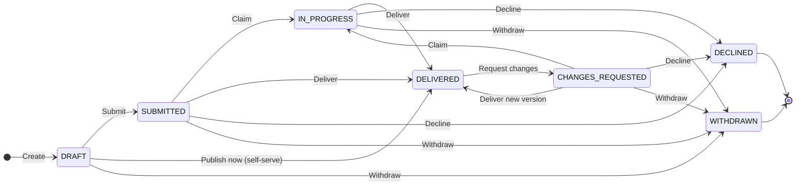

import { Callout, Steps } from "nextra/components"

# Data Requests

**Data Requests** let business users and analysts ask a data team for a governed [shared dataset](/data-query/#shared-datasets) using a visual join canvas, without ever needing raw-table access.

In Classifyre, **Cases** cover two kinds of work: **[Investigations](/investigations/)** (triaging findings, duplicates, and data leaks) and **Data Requests** (turning a business data need into a versioned shared dataset).

---

## Who it is for

- **Requesters (business users, analysts, and downstream teams)** who need columns joined across sources they cannot query directly. Instead of writing tickets or asking for CSV exports, they sketch the tables, joins, columns, and filters they need and route the request to a data team.
- **Data teams** (any group holding `dataset.publish`) who review incoming requests, verify permissions against their own access, refine SQL when needed, and publish or link a governed shared dataset.
- **Self-serve publishers** who already hold publish rights and want to build the SQL visually and deliver the dataset themselves in one step.

---

## Creating a request

<Steps>

### Open a new Data Request case

Go to **Cases → New case** and choose **Data request**. Give the request a title, an optional description, and a priority (*Low*, *Medium*, *High*, or *Critical*).

### Pick the data team and audience group

- **Route to (data team)** — choose a group that holds `dataset.publish`. Members of that group receive the request and build the dataset under their group's access.
- **Audience group** — choose one of your own groups that should receive query access to the delivered shared dataset.

### Sketch the dataset on the canvas

Place catalog tables, draw column-to-column joins, tick the columns to keep, add filters, and pin comments where context helps. Valid SQL generates live as you work.

### Submit the request

Drafts stay private to you until you click **Submit**. Submitting notifies the routed data-team group and places the request in their team queue.

</Steps>

---

## The visual join canvas

The request workspace combines the catalog rail, a visual join canvas, and a live SQL / checks / delivery panel.

- **Tables** — drag or add up to **12** catalog tables across up to **8** sources onto the canvas. Already-published `shared.*` datasets are excluded; requests are built from governed source tables.
- **Column-to-column joins** — drag a column on one table card onto a column on another to create an **INNER** or **LEFT** join. Multiple joins between the same pair of tables combine into one `ON … AND …` clause. Every table on the canvas must connect to the rest; disconnected tables are flagged as an error rather than turned into an implicit `CROSS JOIN`.
- **Columns** — tick the columns you want in the output. When two kept columns share a name, the generator disambiguates them deterministically as `<alias>_<column>`.
- **Filters** — attach filters on any column using `=`, `!=`, `<`, `<=`, `>`, `>=`, `LIKE`, `ILIKE`, `IN`, `NOT IN`, `IS NULL`, or `IS NOT NULL`. Literal values are validated and formatted according to the column's type.
- **Pinned comments** — drop discussion threads directly onto the canvas (anchored to a table, a specific column, or free-form on the sheet) to ask questions, clarify edge cases, or resolve open points with the data team.
- **Live SQL** — the canvas continuously produces deterministic DuckDB SQL with unquoted three-part table names (`source.schema.table`), minimal identifier quoting, and BFS-ordered joins.

---

## What requesters can and cannot see

<Callout type="info">
Requesters can place **any catalog table** onto the canvas — including locked tables they cannot query — as long as they hold `asset.view` (included in the built-in **Viewer** role; **Data reader** alone does not include `asset.view`).
</Callout>

- **Visible to requesters:** table names, column names, column types, and whether a column is masked or hidden.
- **Never visible to requesters:** table rows or a live data preview of tables they cannot query.
- **No raw-table grants:** fulfilling a data request never grants the requester access to the underlying tables. Their audience group receives read access only to the delivered `shared.<domain>.<name>` dataset, where every underlying mask, classification, and row filter is enforced as a strict floor.

---

## Routing & claiming

Data requests always route to a **group** holding `dataset.publish`, never to an individual, so requests do not stall when someone is away.

- Incoming requests appear under **Cases** (filtered to your team's requests) and in the [notification bell](/notifications/).
- Any member of the routed group — or a case manager holding `case.manage` — can **Claim** a request, setting themselves (or a teammate) as assignee and moving the request to **In progress**.
- If a request belongs to another domain team, a team member or case manager can **Reroute** it to a different `dataset.publish` group. Rerouting keeps the current state and notifies the new group.

---

## Request states

Every data request follows an explicit state machine:

So case lists, filters, and counts work seamlessly across both Investigations and Data Requests, each request state maps automatically to a case status:

| Request state | Case status | Who can act next |
| --- | --- | --- |
| **Draft** | Open | Requester edits spec, submits, publishes self-serve, or withdraws (private to requester) |
| **Submitted** | Open | Requester edits spec or withdraws; routed team claims, reroutes, edits, delivers, or declines |
| **In progress** | In progress | Routed team edits spec or SQL, reroutes, delivers, or declines; requester can withdraw |
| **Delivered** | Closed | Audience group queries the shared dataset; requester can request changes |
| **Changes requested** | In progress | Requester updates spec or withdraws; routed team claims, edits, delivers a new version, or declines |
| **Declined** | Closed | Terminal state (decline reason is shown to the requester) |
| **Withdrawn** | Closed | Terminal state (withdrawn by the requester) |

---

## The data team's workflow

When a data team opens a submitted request, every check and SQL tool runs in the team's governance context:

### Checks run as the routed group

SQL is always checked and described against the **routed group's** permissions, never the requester's:

- **Static check** — verifies every referenced table against the routed group's catalog, checks whether the group can query each table, and lists masked and hidden columns without launching a query worker.
- **Describe** — resolves full column lineage and inherited classification/mask floors as the routed group (cached by SQL hash).

### Hand-editing SQL

The canvas covers common joins and filters cleanly. When a request requires aggregations (`GROUP BY`), window functions, CTEs, or custom expressions, a member of the routed group can edit the SQL directly in the editor.

- Once SQL is hand-edited, canvas layout moves leave your SQL intact.
- Choose **Regenerate** at any time to clear the override and return to canvas-generated SQL.

### Publishing or linking a shared dataset

To fulfil a request, the data team can:

- **Publish a new shared dataset** — opens the standard [shared dataset](/data-query/#shared-datasets) sheet prefilled with the request's SQL, owning group (the routed group), and audience group.
- **Update an existing shared dataset** — publishes a new version of the dataset already linked to the request (for example after a change request).
- **Link an existing shared dataset** — if an approved shared dataset already answers the question and grants query access to the audience group, link it directly without duplicating SQL.

Delivery verifies that the dataset exists and that the requester's audience group can query it, records a delivery snapshot (spec, SQL, delivery mode, and dataset version), moves the request to **Delivered**, and notifies the requester.

If the request cannot be fulfilled, choose **Decline** and provide a written reason for the requester.

---

## Self-serve ("Publish now")

If the requester already holds `dataset.publish` — or owns/stewards every underlying table and can query them — Classifyre shows **Publish now**.

Self-serve lets data-savvy requesters use the same visual join canvas to build their SQL, publish the shared dataset directly, and immediately close the request as **Delivered** (recorded with delivery mode *Self-serve*), preserving the spec and audit trail without waiting on another team.

---

## Versions, change requests & live status

Data needs rarely stop at version 1.

- **Requesting changes** — on a delivered request, the requester can click **Request changes** and explain what needs to change. The request moves to **Changes requested**, posts the reason as a comment, and notifies the routed data team.
- **Versioned deliveries** — when the team updates the shared dataset and delivers again, the request records a new delivery round (`v2`, `v3`, …) with its own spec and SQL snapshot while keeping every earlier delivery intact in the history.
- **Live dataset status** — every delivered request monitors the linked shared dataset and displays its live state:
  - **Ok** — active and queryable by the audience group.
  - **Retired** — the dataset's governance lifecycle is set to Retired.
  - **Blocked** — an owner of an underlying source table blocked the shared dataset.
  - **Unavailable** — the owning group lost access to one of the underlying tables (the requester is notified automatically).
  - **Removed** — the shared dataset was deleted.

---

## Notifications

Data-request events are delivered as **Governance** notifications in the [notification bell](/notifications/) and link straight to the case:

| Event | Who is notified |
| --- | --- |
| **Request submitted** | Routed data-team group |
| **Claimed or rerouted** | Assignee, requester, or newly routed group |
| **Dataset delivered** | Requester (includes dataset name and version) |
| **Changes requested** | Routed data-team group (includes the reason) |
| **Request declined** | Requester (includes the decline reason) |
| **Request withdrawn** | Routed data-team group |
| **Dataset unavailable** | Requester (when a delivered dataset can no longer be read) |

---

## AI agents (MCP)

AI assistants connected to Classifyre's [MCP server](/settings/mcp-server/) with a personal sign-in token can read, draft, and submit data requests through the **Data** tool group:

| Tool | What it does |
| --- | --- |
| `list_data_requests` | Lists requests in the current workspace by `scope`: `mine` (created by you, default), `team` (routed to your data-team groups), or `all` (requires `case.view`). |
| `get_data_request` | Reads one data request by case ID, including its visual join spec, generated or hand-edited SQL, delivery history, and live dataset status. |
| `create_data_request` | Creates a new draft data request with `title`, optional `description` and `priority`, `routeGroupId`, `audienceGroupId`, and an optional canvas `spec` (tables, joins, filters). |
| `submit_data_request` | Submits a draft data request to its routed data-team group so the team is notified and can claim and deliver a shared dataset. |

<Callout type="info">
Plain-language dataset drafting works through an MCP AI assistant calling `create_data_request` and `submit_data_request` on your behalf. In the Classifyre web app, requests are built directly on the visual join canvas.
</Callout>
