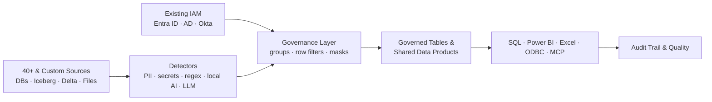

# How Classifyre Works

Classifyre is a **sovereign data governance platform** that integrates with
the systems your organisation already operates — databases, lakehouses
(Iceberg, Delta, Parquet), cloud storage, collaboration platforms, and your
existing identity provider — without requiring you to replace your ETL
pipelines or BI tools.

Prefer to explore screen by screen? See **[A Tour of the
App](/how-it-works/in-the-app/)** for a map of every section in the web UI.

Everything below runs inside a **[workspace](/how-it-works/workspaces/)** — an
isolated domain (such as a business unit, region, or subsidiary) with its own
sources, classifications, access grants, shared datasets, and audit trail.

---

## The end-to-end governance flow

**1. Connect sources in place.** Point Classifyre at the systems you already
run — PostgreSQL, MySQL, Databricks, ODBC databases, Iceberg and Delta
lakehouses, Parquet files in S3/Azure/GCS, Confluence, Jira, or custom
connectors. Classifyre reads metadata and data in place rather than copying
your estate into another vendor warehouse. See [Sources](/sources/).

**2. Detect sensitive and business-specific data.** Built-in packs classify
personal data (PII across EU, US, and global identifiers) and secrets out of
the box. Custom detectors extend this to any business rule — from regex and
Python checks to lightweight on-CPU zero-shot extraction and classification
models, decision models, and private LLMs. Every finding carries a score and
written explanation. See [Detectors](/detectors/).

**3. Govern access by organisation.** Connect Entra ID, Active Directory, Okta,
or any OIDC/SAML directory. Access is always granted to **groups** — per
workspace, source, table, or shared dataset — with optional expiration dates,
named owners and stewards, and owner-approved access requests. See
[Access & Sign-in](/access/).

**4. Enforce multi-level column and row masking.** Classified columns are
masked automatically inside the query engine — redacted, last-four,
deterministic hashed pseudonymisation (so joins and distinct counts still
work), empty, or completely hidden — and row-level filters restrict each group
to its own rows. Different groups querying the exact same table receive
different rows and clearance levels, and workspace admins do not read clear
personal data by default. See [SQL & Masking](/data-query/).

**5. Query in SQL, Power BI, Excel, ODBC, and MCP.** Teams continue working in
the tools they already know. Classifyre exposes a PostgreSQL-compatible TLS
endpoint with personal, expiring, revocable connections — eliminating shared
database passwords. In production, revoking direct analyst logins on underlying
databases and restricting source network ports to Classifyre ensures BI, SQL,
and MCP AI tools cannot bypass governance. AI agents connected over MCP inherit
the exact permissions and masks of the signed-in user. See
[SQL Connections](/sql-connections/).

**6. Publish governed data products.** Teams combine data across sources into
governed **shared datasets** (live cross-source queries or shared data
products) with named owners and audiences. Every shared dataset inherits the
masking and classification rules of its underlying tables as a strict floor,
and supports additional group-level masks and row filters. See
[Shared Datasets](/data-query/#shared-datasets).

**7. Audit every read and verify quality.** Every SQL query, export, grant,
and approval is recorded with who accessed what and through which tool.
Scheduled data quality checks and open data contracts (ODCS) keep governed
tables trustworthy and audit-ready.

**8. Incident response (optional).** When sensitive data or credentials leak
outside governed paths, the same connectors and findings feed standing
inquiries, cross-system duplicate fingerprints, and structured cases — with an
optional supervised Autopilot. See [Investigations](/investigations/).

---

## Where to go next

| Page | What it covers |
|---|---|
| [A Tour of the App](/how-it-works/in-the-app/) | Every screen in the app and what it is for. |
| [Access & Sign-in](/access/) | Directory integration, groups, roles, grants, and audit trails. |
| [SQL, Masking & Shared Datasets](/data-query/) | Cross-source SQL, column masks, row filters, and shared data products. |
| [SQL Connections](/sql-connections/) | Connecting Power BI, Excel, Tableau, DBeaver, and ODBC tools. |
| [Sources](/sources/) | All built-in connectors and custom connector authoring. |
| [Detectors](/detectors/) | Pre-built PII/secret packs and custom detectors from regex to AI. |
| [Deploy](/deployment/) | Local Docker evaluation and production Kubernetes/OpenShift Helm deployment. |
