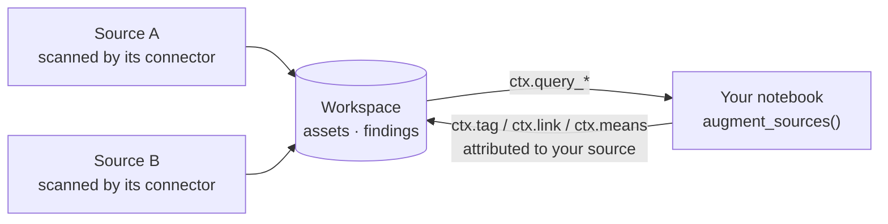

import { Callout, Steps } from "nextra/components";

# Query and Augment Other Sources

A [custom connector](/sources/custom-connectors/) usually reads one external
system. But sometimes the interesting question is about what Classifyre
**already knows**: which documents carry a high-severity finding, which sources
hold the same invoice, which assets deserve a human look *because of what is
next to them*. A notebook can ask those questions, and write the answers back
onto the assets they are about — tags, links, glossary meanings — without
scanning anything again.



<Callout type="info">
  Everything stays inside one workspace, and nothing a notebook can read
  includes another source's credentials, variables or code. Reads and writes go
  through the platform on the notebook's behalf; the notebook itself never holds
  an API key.
</Callout>

---

## Reading the workspace

All reads work during a scan. Running a cell in the editor has no scan to read
for, and says so.

| Call | Returns |
| --- | --- |
| `ctx.query_sources(search=, type=, status=)` | Sources: name, type, the status of the latest run. Never configuration. |
| `ctx.query_assets(source=, kind=, where=, search=, term=, findings=, semantic=, include=)` | Assets with their metadata, and optionally their open findings. |
| `ctx.query_findings(detector=, detector_type=, finding_type=, severity=, status=, source=, asset=, asserted_by=)` | Findings. Open ones unless you say otherwise. |
| `ctx.query_detectors(type=)` | Custom detectors: key, name, type. Never the pipeline or its secrets. |

Each takes `limit=` (up to 5,000) and `cursor=`, and returns a page with
`items` and `next_cursor`. **Every read is paged** — there is no call that
returns "everything" — and there is no limit on how many pages a run reads. The
`ctx.each_asset(...)`, `each_source`, `each_finding` and `each_detector`
helpers take the same filters and walk every page for you:

```python
for asset in ctx.each_asset(findings={"severity": ["HIGH", "CRITICAL"]},
                            include=["findings"]):
    ...
```

### Filtering assets

Filters combine; an asset must satisfy all of them.

| Filter | Keeps assets… |
| --- | --- |
| `source=` | of one source (its name or id). Leave it out to read every source. |
| `kind=`, `search=`, `status=` | of a kind, whose name contains the text, with a given status. |
| `where={"key": {"gt": 0}}` | whose metadata matches. Operators: `eq`, `in`, `exists`, `gt`, `gte`, `lt`, `lte`. |
| `term="pii"` | currently linked to a glossary term (`include_narrower=True` adds narrower terms). |
| `findings={"detector": "pii-email", "severity": ["HIGH"]}` | that have matching findings. |
| `semantic="late payment disputes"` | ranked by meaning, best first, over the 200 closest. |
| `exclude_visited={"key": "id", "since_days": 90}` | this source has not scanned in the last 90 days. |

### From a detector to its findings, and to the assets

```python
detector = next(ctx.each_detector(type="TAG")).key

for finding in ctx.each_finding(detector=detector):      # its findings
    ...
for asset in ctx.each_asset(findings={"detector": detector}):   # their assets
    ...
```

---

## Writing back

Define `augment_sources()` next to (or instead of) `extract()`. It runs after
the notebook's own assets have been scanned, and `ctx` is available as usual.

```python
def augment_sources():
    for asset in ctx.each_asset(findings={"detector": "pii-email"}):
        ctx.tag(asset, "needs-review", "email found")        # a tag
        ctx.means(asset, "personal-data")                    # a glossary meaning
        for twin in ctx.each_asset(search=asset.name, limit=20):
            if twin.id != asset.id and twin.name == asset.name:
                ctx.link(asset, twin, "SAME_AS")             # a link
```

A notebook that defines `augment_sources()` does not need `extract()` — it may
own no assets at all. Writes are buffered and sent in batches, so tagging a
million assets is one loop.

| Call | Does |
| --- | --- |
| `ctx.tag(asset, key, value, severity=None)` | Tags an asset. `key` is the key of an **active Tag detector**; one that does not exist is refused with the list of valid keys. |
| `ctx.tags(asset, {key: value})` | Several tags at once. |
| `ctx.link(a, b, relation="REFERENCES")` | A link between two assets. Each end is an asset from a query, an asset id, or a URN. |
| `ctx.means(asset, "term-key")` | "This asset means that glossary term." A term that does not exist yet links once it is defined. |
| `ctx.augmentation_stats` | What this run has written so far. |

`ctx.tag` is for assets of **other** sources. For assets your own notebook
yields, keep using `Asset(tags=...)`.

### Whose is it?

Every tag and link records the source and run that wrote it, and the product
shows it. That matters in three ways:

- **Nothing is overwritten.** A tag you write never replaces the asset's own tag
  with the same key, or another source's. A link that a connector or a person
  already holds is left as it is, and counted as *skipped* in the run log.
- **Two sources can say the same thing.** If sources A and B both tag an asset
  `needs-review`, the asset has two tags, one from each.
- **It is yours to take back.** `list_source_augmentations` (MCP) shows what a
  source has written; `retract_source_augmentations` takes all of it back.
  Deleting the source removes what it wrote.

### It follows the data

When `augment_sources()` finishes without an error, what **this source** wrote
in an earlier run and did not write now is retired: a tag you stop asserting is
resolved, a link you stop drawing is removed. Nothing a connector, a person or
another source wrote is touched.

So write the *whole picture* every run, not just what changed. If a run only
looks at part of the workspace, say so, and nothing is retired:

```python
ctx.set_partial_coverage("only findings since yesterday")
```

A run that is stopped or fails retires nothing either. And inside
`augment_sources()` a read does not declare partial coverage by itself, because
an augmentation owns no cohort — only your own `set_partial_coverage` does.

<Callout type="warning">
  Tags are findings. A tag you write shows in findings lists, counts toward
  severity filters and can be cited in a case, like any other finding. Pick the
  Tag detector's severity with that in mind: you can ask for a lower severity
  than the detector's, never a higher one.
</Callout>

---

## Starting points

In the source form, **Templates** offers two starters:

<Steps>

### Query other sources

Lists sources, detectors and assets with high-severity findings, and logs a
summary. Read-only — a safe first run.

### Augment other sources

Finds assets another detector flagged, tags them, gives them a glossary
meaning, and links duplicates across sources.

</Steps>

Create the Tag detector first (**Detectors → New → Tag**) — its key is the `key`
you pass to `ctx.tag`.

---

## For agents and scripts

The MCP server exposes the same capabilities:

- `describe_notebook_cross_source` — the SDK reference, for authoring.
- `list_source_augmentations` — what a source wrote onto other sources, tags or
  links, paged by cursor.
- `retract_source_augmentations` — take it all back.
- `search_sources`, `search_assets`, `search_findings` — the same filters, for
  exploring outside a notebook.

See [MCP server](/settings/mcp-server/).

---

## Limits and guarantees

| | |
| --- | --- |
| Page size | 1–5,000 per read; no total cap. |
| Query time | 15 seconds each. A slow query fails with advice to narrow it. |
| Scope | The workspace the run belongs to. |
| Credentials | Never readable — not through a query, not through an error. |
| Reads and writes need | A running scan. Not the cell editor. |
| Semantic search | Ranks the 200 closest assets; page through them with the cursor. |
