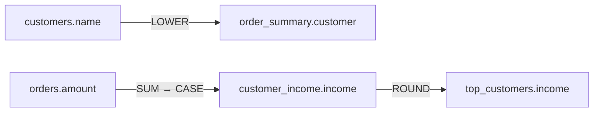

import { Callout } from "nextra/components"

# Column-Level Lineage

Table-level lineage says *the `order_summary` view is built from `orders` and
`customers`*. That is a start, but it is rarely what you need to know:

- **Before you change a column:** does anything read `customers.email`, and
  what happens to it on the way?
- **When you find sensitive data:** the `customer` column of a report holds
  names. Which source column did they come from, and was anything done to them?

**Column-level lineage** answers both. For every column of a view, Classifyre
records which upstream columns feed it and every function the value passes
through.

---

## Reading the column lineage panel

Open any table or view, choose the **Connections** tab, and pick a column in the
**Column lineage** panel below the canvas. Each row is one step back, read left
to right in the direction the data moves:

> `customer_income` · `income → ROUND → income`
> ↳ `orders` · `amount → SUM → CASE → income`

The first row says that `top_customers.income` is `ROUND(income)` from the
`customer_income` view. The indented row goes one step further back: that
`income` is a `SUM` over a `CASE` on `orders.amount`. The panel follows
columns up to three steps back, through as many views as there are.

Each row shows:

| Part | What it tells you |
|---|---|
| **Table** | Where the upstream columns live. Indented rows are further upstream. |
| **Chain** | The source columns, the functions applied in order, and the column they produce |
| **Type** | **Identity** (copied as-is), **Transformed** (an expression changed it) or **Aggregated** (`SUM`, `COUNT` and the like over many rows) |
| **Source and confidence** | How the mapping was learned, for example *SQL parsed · 80%* |
| **SQL** | Opens the exact expression, and the full view definition it was read from |

### What counts as a step

Every function or operator that **changes the value**: `LOWER`, `TRIM`,
`CONCAT`, `CAST`, `COALESCE`, arithmetic such as `*` or `-`, `CASE`, JSON path
lookups, and window functions (shown as, for example, `ROW_NUMBER OVER`). A
column copied as-is has no steps.

Some things are deliberately left out of the chain:

- **Conditions.** In `CASE WHEN amount > 0 THEN amount END`, the `>` decides
  *which* value is used; it does not change it. The chain is `CASE`.
- **Casts on constants.** PostgreSQL stores views with `NULL::numeric` and
  `'web'::text` added throughout. Those are not transformations of your data.

### Columns that only filter

A column can matter without feeding any output value: a date in a `WHERE`, a
join key, a `GROUP BY`, a sort. These shape **which rows** come out, not what is
in them. They are listed separately, under **Columns that shaped which rows came
out**, each against its own table.

### Columns with no source

A column such as `'web' AS channel` or `CURRENT_TIMESTAMP AS loaded_at` is not
fed by any table. It is still listed, as a *constant*, so you can see the view
sets it itself.

---

## How it is worked out

Most databases can tell you which tables a view depends on, but not which
columns. So Classifyre reads the view's own SQL, as the database stores it, and
follows each output column back to the base tables:

- **Through `WITH` clauses and subqueries.** A column taken from a CTE is
  followed into the CTE, and on to the real table behind it.
- **Through `UNION`s.** Each branch is followed separately, so
  `SELECT amount FROM orders UNION ALL SELECT -amount FROM refunds` shows
  `orders.amount` copied as-is and `refunds.amount` negated.
- **Across views of views.** Each view's mapping is stored once, so the panel
  can chain them together however deep the stack is.
- **Per table.** In a view that joins `orders` and `customers`, each column is
  tied to the table it actually comes from, never to both.

Where the platform itself reports column lineage, as Databricks Unity Catalog
does, that is used instead of the SQL. It names the columns but not the
functions between them, so those rows have no chain of steps.

<Callout type="info">
**When the answer would be a guess, there is no answer.** A `SELECT *` view
gives no column detail: its columns are whatever the base table has, and the
link stays at table level. The same goes for a column with no table prefix in a
join (`SELECT amount FROM orders JOIN refunds …`): without knowing both tables'
columns, it could come from either, so it is left out. A missing mapping is
better than a confidently wrong one when the question is *what breaks if I drop
this column?* Writing `o.amount` instead of `amount` in the view fixes it.
</Callout>

---

## How much to trust a mapping

Every mapping records how it was learned, and the panel shows it on each row:

| Shown as | Meaning | Confidence |
|---|---|---|
| **Catalog** | The platform reported the column lineage itself | 95% |
| **SQL parsed** | Read from the view definition, as described above | 80% |
| **Manual** | Declared by a person, or by a [custom connector](/sources/custom-connectors/) | As declared |

The **SQL** button shows exactly what the mapping was read from, so you can
check the derivation instead of trusting a label.

---

## Column lineage in an investigation

On a [case board](/investigations/cases/connections/), lineage is how you
follow data out of the evidence:

- **Suggested neighbours** show the views and tables connected to your evidence
  by lineage, labelled *view*, *derived* and so on. When an asset has too many
  neighbours to draw, the board still shows the ones connected by lineage and
  holds back only foreign keys, mentions and look-alikes until you choose how
  far to look.
- **Show connections** with *Upstream* and *Lineage* walks back to where a
  value came from, as many hops as you ask for.
- Open any table on the board and its **Connections** tab has the same column
  panel, to see which column carried the data.

A typical trace: a finding flags names in the `customer` column of a report
view. The column panel shows it is `LOWER(customers.name)`. The **Connections** tab
of `customers` then shows every other view that reads that table, which tells
you where else the same names have gone.

---

## Which sources have column-level lineage

| Source | Column detail from |
|---|---|
| [PostgreSQL](/sources/postgresql/) | The view SQL. Views are scanned by default (*Include views*). |
| [SQL Server](/sources/mssql/), [Oracle](/sources/oracle/), [Hive](/sources/hive/) | The view SQL |
| [Snowflake](/sources/snowflake/) | The view SQL, alongside the account's object dependencies |
| [Dremio](/sources/dremio/) | The view SQL |
| [Databricks](/sources/databricks/) | Unity Catalog's own column lineage, when *Include column lineage* is switched on |
| [Custom connectors](/sources/custom-connectors/reference/#relating-assets) and [augmentation](/sources/augmentation/) | Whatever you declare, including the functions on the way |

Views have to be part of the scan for their lineage to appear. If a view's
**Connections** tab shows no lineage, check that the source includes views and that
the view's base tables are in scope. After changing either, run the source
again.

---

## Common questions

**Why does my view show table lineage but no column lineage?**
Most often it selects `*`, or its columns have no table prefix in a join. Both
are left at table level on purpose, as explained above.

**Why are some columns upper-case and others lower-case?**
The panel shows names as each database stores them. Snowflake and Oracle store
unquoted names in upper case, PostgreSQL in lower case. Matching ignores case,
so a column is followed back either way.

**Does column lineage follow data across systems?**
Yes, wherever the table-level link crosses systems: a Databricks table read by
a Tableau data source, or a view reading a table in a schema you scan later.
See [Lineage across systems](/sources/lineage/#lineage-across-systems).

**Does it read stored procedures or ETL jobs?**
Not yet. Column lineage comes from view definitions and platform catalogs.
Data moved by procedures or external jobs shows up only where the platform
records it, or where you declare it in a
[custom connector](/sources/custom-connectors/).
