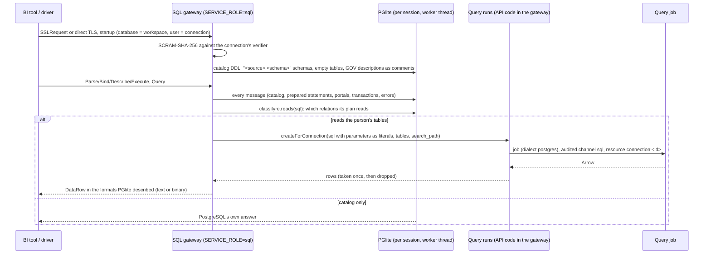

# PRD DQ · Data query: SQL over the tables of a workspace

|                  |                                                                                                                                                                  |
| ---------------- | ---------------------------------------------------------------------------------------------------------------------------------------------------------------- |
| **Status**       | Phases 0–2 built 2026-11-09, plus export (from phase 3) and the phase-1 hardening (§9 "As built"). Phase 4, SQL connections (PostgreSQL protocol for BI tools and drivers), built 2026-11-13 (§5.7, §9). Phase 3 built 2026-11-13/14: masks (§5.8), access requests (§5.9), row filters (§5.10, added to scope 2026-11-14), MCP `query_data` (§5.11). Governed assets are never hard-deleted (2026-11-14), which replaced the planned purge clean-up. Phase 6 reshaped 2026-11-16 from Delta data products into **shared datasets** (governed saved queries, not materialised, §5.12), being built. Phase 5 proposed. Owners, business metadata and data quality moved to [GOV](GOV-governed-data-assets.md) (2026-11-12). |
| **Size**         | L (7 phases, each its own PR or set of PRs)                                                                                                                      |
| **Depends on**   | [IAM](IAM-access-management.md) (grants, roles, capabilities), the CLI's DuckDB readers (`apps/cli/src/utils/duckdb_engine.py`, `lakehouse_tables.py`)          |
| **Starts from**  | The payload-access proof of concept `fedsql` (outside this repository: `acme/poc-payload`, reviewed 2026-11-05)                                               |
| **Not in scope** | writing to sources, a warehouse of copies, user-defined functions, row filters computed from a person's directory attributes (§5.10 names groups) |

## 1. Summary

Classifyre knows every table of a workspace (assets of kind `table`, and table files in buckets) and what was found in them, but nobody can read the rows. This PRD lets anyone allowed — by a role on the workspace or by a group grant on one source or one table — query those tables with standard SQL, from the asset's page or from a SQL page that shows what they may query, and join tables across sources (a PostgreSQL table with a Delta table in a bucket, for example).

The engine is the one the CLI already has, DuckDB, run the way every other piece of CLI work runs: an **ephemeral job** per query (a Kubernetes Job, or a local process in the all-in-one image). The API decides what a query may read; the job enforces it on the SQL itself.

Later phases add column masking (driven by the PII findings Classifyre already has), access requests, **SQL connections** for BI tools and drivers (phase 4, §5.7), more source types, and **shared datasets** (phase 6, §5.12): a multi-table query that a publisher owns and shares with a named audience as a governed asset of its own, read without access to its base tables, with the base tables' masks and classification carried through.

What makes a table a *governed data asset* — an accountable owner, stewards and a custodian from IAM, a description and column-level business metadata, and ODCS-shaped quality rules with kept results — is its own PRD, [GOV](GOV-governed-data-assets.md). This PRD's phase 3 builds on it: access requests go to the table's owner, and default masks come from GOV's column classification. GOV's whole-table quality rules run on this PRD's engine (job mode `quality`).

## 2. What the proof of concept showed

| Finding                                                                                                                                         | Taken over as                                                        |
| ----------------------------------------------------------------------------------------------------------------------------------------------- | -------------------------------------------------------------------- |
| One isolated in-memory DuckDB per query, sources attached under hidden names, only policy views exposed                                        | §5.2, unchanged                                                      |
| SQLGlot gate: one SELECT, function allowlist, no table functions, only registered names; its bypass list                                      | `apps/cli/src/query/gate.py`, stricter: an allowlist of **tables**   |
| Bucket-scoped S3 secrets, read-only PostgreSQL attach, `pg_use_ctid_scan = false` (LIMIT over-returned rows, F01)                              | §5.3                                                                 |
| `delta_scan` obeys the Delta log (5 active rows, not the 9 files on disk)                                                                      | Delta and Iceberg read through their scanners, never as file globs   |
| Timeout did not cover source setup (F02); results fully materialised (F03)                                                                     | One deadline around setup and execution; row and byte caps           |
| Roles per source, column allowlists, hides and masks                                                                                           | Grants per source **or table** (§4); masks in phase 3                |
| Hand-written PostgreSQL wire server worked with JDBC/ODBC drivers (text results only; Power BI and Excel never signed off)                    | Phase 4: PGlite as the catalog and protocol back end, binary results (§5.7) |
| "Delta" in the POC meant Delta Lake; a joined result becomes a Delta table only if something publishes it                                     | Phase 6, shared datasets (query first; materialising, Delta included, later — §5.13) |

## 3. Requirements

| #   | Requirement                                                                                                                                         |
| --- | --------------------------------------------------------------------------------------------------------------------------------------------------- |
| R1  | A person can query a table only when a role on the workspace gives `data.query`, or a data-reader grant names the table or its source.             |
| R2  | A query can read nothing but those tables: no files, no table functions, no system catalogs, no other source's credentials.                        |
| R3  | Only SELECT. No writes, no settings, no attachments, one statement.                                                                                 |
| R4  | People see what they can query, and what exists that they cannot (when they can see assets at all), and why.                                       |
| R5  | One query can join tables of several sources.                                                                                                       |
| R6  | Every query is attributed and the tables it read are recorded (audit).                                                                              |
| R7  | Results are bounded (rows, bytes, time) and the bound is visible; nothing is silently cut.                                                         |
| R8  | *(Changed 2026-11-09.)* No per-workspace switch: sign-in is always on, so grants (`data.query`, Data reader on a workspace, source or table) are the only gate. Workspace admins query straight away. |
| R9  | Reuses the CLI's connection code and the job machinery; no second engine, no long-lived worker to run in phase 1. *(Changed 2026-11-21: a warm query worker runs queries, with a Job as the overflow — §5.3, §9 *Query worker*. Still one engine and one code path.)* |

## 4. Who may query what

**Capability.** `data.query` — "Query the rows of tables with SQL". It is a workspace capability like every other, so Workspace admin, Workspace manager and Tenant admin have it on their scopes.

**Role.** `data-reader` (Data reader) holds only `data.query`. It is an add-on, like Code author: combined with a role that opens the workspace (Viewer or more).

**Scopes.** A data-reader grant can be on the tenant, a group's workspaces, a workspace — or on **one source** or **one table** of a workspace. The last two are the first grants on single resources (`iam_grants.scope_type` `source` / `asset`, `scope_id = <namespace id>/<source or asset id>`). They never give anything workspace-wide (`grantApplies` is false for them); the namespace hook works out, per request, which sources and tables they open (`resourceGrantsInWorkspace`) and `IamAccessPolicy.check(actor, capability, resource)` honours them. Grants go to groups only, as since IAM step 8f: a one-person need is a small group.

**Sign-in off.** *(Gone 2026-11-09: sign-in is always on.)*

**The settings.** `data_query_settings` (per workspace): `max_rows` (10,000), `timeout_seconds` (120) and `export_max_rows`. Changed with `workspace.settings`. *(The `enabled` switch was dropped 2026-11-09, migration `20261110090200_data_query_always_on`.)*

**What a person sees.** The catalog lists every table-shaped asset. A table is `canQuery` when DuckDB can read it and a role or grant covers it (R8: no switch). Tables someone cannot query are listed (locked) only if they hold `asset.view`.

## 5. Design

### 5.1 Flow

```mermaid
sequenceDiagram
  participant W as Web (SQL page / asset Data tab)
  participant A as API
  participant J as Query job (CLI image)
  W->>A: POST /<ws>/query-runs {sql}
  A->>A: setting on? catalog for this person → allowed tables
  A->>A: sources the SQL names (sqlName prefix) → their recipes, decrypted
  A->>A: QueryRun PENDING (token hash); per-table audit on success, for the tables the job read (R6)
  A-->>W: run (PENDING)
  A->>J: K8s Job or local process, request gzipped in env
  J->>J: SQLGlot gate against the allowed tables
  J->>J: attach sources as __src_<n>, views <source>.<schema>.<table>
  J->>J: lock configuration, run with LIMIT max_rows+1 under one deadline
  J->>A: POST /<ws>/query-runs/:id/result (Arrow IPC, X-Query-Run-Token)
  W->>A: GET /<ws>/query-runs/:id (poll)
  W->>A: GET /<ws>/query-runs/:id/result → Arrow → grid
```

### 5.2 Names

A table is `<source>.<schema>.<table>`, every part a plain lower-case identifier (`apps/api/src/data-query/sql-names.ts`):

| Source                         | schema                                         | table                         |
| ------------------------------ | ---------------------------------------------- | ----------------------------- |
| PostgreSQL                     | `schema` (prefixed with the database when a source scans several) | `table_name`      |
| MySQL                          | the database                                   | `table_name`                  |
| Iceberg REST, DuckLake         | namespace / schema                             | `table_name`                  |
| Bucket tables (Delta, Iceberg) | the folders of the table root, joined with `_` | the last folder               |
| Bucket files (Parquet, CSV, TSV, JSON lines, Avro) | the folders                | the file name without extension |

`Source.sqlName` is given from the source's name the first time it is needed and **kept** when the source is renamed, so saved SQL keeps working. Colliding table names get `_2`, `_3` by asset id.

### 5.3 The job (`apps/cli/src/query/`)

- `gate.py` — the SQLGlot gate. Refuses: non-SELECT roots, any DDL/DML/INTO/COMMAND/LOCK node (write CTEs included), functions outside `SAFE_FUNCTIONS`, qualified functions, anything in FROM that is not a plain name (files, `read_*`, `query()`, `postgres_query()`), names not in full (`source.schema.table`), and every name not in the request. Rewrites names quoted and lower-cased.
- `bindings.py` — one adapter per source type:
  - PostgreSQL / MySQL: DuckDB's scanners, `READ_ONLY`, from the recipe fields the connectors read; no Python driver needed.
  - Iceberg REST / DuckLake: the scan's own `DuckDBAttachedSource._attach`, under the query's alias (`_attach_alias`, secrets prefixed with it).
  - Buckets: the source's `TableStorage` (the scan's secret body, now with a `SCOPE` per bucket); `delta_scan`, `iceberg_scan(…, allow_moved_paths)` with `unsafe_enable_version_guessing` (a query reads the table as it is now, not the version the last scan recorded, which is gone once the table moves on), `read_parquet`, `read_csv`, `read_json`, `read_avro`.
- `session.py` — attaches only the sources the SQL reads, creates the views, sets `lock_configuration`, turns extension auto-loading off, runs under one deadline (`conn.interrupt()`), cuts to `max_rows` and `max_result_bytes`, converts columns the browser's Arrow reader cannot decode to text.
- `runner.py` — posts Arrow IPC (or a JSON error) with the run's token, and prints one `__CLASSIFYRE_QUERY_RESULT__` line so the API can still say what happened when the callback never came. Errors pass the recipe redactor.
- `python -m src.main query <file>` skips importing every connector: a person is waiting.
- `worker.py` + `warm.py` — **the query worker** (`python -m src.main query-worker`, decided and built 2026-11-21, replacing "jobs only"): the same CLI image as a Deployment. A fork server (multiprocessing `forkserver`, preloading `src.query.warm`) imports DuckDB, pyarrow, SQLGlot, this package and every source module once, and loads the DuckDB extensions once to warm the page cache; each query is a `fork()` of it that runs `run_query` + `_report` exactly as a Job does (callback with the run's token, same payload), then exits. The HTTP front (`POST /v1/queries`, bearer token) admits one query per slot and answers `503 busy|draining` before doing anything, so the API runs that query as a Job instead; it stops a query when the API drops the request (cancel), at the query's timeout + 60 s, and on `SIGTERM` (drain: no new queries, running ones finish within `drainSeconds`). Query processes are not dumpable (`PR_SET_DUMPABLE 0`) and see an allowlisted environment (`scrub_environment`: no API secrets, no Kubernetes variables); the pod has no service-account token. Slots follow the pod's memory limit (`memoryPerQuery`, up to 256), DuckDB gets an equal share. macOS uses `spawn` (no warm state; Apple frameworks are not fork-safe).
- Not done: keeping a DuckDB database with its extensions loaded in the fork server, for the query processes to inherit (it would save the ~0.5 s each query spends loading delta and iceberg). DuckDB 2.0 starts ~48 background threads per database even at `threads = 1`; forking with them running is a deadlock risk, and closing a forked copy segfaulted in the test. A pool of pre-forked spare processes that open their database before a query arrives is the way to get it.

### 5.4 The API (`apps/api/src/data-query/`)

- `QueryCatalogService` — the table list of a workspace (cached 30 s), then per request who may query what.
- `QueryRunService` — creates the run, picks the sources the SQL names in code (only allowed ones), decrypts their recipes, starts the job, receives the result. At most 8 sources per query; running queries per person 100 with the query worker, 20 without (`QUERY_MAX_ACTIVE_PER_PERSON`, Helm `queryWorker.maxActivePerPerson`; 3 until 2026-11-21, when each query was a Job), 200 per workspace (`queryWorker.maxActivePerWorkspace`) and 10 overflow Jobs per workspace (`queryWorker.maxOverflowJobsPerWorkspace`). Results expire after 24 h.
- Routes: `GET data-query/catalog`, `GET|PUT data-query/settings`, `POST query-runs`, `GET query-runs`, `GET query-runs/:id`, `GET query-runs/:id/result`, `POST query-runs/:id/cancel`, and the job's `POST query-runs/:id/result`.
- The callback route is the one public workspace route: the namespace hook lets `POST /query-runs/<uuid>/result` with an `X-Query-Run-Token` through, and the route compares the token's sha256 with the run's (constant time), then clears it. The job holds no `CLASSIFYRE_INTERNAL_KEY`, like a notebook job.
- Job mode `query` in `kubernetes-cli-job.service.ts`: the quick resource profile, `activeDeadlineSeconds = timeout + 60`, `backoffLimit 0`, optional `K8S_CLI_QUERY_JOB_PRIORITY_CLASS` and `K8S_CLI_QUERY_JOB_MEMORY`. Since 2026-11-21 a query goes to the query worker first (`QueryWorkerClient`, `QUERY_WORKER_URL`/`QUERY_WORKER_TOKEN`); a busy pod is retried twice (the Service may pick another replica), then the query runs as a Job (`QUERY_WORKER_OVERFLOW=job`, or `refuse`). A worker lost mid-query fails the run rather than rerunning it.
- A run still `PENDING`/`RUNNING` 20 minutes after it was created is settled as `lost` before the cap is counted: an API restart mid-run left such runs counting against their person forever (found 2026-11-21).

### 5.5 The web app

- **SQL page** (`/<ws>/query`, sidebar "SQL"): the editor leads, with Run, Format, Save and Export in one toolbar above it and the result below; the explorer sits beside it with Tables (sources → tables → columns, starred sources first, play mark = can query, lock = cannot, a reason when it cannot be queried (unreadable, or locked for lack of a grant — R4), "Only what I can query", filter), History (your recent runs, reopened as SQL only — rows expire and may be huge) and Saved (your saved queries, per signed-in person by actor reference; visitors of a public workspace save nothing). Everything inserts where the cursor stands in Monaco, never appended to the query's end. Below the result: **Access** (every Data reader grant in the workspace; Give access on the whole workspace) and **Activity** (`resource=data`).
- **Asset → Data tab**: shown for table-shaped assets; the editor starts with `SELECT * FROM <table> LIMIT 100`, "Open in SQL" carries the query over. Below the result, for people with `access.view`: **Access** (grants on the table, its source and wider; Give access gives the Data reader role on this table only — `access.manage`) and **Activity** (`resource=asset:<id>`).
- **Source → Data tab** (`/<ws>/sources/<id>?tab=data`, built 2026-11-11): the same layout, with the source's tables beside the editor (the explorer, tables only, over a catalog narrowed to the source — completions too). Access lists grants on the source, on any of its tables, and wider; Give access gives the Data reader role on the whole source; Activity filters on `resource=source:<id>`.
- **Activity per scope**: `audit_events.resources` (text[], GIN) tags each table read/export with `data`, `asset:<id>`, `source:<id>`, and each grant given or removed with `data` (data-reader) and its `asset:`/`source:` scope (a table grant also its source, from `GrantDto.sourceId`). `GET /audit-events?resource=…` filters on one tag (`identity/audit-resources.ts`). `DELETE …/access/grants/:id` answers with the removed grant, so removals are named and tagged too.
- **Settings → General**: the limits, with who last changed them.
- Libraries: Monaco (already in the app, served from the app's own copy) with its SQL grammar and a completion provider fed by the catalog; `@tanstack/react-table` v8 + `@tanstack/react-virtual` for the grid (sortable, only visible rows in the DOM); `apache-arrow` to decode; `sql-formatter` for Format.

### 5.6 Export and large tables

- `POST query-runs {sql, format: xlsx|csv|parquet}` runs the same job with `exportFormat`: `COPY (SELECT … LIMIT export_max_rows) TO file`, through DuckDB's `excel` extension for `.xlsx` (types Excel has no cell for written as text, text cut to 32,767 characters, at most 1,048,575 rows), zstd Parquet, CSV with a header. One count of `cap + 1` rows says whether the cap cut it. Files over 256 MB are refused, not cut. Needs `data.export` on top of the right to read; audited as `query-runs.export-table.<format>`. `GET query-runs/:id/result` answers with the file's media type and `Content-Disposition`.
- **Large tables.** Nothing is copied before it is read. Every query is wrapped as `LIMIT max_rows + 1`, so `SELECT *` stops early; filters push down into PostgreSQL/MySQL scans and Parquet/Delta/Iceberg row-group pruning. DuckDB is given the pod's budget: the API sets `CLASSIFYRE_QUERY_MEMORY_LIMIT` (70 % of the job's memory limit), `CLASSIFYRE_QUERY_THREADS` (whole cores) and `CLASSIFYRE_QUERY_MAX_SPILL`; sorts, aggregates and joins larger than memory spill to the pod's disk. Measured in a 2 GiB / 1 CPU pod on 60 M rows (2.5 GB Parquet): `SELECT *` 3 s (cut at 10,000), count+sum 6 s, top-20 7 s, 2 M-group aggregate 5 s, full sort (top-N by the wrap) 12 s, 60 M-group aggregate 51 s with spilling — no OOM. Without the settings DuckDB still respected the cgroup memory limit, but ran 10 threads on 1 CPU: 84 s for the last one.
- Helm `api.cliJobs.query` (`memory` 2Gi, `cpu` 1, `priorityClassName` interactive, `maxSpill` 10GiB) and `priorityClasses.interactiveName/Value` (5000, `preemptionPolicy: Never`: ahead of queued scans, never evicting a running one).

### 5.7 SQL connections (phase 4)

BI tools and drivers reach the same tables over the PostgreSQL protocol. Decided with the user on 2026-11-13: connections are made by their person **and** given by admins and owners; a connection is a **channel, not a right** (its person's live rights, narrowed by its scope, minus owners' blocks — IAM's groups-only grants stay); an owner or steward **closes their table or source to one connection**, admins and the person revoke the whole of it; **jobs only**, latency measured.



- **Opt-in** (decided 2026-11-13, after the first smoke): nothing is reachable through SQL connections until a source or table is opened (`data_connection_exposures`, migration `20261113150000_sql_connection_exposures`; a table is open when it or its source is) by `asset.govern`, its owner or steward, or `data.connection.manage`; audited `data-connections.open|close`. A connection names its sources or tables (picked like *Give access*, from what is open and the person may query); an all-scope connection is for admins and people holding an owner, steward or custodian role (own or through a group) only. The gateway's catalog and every data statement apply open ∩ scope − blocks.
- **Connections** (`data_connections`, `data_connection_blocks`, workspace schema): name, person, user name (`<login>_<name>`, unique in the workspace), SCRAM-SHA-256 verifier (salt, 4096 iterations, StoredKey, ServerKey — never the password), scope (sources/tables; empty = everything the person may query), who gave it, expiry (1–365 days, 90 by default), last use and client address, revocation. Routes under `/<ws>/data-connections` (mine, all, per asset/source, create, issue, password, revoke, blocks, endpoint), rights in the service: its person (`data.connect`, also from a Data reader grant on a table, or owning tables), `data.connection.manage`, or governing the table/source. Every change is audited with `changes` and `connection:<id>`; issued, revoked and blocked connections notify their person (GOVERNANCE).
- **The gateway** (`apps/api/src/sql-gateway/`): Node TCP listener in the API image. TLS 1.3 always (`SQL_GATEWAY_ALLOW_PLAINTEXT` for development only); both negotiations — `SSLRequest` (every client) and direct TLS (libpq 17 `sslnegotiation=direct`, and Traefik `passthrough`, which answers the SSLRequest itself); SCRAM only; an unknown (or unrevealed) user name goes through the same exchange with a decoy verifier derived from the application secret — the same salt every time, no PBKDF2, so neither the salt nor the timing tells names apart — and only a correct password learns that a connection is revoked or expired; lockout after 10 failures in 15 minutes per user and per address; PROXY protocol v1/v2, accepted only from `trustedProxies`; allowed networks; sessions per pod and per connection; idle timeout; CancelRequest cancels the job; a 30-second sweep ends sessions of revoked or expired connections; the person's principal is rebuilt before every data statement (a removed grant or a leaver stops at once).
- **PGlite as protocol back end**: one PostgreSQL-in-WebAssembly per session in its own worker thread, started from a per-workspace template (database named after the workspace, Classifyre's helper functions) in about a second, ~150 MB. It holds only the session person's metadata, never rows; whatever a client does there reaches no data. Because every message goes to a real PostgreSQL, clients get real `pg_catalog`/`information_schema`, prepared statements, portals, transactions and error states. `classifyre.reads()` explains a statement (`EXPLAIN (VERBOSE, GENERIC_PLAN)`, in a subtransaction) to see whether it reads the person's tables; mixing them with the catalog is refused. Data errors are raised through `classifyre.fail()`, so the transaction aborts and the extended protocol skips to Sync as PostgreSQL does.
- **Results** are encoded by the gateway from the job's Arrow into the types PGlite described, text or binary (Npgsql/Power BI and pgJDBC ask for binary): integers, floats, numeric (base 10000), text, bytea, uuid, json/jsonb, date, time, timestamp(tz), one-dimensional arrays. A result over the cap (`max_rows`, `export_max_rows` with `data.export`) is refused after the rows up to it (SQLSTATE 54000), never cut silently. Loading results into PGlite instead was measured and dropped (1M rows: 7.7 s, +1.5 GB).
- **The job**: `dialect: postgres` with the workspace as `database` and the client's `searchPath`; the gate resolves `"src.sch".tbl`, `ws."src.sch".tbl` and bare names on the search path, then writes DuckDB SQL. (Unquoted `src.sch.tbl` cannot get that far: PGlite, like PostgreSQL, reads it as a cross-database reference and refuses it.) The gate stays the authority.
- **Exposure** (Helm `sqlGateway`, on by default since 2026-11-23): Service `ClusterIP`/`NodePort`/`LoadBalancer` (with source ranges) — no proxy needed; Traefik v3 `IngressRouteTCP` (`tls: none` raw TCP on a dedicated entrypoint, `passthrough` SNI routing; no `terminate`, so TLS always ends at the gateway); ingress-nginx `tcp-services` (documented). Certificate from `tls.existingSecret`, cert-manager, or a CA and certificate the chart makes once and keeps (`lookup`), the CA downloadable in the app. The all-in-one image listens on 5433 (not 5432: its own PostgreSQL holds that), every documented `docker run` publishes it as `-p 5433:5433`, the port the app shows defaults to the listening one (`SQL_GATEWAY_PUBLIC_PORT` for another), and it makes its CA under `/var/lib/classifyre/sql-tls`. **On by default, configured on purpose:** `GET data-connections/endpoint` reports `enabled` (a gateway runs: `SQL_GATEWAY_ENABLED`, set on every pod by the chart) and `configured` (a public host is set). Gateway on without a host, the UI keeps **Connect a tool** and warns "not configured yet" with a link to the setup guide on the dialog, Settings → SQL connections and the Governance tab (`SqlEndpointNotice`); gateway off, it hides the button and says so in settings. While the endpoint loads the button is not drawn (it used to flash on and vanish).
- **Product**: Settings → *SQL connections* (mine; everyone's for managers; reveal once; connection strings for psql, JDBC, ODBC, Npgsql); *Connect a tool* on the SQL page and the Data tabs; the asset and source Governance tabs gain *Access* (connections that read it, name it or are closed on it, reads and last read, give, close, revoke); Activity names the connection (*via SQL connection …*); GOV's Usage counts people, not tokens or connections, split by channel.
- **Fixed on the way**: MCP requests now get grants on single sources and tables (`CLS_RESOURCE_GRANTS` was missing), and owners keep their own tables over MCP (`ownerDataScope` matched `user:x@mcp:t`); runs record `person_ref`, `channel`, `connection_id`, and the per-person cap counts the person across channels; reads were always audited as `rest`.

### 5.8 Masked and hidden columns (phase 3, built 2026-11-13)

**Policy per column.** `asset_column_annotations.access` (`clear` | `mask` | `hide`, null = follow the classification) and `mask_kind` (`redact` | `partial` | `hash` | `null`, null = `redact`), set by the asset's owner or a steward (G-1 rights) in the governance Columns dialog, audited as `governance.column.update` with what changed. Unset, a column follows GOV's effective classification (the steward's, else the one open findings derive): *personal* and *sensitive* → masked (`redact`), *secret* → hidden, anything else clear. One rule, `effectiveColumnPolicy` (`apps/api/src/data-query/column-masks.ts`; the web mirrors it in `lib/column-access.ts` for the dialog's preview, `column-access.spec.ts` pins the two to the same cases). Secrets classify a column because the secrets detector tags a finding in a sampled row with its row and column (`detectors/tabular_lines.py`), as PII does.

**Who reads in clear** (`clearScopeOf`, `apps/api/src/data-query/clear-scope.ts`, used by the catalog and by governance): `data.unmask` on the workspace (a role); `data.unmask` on a source or table (a resource grant — `data.unmask` is resource-grantable like `data.query`); and the owners and stewards (person or one of their groups) of the table or its source (`governedDataScope`). The capability comes with **Data reader, unmasked** (`data-reader-unmasked`: `data.query`, `data.connect`, `data.unmask`), given exactly like Data reader — Settings → Access, or a source's or table's Data tab, where the Give access dialog now offers both roles. Tenant admins hold it; **Workspace admin does not** (like `code.author`): reading masked data is a trust decision of its own, and since nobody gives more than they have, a workspace admin gives the unmasked role only once a tenant admin gave it to them. Custodians get nothing from their role. **`asset.govern` is not `data.unmask`:** someone who does not read a table in clear (a workspace admin, a curator) may make its columns stricter and may name others owner or steward, but may not make a column show more than it does — clear instead of masked, a weaker mask, a lower classification (`exposureOf`: hidden < emptied or redacted < hashed < last four < clear) — nor name themselves or a group of theirs owner or steward; both refused with `UNMASK_REQUIRED`, and the Columns dialog says so before saving (`AssetColumnsDto.inClear`).

**Where it is enforced: the job's views.** The catalog computes each person's masks per request (annotations read every time, so a steward's change applies to the next query; derived classifications cached 30 s with the table list). Every table in a job request carries `columns: [{column, action, mask}]` for the person and `knownColumns` (what the scan recorded), and the request a per-workspace `maskSalt` (HMAC of the application secret). `apps/cli/src/query/masks.py` builds each view as `SELECT <projection> FROM <relation>` from `DESCRIBE`: hidden columns left out, masked ones replaced (`'****'`; `'••••'` and the last four, values under nine characters `'****'`; `left(sha256(salt || value), 16)`; `CAST(NULL AS type)` — non-text columns get NULL for `redact`/`partial`), matched exactly then case-insensitively; a column neither masked nor known (renamed at the source since the scan) is hidden, since nothing says it is not what a mask was for; a table whose every column is hidden is refused (`columns_hidden`). The view is the only way to the table (the gate allows nothing else), so `WHERE`, `JOIN` and `GROUP BY` run on masked values: a filter cannot recover what the result hides. The SQL page, Data tabs, exports and SQL connections all go through it; phase 6's publish can reuse the same projection (`masked_projection`), but who reads in clear and the masks are worked out today for one signed-in person; publishing for an owning group needs them computed for a group. System runs (`createSystem`, quality measurements) carry no masks; that is why a library or sql quality rule may be written or tested only by someone who queries the table, reads it in clear and sees all of its rows (`TABLE_READ_REQUIRED`, GOV §5.4), since its numbers are shown to everyone who sees the asset.

**What people see.** Catalog columns carry `access`, `mask` and `inClear`; hidden ones are left out and counted (`hiddenColumns`); the job's mask list is stripped from the catalog response. The run keeps the masks of the tables it names (`query_runs.masks`, shown above the result: "Masked for you: …"); hidden columns are kept and shown as a count, never by name. The explorer marks masked columns; a SQL connection's catalog types a hashed column as text and says *Masked (kind)* in the column's comment. Governance's Columns step shows each column's access (by classification or set by a steward).

### 5.9 Access requests (phase 3, built 2026-11-14)

Governance buyers expect to ask and approve rather than wait for an admin. A person who cannot query a table or source (or queries it masked) asks for it; its owner decides; approval is an ordinary expiring grant.

- **Asking** (`POST /<ws>/data-access-requests`): the table or source, **a group of the requester's** (grants go to groups, IAM 8f — someone in none is told to ask for one; the group lineage counts, so a parent group can be named), the role (`data-reader` or `data-reader-unmasked`), 1–365 days (90 by default) and a reason (10–2,000 characters). Refused when the person already queries it (`ALREADY_HAS_ACCESS`, unless asking to unmask what they read masked) or has one waiting (`REQUEST_PENDING`). Kept in `data_access_requests` (workspace schema; `PENDING`, `APPROVED`, `DENIED`, `WITHDRAWN`).
- **Who decides**: the effective **owner** (the table's, else its source's, GOV R2); with no owner, the **stewards**; with neither, nobody by name — the notification goes to the workspace's governance audience (its owning group by default) and admins decide. Anyone with `access.manage` may decide every request. Nobody decides their own (`OWN_REQUEST`). Others get 404.
- **Never more than the decider holds** on that table: their workspace capabilities plus what the table gives them — `data.query`/`data.connect` when they query it (a grant or ownership), `data.unmask` when they read it in clear (§5.8). So an owner can give either role; an admin without `data.unmask` can approve the unmasked role only as Data reader (`GRANT_EXCEEDS_OWN_ACCESS`). The decider may shorten the time or give Data reader instead of the unmasked role, never more.
- **Approval** calls `AccessManagementService.addGrant` as the decider: a Data reader grant to the group on `asset`/`source` `<ws>/<id>`, `expires_at` set (grants already stop applying when they expire; `listGrants` filters them). It is the same grant *Give access* makes, listed and removable on the Data tab and in Settings → Access. **Decline** takes a note.
- **Notifications** (`GOVERNANCE`): `governance.access_requested` to the deciders (link to the Governance tab), `governance.access_decided` to the requester (link to the Data tab).
- **Audit**: `data-access-requests.create|approve|deny|withdraw`, resources `data`, `asset:`, `source:`, with what changed (role, group, end date); the grant itself is also a tenant event.
- **Product**: a locked Data tab (table or source) shows *Request access* (or the request waiting, with *Withdraw*); a Data tab with masked columns shows *Ask to read in clear*; the Governance tab's *Access* step (table) and the source's Governance tab list the requests for whoever decides, with *Approve* and *Decline*; Settings → Access lists every request waiting for an access manager.
- **Not built**: a requester group made on approval (the IAM service account is read-only, IAM 8d); reminders for requests nobody decides; renewal before expiry (asking again works).

### 5.10 Row filters (phase 3, built 2026-11-14)

Added after the positioning review of 2026-11-14: regional splits (a Land sees its districts) are a standard checklist line, and masks alone cannot express them.

- **Policy per table**: `asset_row_policies` (one row = filtering on) and `asset_row_rules` (`principal_ref` = `group:<id>` or `everyone`; `conditions` = `[{column, op: in | not_in, values}]`, all of them, none = every row). Up to 20 rules, 5 conditions, 100 values (text, numbers, booleans).
- **Semantics**: off — every reader sees every row. On — a reader sees the rows that at least one rule for them (everyone, or a group in their lineage) selects, and **no row without one** (fail closed). The table's or source's **owners and stewards** see every row. Nobody else is exempt: `data.unmask` is about columns, not rows, so tenant admins are filtered like anyone else (they get rows through a rule, or by being named steward).
- **Changing it** (`GET|PUT /<ws>/assets/:id/rows`, Governance tab step *Rows*): governing the table (`asset.govern`, owner, steward) allows turning filtering on and removing rules. Anything that can show someone more rows — turning it off, a new rule, any change to a rule (whether new values are narrower depends on the data) — needs seeing every row, i.e. owner or steward (`ALL_ROWS_REQUIRED`): the row twin of §5.8's `UNMASK_REQUIRED`. Columns must be recorded columns of the table; groups must exist in the tenant. Audited `governance.rows.update` with each rule as text, resources `governance`, `asset:`, `source:`, `data`.
- **Enforced in the job's views**, like masks: each request table carries `rows: {anyOf: [[condition…]…]}` for the person; `apps/cli/src/query/rows.py` builds `CREATE VIEW … AS SELECT <masked projection> FROM <relation> WHERE <filter>`. The filter reads the raw values (before masks); values are literals (quoted; for non-text columns `TRY_CAST(… AS <type from DESCRIBE>)`, so a value the type cannot hold matches nothing); `NOT IN` also excludes NULL; a column the table no longer has makes its condition false; a `rows` value that does not parse selects nothing. Every reading path goes through the view: SQL page, Data tabs, exports, SQL connections, MCP. System runs (quality) are unfiltered, which is why their rules need someone who sees every row (`TABLE_READ_REQUIRED`).
- **What people see**: the catalog's `rowFilter` (their own entries only, never other groups' rules), the explorer's *Rows filtered for you: region is one of Tirol*, and the run's `row_filters` (migration `20261114090000_access_requests_and_row_filters`) shown above the result.
- **Not built**: rules from a person's directory attributes (department, region) rather than named groups; filters on struct fields; a SQL connection keeps the catalog it signed in with (its reads are filtered live).

### 5.11 MCP `query_data` (phase 3, built 2026-11-14)

- A capability group **`data`** with two read-only tools: `list_queryable_tables` (the person's catalog: tables they can query, columns as they see them, hidden ones counted, their row filter in words) and `query_data` (`sql`, `maxRows` ≤ 500, default 100). Gated on `workspace.view` like the REST routes; the catalog decides per table.
- `query_data` is `QueryRunService.runAndRead`: the SQL page's run (pre-check, the per-person and per-workspace caps across channels, masks, row filters, timeout), awaited, with the first `maxRows` rows decoded from Arrow to JSON (bigints beyond 2⁵³ as text, dates ISO, bytes as a size). The result says when it shows fewer rows than the run returned, which tables were masked or filtered, and the error code on failure. Reads are audited per table as the token's person, channel `mcp` (`via` the token).
- **Only for a person**: a call without a signed-in person in context (Autopilot's in-process bridge, a system actor) is refused — an agent acting for nobody has no grants to read under.
- Tokens scoped to groups get it only with `data` ticked; *all tools* tokens get it at once (documented in the MCP page's scopes callout).

### 5.12 Shared datasets (phase 6, decided 2026-11-16)

**What sells.** Not a file format. Buyers (public sector, enterprise) ask to *share a governed, masked extract with another department or a partner without giving them the raw tables*: sharing between agencies, reporting extracts for auditors, later open-data publication. Lineage and a kept history answer audit and GDPR questions. What they pay for is the request, the approval and the audit trail around the query, not writing the query. Consumers open the result in Power BI, Excel, Jupyter or Databricks; Classifyre never runs their code (no notebooks here) and builds no charts (a preview grid with row counts is enough).

**Name.** *Shared dataset* everywhere in the product and the code (`shared-datasets`, `SharedDataset`). Not "published dataset": "published" reads as a state, and a dataset can be shared, blocked or retired. Marketing may still say "published datasets".

**What it is.** A **saved query that a named publisher owns and that is shared with a named audience**. It is not public by default, and it is not a private copy for one requester. People who know SQL build it (on the SQL page); business users find it in the catalog, ask for access, and use it. **It is not materialised**: every read runs its SQL live, as a view, through the same job as any query (§5.1). Materialising it on a schedule is a later option (§5.13).

| Question | v1 |
| --- | --- |
| Who builds it | A **publisher**: `dataset.publish` (add-on role *Dataset publisher*, like Code author), the roles above it (Workspace admin, Workspace manager, Tenant admin hold every workspace capability), or the **owners and stewards of every input table** (or of its source), without the role. In every case the publisher must query each input themselves. |
| Who asks for it | Anyone who can see assets: *Request access* on a dataset they cannot read (§5.9 unchanged — the dataset is a table of the catalog). |
| Who approves | **Nobody blocks publication.** It is live at once; the owners and stewards of its inputs are told (*X now shares columns of your table with /group*) and **can block it** (decided with the user 2026-11-16). After that, the dataset's owner decides each access request. |
| Who sees it | Discovery and access are separate. Everyone with `asset.view` finds it in the catalog and the SQL explorer (locked when they cannot read it, R4). Only its **audience** reads it: Data reader (or *Data reader, unmasked*) grants to groups on the dataset, given at publish and later with *Give access* (§4). Readers need no access to its inputs. |
| Trust | Two badges, as in Power BI: **Promoted** (its owner or a steward says it is ready) and **Certified** (GOV's lifecycle `active`, §GOV — an owner or steward certifies after the checklist). |
| AI | Not in v1. Later at most an *AI draft* for publishers, who check the SQL before sharing (§5.13). |

**Where it lives: an asset of a built-in source.** The question was whether a dataset is a layer above the catalog or a source of its own. It is both: its definition is its own table, and **each dataset is an ordinary `Asset`** of a built-in source of type `SHARED_DATASET` — **always present, exactly one per workspace** (made with the workspace, and by the migration for existing ones; made again the next time a dataset is shared if it were ever missing), SQL name `shared` (reserved), never scanned, never scheduled, **never deleted, renamed or edited by anyone** (REST and MCP refuse), not offered in *New source*, listed on its own page rather than among the sources. So everything keyed on assets applies unchanged: GOV owners, stewards, custodians and the certification lifecycle; the Columns, Rows and Quality steps; ODCS contracts; `asset` grants; access requests to the dataset's owner; `asset:<id>` activity; usage; the Connections canvas; SQL-connection exposure; MCP `list_queryable_tables` and `query_data`; export. A dataset's SQL name is `shared.<domain>.<name>` (the domain is a plain word the publisher picks, by default the owning group's).

- `shared_datasets` (workspace schema, 1:1 with the asset): `asset_id`, `domain`, `name`, `description`, `sql`, `owning_group_id`, `kind` (`query`; `materialized` and `external` reserved, §5.13), `inputs` (asset ids the SQL reads), `columns` (the output columns with their upstream columns), `promoted_at`/`promoted_by`, `retired_at`, `created_by`, timestamps.
- `shared_dataset_versions`: every change of SQL, owning group or description, numbered, with who and what changed — the dataset's history (a *refresh* becomes a version only once datasets are materialised).
- `shared_dataset_blocks`: an input table (or its source) closed to one dataset, by whom, why, when lifted.
- **No detectors run on a dataset.** There is nothing to scan (it holds no data), and everything a detector would find is already classified on its inputs and carried through lineage. A materialised dataset could be scanned later.

**Run as the owning group, checked on every read.** The publisher names an **owning group** (one of theirs). Its inputs are read with that group's rights — never the reader's, never the publisher's personal ones: the group's grants (Data reader on the workspace, a source or a table), the tables it stewards, its `data.unmask` — the same scope, clear scope and row filters §4, §5.8 and §5.10 compute for a person, computed for a group (`principalForGroup`). Owners are people (GOV), so a publisher who owns a table but whose group holds no grant on it is offered *Give /group access* in the share dialog. On every read the API checks again: the group must still query every input, and no input may be blocked; otherwise the read is refused (`dataset_inputs_unavailable`, `dataset_blocked`) and the owner is told once. A leaver's datasets keep working: they run as the group, and the owner is reassigned like any GOV owner.

**Governance: an inherited floor plus its own layer.** The effective rule is always the stricter of the two.

| Area | Inherited from inputs (enforced) | The dataset's own layer |
| --- | --- | --- |
| Masks | The inputs are read through views masked **for the owning group** (§5.8): what the group reads masked, the dataset can only pass on masked | The output columns are masked for readers by their classification; a steward may mask or hide more |
| Classification | Each output column's **floor** is the strictest effective classification of the input columns it comes from (column lineage); a column whose lineage cannot be traced takes the strictest of all inputs. Live: a steward's change on an input applies at the next read | Can be raised, never lowered |
| Rows | The inputs' row filters apply to the owning group (§5.10) | Its own row filters apply to readers (the Rows step) |
| Grants | The owning group must hold the input grants, checked on every read | Its own audience: readers need no input access |
| Owner | Input owners are named in lineage and told when their table is shared | Its own owner (the publisher by default), stewards and custodian |
| Quality | Failing checks on an input are shown on the dataset (*Inputs* step) | Its own checks on the output: row count, nulls, schema, SQL (GOV G-4, run as the owning group) |
| History | Input changes are visible in lineage and their activity | Each change of the definition is a version |

**Never looser.** Making an output column show more than its floor (a lower classification, clear instead of masked, a weaker mask — `exposureOf`) is refused with `INHERITED_FLOOR`, whoever asks, including tenant admins: removing an inherited mask is the input owner's decision, not the dataset's. Reading the output in clear still works the usual way (§5.8: `data.unmask` on the dataset, or owning or stewarding it), and it never reveals more than the owning group reads on the inputs. An approval path for exceptions (the input owner approves, logged) is open (§5.13): it is a question for the customer interviews first.

**The job.** A request table may be `kind: "dataset"`: its SQL (as published, re-gated in the job), its inputs (each a table entry with the owning group's masks and rows), and the reader's masks and rows on the output. `session.py` attaches the inputs under a hidden catalog per dataset (`__ds_<n>`), so a reader can neither name them nor collide with the tables they query themselves; rewrites the dataset's SQL onto those names; then creates `shared.<domain>.<name>` as `SELECT <reader's projection> FROM (<dataset SQL>) WHERE <reader's row filter>`. A reader may join a dataset with tables they query directly. The eight-source limit counts the dataset's inputs. Output columns not recorded when it was shared (a `SELECT *` over an input that gained a column) are hidden, as for any table (§5.8). **Describe** (`describe: true` on a query request) returns the output columns, their types and their column lineage (SQLGlot, `utils/sql_lineage.py`, with the inputs' columns so `*` expands) without reading rows: the share dialog's *Check* and every save use it.

**Lineage and column lineage.** On every save the API writes FLOW edges from each input to the dataset (`method SQL_PARSED`, `fieldMappings` per output column with its transform — identity, transformed, aggregated — `via` the dataset), asserted by the built-in source and replaced on the next version. The dataset's page shows both: the Connections canvas (inputs upstream, and whatever the inputs come from) and the column lineage panel (each output column with the input columns it comes from); an input's page shows the dataset downstream.

**Activity, usage and notifications.**
- Audited (resources `data`, `governance`, `asset:<dataset>`, `source:<built-in source>`; inputs also `asset:<input>`): `shared-datasets.create|update|promote|unpromote|block|unblock`, with what changed; retiring and restoring are the asset's lifecycle and audited as governance changes.
- A read of a dataset records the dataset (`query-runs.read-table`) and each input it reached (`via` the dataset), so an input's owner sees who received their data and through which dataset; GOV's Usage counts those reads *through shared datasets*.
- `GOVERNANCE` notifications: `governance.dataset_shared` to the owners and stewards of each input (on share, and when a new version reads a new input), `governance.dataset_blocked` / `dataset_unblocked` to the dataset's owner and stewards, `governance.dataset_unavailable` when its owning group lost an input.

**The product.**
- **SQL page**: *Share as dataset* beside *Save* for whoever may share. A side sheet in steps: *Definition* (name, domain, description), *Inherited* (from describe: output columns with their floor classification and *From orders.email*, the input owners who will be told, the owning group's missing access with *Give access* for owners), *Audience* (owning group, audience groups and role) — then *Share*. The explorer lists `shared` like any source.
- **Shared datasets** page (sidebar): the built-in source's assets in the assets table, with *Promoted* and *Certified*, and *New shared dataset* (opens the SQL page).
- **A dataset's page** is its asset page with a *Shared dataset* badge, *Promoted*, the lifecycle badge and its state; tabs *Overview*, *Definition* (the SQL read-only, versions, *Edit on the SQL page* for its owner, stewards and publishers), *Data*, *Governance* (the usual steps; Columns shows each floor with *From input …*; an *Inputs* step lists each input with its owner, classification, quality and block), *Connections*, *Activity*. No Findings tab.
- **An input's Governance → Access** step lists *Shared datasets using this table* with their owner, audience and reads, and *Block* / *Lift* for its owners and stewards (and `asset.govern`) — the twin of *Close here* for SQL connections.
- **Datasets over SQL connections** read only inputs open to connections (and not blocked for that connection). A table a draft or active dataset open to connections reads cannot be closed to connections: its dataset is deprecated, retired or closed first. A dataset opens to connections only once its inputs are open (decided 2026-11-16).
- Inherited values use the same signs as everywhere else: the *From source* tag of the ownership card, the *From classification* tooltip of the access chip, worded *From input*.

### 5.13 Shared datasets later (planned, not built)

- **Materialising** (opt-in per dataset): a schedule (pg-boss, like quality rules) writes the result to a **workspace dataset store** — one storage per workspace, set by an admin (a bucket on S3/Azure/GCS/B2, or a volume in the all-in-one image) — as Parquet (Delta later: delta-rs cannot write to B2, write locally and upload). Each refresh is a version; the asset is then read through the existing bucket binding (`kind: materialized`), quality checks get freshness, and a detector scan of the output becomes possible.
- **External shared datasets**: wrapping what another platform shares (Delta Sharing, a Snowflake share, a Databricks share) as a dataset of `kind: external`. The seam is one interface in the API, `SharedDatasetProvider.resolve(dataset) → job binding` (`query` today: SQL over inputs; `materialized`: a relation in the dataset store; `external`: a binding to the share), so the catalog, grants, masks on the output, activity and the product stay the same.
- **Outbound audiences**: besides groups, an audience may later be a partner (a Delta Sharing recipient or a signed export link) or open data (data.gv.at: since the Informationsfreiheitsgesetz of September 2025 public bodies publish proactively), each with its own approval by the input owners.
- **Floor exceptions**: removing an inherited mask or lowering an inherited classification, approved by the input's owner and logged (the customer-interview questions on approval and inheritance).
- **Datasets over datasets** (cycle check, the owning groups chained) and an **AI draft** for publishers (from a business user's request text to a first SQL, and a description), always reviewed before sharing.

## 6. Phases

| Phase | What | Status |
| --- | --- | --- |
| 0 | This PRD; POC gate ported with its bypass list; job latency measured | Built 2026-11-09 |
| 1 | CLI engine and bindings, job mode `query`, API runs and catalog, `data.query` / `data-reader`, source and table grants, workspace setting, audit | Built 2026-11-09 |
| 2 | SQL page, asset Data tab, grant panel, settings card; redesigned 2026-11-10 into an IDE-style runner (Monaco-centric toolbar, cursor-aware explorer, per-user history and saved queries in `saved_queries`); source Data tab and per-scope Access/Activity 2026-11-11 | Built; redesign built 2026-11-10; source tab 2026-11-11 |
| 3 | **Access governance** (after [GOV](GOV-governed-data-assets.md) G-1/G-2): column hide/mask (§5.8 — per column, clear text through `data.unmask` grants to groups, *built 2026-11-13*); **classified columns masked by default** — GOV's column classification (derived from open findings, or a steward's override) — unless `data.unmask`; **access requests routed to the table's owner** (then a steward, then the workspace's admins), approval ending in an expiring Data reader grant to a group the requester names (§5.9, *built 2026-11-14*); **row filters** per group (§5.10, *added and built 2026-11-14*); MCP tool `query_data` (§5.11, *built 2026-11-14*); governed assets never hard-deleted (*decided and built 2026-11-14*, in place of cleaning grants and governance rows up on purge). Export to Excel/CSV/Parquet (`data.export`) and saved queries built 2026-11-09/10 | Built |
| 4 | **SQL connections** (§5.7): a PostgreSQL endpoint (the SQL gateway, `SERVICE_ROLE=sql`) for BI tools and drivers; per-person connections with SCRAM verifiers, issued by their person or by an admin or owner, revocable, closable per table by owners; every data statement a phase-1 job audited with the connection; TLS always, exposed directly (LoadBalancer/NodePort), through Traefik (`IngressRouteTCP`) or ingress-nginx TCP, or from the all-in-one image; Governance tab *Access* and usage by channel. Jobs only (no warm pool, decided 2026-11-13; **reversed 2026-11-21**: the query worker, §5.3, with Jobs as overflow) | Built 2026-11-13 |
| 5 | More sources: Snowflake, BigQuery, MSSQL, Databricks, Trino, Redshift, Athena, Oracle, Hive through DuckDB extensions where reliable, otherwise a driver binding with projection/filter/LIMIT pushdown and a row cap that refuses rather than silently answers on part of a table; file tables in SharePoint/Drive by materialising them. *Moved 2026-11-21 to [QC · Query connectors](QC-query-connectors.md): one read interface per source type (native, community extension, Python Arrow connector, custom notebook `scan()`), Meilisearch and Neo4j first.* | Moved to QC |
| 6 | **Shared datasets** (§5.12, reshaped 2026-11-16 from "Delta data products" after the marketing review): a saved multi-table query, owned by a publisher and an owning group, shared with audience groups; an asset of the built-in *Shared datasets* source, so ownership, certification, columns, rows, quality, grants, access requests, activity, usage, lineage, SQL connections, MCP and export apply unchanged; **not materialised** — it runs live as a view, its inputs read as the owning group (re-checked on every read); inherited masks and classification as a floor the dataset can raise but never lower; input owners notified and able to block it; *Promoted* next to GOV's *Certified*. Materialising, external datasets, outbound audiences and floor exceptions are later (§5.13) | Being built |

## 7. Risks and open questions

- **Job start-up was the latency floor** (until the query worker, 2026-11-21: about 1 s from Run to result on the dev stack, §9). A query that overflows to a Job still pays it. Mitigations in place: the quick profile, no internal-key/HF token work, the `query` command skips connector imports, optional interactive priority class, DuckDB extensions baked into the CLI image (`/opt/duckdb-extensions`, loaded before the shared cache; iceberg's `avro` loaded from there first), the image byte-compiled (2026-11-15). Measured 2026-11-15 on the dev stack: about 2.7–3.3 s from Run to result for a one-table count over Azure Delta and Iceberg, of which the job's own work is about 1 s (setup, mostly reaching the storage) and the pod about 1 s to start; the rest is Python start-up and the API's polling.
- **Grants on single resources are new to IAM.** They are evaluated per request from the principal's grants (no extra lookups) and listed among the workspace's grants. Governed assets (an owner on them or their source) are never hard-deleted: a purge keeps them and a source with any is not deleted (decided 2026-11-14, replacing a planned clean-up on purge). Their grants, roles and settings therefore never point at nothing. An ungoverned asset that is purged can leave grants on it behind; asset ids are deterministic, so a rescan of the same item picks them up again, which is accepted: whoever wants it otherwise gives it an owner.
- **Masking is display protection, not anonymisation** (as the POC noted): someone who can query a column can infer from it. Phase 3 hides by default what GOV classifies (detectors' findings, or a steward's override).
- **Row filters fail closed and bind admins too** (§5.10): turning filtering on with no rules leaves every reader but the owner and stewards with an empty table. That is intended; the Rows step says so before saving.
- **Two S3 sources on the same bucket with different keys** in one query: secrets are scoped by bucket, so the longest scope wins. Rare; documented.
- **Delta writes to B2** fail through delta-rs (no `If-None-Match`): materialising shared datasets (§5.13) writes locally and uploads.
- **Shared datasets run their inputs as the owning group** (§5.12): a group losing a grant breaks every dataset it owns at the next read. That is intended ("checked on every read"); the owner is told once.
- **An output column whose lineage cannot be resolved takes the strictest classification of all inputs** (fail closed). Publishers who see everything masked name their columns explicitly; the publish dialog shows which columns it could not trace.
- **Masking is display protection** for shared datasets too: an audience that reads a masked column can still infer from it, and a dataset's own SQL can aggregate values the audience could not read row by row — that is the purpose, and why the input owners are told and can block it.

## 8. Testing and acceptance

| Level | What |
| --- | --- |
| CLI unit (`tests/test_query.py`) | The POC's bypass list and more (34 statements refused), analytics SQL accepted, joins across files, exact row cap, byte cap, timeout, refused table before attaching, engine errors reach the person, one marker line |
| API unit | Names and locations per source type, collisions, mentioned sources, resource grants; route-access completeness (the callback is the one public workspace route) |
| Dev stack | `lakehouse-lab`: Delta + Iceberg + Parquet/CSV in buckets, PostgreSQL joined with Delta, timeout, cancel, refusal, audit rows, latency |
| Shared datasets (dev stack) | `lakehouse-lab`: share a join of two owned tables as `shared.<domain>.<name>`; input owners told; a reader without input grants reads it masked by inheritance (SQL page, Data tab, export, SQL connection, MCP); lowering below the floor refused; block and lift; the owning group losing a grant; lineage and column lineage on both pages; activity on dataset and inputs |
| Personas (next) | `scripts/dev/iam-personas.sh`: no grant (table absent from the catalog, query refused), table grant, source grant |

## 9. As built

### Phases 0–2, 2026-11-09

- Code: `apps/cli/src/query/` (gate, bindings, session, runner), `apps/api/src/data-query/`, `apps/web/components/data-query/`, `apps/web/app/[locale]/[namespaceSlug]/(dashboard)/query/`. Migration `20261109120000_data_query` (`sources.sql_name`, `query_runs`, `data_query_settings`); `iam_grants_scope_type_check` widened in `identity/tenancy.sql.ts`.
- DuckDB 2.0 (the CLI's local venv) dropped `pg_experimental_filter_pushdown`; the scanner settings are best effort per statement. Its DB-API results no longer have `.arrow()`: the session uses `conn.sql(…).to_arrow_table()`.
- The Iceberg and DuckLake sources attach under `_attach_alias` and prefix their secret names with it when it is not the default, so scans are unchanged and several catalogs fit in one query.
- The CLI image keeps DuckDB/pyarrow (`file-processing`) and SQLGlot (`lineage`) in optional groups; `runner.ensure_dependencies()` installs them on first use into the shared uv cache. Baking them (and the DuckDB extensions) into the image is the next latency step.
- Local (macOS, DuckDB 2.0): Parquet + CSV join, Delta and Iceberg from the lab folder, PostgreSQL (`lineage_smoke` on the dev Postgres) joined with Delta, timeout, refusals — all through `python -m src.main query`.
- In the cluster (a pod on the scan job's template, `classifyre/cli:latest`, host-mounted `src`), against the lakehouse lab: S3 Delta, S3 Iceberg, S3 CSV, Polaris (Iceberg REST), DuckLake, Azure Delta, local-folder Delta, a four-source query and an S3 Delta ⋈ Polaris join — each 1–2 s including DuckDB extension loading, setup 0.3–0.8 s, the queries themselves under 0.1 s.
- End to end on the dev stack with sign-in on (2026-11-09, workspace `lakehouse-lab`, a tenant admin): switched on in Settings → General; the SQL page lists 8 sources and their tables with the right marks (Lance, Paimon and Trino tables shown as not queryable, with the reason); `SELECT … FROM lab_s3_tables.tables.delta_orders JOIN lab_polaris_iceberg_rest.crm.orders … (SELECT count(*) FROM lab_ducklake.crm.people)` ran as a Kubernetes Job and came back through the callback: 11 rows, the row the lab deleted from the Delta table absent, 3 tables recorded on the run and in `audit_events`. Refusals came back with their codes (`function_not_allowed`, `table_not_available` for a missing table and for a Lance table, `select_only`, `execution_error` for an unknown column). Asset → Data tab ran `SELECT * FROM shop_lake.shop.orders`; a table grant to a group was given, listed and removed from the panel.
- Latency through a Job on k3d: 10–20 s per query (pod start dominates; setup 1.7–5 s inside, the query itself under 0.4 s); the first query after the image was pulled took 44 s (optional groups installed). Refusals cost a whole job too (7–15 s): a cheap validation in the API before starting a job is worth adding.
- Fixed while testing: the migration had been applied before `callback_token_hash` was added to it, so the column moved to its own migration (`20261109130000_query_run_callback_token`); polling now rides out gateway errors for 90 s (an API restart dropped the port-forward mid-run); dates and timestamps from Arrow are shown as dates, not epoch milliseconds; `?tab=data` opens the Data tab (the tabs remount once it is known).
- Then, the same day: **API pre-check** (`sql-precheck.ts`): one statement, a read-only start, no file/table functions, no full name of a table of a known source that is not granted — refused at once with the job's codes, the job's SQLGlot gate still the authority; **export** (§5.6); **large tables** (§5.6); **Helm** query-job values and the `interactive` priority class; **the CLI image** syncs `file-processing` and `lineage` and ships the DuckDB extensions in `/opt/duckdb-extensions` (`CLASSIFYRE_DUCKDB_BAKED_EXTENSION_DIR`, loaded before the shared cache or INSTALL; +356 MB of extensions); **persona checks** `D` in `scripts/dev/iam-personas.sh` (17 checks; the whole suite 83/83 on a throwaway release, 2026-11-09); **Playwright** steps in `apps/e2e/tests/smoke.spec.ts` with `docker/fixtures/smoke/orders.csv` (7/7 against the dev stack: SQL off → on, a GROUP BY on the SQL page, Excel download, CSV through the API, a refusal; the viewer locked, then given the one table, querying it from the Data tab, refused an export). On the dev stack refusals now answer in 20–100 ms instead of 7–15 s; an Excel export of `shop_lake.shop.orders` opened with 12 rows and real dates.
- Not verified: a full build of the CLI image with the baked groups and extensions (the extension step was run locally and `docker build --check` passes); the image grows by the two groups and 356 MB of extensions.

### Phase 4, SQL connections, 2026-11-13

- **Code**: API `src/sql-connections/` (service, controller, DTOs, `scram.ts`), `src/sql-gateway/` (listener, `pg-protocol.ts`, `pg-session.ts`, `pg-types.ts`, `catalog-ddl.ts`, `pglite-host.ts` + `pglite-worker.ts`, `proxy-protocol.ts`), `src/identity/principal-context.ts`, `src/data-query/connection-scope.ts`; migration `20261113130000_sql_connections`; dependencies `@electric-sql/pglite` 0.5.16 and `apache-arrow` 21 in the API. CLI gate `dialect=postgres`. Web `components/sql-connections/`, `components/governance/access-card.tsx`, Settings tab *SQL connections*, *Connect a tool*. Helm `sqlGateway` (Deployment, Service, generated CA or existing Secret or cert-manager, Traefik `IngressRouteTCP`), Docker entrypoint (port 5433, CA under `/var/lib/classifyre/sql-tls`). Docs page *SQL Connections*; smoke kit `development/sql-gateway-smoke/` (JDBC program, psql and isql lines); `SQL_GATEWAY_TRACE=true` logs a session's message types, statements and errors (never values).
- **Spike**: PGlite in a worker thread starts from a per-workspace template in 0.8–2 s and holds ~150 MB, freed when the thread ends; one instance per session (no sharing: prepared statements, portals and settings are per connection). Loading results into PGlite (1M rows: 7.7 s, +1.5 GB) was dropped for encoding rows in the gateway.
- **Each session runs as a role named after the connection** with USAGE/SELECT on its schemas: `current_user` is the connection, and writes fail with `permission denied` (42501) instead of landing in the empty catalog tables.
- **Found while testing**: unsynced internal messages before a simple Query left PGlite in a transaction (`T`), so psqlODBC wrapped every statement in a SAVEPOINT and failed — internal messages in a simple query now end with their own Sync; a direct-TLS ClientHello put back on the socket was lost while it kept flowing (paused now); cancelling a job raced with the job's exit (now marked cancelled first) and ran outside the workspace context.
- **Verified on the dev stack** (2026-11-13, skaffold, `lakehouse-lab`; gateway port-forwarded to `localhost:25432` because 15432 was taken on the machine): signed in as `admin`, created *DBeaver* in Settings (password shown once, CA downloaded); psql 18 with `verify-full` over TLS 1.3 (ALPN `postgresql`, SCRAM), also with `sslnegotiation=direct`; plaintext and a wrong password refused; `\dn`/`\dt`/`\d+` list the workspace's source schemas and GOV's business names as column descriptions; data from the Azure Delta table, a search-path query on S3 Delta (11 rows), errors with their SQLSTATEs. pgJDBC 42.7.11 (DBeaver's driver): getSchemas/getTables/getColumns with remarks, `SELECT *` (14–15 s per data statement, the job start dominating), a server-prepared parameterised count in binary, fetch-size 2 portals, unknown column 42703, `DELETE` 42501, cancel 57014 after 2.9 s, session usable after. psqlODBC (`isql`): count and filtered rows. Governance tab *Access* on `delta_orders`: the connection with its reads; *Close here* removed the table from the connection's catalog and reads, other tables kept working; lifted again; Usage "Through: SQL connections 15 · the app 4"; Activity reads as `channel sql`, `via sql-connection`, `connection:<id>`, the actor resolving to *via DBeaver*; block/unblock recorded with what changed. As admin, gave `test` a connection for the S3 `delta_orders` only; `test` got the GOVERNANCE notification, revealed the password, saw exactly that one table though a tenant admin, and was refused the Azure one; revoking it ended a live session within 30 s and refused new sign-ins.
- **Not verified**: Npgsql/Power BI, Excel and Tableau themselves (desktop apps, no Npgsql runtime here), Traefik on k3d (no Traefik in the dev cluster), the all-in-one image build with the gateway, a non-admin persona whose rights come from a table grant (unit-tested scope logic; `test` is a tenant admin), and managers' *Everyone's* view beyond rendering.

- **Second round, same day (user feedback):** Activity showed raw `user:…@sql:…` references and "Web & API" for connection reads — the web's actor-reference parser knew only `@mcp:`; it now names the person with *via <connection>*, and the channel column and filter know *SQL connection*. Connections were all-or-nothing: they are now **opt-in per source/table** (`data_connection_exposures`, the *Open to SQL connections* switch at the top of the Governance tab's Access step, listed in Settings → SQL connections) and **scoped like Give access** (a shared-`MultiSelect` picker of open sources and tables you may query, preset from the Data tab's *Connect a tool → New connection for …*; "everything" only for admins and owner/steward/custodian role holders). Smoke on the dev stack as `admin`: with nothing open the all-scope connection reached nothing; opened Azure `delta_orders` (audited *Opened to SQL connections*); created *Tableau* from its Data tab with the scope preset; psql saw exactly that table (11 rows) and not the S3 one; creating a connection for a closed table answered 400 `SCOPE_NOT_OPEN`; Activity listed the reads as the person *via Tableau*, channel *SQL connection*.
- **Code review, same day:** sign-in no longer tells names apart — the refusal names a revoked or expired connection only after a correct password, unknown names get a stable decoy salt (HMAC of the application secret) and no PBKDF2 (`sign-in.ts`), and lockouts are audited once per window; TLS floor 1.3; Traefik `terminate` removed and PROXY headers accepted only from `trustedProxies`; a connection for everything is given only by `data.connection.manage`, and only to a person who may have one themselves (`personMayConnectAll`: their own manage right or owner/steward/custodian role); rights rebuilt before every data statement. Refactors: the connection service split into rights, exposure, sign-in and lifecycle services; one helper each for the person (`personOf`), the channel (`asAuditChannel`, `channelOfRef`, `viaOfChannel`) and the scope ids (`ScopeIds`, `connection-scope-rules.ts`); `createForConnection` returns a `done` promise. New specs for sign-in, protocol, PROXY, catalog DDL, principal context, scope rules, rights, connection create/issue rules and the query-run connection path; they caught a PROXY v1 reader that waited for bytes past the header.
- **Second code review, 2026-11-16:** PGlite always signs in as its bootstrap superuser, so `SET SESSION AUTHORIZATION postgres` (or `set_config`, or dynamic SQL in a `DO` block) left the connection's read-only role. The catalog is per person, so nothing beyond the person's own session was reachable, but the session now asks who it runs as after every request (a prepared `current_user`/`is_superuser` probe on its own portal; PGlite reports no ParameterStatus) and ends with `42501` when it is not the connection. Before sign-in: at most 64 sockets, 20 s each, sign-in messages capped at 16 KB. Session limits count sessions whose PGlite is still starting. A catalog request running over 30 s (`SQL_GATEWAY_CATALOG_STATEMENT_SECONDS`) stops the worker. `proxyProtocol` needs `trustedProxies` (the gateway does not start without them, nor with a malformed CIDR; `10.0.0.0/` used to match everything). One sign-in at a time per name and address; the lockout is per name *and* address (plus per address), so nobody locks a BI tool out from elsewhere, and old keys are pruned. An unknown workspace goes through the same decoy exchange and refusal as a wrong password (no `3D000`). A connection for everything is re-checked at sign-in and before each statement (`stillAllowed`). The all-in-one image deletes the CA key once the certificate is signed. Still open: the membership cache (60 s) delays a leaver's cut-off by up to a minute; PGlite's WebAssembly memory has no cap below its own maximum.

### Phase 3, masked and hidden columns, 2026-11-13

- Built as §5.8: migration `20261113170000_column_masks` (`asset_column_annotations.access`, `.mask_kind`, `query_runs.masks`), capability `data.unmask`, role `data-reader-unmasked`, catalog masks per person, job views in `apps/cli/src/query/masks.py`, Columns-step access control, explorer and result notes, Give access role choice on Data tabs.
- Tests: `column-masks.spec.ts`, `query-catalog.masks.spec.ts` (defaults, steward override, clear by role, by table grant, by stewardship through a group), CLI `test_query.py` (masked values filter on masked values, mask kinds, hash stable and joinable, hidden column absent and refused by name, every column hidden refused, export masked).
- **Verified on the dev stack** (skaffold, `lakehouse-lab`): admin (tenant admin) saw ~25 PII columns marked *masked for others, in clear for you*. The invented `smoke-viewer` (Viewer + Data reader on S3 `iceberg_contacts`) got `contact` as `****` on the SQL page with the note and the explorer's mask mark; over a SQL connection `\d+` said *Masked (redact)*, rows were `****` and `WHERE contact LIKE '%@%'` counted 0. Admin gave the group *Data reader, unmasked* from the table's Data tab: the same connection read the real addresses on its next statement. A steward set the column to *hashed* in the Columns dialog (audited `contact.maskKind → hash`); after the unmasked grant was removed the connection read 16-hex hashes, 11 distinct. Temporary grants, the opening and the connection were removed afterwards.
- **Code review, 2026-11-14:** `asset.govern` without clear reading may no longer loosen a column or name oneself owner or steward (`governance-unmask.spec.ts`); secrets in table cells now classify their column (findings from earlier scans carry no column: a re-scan is needed); hidden columns are counted, not named, in run results (`parseRunMasks` also checks stored shapes); columns the scan did not record are hidden in masked views; `partial` shows the last four only of values of nine characters or more, behind a fixed `••••`; the catalog's mask strip moved into `publicCatalog()`; a masked run without a workspace fails instead of sharing one hash key. Not re-verified on the dev stack.
- Notebooks need no masked views: `augment_sources()` and the `ctx.query_*` reads see catalog metadata and findings (finding content is redacted), never table rows; custom sources and custom detectors read payload while scanning, with the source's own credentials, which is ingestion, not a person reading data.
- Open: a policy per field of a struct (scans record and classify top-level columns only, so a struct column has one policy, applied to every field); a SQL connection's catalog is built at sign-in, so a column hidden mid-session keeps its catalog entry until reconnect (its reads fail with the column-count error, never show data).
- **Code review, 2026-11-16:** setting `access: clear` or a mask weaker than redact (`partial`, `hash`) needs clear reading even when it changes nothing today: on a column nobody has classified yet it would outrank the classification a later scan brings and keep the column open (`UNMASK_REQUIRED`). The same check applies to ODCS contracts, which go through `updateColumn`.


### Phase 3, access requests, row filters and MCP `query_data`, 2026-11-14

- **Code**: API `src/access-requests/` (service, controller, DTOs, module), `src/data-query/row-filters.ts`, `src/governance/governance-rows.service.ts` (routes `GET|PUT assets/:id/rows` on the governance controller), `QueryCatalogService.rowFilters()`, `QueryRunService.runAndRead()` (Arrow → JSON for MCP), MCP group `data` (`list_queryable_tables`, `query_data`), notifier events `governance.access_requested|access_decided`; `AccessManagementService` now exported by the identity module. Migration `20261114090000_access_requests_and_row_filters` (`asset_row_policies`, `asset_row_rules`, `data_access_requests`, `query_runs.row_filters`). CLI `apps/cli/src/query/rows.py`, wired into `session.py`'s views. Web `components/access-requests/` (request form, deciders' list), `components/governance/rows-card.tsx` (step *Rows*), `access-requests-card.tsx` (Governance tab of tables and sources), Settings → Access list, run and explorer notes (`lib/row-filters.ts`, `hooks/use-row-words.ts`). Docs: *Asking for access*, *Filtered rows*, *AI agents (MCP)* on the data-query page; row filters on the SQL connections page; the Data scope on the MCP page.
- **Tests**: API `row-filters.spec.ts`, `query-catalog.masks.spec.ts` (row filters per person: groups, everyone, none, owners exempt, unmask not exempt, unreadable rules), `governance-rows.spec.ts` (stricter allowed, looser refused without owner/steward, unknown column, rule for a person), `access-requests.spec.ts` (17: asking, routing owner → stewards, refusals, owner approval into the grant, unmasked role refused/downgraded, own request, decline, withdraw); CLI `test_query.py` (row filter: selected rows only, OR/AND, none, every row, missing column, literals not SQL, values before masks, exports); web `row-filters.spec.ts`.
- **Verified on the dev stack** (skaffold, `lakehouse-lab`, the invented `smoke-viewer` and `smoke-admin` accounts; `/smoke-viewers` given Viewer on the workspace for the test): as `smoke-viewer`, the locked Data tab of the Azure `delta_orders` offered *Request access*; the form named the owner *smoke-admin* as decider; the request was stored, audited and notified to the owner. An MCP token scoped to *Data* listed exactly the one table the person could query, with `contact` masked; `query_data` ran a job (14.6 s) and returned masked rows with a note on the rows left out; a table without access came back `table_not_available`; the read was audited as the person `@mcp:<token>`, channel `mcp`. As `smoke-admin` (owner) the Governance tab's *Access* step listed the request; *Approve* for 30 days made a Data reader grant to `/smoke-viewers` on that table expiring 2026-12-14 and notified the requester. In step *Rows* the owner turned filtering on with `/smoke-viewers: id is one of 1, 2, 3, 5`. On `iceberg_contacts`, which `smoke-admin` (a tenant admin) does not own, turning filtering on was allowed, widening a rule and turning it off were refused `ALL_ROWS_REQUIRED`, and the SQL page then showed the tenant admin only ids 2 and 3, in clear, under *Rows filtered for you*. Back as `smoke-viewer`, the Data tab showed *Ask to read in clear*, and `SELECT *` returned ids 1, 3, 5 (2 is the row the lab deletes), `email` masked, with both notes; MCP returned the same. Grants, policies, the request and tokens were removed afterwards.
- **Open**: rules from directory attributes; reminders for undecided requests.

### Phase 3, governed assets never deleted, 2026-11-14

- Decided in place of the purge clean-up: an asset is never hard-deleted while it, or its source, has an open owner (GOV §4). `SourceService.purgeAssets` deletes only ungoverned matches and returns `keptGoverned` (dry runs too); `deleteSource` (REST, MCP `delete_source`) answers 409 for a source with an owner or with owned assets, checked before its schedule or logs are touched. The unused `AssetService.deleteAsset` was removed. Removing the owners first is the deliberate way out. Web: the purge toast names the kept assets, both dialogs say the rule, API refusals are shown as sent. Docs: *Governed assets are never deleted* on the assets page.
- **Verified on the dev stack** (skaffold, `lakehouse-lab`, the invented `smoke-admin`; *Lab · Azure tables* has 4 assets, 2 owned): REST dry run `matchedAssets 4, keptGoverned 2`; a real purge `namePrefix=delta_orders` deleted 0 and kept 1; `DELETE /sources/<id>` answered 409 naming the 2 owned assets. Over MCP (a token scoped to *sources* and *findings*), `purge_source_assets` kept the owned asset the same way and `delete_source` came back as a tool error with the same message. Afterwards the source and its 4 assets and both owners were still there; the token was deleted.
- **MySQL over SQL, same review:** `ssl_mode: REQUIRED` is sent to DuckDB as `required` with or without a CA (it used to be left to the scanner's `preferred`, which falls back to plain text); *Verify CA* / *Verify identity* without the source's CA check against the system roots (certifi), as the scan does.
- **Code review, 2026-11-16:** a purge also keeps assets that carry a protection that would cascade away with them — a row filter, a column hidden, masked or classified, an open steward or custodian (`protectedAssetWhere`): a re-scan brought such an asset back with the same id and none of it, so grant holders saw every row and column. Row filters are described to readers without the hidden columns they test (`rowFilterAsSeen`: *(a hidden column)*, masked values as `…`) in the catalog, MCP and a run's notes. The secrets detector tags cells on every row of a sweep's pages (`row_2:` and later), and a deeper line is a continuation, not a column. Approving checks the requester is still in the request's group (`409 REQUESTER_LEFT_GROUP`); a steward who cannot query the table is told an admin decides (stewards give only what they hold, GOV R3). Accepted (decided 2026-11-16): deleting a workspace drops its schema, governed assets included; the deletion's grace period is the safeguard. Still open: `assertSourceDeletable` runs before, not inside, the delete's transaction.

### Phase 3, contracts carry access, nested masks, faster start, 2026-11-15

- **ODCS**: each column of an exported contract carries `customProperties` `access` (`clear`, `mask`, `hide`), `maskKind` for a mask and `accessFrom` (`steward`, or `classification` when it follows the classification). Applying a contract sets them through the Columns-step path (`updateColumn`), so a column it would make show more is skipped with `UNMASK_REQUIRED`'s message unless the person reads the table in clear; `accessFrom: classification` sets the column back to following its classification. Unknown values are skipped with the path.
- **Struct and list columns are masked value by value** (`masks.py`): a struct keeps its fields and a list its elements, each masked as a column of its type would be (text `****` or last four, others NULL; `hash` per field, so a hashed field joins with a hashed column of the same value); `null` empties the column whole; maps and unions are masked whole. `maskedType` gives the catalog the hashed shape (`STRUCT(a VARCHAR, b VARCHAR[])`).
- **Start-up**: extensions were already baked into the image since phase 1 (the note above said otherwise). Iceberg's start-up loaded `avro` by autoload, which installs into a writable extension directory and so never used the baked copy: `load_extension` now loads an extension's dependencies first, the same way. The image is byte-compiled (`UV_COMPILE_BYTECODE=1`, `compileall src`): a fresh pod imported the query path in 1.1–1.5 s, 0.4 s compiled (+40 MB image).
- **Measured on the dev stack** (`lakehouse-lab`, the invented `smoke-admin`; `SELECT count(*)` over the Azure Delta and Iceberg tables, five runs each way): Run to result 4.4–4.6 s with the current image (pull policy `Always` on the dev stack, which adds a registry check of about 0.8 s that the production chart's `IfNotPresent` does not), 2.7–3.3 s with a byte-compiled build of it and `IfNotPresent`. The job's own timings were the same both ways (setup 1.0–1.6 s, execute under 0.1 s). The job template was set back to `classifyre/cli:latest` afterwards.
- **Verified live**: the export of `delta_orders` lists `id` clear and `email` masked (redact), both following the classification; a contract setting `email` hidden was applied and audited (`email.access: null → hide`), and re-applying the original set it back (`hide → null`). Not verified live: an import refused for showing more (unit path), struct columns on a real source (DuckDB-backed tests).


### Phase 6, shared datasets, 2026-11-16

- **Code**: CLI `apps/cli/src/query/session.py` (a request table with `dataset: {sql, inputs}` becomes a view over its inputs, attached under `__ds_<n>` with the owning group's masks and rows; the reader's masks, rows and recorded columns on top; `describe: true` returns columns and lineage instead of rows), `gate.py` (`rename`, to write a dataset's SQL onto its hidden inputs), `describe.py` (column lineage through `utils/sql_lineage.py`, inputs renamed `t<j>` and `*` expanded with the inputs' columns), `masks.py` (`known` alone projects a dataset to its recorded columns). API `src/shared-datasets/` (service, controller, DTOs, module: list, get, describe, create, update, versions, promote, uses, block, unblock, options), `src/data-query/data-principal.ts` (`DataPrincipal`, `groupPrincipal`), `shared-dataset-resolver.ts` (expansion and refusals on every read, `dataset_retired|blocked|inputs_unavailable`, told once), `dataset-floor.ts` (column floors, `datasetColumnPolicy`), `QueryCatalogService.catalog(principal?)` / `scope` / `clearScope` / `rowFilters` taking a principal, `columnMasks` applying floors, `datasetFloors`, `classificationsOf`; `QueryRunService` expands datasets in `launch` and `createSystem`, `describe()`, audits each input read with `dataset:<id>`; `IdentityService.groupAccessIn`; `governedDataScope` for `group:` principals; `clearScopeFor`; capability `dataset.publish`, role `dataset-publisher`; `INHERITED_FLOOR` in `updateColumn`; the Columns step's `inherited`; usage channel `dataset`; notifier `datasetShared|datasetBlocked|datasetUnavailable`; the built-in source refused by update, delete, create and run, left out of the Sources list. Migrations `20261116090000_shared_dataset_source_type` (enum value alone: it cannot be used in the batch that adds it) and `20261116090100_shared_datasets` (tables, `shared` taken back from any source that had it, the built-in source in every workspace). Web: `components/shared-datasets/` (share sheet, inherited tag, overview, definition and versions, columns, inputs, uses with Block/Lift), `lib/shared-datasets.ts`, *Share as dataset* in the SQL page's toolbar (`?dataset=<id>` saves a new version), the *Shared datasets* page and sidebar entry, the asset page's dataset variant (Definition and Activity tabs, Inputs step, no Findings), the built-in source's icon. Docs: *Shared datasets* on the data-query page; `changelog.d/shared-datasets.added.md`.
- **Tests**: CLI `test_query.py` (inputs masked and filtered for the group, reader masks and rows on the output, unrecorded columns hidden with and without masks, inputs not nameable, dataset SQL gated, join with the reader's own table, describe: columns, lineage, `*` and unqualified join columns); API `dataset-floor.spec.ts` (floors, fail closed, never looser, group principal's clear scope), `shared-dataset-resolver.spec.ts` (expansion as the group, retired, blocked, lost input told once, cleared), `query-catalog.masks.spec.ts` (floors in the catalog, a steward cannot loosen). Whole API suite 3,370 passing.
- **Verified on the dev stack** (skaffold, `lakehouse-lab`, the invented `smoke-admin` and `smoke-viewer`, through the app's own sign-in and API; the browser pane was not available in this session): the migrations made the built-in source (`shared`) in the workspace. As `smoke-admin` (tenant admin, owner of the Azure `delta_orders`), describe of a join of the Azure `delta_orders` and `iceberg_contacts` ran as a job in ~15 s and gave `email`, `contact` and `lower(email)` the floor *personal* from their columns and `count(*) OVER ()` none (after a fix: columns no table feeds were first counted as untraced); shared as `shared.sales.orders_with_contacts`, owning group `/admins`, audience `/smoke-viewers` (a Data reader grant on the dataset). Told: the other owners and stewards of both tables, not the sharer. Two FIELD lineage edges (`SQL_PARSED`, 4 and 2 mappings); column lineage traces `email_lower` to `delta_orders.email` through `LOWER(o.email)`. As `smoke-viewer` (Viewer for the test, no grant on the Azure tables): both tables locked, the dataset queryable; `SELECT *` returned 10 rows in ~9.5 s with the three columns `****` and the count in clear; `WHERE email LIKE '%@%'` counted 0; the base table and `"__ds_0".main.t0` refused `table_not_available`; a join of the dataset with the viewer's own S3 table worked. The owner read the emails in clear. Making `email` clear, `public` or `partial` was refused `INHERITED_FLOOR` (tenant admin included); hiding `email_lower` worked and readers lost the column. Blocking from `iceberg_contacts` made reads fail `dataset_blocked`; lifting restored them. `delta_orders` usage showed *shared datasets 6*. Version 2 (a `WHERE`) and its history, *Promoted*, the list as the viewer; the viewer's edit refused; deleting the built-in source 409, running it 400. The temporary Viewer grant was removed; the dataset stays in `lakehouse-lab` as an example.
- **Not verified live**: the web pages (share sheet, dataset page, list, uses card — typechecked and linted only), a dataset over SQL connections and MCP (same run path, unit-covered), an owning group losing an input (`dataset_inputs_unavailable`, unit-tested: `/admins` holds tenant admin), the built-in source left out of the Sources list, quality checks on a dataset, de translations reviewed by a native speaker.
- **Code review, same day:** a whole-row reference (`SELECT c AS r FROM t c`, `to_json(c)`) traced to a "column" `c` that no input has, so the floor was empty: an upstream that is not a column of its input now makes the column untraced (strictest of all inputs). Input column names are matched without case (lineage lowercases them; a steward's RESTRICTED on `IBAN` was missed). The floor also carries the inputs' own policies, so a column a steward masked or hid without classifying it stays masked in the dataset (`ColumnFloor.policy`, also in `INHERITED_FLOOR`). The migration's move of an existing `shared` source picks `shared_source_2`, … when `shared_source` is taken. A dataset's SQL and versions need `asset.view`. Open: failing checks on an input are not shown on the dataset. **Decided 2026-11-16, datasets and SQL connections:** over a connection, a dataset reads only inputs that are themselves open to connections and not blocked for it (`dataset_inputs_closed`, not an outage, nobody told); a table (or a source, for its tables not opened on their own) cannot be closed while a draft or active dataset open to connections reads it (`409 DATASETS_READ_TABLE`, naming them): deprecate or retire the dataset, or close it, first; a dataset opens to connections only once its inputs are open (`409 DATASET_INPUTS_CLOSED`). **ODBC drivers** stay unrestricted: whoever may create a source names the driver (decided 2026-11-16).

### Query worker, 2026-11-21

- **Code**: CLI `src/query/worker.py`, `src/query/warm.py`, `query-worker` in `src/main.py`, `_report(echo=False)`; `utils/duckdb_engine.load_extension` loads the image's baked copy **before** `LOAD <name>` (with DuckDB's autoinstall, `LOAD delta` on an empty extension directory downloaded 100 MB instead of failing over: every fresh pod, and never without internet; the docstring already said baked first). API `cli-runner/query-worker.client.ts` (node:http, not fetch: undici's 5-minute headers timeout would cut long queries, and a failed connect must be told from a connection lost mid-query), `runQueryExecution`/`cancelQueryExecution`; per-person cap configurable (`QUERY_MAX_ACTIVE_PER_PERSON`, default 100, was 3) and lost runs settled. Helm `queryWorker` (Deployment + Service + token Secret + HPA on CPU + PDB at 2+ pods + NetworkPolicy ingress from the api/worker/sql-gateway pods; CLI image, `cliJobs` security contexts, extra env and volumes, local folders; `maxSurge 1 / maxUnavailable 0`, `preStop sleep 5`, grace = drain + 20 s). All-in-one image: s6 service `query-worker` on 127.0.0.1, `QUERY_WORKER_ENABLED`, `QUERY_WORKER_SLOTS`. Benchmark `development/lakehouse-lab/bench_query.py`.
- **Tests**: CLI `tests/test_query_worker.py` (19: config, slots from memory, env allowlist, a query delivered like a Job, a process per query, refusals, token, busy, deadline, cancel by disconnect, drain, metrics) on macOS (spawn) and Linux in the CLI image (forkserver); API `query-worker.client.spec.ts` (15) and the lost-run and cap tests.
- **Measured on the dev stack** (k3d, one node with 10 CPUs, `lakehouse-lab`, `admin`; the same script, mix and clients before and after; SQL-connection runs over TLS through a port-forward). Per query, p50 of 5:

  | | Jobs | Query worker |
  | --- | --- | --- |
  | REST, one-table reads (S3/Azure Delta, Iceberg, Polaris, DuckLake) | 4.8–5.3 s | 0.8–1.2 s |
  | REST, two-source joins | 5.3–5.8 s | 1.7 s |
  | SQL connection (psycopg), same reads and a join | 8.8–9.1 s | 0.85–1.2 s |
  | Setup inside the query (DuckDB, sources) | 1.5–2.4 s | 0.6–1.1 s |
  | Throughput, 1 / 2 / 3 clients (REST) | 0.19 / 0.34 / 0.45 q/s | 0.70 / 0.97 / 1.06 q/s |
  | Throughput, 1 / 2 clients (SQL connection) | 0.10 / 0.21 q/s | 0.95 / 1.04 q/s |

  The SQL connection waited longer than REST on Jobs because the gateway waits for the Job to be seen finished (status poll every 2 s, then its log); the worker answers when the result is posted. The 3-client runs hit the person's cap of 3 in both, because one run had been left `RUNNING` by an API restart (the lost-run fix above). With the cap at 100 and the HPA: 6 clients 2.2 q/s, 12 clients 3.85 q/s, 0 failures; the HPA went from 1 to 5 pods in ~40 s (the dev CPU request is 100 m, so it scales at once); 19 busy answers were all retried onto another pod, no query became a Job. A worker pod used 240–410 MiB under load; warm-up 4.4–5.5 s before ready (16.9 s before the baked-extension fix).
- **Rollout and failure, live**: `kubectl rollout restart` at 15 s into 3 clients × 60 s: 70 of 70 queries succeeded, none went to a Job. Worker scaled to 0: the next query ran as a Job (7.1 s, "query worker unreachable, not taken" logged). The fork server holds no threads besides jemalloc's (fork-safe through its own atfork hooks).
- **Not verified**: the all-in-one image with the worker (entrypoint and s6 service written and syntax-checked, not built); TLS between the API and the worker (cluster network, bearer token and NetworkPolicy only); a multi-node cluster; very large results through the worker (same callback path as Jobs).

### Query worker, review fixes, 2026-11-21

A review of the commit above found the query processes well isolated from each other but the container, files and admission around them not ready for many workspaces sharing one pool. What changed:

- **Credentials**: the token is a mounted file (`CLASSIFYRE_QUERY_WORKER_TOKEN_FILE`, `QUERY_WORKER_TOKEN_FILE` on the API side), read again when it changes on both sides, so a re-rendered Secret (`helm template`, GitOps) reaches running pods without a restart; a 401 re-reads it once. The main process, the fork server and every query process are `PR_SET_DUMPABLE 0`: no process of the same user can read their memory, environment or `/proc` files (in the pod: `cat /proc/1/environ` → permission denied). `START_METHOD=fork` is refused.
- **Files**: DuckDB in every query session (Jobs too) runs with `enable_external_access = false` once its views exist; `allowed_directories` are remote URL schemes (each source's secret scopes them), the query's own spill directory, its sources' local roots (`QueryBinding.local_paths`) and attached database files, then `lock_configuration`. Behind the SQL gate, `read_text('/proc/1/environ')` or another query's spill file is refused. Each query gets its own directory under `/tmp/classifyre-queries` (TMPDIR, cwd, spill, CA bundles, exports), removed by the main process when the query ends, killed or not.
- **Image**: the clients of every queryable source are baked into the CLI image and recorded as installed (`CLI_BAKED_GROUPS` in the root and dev Dockerfiles, checked by `tests/test_query_manifest.py`), so the worker runs with installing off on a **read-only root filesystem** with its own security contexts (template defaults when the values are emptied). numpy's OpenBLAS started a thread per core at import once those clients were present; `OPENBLAS/OMP/MKL_NUM_THREADS=1` keeps the fork server single-threaded (a Linux test checks it).
- **Admission**: per workspace (200 running) and overflow Jobs per workspace (10, then "busy"); the per-person default is 100 only with the worker (20 without). A query over a source that loads native drivers (ODBC) answers `job_only` and runs as a Job. Lost runs: 30 min, swept once a minute per workspace and process, and they keep their callback token, so a late result is still recorded and audited.
- **Memory**: a guard thread stops a query process past `maxMemoryPerQuery` (1536Mi, its own pages from `/proc/<pid>/statm`) and the largest query when the container passes `memoryGuardPercent` (90 %) of its limit, so one query fails ("out of memory") instead of the kernel stopping every query in the pod (memory.oom.group).
- **Lifecycle**: drain 960 s by default (the longest timeout plus the backstop), so a rollout or scale-down stops no query. Cancel marks the run first and only if nothing settled it (a result that came first stands); a cancelled run never starts; an API replica running a query on the worker polls the run every 3 s and drops its request when another replica cancelled it.
- **Network**: a worker NetworkPolicy on by default (`queryWorker.networkPolicy`): ingress only from this release's api/worker/sql-gateway pods, egress anywhere but link-local (cloud metadata). In k3d: blocked from the IAM pod, allowed from the API.
- **Measured after** (same stack and script): REST reads 0.78–1.2 s, joins 1.2–1.7 s, 12 clients 3.3 q/s, 0 failures over 214 queries; SQL connection 0.74–1.15 s; the connectors mix answers as expected; cancel mid-query: CANCELLED, worker "cancelled in 2547 ms", no query directory left; warm-up 4.6 s, no thread but jemalloc's at fork.
- **Not done**: separate uids or containers for the query processes (the main process would need `CAP_SETUID`; non-dumpable processes and the DuckDB lockdown are what keep a query from another's credentials); a per-tenant cap (runs live in one schema per workspace, counting a tenant means every schema); TLS between the API and the worker; scaling on running queries (`extraMetrics` takes a Pods metric on `classifyre_query_worker_active`). In the all-in-one image the worker still runs as the API's user, as local query processes did before it.


### Battle test, Kestrel & Finch, 2026-11-23

A new tenant, ten people in eleven groups and five sources of five kinds (PostgreSQL, S3 Delta, Polaris Iceberg, DuckLake, ODBC) run end to end: scans, classification, owners and stewards, every mask kind, region and consent row filters, an access request, a three-input shared dataset for an outside agency, SQL connections from psqlODBC, psql and Metabase. 38/38 persona checks, 11/11 ODBC, 9/9 Metabase after fixes. Fixed: PII findings lost their column on tables over 200 cells per page and on sweep pages past the first (nothing classified, nothing masked by default); camelCase column names got no hints; EU national ids derived *personal*; every ODBC-source query failed under the 2026-11-21 lockdown (ODBC queries now keep external access in their own Job, refused in the shared worker); a dataset whose owning group reads no row of an input is refused at share (`groupRows`); new role **Data consumer** (workspace without findings, assets or sources); the gateway waits for sessions still starting instead of refusing BI dashboards as busy. Open, a release blocker for masking: finding contents bypass column masks for every Viewer. Report: `docs/reviews/2026-11-23-battle-test-kestrel-finch.md`; scenario kit: `showcases/kestrel-finch/`.
