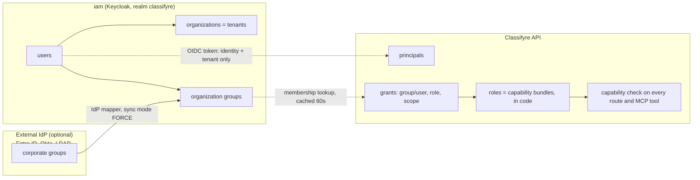
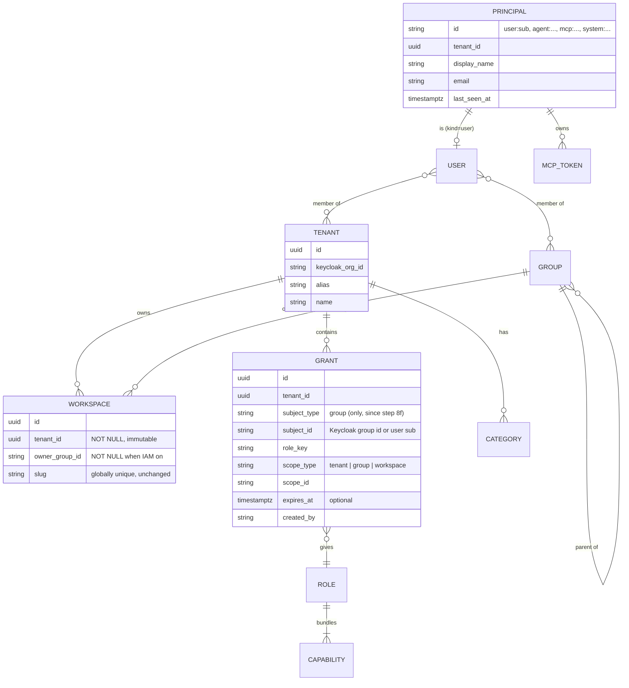
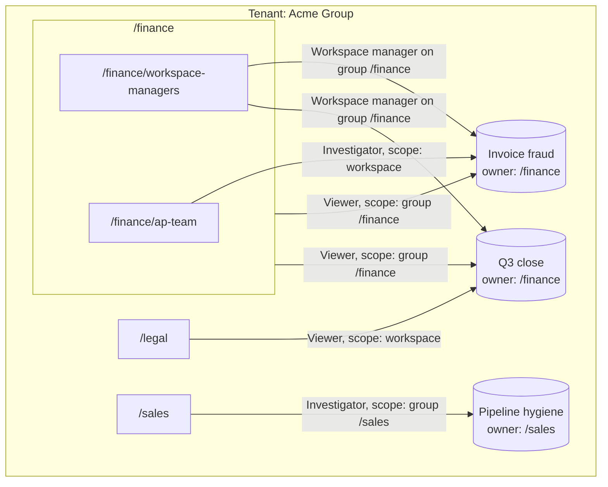
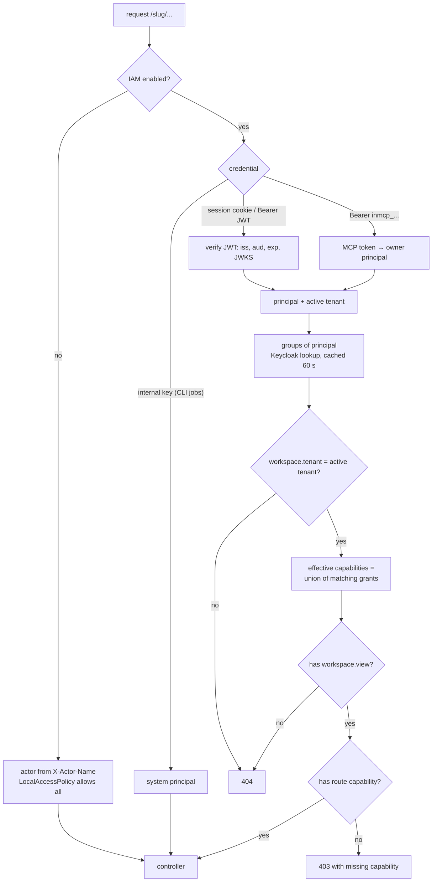
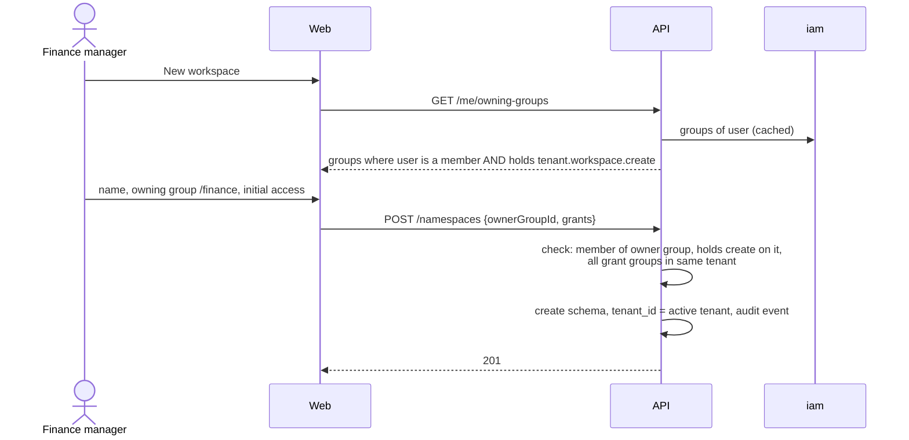
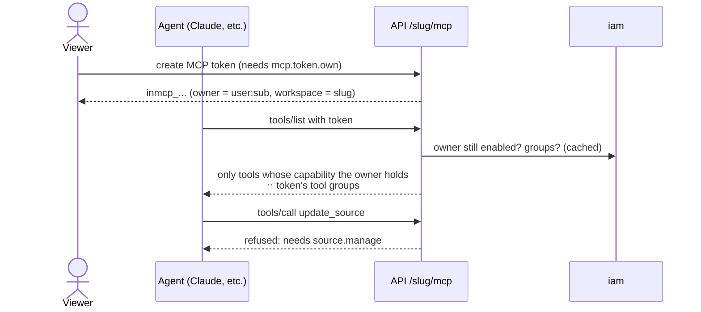
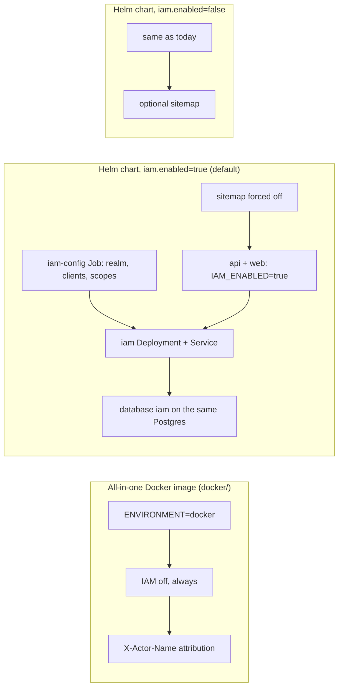
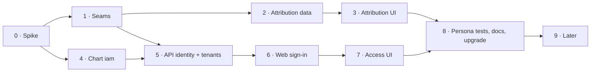

# PRD IAM · Identity and access management

|                       |                                                                                                                                      |
| --------------------- | ------------------------------------------------------------------------------------------------------------------------------------ |
| **Status**            | Steps 0–8 done 2026-11-04; three reviews, all blockers fixed 2026-11-05 (§13, Review and Hardening); release is the maintainers' call |
| **Size**              | L (9 steps, each its own PR)                                                                                                         |
| **Depends on**        | [S1 · Enterprise extension seams](S1-enterprise-extension-seams.md) (step 1 builds S1 R1–R8 and R15)                                 |
| **Identity provider** | Keycloak 26.8.1 (`quay.io/keycloak/keycloak:26.8.1`, released 2026-10-13), Helm chart only                                           |
| **Not in scope**      | the all-in-one Docker image, per-record rules (for example "this case is visible to its team only"), Keycloak Authorization Services |

## 1. Summary

Add sign-in, tenants and role-based access to Classifyre. IAM is **optional**. With IAM off, everything works as it does today. Only the Helm chart can turn it on, and there it is **on by default**.

The split of responsibilities:

- **Keycloak** answers _who is this?_ It holds users, the tenant they belong to (a Keycloak _Organization_), and their groups (business units and teams). It never decides what someone may do in Classifyre.
- **Classifyre** answers _what may they do here?_ It holds **grants**. A grant gives a group (or a single user) a **role** on a **scope**: one workspace, all workspaces owned by a group, or the whole tenant. A role is a fixed bundle of **capabilities** defined in code (`source.manage`, `case.edit`, …).

Capabilities only add up. There are no deny rules, conditions or policies. "Can this person do X in workspace W?" is always answered by a union of grants that can be listed and explained in the UI.

## 2. Hard rules

These come from the request. Each one has a check that fails CI or fails the deployment.

| #   | Rule                                                                                   | How it is enforced                                                                                                                                                                                                                                                                                                         |
| --- | -------------------------------------------------------------------------------------- | -------------------------------------------------------------------------------------------------------------------------------------------------------------------------------------------------------------------------------------------------------------------------------------------------------------------------- |
| H1  | Everything keeps working without IAM                                                   | `IAM_ENABLED` is unset by default. The default `LocalAccessPolicy` allows everything and the actor comes from `X-Actor-Name`, as today. The whole API e2e suite runs in both modes                                                                                                                                         |
| H2  | The all-in-one Docker image never uses IAM                                             | Nothing under `docker/` changes. The API refuses to boot when `ENVIRONMENT=docker` and `IAM_ENABLED=true`, and a spec covers this. No Keycloak artefact goes into any image built by the root `Dockerfile`                                                                                                                 |
| H3  | Keycloak runs from the chart only, optional, on by default, kept current by Dependabot | `iam.enabled: true` in `helm/classifyre/values.yaml`. The image tag is tracked by Dependabot (step 4, §9.3)                                                                                                                                                                                                                |
| H4  | With IAM on, there is no SEO and no sitemap                                            | `templates/validate-values.yaml` fails the install when `iam.enabled` and `frontend.sitemap.enabled` are both true. The web app and the API also ignore `SITEMAP_ENABLED` when `IAM_ENABLED=true`: `robots.txt` serves `Disallow: /`, sitemap routes 404, every page is `noindex`                                          |
| H5  | The chart says `iam`, never `keycloak`                                                 | Values key `iam`, templates `iam-*.yaml`, resources `<fullname>-iam`, env vars `IAM_*`. The only place the word appears is the image repository. A `helm template` test greps the rendered manifests for `keycloak` outside image references and the variable names the images themselves require (`KC_*`, `KEYCLOAK_URL`) |
| H6  | The UI shows who changed what                                                          | Every authored entity records `createdBy` / `updatedBy` as an actor reference, and every workspace has an audit trail (§10, §11). This also works without IAM, with self-declared names                                                                                                                                    |
| H7  | The backend respects the tenant                                                        | A workspace belongs to exactly one tenant, and every request is checked against it in the namespace hook before any controller runs. A workspace in another tenant answers **404**, not 403, so its existence does not leak                                                                                                |

## 3. Vocabulary

| Term                | Meaning                                                                                                                                                                                                                | Lives in                                                |
| ------------------- | ---------------------------------------------------------------------------------------------------------------------------------------------------------------------------------------------------------------------- | ------------------------------------------------------- |
| **Tenant**          | A company, or a department that runs as its own company. Owns workspaces, groups and grants                                                                                                                            | Keycloak Organization + `public.iam_tenants`            |
| **Workspace**       | Today's namespace (`public.namespaces`, schema `ns_<slug>`). Belongs to exactly one tenant and is owned by exactly one group                                                                                           | Classifyre                                              |
| **Group**           | People. A business unit (`/finance`), a team (`/finance/ap-team`) or an access group made only to receive a grant (`/finance/workspace-managers`). Hierarchical: being in a child group counts as being in its parents | Keycloak (organization groups)                          |
| **Capability**      | One thing the API allows, for example `source.manage`. Every REST route and every MCP tool declares exactly one                                                                                                        | Code (`identity/capabilities.ts`)                       |
| **Role**            | A named bundle of capabilities, for example _Investigator_. Built in, versioned with the code                                                                                                                          | Code (`identity/roles.ts`); custom roles later (step 9) |
| **Grant**           | _subject_ (group or user) gets _role_ on _scope_ (tenant, group-owned workspaces, or one workspace)                                                                                                                    | `public.iam_grants`                                     |
| **Principal**       | Anything that acts: a person, an agent, an MCP token, the system                                                                                                                                                       | `public.iam_principals`                                 |
| **Actor reference** | How an action is attributed in the data, for example `user:9f2c…` or `user:9f2c…@mcp:41ab…`                                                                                                                            | Text columns in each workspace schema                   |

### 3.1 "A group is a business unit, but also a set of permissions"

Both readings are useful, so the model keeps them apart instead of mixing them:

- A **group never carries permissions by itself**. It only says who belongs together.
- A **role never names a team**. It only says what can be done.
- A **grant** joins the two, on a scope.

So "finance can see these workspaces" is a grant to `/finance`. "These five people manage finance workspaces" is a grant to an _access group_ `/finance/workspace-managers`. To Keycloak, both are ordinary groups. Classifyre only sees a group that holds a grant. Tenant admins can model either way without new concepts, and the "why can I do this?" view (§12.4) always names the group and the role.

## 4. Who decides what



Why grants are not Keycloak roles: a role per workspace (`ws-finance-q3:viewer`) means one role per workspace per role, which is the "role explosion" the Keycloak guidance warns against. It also puts workspace data in a system that knows nothing about workspaces. Keycloak keeps the stable, coarse facts (who, which tenant, which groups). Classifyre keeps the fast-changing, workspace-specific facts.

## 5. Data model



Notes:

- `public.iam_tenants`, `public.iam_grants` and `public.iam_principals` sit next to `public.namespaces` and are migrated the same way, by idempotent DDL in the registry (`registry/namespace-registry.sql.ts`). They are not in the per-workspace `schema.prisma`.
- `public.namespaces` gains `tenant_id` (NOT NULL, pointing to a `local` tenant row when IAM is off) and `owner_group_id` (NULL only when IAM is off).
- `public.namespace_categories` gains `tenant_id`. Today categories are shared by every workspace on the instance. With tenants they must not be.
- Grants hold Keycloak **group ids**, not paths, so renaming or moving a group in Keycloak does not break access.
- `scope_type = group` means "every workspace owned by this group or by one of its child groups". That covers "finance's steward curates all finance workspaces" without a grant per workspace.
- Slugs stay globally unique, so URLs (`/<slug>/…`) do not change. The cost is that a tenant can learn that a slug is taken. Accepted for now; listed in §15.

## 6. Capabilities and roles

### 6.1 Capabilities

Every REST route declares one with `@Requires('<capability>')`. Every MCP tool declares one in `mcp-catalog.ts`. A completeness spec, in the style of `mcp-catalog.completeness.spec.ts`, fails when a route or tool has none. The existing MCP capability groups (`sources`, `cases`, `glossary`, …) stay as they are: they narrow what a token may use, and they are not permissions.

| Area                | Capabilities                                                                                                                      |
| ------------------- | --------------------------------------------------------------------------------------------------------------------------------- |
| Workspace           | `workspace.view`, `workspace.settings`, `workspace.pause`, `workspace.delete`, `workspace.transfer` (export/import/copy)          |
| Access              | `access.view`, `access.manage` (grants on this workspace)                                                                         |
| Sources and scans   | `source.view`, `source.manage`, `source.run`, `source.purge`                                                                      |
| Findings and assets | `finding.view`, `finding.triage` (status, severity, bulk), `asset.view`, `asset.tag`                                              |
| Detectors           | `detector.view`, `detector.manage`, `detector.train`                                                                              |
| Code                | `code.author` (custom source code, Python detectors, notebooks that run code). Kept apart because it runs code inside the cluster |
| Investigations      | `case.view`, `case.edit`, `case.manage` (close, delete, cleanup), `inquiry.view`, `inquiry.edit`, `lead.review`                   |
| Meaning             | `glossary.view`, `glossary.edit`, `glossary.approve`, `entity.view`, `entity.manage`, `correlation.review`                        |
| Agents              | `agent.view`, `agent.configure` (harness, autopilot, AI providers, chat bots), `agent.use` (assistant, AI completion)             |
| Data out            | `data.export` (CSV, case export, live queries)                                                                                    |
| Tokens              | `mcp.token.own` (create and revoke your own), `mcp.token.admin` (see and revoke everyone's in the workspace)                      |
| Tenant              | `tenant.workspace.create` (scoped to an owning group), `tenant.access.manage`, `tenant.categories.manage`, `tenant.audit.view` |
| Platform            | `platform.tenants.manage`                                                                                                         |

### 6.2 Built-in roles

| Role                     | Scope              | Adds to the role on its left                                                                                                                   |
| ------------------------ | ------------------ | ---------------------------------------------------------------------------------------------------------------------------------------------- |
| **Viewer**               | workspace or group | every `*.view`, `mcp.token.own`                                                                                                                |
| **Investigator**         | workspace or group | Viewer + `agent.use` (assistant and completion), `finding.triage`, `case.edit`, `inquiry.edit`, `lead.review`, `asset.tag`                      |
| **Curator**              | workspace or group | Viewer + `agent.use` (assistant and completion), `glossary.edit`, `glossary.approve`, `entity.manage`, `correlation.review`                     |
| **Source manager**       | workspace or group | Not built on Viewer: `workspace.view`, `source.*`, `detector.*`, `finding.view`, `asset.view`, `mcp.token.own`. No case or inquiry access (U3) |
| **Workspace admin**      | workspace or group | everything workspace-scoped except `code.author`                                                                                               |
| **Code author** (add-on) | workspace or group | `code.author` only. Combined with another role                                                                                                 |
| **Workspace manager**    | tenant             | `tenant.workspace.create` for that group, and Workspace admin on every workspace the group owns. Tenant scope only: an access group (`/finance/workspace-managers`), never one workspace |
| **Auditor**              | tenant             | `tenant.audit.view`, `access.view` and `workspace.view` (metadata only, no findings content; redaction by S1's content presenter is step 9)    |
| **Tenant admin**         | tenant             | everything in the tenant, including `code.author`                                                                                              |
| **Platform operator**    | instance           | `platform.tenants.manage`. Sees no workspace content unless also granted. The one Keycloak realm role (`classifyre-operator`)                  |

Investigator and Curator are side by side, not stacked: a person who needs both gets two grants.

### 6.3 How to add a feature later

1. Add the capability to `identity/capabilities.ts`.
2. Add it to the built-in roles in `identity/roles.ts` (at least Workspace admin; a spec checks this).
3. Put `@Requires(...)` on the routes and set the capability on the MCP tools.

No migration and no Keycloak change. When custom roles exist (step 9), tenant admins can add the new capability to their own bundles.

## 7. Business use cases

These become persona e2e tests in step 8. Each persona is a seeded user in the dev realm.

An example tenant, as the business sees it:



Sales never sees the finance workspaces and finance never sees _Pipeline hygiene_. Legal sees only _Q3 close_. Only the members of `/finance/workspace-managers` can create workspaces, and only workspaces owned by `/finance`.

| #   | Who                                                   | Needs                                                                                                  | Modelled as                                                                                                                                                                            |
| --- | ----------------------------------------------------- | ------------------------------------------------------------------------------------------------------ | -------------------------------------------------------------------------------------------------------------------------------------------------------------------------------------- |
| U1  | Finance controller                                    | Sees finance workspaces, changes nothing, creates a personal MCP token so an agent reads the same data | Viewer on `group:/finance`. The token can never do more than its owner: its tools are cut to read-only (§8.2)                                                                          |
| U2  | Fraud investigator                                    | Works cases and triages findings, cannot change sources or detectors                                   | Investigator on the workspace                                                                                                                                                          |
| U3  | Data engineer                                         | Connects sources, runs scans, tunes detectors, never sees case notes                                   | Source manager, which deliberately leaves out `case.view` and `inquiry.view`                                                                                                           |
| U4  | Finance and sales in one tenant                       | Each sees only its own workspaces                                                                      | Grants on `group:/finance` and `group:/sales`. No grant, no visibility: the workspace directory does not list it and its URL answers 404                                               |
| U5  | Finance workspace manager                             | Creates workspaces, but only for finance                                                               | Workspace manager on `group:/finance`, given to the access group `/finance/workspace-managers`. Creating a workspace requires the owning group to be one the user belongs to (§8.1)    |
| U6  | Legal needs a read-only look at one finance workspace | Shared without moving it                                                                               | A Workspace admin adds Viewer for `/legal` on that workspace. Only groups of the same tenant can be picked                                                                             |
| U7  | Glossary steward                                      | Approves terms in all finance workspaces                                                               | Curator on `group:/finance`                                                                                                                                                            |
| U8  | Detector developer                                    | Writes Python detectors in one workspace                                                               | Source manager + Code author on that workspace                                                                                                                                         |
| U9  | External auditor                                      | Reads the audit trail of the whole tenant, never sees matched content                                  | Auditor on the tenant                                                                                                                                                                  |
| U10 | Contractor for six weeks                              | Investigates one workspace, then loses access automatically                                            | A user grant (Investigator) with `expires_at`                                                                                                                                          |
| U11 | Mover: finance to sales                               | Loses finance access and gains sales access without anyone touching Classifyre                         | Group change in Keycloak or the IdP. Takes effect within the membership cache TTL, MCP tokens included                                                                                 |
| U12 | Leaver                                                | Everything stops                                                                                       | User disabled in Keycloak: the session ends when the access token expires (5 minutes), MCP tokens fail at the next membership lookup                                                   |
| U13 | Autopilot / harness agent                             | Works a workspace autonomously, within limits                                                          | A per-workspace agent principal (`agent:<workspace>:autopilot`) holding a role chosen in harness settings (default Investigator). The existing `OBSERVE_ONLY` modes still apply on top |
| U14 | Tenant admin                                          | Manages grants, categories and workspaces of the tenant                                                | Tenant admin on the tenant                                                                                                                                                             |
| U15 | Platform operator                                     | Creates tenants for new customers, no content access                                                   | Platform operator                                                                                                                                                                      |
| U16 | Analyst exports a CSV                                 | Data leaves the instance                                                                               | `data.export`. Not in Viewer or Investigator by default: a separate grant, or part of Workspace admin                                                                                  |

## 8. Key flows

### 8.1 Every request



The namespace hook (`namespace/namespace-request.hook.ts`) already resolves the workspace before any controller runs. It now also resolves the principal and the effective capabilities and stores them in CLS next to `CLS_NAMESPACE_ID`. The global guard then only compares the route's `@Requires` with what CLS holds. One database round trip per request at most; grants for a principal are cached for the life of the membership cache entry.

### 8.2 Creating a workspace



The rule "can only create a workspace for a group they belong to" is an invariant in code, not a grant. Even a mistaken grant cannot let someone create a workspace for a group they are not in. Tenant admins are the exception: they can pick any group in the tenant.

### 8.3 MCP tokens and agents



- `McpAccessToken` gains `owner_sub`. With IAM on, a token without an owner is refused (`MCP_TOKEN_WITHOUT_OWNER`).
- Effective rights are computed on **every call** from the owner's current grants. They are never copied into the token. So a viewer's agent is read-only, a mover's agent follows the move, a leaver's agent stops.
- `tools/list` hides tools the owner cannot use, so agents do not plan with tools they will be refused.
- Attribution reads "Anna Berg via _claude-desktop_" (actor reference `user:<sub>@mcp:<tokenId>`).
- Later (step 9): MCP clients can sign in with OAuth against the `iam` realm instead of pasting a token.

## 9. Deployment

### 9.1 Modes



### 9.2 Chart values (sketch)

```yaml
iam:
  # -- Sign-in and access management. Turning it off restores open access (every visitor can do everything).
  enabled: true
  image:
    repository: quay.io/keycloak/keycloak
    tag: "26.8.1"
  replicas: 1 # 2+ in production: distributed cache over a headless service
  path: /iam # served through the web app on ingress.host, so no extra DNS name or certificate
  exposeAdminConsole: false # /iam/admin and /iam/realms/master are blocked at the web proxy unless true
  realm: classifyre
  tokenLifespan: 5m
  database:
    mode: shared # shared = new database "iam" on postgres.mode's server; external = below
    external: { host: "", port: 5432, database: iam, existingSecret: "" }
  bootstrap:
    tenant: { alias: default, name: Default }
    adminEmail: "" # first tenant admin; gets a set-password action, nothing else
  config:
    image:
      repository: adorsys/keycloak-config-cli
      tag: "" # pinned to the 26.x line, tracked like the server image
  smtp: {} # password reset and invite mails
  identityProviders: [] # OIDC/SAML brokers, mapper sync mode FORCE
```

New templates: `iam-deployment.yaml`, `iam-service.yaml`, `iam-headless-service.yaml`, `iam-secrets.yaml`, `iam-database.yaml`, `iam-config-job.yaml`, plus rules in `networkpolicy.yaml`. The identity server has no ingress of its own: the web app proxies it (route `/iam/[...path]`), the same way it proxies `/api`, so external systems keep one public entrance. `deployment-api.yaml` and `deployment-web.yaml` get `IAM_ENABLED`, `IAM_ISSUER_URL` (public, used to check `iss`), `IAM_INTERNAL_URL` (in-cluster, used for JWKS and admin lookups), `IAM_SERVICE_URL` (in-cluster, used by the web proxy), `IAM_REALM` and client secrets.

Decisions:

- **Own templates, not a sub-chart.** Keycloak is one container. The Bitnami chart's images are no longer freely published, the community `keycloakx` chart lags upstream, and the operator needs cluster-wide CRDs that a workload chart should not install. Our own `Deployment` keeps names under `iam` (H5).
- **Separate database, same server.** Keycloak gets its own database `iam` with its own user, never the `classifyre` database, whose `public` schema holds the registry. For `cnpg` it is a `Database` resource on the existing cluster; for `embedded` an init step; for `external` the operator supplies it.
- **Same host, path `/iam`.** `iam` is added to `RESERVED_PREFIXES` and `RESERVED_WEB_PREFIXES` in `namespace/namespace.constants.ts`, so no workspace can be called `iam`. The ingress sends `/iam` to the web service, whose `/iam/[...path]` route forwards to the ClusterIP identity server; nothing about Keycloak is reachable on its own port from outside.
- **Upgrades use `strategy: Recreate`.** Keycloak minor upgrades need all nodes stopped. Sign-in is down for about a minute; issued tokens keep working because the API checks them against cached keys, and membership lookups fall back to the last answer for up to 15 minutes. Back up the `iam` database before minor upgrades (documented in `NOTES.txt` and the chart README).
- **Structure as code, membership by people.** The `iam-config` hook Job applies the realm structure (clients, client scopes, mappers, flows, the `classifyre-operator` role) on every install and upgrade. Groups, users and organization membership are left to tenant admins and IdPs: the job never deletes what it does not own, which avoids the known `managed.group=full` deletion trap.
- **Realm settings from the Keycloak guidance:** clients `classifyre-web` (confidential, used by the web server, authorization code + PKCE) and `classifyre-api` (audience; service account allowed to read users and groups only). _Full Scope Allowed_ off on every client. Implicit and password grants off. Access tokens 5 minutes. Brute-force detection on. Admin events with representation on. The master realm is never used by the application.

### 9.3 Keeping Keycloak current

No new Dependabot entry is needed. The existing `helm` entry for `/helm/classifyre` already reads image references in `values.yaml`: Dependabot's Helm parser (`helm/lib/dependabot/helm/file_parser.rb`, `parse_values_yaml_files`) picks up every hash that has a `repository` and a **string** `tag`. So `iam.image` is tracked as long as its tag is a quoted string, never empty or templated. (The setup job runs `kcadm.sh` from the same image, so there is no second image to track.)

Majors (27.x) are ignored in `dependabot.yml` and upgraded on purpose, like Node and Python today. Step 4 adds that `ignore` rule for `quay.io/keycloak/keycloak`.

## 10. Backend work

All in `apps/api/src/identity/` unless noted.

1. **Actor context and access seam (S1 R1–R8).** `ActorContextService`, `ACCESS_POLICY` with `LocalAccessPolicy`, `@Requires()` on every route, a capability on every MCP tool, completeness specs. The 11 `@ActorName()` call sites move to `@CurrentActor()` and the decorator is deleted (no adapter kept).
2. **Mode switch.** `IAM_ENABLED` selects `LocalAccessPolicy` or `IamAccessPolicy` at boot. Boot fails on `ENVIRONMENT=docker` with IAM on, and fails when IAM is on but the issuer is unreachable at startup after retries.
3. **Credential verification.** JWT checked with Node's `crypto` (no extra dependency; RS/PS/ES algorithms, the key's published `alg` must match) against the realm's JWKS (`IAM_INTERNAL_URL`), `iss` = `IAM_ISSUER_URL`, `aud` = `classifyre-api`. Accepted from `Authorization: Bearer` (scripts) or the `cf_session` cookie (browser, §12.1). Cookie-authenticated unsafe methods require a matching `Origin`, checked in the namespace hook for workspace routes and in `AccessGuard` for every other route.
4. **Membership lookup.** `MembershipService` asks Keycloak (service account `classifyre-api`, realm-management roles `view-users` and `view-organizations` only) for the user's enabled state (`GET /users/{id}`), their organizations (`GET /organizations/members/{id}/organizations`) and their groups in the active one (`GET /organizations/{org}/members/{id}/groups`). That last call returns direct memberships only, each with its `parentId`, so ancestors come from the organization's group tree (`GET /organizations/{org}/groups`, cached per organization). Results are cached 60 seconds per principal. Tokens carry identity and tenant only, so they stay small and group renames do not matter.
5. **Tenant model.** `public.iam_tenants`, `iam_grants`, `iam_principals`; `tenant_id` and `owner_group_id` on `public.namespaces`; `tenant_id` on categories. The `local` tenant row exists in both modes, so code never branches on "is there a tenant".
6. **Namespace hook.** Resolves principal, checks tenant (404), computes capabilities, requires `workspace.view` (404). `NamespacePausedGuard` and `DemoModeGuard` stay separate and unchanged.
7. **Registry routes** (`/namespaces`, outside any workspace): list only visible workspaces of the active tenant; create enforces §8.2; update/delete need the workspace's own capabilities; thumbnails and categories are tenant-scoped.
8. **WebSockets.** `runner-events`, `notification-events` and `case-board` gateways verify the cookie or token in the handshake and require `workspace.view` for the `namespaceSlug` they join. Case-board writes require `case.edit`.
9. **MCP.** Owner on tokens; per-call capability check in `mcp-tool-executor.service.ts`; filtered `tools/list` (§8.3).
10. **Non-HTTP actors.** CLI jobs keep the internal key and act as `system:runner`, while the run keeps `triggeredBy` of whoever started it. pg-boss jobs and the scheduler run under `runAsActor(system:scheduler, …)`. Autopilot runs as its workspace agent principal (U13). Chat bots act as their own principal, with a role picked when the bot is configured.
11. **Grants API.** CRUD on grants for workspace admins (scope = their workspace) and tenant admins (any scope in the tenant), group search proxied to Keycloak, `GET /me` with the active tenant, groups and per-workspace capabilities, `GET /<ws>/access/explain?capability=` returning the grants that give it.
12. **Sitemap.** `sitemap/` endpoints answer 404 when IAM is on.

## 11. Attribution: who changed what

### 11.1 Data

- **Actor reference**, one text format everywhere (`identity/actor-ref.ts`): `user:<sub>`, `mcp:<tokenId>`, `agent:<kind>` (the autopilot is `agent:autopilot`), `system:<job>`. A delegated action appends the channel: `user:<sub>@mcp:<tokenId>`. Anything else is a **self-declared name**, stored as typed: that is how identity works with IAM off, so it is not a legacy form to migrate. A typed name that would parse as a reference is refused. Existing free-text columns (`createdBy`, `addedBy`, `decidedBy`, `reviewedBy`, `triggeredBy`, `verifiedBy`, `actor`, `author`) hold this format.
- **Last changed by comes from the audit trail.** Instead of adding `updated_by` columns to 17 models (and touching every service's update path), "created by / last changed by" for an entity is the oldest and newest audit event for it. Existing author columns stay: product timelines and queries (agent vs. person work) use them.
- **Audit trail.** An append-only `audit_events` table in every workspace schema: actor, how they were identified, channel (`rest` / `mcp`), the capability used, the operation (`PATCH /sources/:id` or the tool name), entity type and id, the top-level field names sent (never values, so never secrets or matched content), HTTP status. REST changes are recorded by one global interceptor, MCP changes by wrapping each change tool's handler: no feature code writes it. Tenant-level events (grants, workspace create/delete) go to `public.iam_audit_events` in step 5. The existing `CaseActivity`, `InquiryActivity` and `GlossaryActivity` stay: they are product timelines, not the audit trail.
- **Display names.** `GET /<ws>/actors/resolve?refs=…&refs=…` returns kind and display name: a self-declared name is itself, an MCP token its name (also once deleted), `agent:autopilot` "Autopilot". People (`user:`) resolve from `public.iam_principals`, which arrives with sign-in in step 5 and is refreshed on each sign-in, so names of people who left still resolve.

### 11.2 UI: where it shows

One component set in `@workspace/ui`, built from today's `ai-actor-badge.tsx`:

- `<ActorChip ref>`: initials or kind icon (person, agent, token, system), name, hover card with email, group and channel ("via token _claude-desktop_").
- `<ChangedBy created updated>`: "Created by A · 3 Nov · Last changed by B · 2 h ago", under page titles.
- `<HistoryDrawer entity>`: the audit events of one entity, newest first, with field names.

| Page                                           | What it shows                                                                                                                                                                 |
| ---------------------------------------------- | ----------------------------------------------------------------------------------------------------------------------------------------------------------------------------- |
| Workspace directory (`namespaces`)             | Owning group and `ChangedBy` on each card; filter "owned by my groups"                                                                                                        |
| Workspace settings                             | New **Access** tab (grants, §12.4) and **Activity** tab (workspace audit trail, filter by person, capability, entity)                                                         |
| Sources list and detail                        | "Last changed by" column; `ChangedBy` + `HistoryDrawer` on detail; config edits listed by changed field, secrets never shown                                                  |
| Scans and runs                                 | "Triggered by": person, schedule, agent or token                                                                                                                              |
| Findings list, detail, bulk operations         | Who changed status or severity and when; bulk operations show their author and size                                                                                           |
| Assets                                         | Who tagged, linked or set a term, including augmenting notebooks                                                                                                              |
| Detectors and fingerprints                     | Created, updated, trained by; test scenarios' authors; feedback author; duplicate decisions (`decidedBy`, already stored)                                                     |
| Glossary                                       | Term created, updated, approved by; proposals decided by; bindings approved or disabled by                                                                                    |
| Investigations: cases, inquiries               | Case `ChangedBy`; events, threads, evidence, leads (proposed and reviewed by), hypothesis rules, finding filters each with their `ActorChip` (data exists, names become real) |
| Case board                                     | Item and link authors, snapshot author, presence avatars with real names instead of self-declared ones                                                                        |
| Harness                                        | Config, goals and memory "set by"; undo entries "reverted by"; agent runs labelled with the agent principal                                                                   |
| Notebooks                                      | Executions "run by"                                                                                                                                                           |
| Explore                                        | Saved views "created by"                                                                                                                                                      |
| Settings: MCP tokens                           | Owner column, last used, "acting as"; admins see every token in the workspace and can revoke                                                                                  |
| Settings: AI providers, MCP servers, chat bots | `ChangedBy` on each                                                                                                                                                           |
| Notifications                                  | Who caused the event                                                                                                                                                          |
| Data transfer                                  | Who exported, imported or copied, and when                                                                                                                                    |

Without IAM the same components show the self-declared name with a small "unverified" mark, so H1 and H6 hold together.

## 12. Web work

### 12.1 Sign-in

- The Next.js server (`apps/web`, standalone output) is the OIDC client. `proxy.ts` handles `/auth/login`, `/auth/callback`, `/auth/logout` with authorization code + PKCE against `/iam/realms/classifyre`.
- It sets the access token as an `HttpOnly`, `Secure`, `SameSite=Lax` cookie `cf_session` on the host, and keeps the refresh token in an encrypted `HttpOnly` cookie. It refreshes before expiry.
- Tokens never reach JavaScript. Images (workspace thumbnails), downloads and Socket.IO send the cookie on their own, and the ingress layout (`/api` straight to the API) does not change. Scripts and MCP keep using `Authorization: Bearer`.
- `IAM_ENABLED=false`: no `/auth/*` routes, no cookie, the actor-name prompt stays as today.

### 12.2 Tenant switcher

A user in several organizations picks one at sign-in (the `organization` scope) and can switch from the account menu (`GET /tenant/tenants` lists their tenants; each entry signs in again for that organization). Opening a link to a workspace of another tenant answers 404 (H7: the tenant boundary never leaks); the workspace directory and the account menu are where a person sees and switches between the tenants they belong to.

### 12.3 Capabilities in the UI

`GET /me` feeds a `useAccess()` hook and a `<Can capability="source.manage">` wrapper (S1 R15). Controls a user cannot use are hidden, or disabled with a tooltip naming the missing capability where hiding would confuse (for example a greyed "Edit source" on a page a Viewer is allowed to see). The server stays the authority.

_As built (step 7):_ `useCan`/`Can` gate the access screens, the tenant page and the owning-group picker. Elsewhere controls stay visible and the server answers `403 CAPABILITY_REQUIRED` with a message naming the capability, which the UI shows as the error. Hiding controls across every page is left for step 9.

### 12.4 Access management

- **Workspace → Settings → Access:** grants on this workspace, and the inherited ones (from group scope and tenant) shown read-only with their source. Add a grant: pick a group of the tenant (search via the API), pick a role, optional expiry.
- **Tenant admin area** (`/<locale>/tenant`): tenant-scoped grants, workspace managers per group, categories, tenant audit trail. Groups and members are read-only here, with a link to the group in the identity provider when `iam.exposeAdminConsole` is on. Membership is managed in Keycloak or the corporate IdP, not in Classifyre.
- **"Why can I do this?"**: next to any capability in the Access tab and in the 403 page, lists the grants (group → role → scope) that give or would give it.
- **New workspace:** owning group picker limited to §8.2's groups; initial grants prefilled with "owning group: Viewer".

### 12.5 SEO off

With `IAM_ENABLED=true`: `lib/seo-metadata.ts` returns `NO_INDEX` for every page, `app/robots.txt` returns `Disallow: /`, `app/sitemap*` routes 404, and `generateMetadata` layouts use generic titles instead of fetching entity names on the server.

## 13. Steps

Each step is one PR to `develop`, with its tests and a `changelog.d` fragment (see the release-notes skill). Steps 1–3 change nothing for users of the Docker image except better attribution.



### Step 0 · Spike (1–2 days, throwaway)

- Run Keycloak 26.8.1 in the k3d dev stack by hand. Confirm: organization groups are hierarchical and readable through the Admin API by a service account limited to view rights; the `organization` scope selects the tenant at sign-in; a user in two organizations works.
- Fallback if organization groups fall short: realm groups under `/tenants/<alias>/…`, with the tenant taken from the top-level group. The rest of this plan does not change.
- Measure the token with the planned mappers (target under 2 KB, so it fits a cookie).
- Confirm Dependabot picks up image tags in `helm/classifyre/values.yaml` (§9.3).
- **Done:** a short note appended to this PRD with the answers.

**Result, 2026-11-04** (Keycloak 26.8.1 in a throwaway namespace of the k3d dev cluster, realm with `organizationsEnabled`):

| Question                                       | Answer                                                                                                                                                                                                                                                                                                                                              |
| ---------------------------------------------- | --------------------------------------------------------------------------------------------------------------------------------------------------------------------------------------------------------------------------------------------------------------------------------------------------------------------------------------------------- |
| Organization groups hierarchical?              | Yes. `POST /organizations/{org}/groups` and `…/groups/{id}/children`; paths are relative to the organization (`/finance/workspace-managers`). Two organizations can each have `/finance`                                                                                                                                                            |
| Kept apart from realm groups?                  | Yes, fully. They do not appear in `GET /groups` or `GET /users/{id}/groups`, and the realm API refuses them ("Cannot access organization related group via non Organization API"). Membership is set with `PUT /organizations/{org}/groups/{gid}/members/{uid}`                                                                                     |
| Readable by a least-privilege service account? | Yes, with `view-users` + `view-organizations`. Without `view-organizations` every organization call is 403. Writes are 403 with these roles                                                                                                                                                                                                         |
| Membership read                                | `GET /organizations/{org}/members/{uid}/groups` returns **direct** groups with `parentId`; ancestors must be resolved from the group tree                                                                                                                                                                                                           |
| Tenant at sign-in                              | Scope `organization:<alias>` puts `"organization": ["<alias>"]` in the token. A user who is not a member gets no claim, so a missing claim must be a refusal. Scope `organization` alone: single-org users get their organization; a user in two organizations sees Keycloak's own picker ("Select an organization to proceed") in the browser flow |
| Sign-in shape                                  | With organizations on, the login is identity-first: username, then (picker), then password                                                                                                                                                                                                                                                          |
| Token size                                     | 1.0–1.1 KB with _Full Scope Allowed_ off and the organization claim, so it fits a cookie. No `aud` by default: the `classifyre` client scope needs an audience mapper for `classifyre-api`                                                                                                                                                          |
| Dependabot                                     | Covered by the existing `helm` entry (§9.3)                                                                                                                                                                                                                                                                                                         |

No fallback to realm groups is needed.

### Step 1 · Seams, behaviour unchanged

- S1 R1–R8 and R15: `identity/` module, `ActorContextService`, `ACCESS_POLICY` + `LocalAccessPolicy`, capability catalogue, built-in roles, `@Requires` on every route, a capability on every MCP tool, `GET /<ws>/me`.
- Remove `@ActorName()` after moving its 11 call sites.
- **Tests:** completeness specs for routes and tools; a deny-all policy makes every route 403 and every tool refuse; every capability is in Workspace admin.
- **Done:** e2e suite green, no response shape changed.

**As built, 2026-11-04** (`apps/api/src/identity/`):

- **Declaring access.** `@AccessArea({ view, change })` on each of the 49 controller classes gives the default: `view` for GET/HEAD and for POSTs already marked `@AllowInDemoMode()` (searches, charts, previews), `change` for the rest. `@Requires(capability)` on a route overrides it (run, purge, approve, export, close, …). `@InternalOnly()` routes stay with the internal-key guard. Health and sitemap are `@PublicRoute()`. 428 routes resolve; `route-access.completeness.spec.ts` fails on any route without one. `PRINT_ROUTE_ACCESS=<file> npx jest src/identity/route-access.completeness.spec.ts` writes the whole table for review.
- **Guard.** `AccessGuard` is the last `APP_GUARD` (after internal key, demo mode, paused). It resolves the actor, leaves it in CLS and on the request, and asks `ACCESS_POLICY`. A route that declares nothing is refused (`ACCESS_UNDECLARED`), so a forgotten decorator fails closed.
- **Attribution.** `@ActorName()` is gone. Its ~60 call sites use `@ActorRef()`, which returns `actor.ref`: today the self-declared name, as before. Step 2 changes what `ref` holds in one place.
- **MCP.** Each tool's capability comes from its capability group and its `readOnlyHint` (every tool already declares one), with overrides in `mcp-tool-capabilities.ts`. `createServer({ capabilities })` disables tools the caller lacks, the same way token tool groups are enforced. The MCP handler acts as an `integration` actor named after the token.
- **`GET /<ws>/me`** returns the actor, `iamEnabled` and the capability list.
- **Capability catalogue** grew against §6.1: `agent.use` (assistant and AI completion, separate from configuring agents) and `entity.view`.
- **Verified** on the dev stack: `/me`, reads, POST searches and MCP `tools/list` (185 tools) unchanged under `LocalAccessPolicy`.

Left for later steps:

- **Code detectors over REST** need only `detector.manage` today. The detector type is in the request body, so `code.author` for `CODE_DETECTOR` writes is a resource-level check in the service (step 5). Over MCP, the `custom_source_code` group check already exists.
- **WebSockets and background jobs** have no actor yet: gateways in step 5, `runAs` for workers and autopilot in step 2.
- **Meaning panels** (`/semantic/findings/:id/meaning`, asset meaning) need `finding.view` / `asset.view`, but the rest of `/semantic` needs `glossary.view`, which the Source manager role lacks.

### Step 2 · Attribution data

- Actor reference format (§11.1), `audit_events` per workspace, `GET /<ws>/audit-events`, `GET /<ws>/actors/resolve`.
- **Done:** every successful change over REST and MCP is in the audit trail with its actor.

**As built, 2026-11-04** (migration `20261104120000_audit_events_and_actor_refs`):

- **References.** MCP tool calls record `mcp:<tokenId>` instead of the literal `'mcp'` (25 call sites in `mcp-server.factory.ts`, through `toolAuthor()`). Internal-key callers are `system:runner`. The autopilot constant `AI_ACTOR` is now `agent:autopilot` in the API and the web; the migration rewrites `ai-autopilot` in all 44 author columns of every workspace.
- **Audit trail.** `AuditInterceptor` (global) records every REST call that is not a read: method not GET/HEAD, capability not a `.view`, not `@InternalOnly()`, inside a workspace. The entity is the route's static path up to its first parameter plus that parameter (`/cases/:id/evidence/:evidenceId` → `cases` / id); a create takes the id from the response. MCP change tools (`readOnlyHint: false`) are wrapped after registration and file their calls under the same entity names as REST (`update_case` → `cases`). Recording never fails a request; a lost row is logged.
- **Found while verifying:** an MCP create has no id in its arguments, so the wrapper takes it from the tool's JSON result, as REST takes it from the response body. Without that, `create_inquiry` was recorded with no entity.
- **Verified** on the dev stack (`test` workspace, rows removed afterwards): REST create, rename and delete of an explore view recorded as the header name with field names only and the right statuses (201, 200, 204); MCP `create_inquiry` and `delete_inquiry` recorded as `mcp:<token>` under the inquiry's id; `actors/resolve` names the token, and "Deleted MCP token" once it is gone. The migration left no `ai-autopilot` in any of the 31 workspaces.
- **Reading it.** `GET /<ws>/audit-events?entityType=&entityId=&actor=&before=&limit=` (newest first, keyset paging) and `GET /<ws>/actors/resolve?refs=…` (repeated parameter, because names may contain commas). Both need `workspace.view`.
- **Changed from the plan:** no `name:` prefix for self-declared names and no `updated_by` columns (see §11.1). `public.iam_principals` moves to step 5, where sign-in fills it.

Left for later steps:

- **Background work** (autopilot cycles, scheduler, pg-boss jobs) still writes its author columns directly and is not in the audit trail: it changes data through services, not routes or tools. `ActorContextService.runAs` exists; recording service-level changes is a follow-up once domain events (00 · F1) exist.
- **Registry routes** (`/namespaces`, outside a workspace) are not recorded until `public.iam_audit_events` in step 5.
- **Agents can claim an author.** `create_inquiry`, `create_case` and `create_case_thread` accept `createdBy` in their input. With IAM on, input author fields must be ignored in favour of the actor (step 5).
- **Old literal authors** like `'mcp'`, `'operator'` and `'user'` in existing rows stay as they are: they display as plain names.

### Step 3 · Attribution UI

- `ActorChip`, `ChangedBy`, `HistoryDrawer`; every page in §11.2; Settings → Activity tab.
- **Done:** Playwright component tests for the three components; page checks in the dev stack in IAM-off mode.

**As built, 2026-11-04** (`apps/web`):

- **Names.** `hooks/use-actors.ts` resolves references in batches (one `actors/resolve` call per 30 ms burst) and caches them per workspace. Self-declared names, agents and the system need no request; only MCP tokens and people do. `ActorChip` shows an icon per kind (person, token, agent, system; the autopilot keeps its amber sparkle), and its tooltip says a self-declared name is unverified without sign-in. `ActorName` is for sentences that interpolate a name ("Added by {{name}}").
- **Raw strings replaced** in 16 places that printed an author as text: notifications, case leads, case timeline, evidence, case clean-up filters and hypothesis rules, harness brief and undo, glossary activity and bindings, and on the case board comment pins, thread entries, edges, snapshots and case file. Without this an MCP change would have shown `mcp:<uuid>`.
- **`ChangedBy`** ("Created by · Last changed by · History") on the source, inquiry, detector, finding and glossary term pages and in the case file. The history opens in a side sheet. "Created by" comes from the entity where it records one; the last change and the history come from the audit trail.
- **Settings → Activity** lists the whole workspace trail with the entity of each change.
- **Tests:** `tests/components/audit-history.spec.tsx` (Playwright CT): token resolved to its name and never shown raw, self-declared names not sent for resolving, history lists field names only, empty state.

Left open:

- **Not checked in the running app.** The dev server on port 3000 (started outside this work) answers every page with HTTP 500, `routeModule.ensureInstrumentation is not a function`: it runs Next 16.2.10 while the checkout now resolves 16.4.3. Next refuses a second dev server in the same checkout. Check the pages after restarting it.
- **Glossary term history** is keyed by term id. Routes that take a key (`/glossary/:idOrKey/...` called with a key) file their events under the key, so those do not show in the term's history.
- **Places from §11.2 not done yet:** the workspace directory card, scans "triggered by" (it shows trigger kinds such as `pg-boss`, not actors), assets, notebooks, explore views, the MCP token owner column (needs owners, step 5), AI provider and chat bot settings, data transfer jobs.

### Step 4 · Chart: `iam`

- Templates and values of §9.2, database per Postgres mode, `iam-config` Job with realm structure, the web `/iam` proxy with admin paths blocked, network policies, `values.schema.json`, `validate-values.yaml` (H4, and `iam.enabled` requires `ingress.host`), `NOTES.txt`, chart README.
- Dependabot `ignore` rule for Keycloak majors (§9.3). `iam` added to the reserved prefixes.
- Dev stack: `skaffold.yaml` / dev values seed a `dev` tenant with groups `/finance`, `/finance/workspace-managers`, `/sales`, `/legal` and one invented user per persona in §7.
- **Tests:** `helm template` with `iam.enabled` on and off for each Postgres mode; the `keycloak`-name grep (H5); the SEO conflict fails; `docker/` has no diff (H2).
- **Done:** `helm install` on k3d brings up a working sign-in page at `/iam`.

**As built, 2026-11-04** (`helm/classifyre`):

- **Templates:** `iam-secrets.yaml` (admin, database, both client secrets and the first admin's password, generated once and read back on upgrade), `iam-deployment.yaml` (server, service, headless service), `iam-setup-job.yaml` with `files/iam/setup-realm.sh`, a network policy, the managed role and `Database` for CloudNativePG in `cnpg-cluster.yaml`, IAM environment for API, worker and web, and `NOTES.txt` lines with the first admin's password command.
- **Database:** `iam.database.mode: shared` gives the server its own `iam` role and database on the chart's PostgreSQL. On embedded PostgreSQL an init container creates both (it runs as the superuser) and keeps the password in step with the Secret. On CloudNativePG it is a managed role plus a `Database` resource (CNPG 1.25+). With an external PostgreSQL the chart refuses `shared` and asks for `iam.database.external.*`. `iam.database.poolMaxSize` (default 20) caps its connections.
- **Web proxy:** without `iam.exposeAdminConsole` the `/iam/[...path]` route forwards only `/iam/realms/<realm>` and `/iam/resources`, so the admin console and the master realm are not reachable from outside. The ingress sends `/iam` to the web service; the identity server itself stays a ClusterIP service.
- **Validation:** the sitemap together with IAM fails the install (H4). So does IAM without `ingress.host` or explicit `iam.appUrl` (the identity server is always `<appUrl>/iam`, never a separate host), and `shared` on an external PostgreSQL.
- **Naming (H5):** the word appears only in the image reference and in the `kcadm.sh` path inside the setup script, which the image dictates.
- **Dev:** `values-dev.yaml` sets `iam.enabled: false`; `CLASSIFYRE_IAM=true ./scripts/dev/start.sh` activates the `iam` skaffold profile, which adds `values-dev-iam.yaml` (public and app URLs are the local web server at `http://localhost:3000` — the web app is not deployed in-cluster for local dev, so its `/iam` proxy serves the browser — admin console exposed) and a port-forward of the identity server for the web server's token calls. `skaffold diagnose` confirms the effective config with and without it.
- **Public demo:** `values-vps.yaml` and `values-vps-develop.yaml` set `iam.enabled: false`: the demo stays open and keeps its sitemap. Without it, their next deploy would have failed validation.
- **Reserved:** `iam` can no longer be a workspace slug (API and API client).

**Changed from the plan:**

- **No keycloak-config-cli.** Its last release (6.5.1, May 2026) is built for Keycloak 26.5.5, and tracking a second image whose tag encodes the server version is fragile. The setup job runs `kcadm.sh` from the same image as the server instead: always version-matched, one image for Dependabot. Every step ensures rather than imports, and it never deletes.
- **Dev personas are not in the chart.** Seeding persona users is test data and moves to step 8; the chart only creates the first tenant (`default`, group `admins`) and its first admin, who must change the password at first sign-in.

**Found while verifying** (throwaway release `iamcheck` in its own namespace, API and worker at zero replicas, removed afterwards; the shared `classifyre-dev` release was in use by another session and left alone):

1. The server image has no `awk`, which the first setup script used. The lookup is plain bash now.
2. **With _Full Scope Allowed_ off, the API's service account got no roles in its token** and every lookup was 403: the role a service account holds reaches its token only when the client's scope maps it too. The setup job now adds those two scope mappings. Step 0 missed this because its test client kept full scope.
3. A second run of the job created nothing new: it is safe to repeat on every upgrade.

Verified: the init container created the role and database; the server started in about 20 s; the issuer is the public URL; the API's service account reads tenants, users and organization groups (token 1.2 KB) and is refused writes; the first admin is in `/admins` and is made to set a new password at first sign-in; the sign-in page is "Sign in to Classifyre", username first.

**Before a release:** with the chart default `iam.enabled: true`, a release cut after this step but before steps 5–6 would have run a sign-in server that protected nothing yet. Steps 5–6 have since landed.

### Step 5 · API identity and tenants

- §10 items 2–12: mode switch, verification, membership, tenant tables and columns, namespace hook, registry routes, WebSockets, MCP token ownership, non-HTTP actors, grants API, sitemap off.
- Upgrade path for an existing install turning IAM on: all workspaces move to the bootstrap tenant, owned by its `admins` group; existing MCP tokens are revoked (they have no owner) and the release note says so.
- **Tests:** the full e2e suite in both modes; a tenant-isolation spec in the style of `websocket/namespace-isolation.spec.ts` (tenant A's principal gets 404 on every route of a tenant B workspace, REST, MCP and sockets); boot refusal on `ENVIRONMENT=docker`.
- **Done:** curl with tokens of two dev personas shows different workspace lists and different 403s.

Split in two, so each part can be verified on its own: **5a** makes the API enforce sign-in end to end; **5b** adds what manages and extends it.

**5a as built, 2026-11-04** (`apps/api/src/identity/`):

- **Mode switch.** `IAM_ENABLED=true` (from the chart) swaps `LocalAccessPolicy` for `IamAccessPolicy` and provides `IdentityService`; without it nothing below runs. `assertIamAllowed()` refuses to boot with `ENVIRONMENT=docker` (H2).
- **Tokens.** `JwtVerifier` checks signature (JWKS from the in-cluster URL, refetched when a new key id shows up), issuer (public URL), audience `classifyre-api` and expiry with Node's own crypto: no new dependency, and `bun.lock` stays as it is. Accepted as `Authorization: Bearer` or the `cf_session` cookie; MCP tokens (`inmcp_`) are left to the MCP handler.
- **Who and which tenant.** The token's `organization` claim must name exactly one tenant (`CHOOSE_TENANT` otherwise). `MembershipService` then asks the identity server, cached a minute, whether the account is still enabled and still in that organization, and for its groups with ancestors. A disabled account or one moved out of the tenant stops within a minute, not at token expiry.
- **Tenancy tables** (`identity/tenancy.sql.ts`, run at boot after the registry DDL): `public.iam_tenants` (with `local` always present), `public.iam_grants`, and `tenant_id` (NOT NULL, `local` by default) plus `owner_group_id` on `public.namespaces`. Tenants are created on first sign-in from the organization.
- **First tenant.** `IamBootstrapService` retries in the background until the chart's bootstrap organization exists, then creates its tenant, gives its `admins` group Tenant admin, and moves every `local` workspace into it, owned by `admins`.
- **Grant evaluation** (`grant-evaluation.ts`): tenant grants apply everywhere, workspace grants to their workspace, group grants to workspaces owned by that group or any group below it. Roles are the built-in bundles; unknown role keys give nothing.
- **Namespace hook.** With sign-in, every workspace request needs a principal of the workspace's tenant with `workspace.view` there; otherwise 401 (`SIGN_IN_REQUIRED`) or 404, the same 404 as an unknown workspace. Cookie-signed writes must come from the app's origin (`CROSS_ORIGIN`). Capabilities and actor go to CLS for the guard. Scan callbacks (internal key) and `/mcp` pass through.
- **Guard.** With sign-in the actor is the token's person (`user:<sub>`, via `oidc`); `X-Actor-Name` is ignored. In a workspace it checks the route's capability against the hook's set; on registry routes it checks tenant-wide capabilities and leaves per-workspace ones to the controller.
- **Registry.** The list and stats show only visible workspaces. Get, thumbnail, update and delete check the workspace (404 if invisible; pausing also needs `workspace.pause`). Create needs `ownerGroupId`, membership of that group (tenant admins excepted) and `tenant.workspace.create` on it, and files the workspace under the caller's tenant. `GET /namespaces/owning-groups` lists the groups the caller may create for.
- **Also:** `/me` reports `iamEnabled: true`; sitemap routes answer 404; MCP answers 401 `MCP_NEEDS_OWNER` until tokens have owners (5b). The chart passes `IAM_APP_URL` and `IAM_BOOTSTRAP_TENANT` to the API.

**Verified** in a throwaway release (namespace `iam-check`, API running, worker at zero, removed afterwards) with a test client allowing password sign-in, groups `/finance`, `/finance/workspace-managers`, `/sales`, a second tenant `globex`, and one invented user per persona:

| Person                    | Grant                           | Saw              | Checks                                                                                |
| ------------------------- | ------------------------------- | ---------------- | ------------------------------------------------------------------------------------- |
| Tenant admin              | Tenant admin (bootstrap)        | both workspaces  | created both, with owners                                                             |
| Finance viewer            | Viewer on `/finance`            | `fin-ledger`     | creating a source 403 `source.manage`; changing settings 403; may create for no group |
| Finance workspace manager | Workspace manager on `/finance` | `fin-ledger`     | may create for `/finance` and below; for `/sales` 403; settings 200                   |
| Sales investigator        | Investigator on `/sales`        | `sales-pipeline` | `case.edit` yes, `source.manage` no; `fin-ledger` 404, its settings 404               |
| Globex user               | none in `default`               | nothing          | `fin-ledger` 404                                                                      |

Also: no token 401; a create without owner 400; a spoofed `X-Actor-Name` recorded as the token's person in the audit trail; cookie reads work, cookie writes from another origin `CROSS_ORIGIN`, from the app 201; MCP `MCP_NEEDS_OWNER`; sitemap 404. With sign-in off the shared dev stack kept working unchanged (31 workspaces, all in `local`).

**Found while verifying:**

1. **Bootstrap race:** the API's first-tenant setup ran before the setup job had created the organization, logged "not found" and stopped. A missing bootstrap tenant is now a retried failure.
2. **First admin without a profile:** the identity server's default user profile requires first name, last name and email, so the bootstrap admin's password sign-in failed with "Account is not fully set up". In the browser this is a profile form at first sign-in, which is acceptable; the chart could set `iam.bootstrap.admin.email` (and names) to skip it.
3. **REST-created inquiries have no `createdBy`**, with or without sign-in (the controller never passed an actor). The audit trail has the author; fixing the column is a small follow-up.

**5b as built, 2026-11-04:**

- **Grants API** (`identity/access.controller.ts`, `access-management.service.ts`). In a workspace: `GET /<ws>/access/grants` (its own grants and the inherited ones, marked `inherited`), `POST` (a role on this workspace), `DELETE /<ws>/access/grants/:id` (only grants made on this workspace), `GET /<ws>/access/groups`, `GET /<ws>/access/roles`, `GET /<ws>/access/explain?capability=` ("why can I do this?"). For the tenant, under the new reserved `/tenant` route: `GET /tenant`, `GET|POST|DELETE /tenant/grants`, `GET /tenant/groups`, `GET /tenant/audit-events`. Every grant is checked: the role fits its scope (workspace roles on a workspace, group or tenant; Workspace manager on a group or tenant; tenant roles on the tenant), the subject group or person belongs to the tenant, the expiry is in the future, and **the author holds every capability the role gives where they give it** (`GRANT_EXCEEDS_OWN_ACCESS` otherwise), so a Workspace admin cannot hand out Code author. Without sign-in these answer 409.
- **Tenant audit trail:** `public.iam_audit_events` records `grant.added`, `grant.removed`, `workspace.created`, `workspace.deleted`.
- **MCP tokens with owners.** `mcp_access_tokens.owner_sub` (migration `20261104180000_mcp_token_owner`) is set from the signed-in creator. Each MCP call rebuilds the owner's principal from the identity server (`IdentityService.principalForOwner`), so the agent can do exactly what its owner can do now; the actor is `user:<sub>@mcp:<token>`. Tokens without an owner answer `MCP_TOKEN_WITHOUT_OWNER`; an owner who lost access, `MCP_OWNER_NO_ACCESS`. With sign-in a person lists and changes only their own tokens unless they hold `mcp.token.admin`. The `MCP_NEEDS_OWNER` stop-gap of 5a is gone.
- **Claimed authors:** `create_inquiry`, `create_case` and `create_case_thread` record the token's owner with sign-in, whatever `createdBy` the agent sends.
- **WebSockets:** the three gateways resolve their workspace through `SocketAccessService.canJoin`, which verifies the session cookie or `auth.token` from the handshake and requires `workspace.view` plus the gateway's own capability (`source.view` for scans, `case.view` for the case board).
- **Names:** `public.iam_principals` keeps each person's name and email, refreshed at sign-in (at most every ten minutes, never failing the request); `actors/resolve` names `user:` references from it ("Former member" otherwise).
- **Categories per tenant:** `namespace_categories.tenant_id` (NULL = the shared default; categories made without sign-in belong to `local`), uniqueness per tenant. Turning sign-in on used to move existing workspaces and categories to the first tenant; since TEN phase 0 an operator moves workspaces explicitly (docs/prd/TEN-tenant-isolation-and-cloud.md §6). A tenant sees its own and the shared default, changes only its own, and can only file a workspace under them.

**Verified** in a fresh throwaway release (removed afterwards): grants given through `/tenant/grants`; a workspace manager listed inherited grants, gave `/sales` Viewer on the workspace (and the sales investigator then saw it), was refused Code author (`GRANT_EXCEEDS_OWN_ACCESS code.author`), could not remove the inherited `/finance` grant (404) but could remove their own (204); a viewer could not remove grants (403); the explainer named `/finance → viewer`; the tenant audit trail listed every change. MCP: the viewer's token saw 92 read-only tools and `update_source` was disabled, the workspace manager's 172; the viewer listed only their own token, the manager both; a change through the token resolves as "Ava Test via ava-agent". **Mover:** after the viewer was taken out of `/finance` in the identity server, their token kept working until the one-minute cache expired and then answered `MCP_OWNER_NO_ACCESS`; their own access to the workspace became 404. Categories: the second tenant saw only the shared default, could not create one (403), and nobody could rename the shared default (404).

**Moved to step 9:** background actors (`runAs` for scheduler, pg-boss jobs and the autopilot under a configured role). They change data through services, not through routes or tools, so there is no access check to bound yet; the autopilot keeps its `agent:autopilot` attribution and its `OBSERVE_ONLY` modes.

### Step 6 · Web sign-in

- §12.1–12.3 and §12.5.
- **Done:** sign in, refresh, sign out and tenant switch work in the dev stack; with IAM off the web is unchanged.

**As built, 2026-11-04** (`apps/web`):

- **OIDC client on the Next server** (`lib/iam/session.ts`, `app/auth/{login,callback,refresh,logout}`): authorization code with PKCE (S256) and a state, both kept in a sealed, ten-minute `cf_auth_flow` cookie. The callback exchanges the code from the server with the client secret (in-cluster token URL, `IAM_INTERNAL_URL`), sets `cf_session` (access token), `cf_refresh` (refresh token sealed with AES-256-GCM, key derived from the client secret) and `cf_id` (for the logout hint), all `HttpOnly`, `SameSite=Lax`, `Secure` on HTTPS. `returnTo` only accepts paths inside the app. Logout clears them and ends the identity server's session.
- **`proxy.ts`** renews a session within a minute of expiry and hands the new token to the same request; a page without a session goes to `/auth/login?returnTo=…`; API calls without a session are left to answer 401.
- **401 in the browser:** `setUnauthorizedHandler` in `@workspace/api-client` (`http.ts`) renews once through `POST /auth/refresh` and retries, one renewal shared by every request that expired together; if renewal fails the page goes to sign-in. This matters in production, where the ingress sends `/api` straight to the API and the proxy never sees those calls.
- **UI:** `ServerConfig.iamEnabled`; an account menu (name, tenant, sign out) in the header; `useMe()`, `useCan()` and `<Can capability>` from `GET /<ws>/me`; the case board shows the signed-in name instead of asking for one.
- **SEO off (H4):** `isSitemapEnabled()` is false with `IAM_ENABLED=true`, which drives `robots.txt` (`Disallow: /`), the sitemap routes and every page's robots metadata.
- **Locale routing** leaves `/auth/*` and `/iam/*` alone.

**Verified** with a production build of the web app (`next build`, run on port 3005 because another session's dev server held the checkout) against a throwaway release whose app URL was `http://localhost:3005`: `/` without a session → 307 to sign-in → 307 to the identity server with PKCE; signing in as the finance viewer in the browser landed on the workspace, which loaded its data through the API with the cookie; no session cookie was readable from JavaScript; the account menu showed "Ava Test · Tenant: Default · Sign out"; `POST /auth/refresh` answered 204; the directory listed only the finance workspace; `/me` said `oidc`, 12 capabilities, no `source.manage`; sign-out ended the identity server session (the next visit asked for a username again). The same build without sign-in: pages 200, `/auth/login` 404, no account menu, `/me` `iamEnabled: false` with every capability.

**Found while verifying:** `next build` type-checks test files with Next's own `ProcessEnv` (which requires `NODE_ENV`), where plain `tsc` passed; the session config now takes a plain record.

Tenant switching: `/auth/login?tenant=<alias>` signs in again for one organization; the account menu lists the person's tenants (`GET /tenant/tenants`). With plain `organization` the identity server shows its own picker.

### Step 7 · Access UI

- §12.4: Access tab, tenant admin area, "why" explainer, new-workspace flow, MCP token owner column and admin view.
- **Done:** U4, U5 and U6 can be set up from the UI alone, with no Keycloak console needed except to add people to groups.

**As built, 2026-11-04** (`apps/web`):

- **Settings → Access** (`components/access/workspace-access-card.tsx`), shown with sign-in to people with `access.view`: every grant reaching the workspace, inherited ones marked and read-only; with `access.manage`, giving a group a workspace role with an optional end date and removing grants made here; "Why can I…?" picks one of your capabilities and lists the grants that give it.
- **Tenant page** `/tenant` (`components/access/tenant-admin.tsx`), for `tenant.access.manage`: every grant of the tenant with role titles and workspace names, giving a role on the whole tenant, a group's workspaces or one workspace (scopes offered per role), removing any grant, and the tenant activity trail with named authors. Linked from the account menu. The API gained `GET /tenant/roles` and `GET /tenant/actors/resolve` (names outside a workspace) for it.
- **New workspace** (`create-namespace-dialog.tsx`): with sign-in an **Owning group** picker lists only the groups the person may create for (`GET /namespaces/owning-groups`), preselected when there is one, and explains when there are none.
- **MCP tokens** show their owner.
- `useCan()` now stays false until `/me` answers (found by the component test): a control that appears late beats one that is offered and then refused. `useIamEnabled()` (from `IamProvider` in the root layout) works outside a workspace too.
- **Tests:** `tests/components/workspace-access-card.spec.tsx` (inherited read-only, remove only grants made here, giving access posts the group, nothing to change for a viewer).

**Verified** with a production build against a throwaway release: the finance workspace manager signed in, the new-workspace dialog offered only `/finance` and `/finance/workspace-managers`, the workspace was created owned by `/finance`; its Access tab listed the two inherited grants, and giving `/sales` Viewer from the form (a cookie-signed POST, 201) added it with a remove button. The tenant admin's `/tenant` page listed every grant (the `/sales` grant under "Finance Q4"), the form and the activity; the activity authors first showed as "Someone" because names were only resolved inside a workspace, fixed with the tenant resolver ("Bea Test").

**Left:** the workspace directory has its own header without the account menu, so the tenant page is reached from inside a workspace or by URL.

### Step 8 · Persona tests, docs, operations

- One e2e test per use case in §7 against the dev realm.
- Docs (`apps/docs`): "Sign-in and access" for operators (chart values, IdP brokering with FORCE sync, Entra group-claim limits, backups and minor upgrades) and for tenant admins (groups vs grants, roles, examples from §7).
- Runbook: rotating the `classifyre-api` client secret, restoring the `iam` database, off-boarding urgently (disable user + revoke sessions).
- **Done:** a release with IAM on by default in the chart.

**As built, 2026-11-04:**

- **Persona suite** `scripts/dev/iam-personas.sh` (+ `iam-personas-seed.sh`, run inside the identity server pod): installs a throwaway release with sign-in in its own namespace on the k3d cluster, seeds two tenants, groups `/finance` (with `workspace-managers` and `ap-team`), `/sales`, `/legal`, `/data-engineering`, `/audit` and one invented user per persona, creates three workspaces, gives the §7 grants through `/tenant/grants`, runs 29 checks, and removes everything (`KEEP=1` keeps it). It covers U1 (viewer read-only, their MCP agent gets only read-only tools), U2, U3, U4, U5, U6, U9, U10 (a grant ending 75 s later), U11 (mover between groups), U12 (leaver disabled: no sign-in, their token refused), U14, U16 and H7 (other tenant, no sign-in). Not covered: U13 (autopilot under a role, step 9) and U15 (platform operator, not built).
- **Operator docs** `apps/docs/app/access/operations`: the identity server's console, tenants and groups, connecting a company directory (organization-linked providers, group mappers with Force sync, Trust email only for your own directory, Entra group ids and the ~200-group limit), turning sign-in on for an existing install, urgent off-boarding, rotating the chart's secrets, backups and upgrades.

**Found while running it:** two failures in its first run, both in the test, not the product. A Globex user's token was requested for the `default` tenant, so the API correctly answered "choose a tenant" (401) instead of the 404 under test; the helper now takes `user@tenant`. And a request body with escaped quotes inside `"$( … )"` reached the API as invalid JSON (400) because macOS's bash 3.2 keeps the backslashes there; the body is now built outside. While writing the runbook: the chart's identity server `admin` password is read only on its first start, so it cannot be rotated by regenerating the Secret like the client secrets; the docs say to change it in the console and update the Secret.

**Release:** steps 0–8 make sign-in usable end to end. Cutting the release that ships it (chart default `iam.enabled: true`) is the maintainers' call.

### Review, 2026-11-04

An independent review (fresh reviewer, no part in writing the code, verified against the code rather than this document) scored steps 0–8 **2.9 / 5**: security 2, tenant isolation and authorization 3, correctness and robustness 2, backward compatibility 4, tests 2, maintainability 4, docs accuracy 3. The design holds (hook-level tenant check, 404 across tenants, no escalation through grants, MCP tokens rebuilt from their owner), but it is **not ready to release** until these are fixed. The first three were re-checked by hand and confirmed.

| #       | Severity            | Finding                                                                                                                                                                                                                                                                                       | Fix                                                                                                   |
| ------- | ------------------- | --------------------------------------------------------------------------------------------------------------------------------------------------------------------------------------------------------------------------------------------------------------------------------------------- | ----------------------------------------------------------------------------------------------------- |
| H-1     | high                | The in-app assistant and chat bots build their MCP server without `capabilities` (`assistant/assistant-mcp.service.ts:46`, `chat-gateway/builtin-mcp-tools.service.ts:63`); anyone with `agent.use` (Investigator, Curator) can have the assistant run `delete_source`, purge, notebook edits | Pass the request principal's capabilities; give chat bots a configured role                           |
| H-2     | high                | The membership cache drops entries when a refresh fails, so an identity-server outage (e.g. a minor upgrade with `Recreate`) becomes a full API outage after 60 s                                                                                                                             | Serve stale entries for a bounded grace period; single-flight loads; fetch the group tree in one call |
| H-3     | high                | A workspace is inserted in `local` and only then assigned; if the assignment fails, the next boot's `adoptLocalWorkspaces` moves it into the bootstrap tenant                                                                                                                                 | Write `tenant_id`/`owner_group_id` in the INSERT; adopt `local` workspaces only once, behind a marker |
| M-1     | medium              | Open redirect after sign-in: `safeReturnTo` accepts `/\evil.example`, which resolves to `https://evil.example/`                                                                                                                                                                               | Compare the resolved origin with the app origin; reject `\`                                           |
| M-2     | medium              | REST lets callers set recorded authors (`cases.controller.ts:57` `dto.createdBy ?? actor`, `case-events.controller.ts:49`, glossary, inquiries, threads)                                                                                                                                      | With sign-in always record the actor (as `claimedAuthor` does for MCP)                                |
| M-3     | medium              | The Origin check for cookie writes runs only in the namespace hook; `/tenant/grants`, `/namespaces` and category writes rely on SameSite alone                                                                                                                                                | Do the check in `AccessGuard` for every cookie-authenticated unsafe method                            |
| M-4     | medium              | Slug conflicts tell one tenant that a workspace name exists in another                                                                                                                                                                                                                        | Per-tenant slugs or a generic error                                                                   |
| M-5     | medium              | The bootstrap re-grants Tenant admin to `admins` on every boot, undoing a revocation                                                                                                                                                                                                          | Run once, behind the H-3 marker                                                                       |
| M-6     | medium              | With sign-in on and no internal key, `@InternalOnly` routes are open to any signed-in person                                                                                                                                                                                                  | Refuse to boot with sign-in on and no key                                                             |
| M-7     | medium (unverified) | `setup-realm.sh` lists users/organizations unfiltered; past the first page it may not find the bootstrap admin                                                                                                                                                                                | Look up with exact filters                                                                            |
| L-1…L-6 | low                 | Sockets checked once per connection; `/tenant/actors/resolve` names principals of any tenant; verifier ignores the key's `alg`; `/<slug>/api/mcp` 401 with sign-in; `useMe` cache never cleared; membership maps never evict                                                                  | —                                                                                                     |

Test gaps named by the review: the IAM branches of the guard, hook, registry controller and MCP handler have no unit tests (they are covered only by the persona suite, which is not in CI and uses bearer tokens only); `JwtVerifier` has no algorithm test; `safeReturnTo` has no backslash case. Docs claims that do not match the code: §10.3 says `jose` (it is Node crypto) and that every cookie write is origin-checked (M-3); the operations page says signed-in people keep working while the identity server is down (H-2); §12.3 says controls are hidden by capability, but only the access screens use `Can`; §8.3 names `owner_principal_id` and `MCP_NEEDS_OWNER` (the code uses `owner_sub` and `MCP_TOKEN_WITHOUT_OWNER`); §9.2 mentions `iam.config.image`, which does not exist.

### Hardening, 2026-11-05

Every finding of the review is fixed or deliberately accepted:

| #   | What changed                                                                                                                                                                                                                                                                                                                             |
| --- | ---------------------------------------------------------------------------------------------------------------------------------------------------------------------------------------------------------------------------------------------------------------------------------------------------------------------------------------- |
| H-1 | The in-app assistant checks every tool call against the asking person's capabilities (`AssistantMcpService.refusal`), so it can do exactly what that person can. Chat bots (Slack, Teams…) have no signed-in person behind them: with sign-in on they can only use read tools. A configured role per bot is left for step 9.             |
| H-2 | Membership lookups are single-flight per key, serve the last answer for up to 15 minutes when the identity server does not answer (with a warning in the log), and drop entries past that grace once a map holds 5,000. Past the grace, requests fail rather than trust old access. The group tree is still read level by level (cached). |
| H-3 | A workspace is inserted with its tenant and owning group in the same statement; there is no moment in which it is in `local`.                                                                                                                                                                                                           |
| M-1 | The sign-in return address uses the app's one `safeReturnTo` (`lib/return-to.ts`), which refuses `//`, `/\`, schemes and control characters (browsers drop tabs and newlines, turning `/\t/x` into `//x`).                                                                                                                              |
| M-2 | With sign-in, `AccessGuard` overwrites every author field a request body carries (`createdBy`, `author`, `addedBy`, `closedBy`, `reviewedBy`, `updatedBy`, `approvedBy`, `resolvedBy`, `changedBy`, `actor`) with the signed-in actor; the case chronology now falls back to the actor instead of `user`.                                 |
| M-3 | `AccessGuard` refuses cookie-authenticated `POST/PUT/PATCH/DELETE` from another origin on every route (`CROSS_ORIGIN`), not only in workspaces.                                                                                                                                                                                         |
| M-4 | Accepted: workspace addresses are one URL space (`/<slug>/…`), so a taken address cannot be hidden. The message now says only "The address '…' is taken", not that a workspace exists.                                                                                                                                                  |
| M-5 | The bootstrap gives `admins` Tenant admin once (`iam_tenants.admins_granted_at`); a revocation stays revoked.                                                                                                                                                                                                                            |
| M-6 | The API refuses to start with `IAM_ENABLED=true` and no `CLASSIFYRE_INTERNAL_KEY` (the chart always sets one).                                                                                                                                                                                                                           |
| M-7 | The setup job looks the first admin up with an exact username filter and asks for one large page elsewhere. The API's bootstrap looked organizations up with `search`, which matches names and domains, not aliases: a tenant whose name does not contain its alias was never found. It now pages through organizations.                 |
| L-3 | The verifier refuses a token whose `alg` differs from the key's published `alg`.                                                                                                                                                                                                                                                         |
| L-6 | Covered by H-2's eviction.                                                                                                                                                                                                                                                                                                               |

**Second review, 2026-11-05** (fresh reviewer): **3.4 / 5** (security 3, isolation 4, robustness 3, compatibility 4, tests 3, maintainability 4, docs 3). It confirmed H-3, M-1–M-3, M-5–M-7 and L-3 as fixed and found three new blockers, fixed the same day:

| #   | Finding                                                                                                                                                                                       | Fix                                                                                                                                                                                                                         |
| --- | --------------------------------------------------------------------------------------------------------------------------------------------------------------------------------------------- | --------------------------------------------------------------------------------------------------------------------------------------------------------------------------------------------------------------------------- |
| N-1 | H-1 only covered the bridged MCP tools; chat bots kept their own write tools (`cases.close`, `inquiries.create`, `autopilot.trigger`) behind `allowMutations`                                 | `chatMutationsAllowed`: with sign-in a bot's turns run with mutations off, so every write tool is observe-only, whatever the bot's flag                                                                                     |
| N-2 | Only the bootstrap tenant's `admins` got Tenant admin; any other tenant had nobody who could grant                                                                                            | Every tenant's top-level `admins` group gets Tenant admin once, on the tenant's first sign-in (`grantAdminsOnce`, same marker); the bootstrap retries until `admins` exists (N-5)                                           |
| N-3 | The web proxy had no error handling for the token request: an unreachable identity server made every page 500, and a 5xx sent valid sessions to sign-in                                     | `tokenRequest` tells "refused" (sign-in ended) from "no answer" (`IdentityUnavailableError`, 5 s timeout); while unanswered, a session that has not expired keeps working, an expired one gets 503 and keeps its cookies |
| N-4 | No timeouts on identity-server calls, so a hanging server held requests for minutes before the stale answer could serve                                                                     | 3 s timeouts on membership lookups, the service-account token and the key fetch                                                                                                                                            |
| N-7 | Case-board presence used the client's name with sign-in                                                                                                                                      | Uses the signed-in person's name                                                                                                                                                                                            |
| N-8 | Tenants were matched by alias only; a re-created organization would take over the old tenant                                                                                                  | Refused when the organization id differs ("an operator has to link it again")                                                                                                                                              |

Open as low: N-6 (people can edit their own first/last name in the identity server's account console, so the shown name is self-chosen; the stored `user:<sub>` stays exact; restrict the name attributes in the realm's user profile if that matters), L-1, L-2, L-4, L-5, and the hook/registry/MCP-handler IAM branches still have no unit tests (covered by the persona suite).

**Verification review, 2026-11-05** (fresh reviewer, of the second-review fixes): **4.0 / 5** (security 4, isolation 4, robustness 4, compatibility 5, tests 3, maintainability 4, docs 4), N-1–N-8 fixed, **no release blockers**. Its low findings were fixed too: the reserved `local` tenant can no longer be reached through an organization or `IAM_BOOTSTRAP_TENANT` (F-1); the once-only admin grant claims its marker and inserts the grant in one transaction, and is written to the tenant audit trail (F-2); the bootstrap moves `local` workspaces in even before `admins` exists and gives them their owner once it does (F-3); case-board presence ignores the client's name for anyone signed in (F-4); the chat-bot form says bots are read-only with sign-in and disables the switch (F-6). Found while running the persona suite on these fixes: the new transactional grant passed the tenant id as one SQL parameter for both `tenant_id` (uuid) and `scope_id` (text), which Postgres refuses ("inconsistent types deduced"); the unit tests mock the database, so only the live run caught it. The suite also waited forever when the API gave up on its tenant setup; it now fails with the API's last message after about twelve minutes. Still open as low: unit tests for the service wiring, the proxy's outage branch and presence (F-5), and skipping renewal for a few seconds after the identity server failed to answer (F-7).

L-1 (sockets checked once per connection), L-2 (`/tenant/actors/resolve` names a principal of any tenant if given its id), L-4 and L-5 stay open as low. New unit tests: the guard's signed-in branch (cross-origin cookie write, same-origin, bearer, author stamping, capability), the membership cache (single-flight, grace, refusal past it), the verifier's algorithm cases, the boot check, the assistant's refusal, and the return-address cases.

### First use on the dev stack, 2026-11-05

Turning sign-in on for the developer's own stack found what the persona suite could not, because the suite sets up organizations correctly:

- **The `classifyre-iam` Secret was deleted with `iam.enabled: false` while the `iam` database stayed**, so turning sign-in on again generated new passwords the database had never seen, and the setup job retried its admin login forever. The Secret now has `helm.sh/resource-policy: keep`, and the setup job gives up after ten minutes with a message naming the cause.
- **A user in no organization got bare 401s.** The API now answers `NO_TENANT` (no organization) or `CHOOSE_TENANT` (several) instead of one code for both; the browser's 401 handler sends those to `/auth/no-tenant`, a plain page that says what is wrong, who can fix it, and offers Try again and Sign out, instead of renewing a session that would be refused the same way.
- **Realm groups looked like they should count.** Only organization groups are tenant groups; the access screens now say where groups come from, and the operations docs, install notes and dev README say people must be organization members first.
- **Two users called `admin`.** The install notes now say which password is for the identity server's console (`admin-password`, master realm) and which signs in to Classifyre (`bootstrap-admin-password`).
- **The workspace list offered "Create workspace" to people who cannot create one, and had no account menu.** It now shows "No workspaces for you yet" when the person may create for no group, hides New workspace for them, and carries the account menu (name, tenant access, sign out).
- `scripts/dev/web-iam.sh` runs the local web app with sign-in against the dev stack.

### Step 8c · People and groups in Classifyre (2026-11-05, reversed by 8d)

First use showed the split was awkward: groups and people in the identity server's console, roles in Classifyre, and the console is not tenant-scoped, so a tenant admin who may change groups there can change every tenant's. Everything a tenant admin does now happens on Classifyre's **Tenant access** page; the identity server's console is left to operators (realm setup, creating tenants, connecting company directories).

- **What moves:** creating, renaming and deleting the tenant's groups (also nested), adding people to the tenant (a new account with a temporary password, or an existing account that is in no tenant), removing them, and adding and removing group members. Roles and grants were already here.
- **Capability:** `tenant.people.manage` ("Manage the tenant's people and groups"), part of Tenant admin. Workspace managers do not get it: they give access to their group's workspaces, they do not decide who is in the group.
- **Rights in the identity server (measured on 26.8.1):** group writes need `manage-organizations`; adding and removing members, creating accounts and setting passwords also need `manage-users`. Realm settings stay refused. Both rights are realm-wide, so the tenant boundary is the API's job: every group and person id a request names is checked against the caller's own organization first, and the organization id always comes from the signed-in principal, never from the request. The chart gives these rights only with `iam.peopleManagement: true` (the default); with `false` the service account stays read-only and the page shows people and groups read-only, for installs whose company directory owns membership.
- **Rules that keep a tenant safe:**
  - An existing account can be added only if it is in no other tenant. An account in another tenant is refused with the same message as an unusable address, so one tenant cannot learn about another's people, nor break their sign-in (two tenants means "choose a tenant").
  - Removing someone removes them from the tenant, its groups and their personal grants. The account itself is deleted only when Classifyre created it for this tenant (`iam_people`) and it is in no other tenant; accounts from a directory or made by an operator stay.
  - Nobody can remove themselves from the tenant or from `admins`, the last member of `admins` cannot be removed, and the top-level `admins` group cannot be renamed or deleted, so a tenant cannot lock itself out.
  - A group that owns workspaces (itself or below) cannot be deleted; deleting a group also deletes the grants given to it or on its workspaces.
  - Temporary passwords are generated by the API, shown once, and must be changed at first sign-in; only for accounts Classifyre created.
  - Every change is in the tenant's activity log.
- **Caches:** the pod that makes a change forgets its cached memberships at once; other API pods follow within a minute (the membership cache).

### Step 8d · People and groups back in the identity server (2026-11-07)

Step 8c is reversed. Classifyre had grown a second user and group manager next to the identity server's: People and Groups tabs, a people service with its own safety rules, an `iam_people` table, account deletion and temporary passwords, and on the Platform page tenant creation and admin changes. To do that, the API's service account held `manage-users` and `manage-organizations`, which are realm-wide: a compromised or buggy API could create an admin in, or remove people from, any tenant.

**What Classifyre keeps:** **access**. It reads organizations, their groups and members (`view-users`, `view-organizations` only) and decides what they may do: roles, grants, owning groups, the tenant's activity, and on the Platform page listing tenants, suspend and resume, copying workspaces in, and removing a tenant's data once its organization is gone.

**What moves back:** creating tenants (an organization with a top-level `admins` group), adding people, making groups, changing members and admins. An operator does it in the identity server's console, or a company directory connected to it owns it. Changes count within the membership cache's minute; nothing in Classifyre is told about them.

**Changes in the identity server without events:** grants point at group ids, so a renamed or moved group keeps them; a deleted group's grants are listed as **Removed group** and give nobody anything until a tenant admin removes them; a person removed from the organization loses access within a minute; an organization deleted there shows as `ORGANIZATION_MISSING` on the Platform page, where its data can then be removed. No callbacks or event listeners. The access screens read the tenant's groups fresh, and a grant naming a group the cache does not know reads them fresh once, so a group made in the console a moment ago can be given access at once; who is in a group still follows the minute's cache.

**Trade-off:** tenant admins can no longer add people themselves. The console is realm-wide, so it is for operators, not tenant admins; installs where a company directory owns membership lose nothing. If self-service comes back (the cloud playground, TEN phase 4), it should be the identity server's own (organization invitations, or delegated admin), not a copy in Classifyre.

**Removed:** `people.service.ts`, `people.controller.ts` and their spec, `/tenant/people*` and `/tenant/groups*` writes, `tenant.people.manage`, `iam_people` (dropped at boot), `iam.peopleManagement` and `IAM_PEOPLE_MANAGEMENT`, the write rights in `setup-realm.sh` (taken away again on upgrade), `MembershipService.send`/`read`/`forget`, the Platform's create tenant and admins routes and dialogs, the web People and Groups tabs, their component test, the docs page *People and groups*. About 4,300 lines of code and docs, plus 3,400 of generated client. The persona suite checks the read-only rights, 404 on the old routes, a group removed in the console showing as removed, a tenant made in the console appearing on the Platform page, and removal only after its organization is deleted.

### Step 8e · A public tenant (2026-11-08)

Asked for: one installation that is public and private at once, as the showcase needs. People who have not signed in browse public content; signed-in people see only their own tenant, never public content mixed in. Chart defaults stay `iam.enabled: true`, public off, demo off; the showcase runs sign-in, public and demo; the all-in-one Docker image keeps no sign-in at all (everything open, as if public).

**Design chosen: the public area is a tenant.** `iam.public.enabled` + `iam.public.tenant` (alias, default `public`; it can be the first tenant). A request with no credentials at all becomes a **visitor**: a principal of that tenant whose only grant is the built-in, never-grantable role `visitor` (scope `public`): the workspace `.view` capabilities without `access.view`, no `mcp.token.own`, no tenant capabilities. Everything else is the existing machinery: the namespace hook checks the visitor like anyone (another tenant's workspace answers 404), capability checks refuse every write (403), data stays in the tenant's database.

Considered and rejected: serving the open database to anonymous requests next to tenant databases in the same process. It would make the API open both kinds of database per request (the mode guard of TEN §4.2 would no longer hold), workers would enumerate two registries, and open-mode rights (everyone may do everything) would need a second permission model for anonymous writes. The tenant design needs one new role and one branch in `IdentityService.authenticate`.

**Rules that keep it safe:**
- Only a request with no token and no session cookie is a visitor; a bad or expired one stays a 401, so the web renews the session instead of silently showing public content.
- The visitor principal is built from the public organization and tenant row, cached a minute. Missing, suspended, deleted or replaced: no visitors (401), so suspending the public tenant on the Platform page closes it.
- Visitors carry no actor reference: nothing could be attributed to them, and they cannot write.
- The sitemap is allowed with sign-in only with a public tenant (`validate-values.yaml`); it is reached through the namespace hook as a visitor, so it lists only the public tenant.
- `DEMO_MODE` is unchanged: read-only for everyone without the bypass key, signed in or not.

**Web:** the proxy no longer sends people without a session to sign in when `IAM_PUBLIC_TENANT` is set; `TenantDto.visitor` swaps the account menu for **Sign in** (`data-testid="sign-in"`) and gives the home page a visitor's empty state.

**Chart:** `iam.public.*`, `IAM_PUBLIC_TENANT` for API and web, the realm setup job creates the public organization with an empty `admins` group unless it is the first tenant. Staging (smoke deploy) runs a separate `public` tenant; the showcase values make their first tenant, `showcase`, public, with demo on. Switching the showcase needs its workspaces copied from the open database once (`workspaces copy --to-tenant showcase --all`), documented in `values-vps.yaml`.

**Checks:** `iam.spec.ts` (visitor principal and capabilities, other tenant's workspace null, a token never becomes a visitor, no public tenant or suspended: 401); the smoke test seeds `smoke-publisher` in the public tenant and checks the UI (Sign in, the public card, not the private one), read-only API answers, 404 for the private workspace, and that a signed-in person of `default` never sees the public workspace. Verified on the k3d dev stack 2026-11-08: 5 of 5 smoke checks.

### Step 8f · Polish: the look, the identity console through the app, docs (2026-11-08)

Asked for: the identity server in Classifyre's style (sign-in page on the landing hero's string board, the console with Classifyre's logo), links from the Access and Platform pages to managing people in the identity server, through the web app only; the Access docs rewritten around the real workflows with real screenshots; then a review of the whole feature.

**Theme as files, never a custom image.** `helm/classifyre/files/iam/theme` holds a Keycloak theme `classifyre` (login on `keycloak.v2`, admin on `keycloak.v2`, account on `keycloak.v3`): CSS over PatternFly's tokens, the logo, the three brand fonts (latin subsets, OFL), and `board.svg`, the landing's pins and threads (`apps/blog/components/closing-board.tsx`) animated in CSS inside the SVG, so the sign-in page needs no script (`scripts/dev/iam-theme-board.py` generates it). A ConfigMap holds each file once; `items` mount `shared/` into every theme type under `/opt/keycloak/themes/classifyre` in the stock image. Keycloak caches theme files for 30 days under a path that changes only with its version, so the chart rewrites every reference to `?v=<hash of the theme>` and restarts the server on a change (`checksum/theme`). `iam.theme: ""` keeps Keycloak's look.

**The realm's identity console through the app** (`iam.realmConsole`, default on). The `/iam` proxy forwards `admin/<realm>/console/…`, `admin/realms/<realm>/…` and `admin/serverinfo`; the master realm's console and API stay closed unless `iam.exposeAdminConsole`. The realm setup job makes `classifyre-operator` a composite of the `realm-management` roles running tenants takes (`view-realm`, users, groups, organizations, identity providers, `view-events`) and takes away anything more an earlier build gave (clients and their secrets, realm settings, flows, authorization, impersonation, `realm-admin`), and all of it when the console is off. Realm settings, sign-in flows and user federation stay with the master realm's admin (break-glass). `/auth/console/?organization=<id>` redirects into the console (organization ids only, validated); the account menu (**Identity console**), the Platform page (header and each tenant) and Tenant access (**Manage people and groups**, for operators; others are told to ask one) link there. `TenantDto` and `PlatformTenantDto` carry `organizationId` (Tenant: operators only). The dev stack now runs like production: master console on the port-forward only.

**Found and fixed while building it:**
- The `/iam` proxy routes answered only GET/POST/OPTIONS/HEAD: every PUT and DELETE of the console (saving, deleting, adding to groups) failed, also with `exposeAdminConsole`. Added PUT, PATCH, DELETE.
- The site-wide trailing-slash 308 also hits `/iam`, and Keycloak 404s some slashless endpoints with a slash (the consoles' translations). The proxy retries a 404 once without the slash (draining the first body; cancelling it hung for 30 s).
- The account menu's name came from `/me`, which only exists inside a workspace: on the home page it was a 404 and the menu said "Signed in". `TenantDto.displayName` carries it.
- The workspace list showed delete and Categories to people who would be refused (visitors, viewers). `GET /namespaces` now returns each workspace's `capabilities` with sign-in; the directory follows them and the tenant's `tenant.categories.manage`.
- Stale texts from before 8d: the no-tenant page and the workspace Access hint still sent people to a People tab that no longer exists.
- A replaced organization's error promised that "an operator has to link it again", which nothing can do; it now says the old organization only comes back from a backup.

**Docs:** `apps/docs/app/access/` is now Overview (two places, building blocks, access always goes to groups, private and public tenants), Getting started (first password, first sign-in, console, groups, people, grants), Organizing people (a whole company: departments, subgroups, workspace managers, isolate and elevate someone, leavers, pitfalls), Roles and rights (generated from `roles.ts`/`capabilities.ts` by `bun run codegen` into `apps/docs/src/_generated/access-catalog.json`), and Running Sign-in (console, look, what happens when the identity server changes). Screenshots are real, from the dev stack, of an invented company (Brightwater Logistics), taken by `apps/e2e/docs/iam-screenshots.spec.ts` (`playwright.docs.config.ts`); `DOCS_SHOTS=a,b` re-takes some.

**Languages (2026-11-08):** the realm setup job turns on internationalization with Classifyre's languages (`en`, `de`, default `en`), so the sign-in pages follow the browser and offer a switch, and the identity server keeps a signed-in person's pick as their `locale`. `/auth/login` passes `ui_locales` from the `returnTo` path prefix, else the `classifyre-language` cookie (`lib/iam/sign-in-locale.ts`). Not built yet (asked to wait): the web reading the account's `locale` after sign-in and writing the web's switch back to the account, which needs the web client to reach the account API. Visitors, sign-in off and the Docker image keep URL prefix, cookie, browser.

**Your account (2026-11-08):** the account menu links everyone signed in to the identity server's account page (`/auth/account/` → `/iam/realms/<realm>/account/`, through the proxy, in the theme): name, email, password, two-factor, sessions, sign-in language. Considered and dropped: moving the language switch itself to the identity server. Visitors, sign-in off and the Docker image would still need the app's switch, the web would have to read the language from the token before rendering, and a change would only arrive with the next token; one switch in the app stays, and the identity server follows it at sign-in.

**Review of the whole feature (2026-11-08), and what was done about it:**
- High: `%2F` and `..` inside a catch-all segment (Next decodes after splitting) let the `/iam` proxy reach the master realm. Segments with `/`, `\`, `.` or `..` are refused (`allowedIamPath`), with tests; confirmed closed live.
- Operator rights were near realm-admin (clients' secrets, flows, realm settings): narrowed as above.
- **Access always goes to groups**, as the user asked: grants to one person are gone from the API (`subjectType` is `group` only, the control database deletes old per-person grants and checks `subject_type = 'group'`); the persona suite's contractor (U10) is in a `contractors` group, and a per-person grant is checked to answer 400.
- Visitors: the lookup is cached for a minute also when there is no public tenant, so anonymous requests never reach the identity server one by one; a request with an `Authorization` header of any kind is never a visitor.
- The proxy no longer sends Classifyre's own cookies to the identity server, forwards only the nearest proxy's `X-Forwarded-For` entry, and refuses bodies over 5 MB.
- Sign-out is a POST from the app's own origin (`lib/iam/sign-out.ts`); a GET or another site's form no longer signs anyone out.
- A deleted tenant answered `TENANT_SUSPENDED` (the page offered a resume that is refused) and a replaced organization answered `SIGN_IN_REQUIRED` (the web renewed the session instead of explaining): now `TENANT_DELETED` and `TENANT_REPLACED`, each with its page, whose texts moved into `i18n/en.json`/`de.json` (`noTenantPage`).
- The setup job reports an organization name already taken instead of failing on a bare conflict; theme references in single quotes get the hash too; `GET /tenant` is asked once per page (`hooks/use-tenant.ts`); the namespaces list has a spec; gated buttons carry `data-testid`s.
- Docs corrected: where Auditor and Tenant admin can be given (tenant only), tenant admins may create a workspace for any group, deleting or moving a group that owns workspaces changes which parent grants reach them, visitors see editors' names in a workspace's history, suspending the public tenant counts within a minute.

### Step 9 · Later

- Custom roles: tenant admins compose capability bundles (still no conditions).
- MCP sign-in with OAuth against the `iam` realm instead of pasted tokens.
- Restricted cases: a case visible only to its members, inside a workspace. Needs record-level checks in services; the `ACCESS_POLICY` seam already takes a resource.
- Redaction by role through S1's content presenter (Auditor sees metadata, never matched content).
- Membership change events from Keycloak to cut the 60-second cache delay.

#### Step 9a · Agent roles (U13, sized, not built)

The autopilot keeps `agent:autopilot` attribution and the `OBSERVE_ONLY` modes. To run it under a configured role instead:

1. **Harness settings gain a role picker** (`AgentConfigDto.roleKey`, default `investigator`): offered roles are the workspace-scoped built-ins, read from `GET /<ws>/access/roles`. Needs `agent.configure` to change, like every other harness setting.
2. **Each cycle rebuilds the owner's principal the way MCP does** (`IdentityService.principalForOwner` with a synthetic owner — the role from settings, the workspace as scope), caps the tool set by `roleCapabilities(roleKey)`, and records `agent:<workspace>:autopilot` (migration rewrites `agent:autopilot` per workspace, or resolves it with the workspace in context).
3. **Chat bots keep `chatMutationsAllowed`** (read-only with sign-in) until they get the same picker; a bot's role would be picked when the bot is configured (`agent.configure`).
4. **Tests:** a persona check that an autopilot limited to Viewer runs reads but is refused writes; a check that changing the role takes effect on the next cycle without restarting anything. Estimated 2-3 days (picker + `principalForOwner` reuse + specs + persona checks).

#### Step 9b · Platform operator console (U15, built as TEN phase 2)

Built 2026-11-07 as the Platform page, see [TEN §4.7.1](TEN-tenant-isolation-and-cloud.md). The sizing below is kept for the record.

The `platform-operator` role and the `platform.tenants.manage` capability exist in code; nothing calls them yet. To make U15 real:

1. **API:** a `platform.tenants.*` route family outside any tenant (create tenant, list tenants, disable tenant), guarded by `platform.tenants.manage` from the token's realm role `classifyre-operator` (read from the service account's role mapping, the same way `view-users` is today). The setup job already creates the realm role.
2. **Web:** an operator page (outside `/tenant`, reachable only with the capability) listing tenants with create/disable. No workspace content is ever shown there (spec §6.2).
3. **Tests:** an operator persona in the seed (realm role assignment) + checks (create tenant, new tenant's admin signs in, operator gets 404 on workspace content). Estimated 2-3 days (routes + page + seed + checks).

## 14. Testing summary

| Level        | What                                                                                                                      |
| ------------ | ------------------------------------------------------------------------------------------------------------------------- |
| Unit         | Capability union over grants, group ancestry, expiry, the creation invariant, actor reference parsing                     |
| Completeness | Every route and MCP tool has a capability; every capability is in Workspace admin; every authored model has actor columns |
| Isolation    | Cross-tenant 404 on REST, MCP and sockets; cross-group invisibility inside one tenant                                     |
| Modes        | API e2e in IAM off and IAM on; boot refusal on Docker with IAM                                                            |
| Chart        | `helm template` matrix (iam on/off × Postgres modes), H4 conflict, H5 grep                                                |
| Personas     | §7 U1–U16 against the dev realm                                                                                           |

## 15. Risks and open questions

- **Keycloak outage.** Sign-in stops. Signed-in browser sessions keep working until their access token expires (5 minutes); bearer tokens and MCP agents until the membership fallback runs out (15 minutes); then requests fail closed. Two replicas in production values.
- **Organization groups are young** (added in 26.6). Step 0 found them sufficient; re-check the Admin API calls of §10 item 4 after every Keycloak minor upgrade.
- **Global slugs** let one tenant learn that another tenant's slug exists. Alternative: `/<tenant>/<slug>/…` URLs, a larger change to routing and links. Decide before step 5.
- **Source manager without case access (U3).** Confirm with a real data-engineering user before step 1 fixes the role table.
- **Tenant admin and content.** As specified, a tenant admin can open every workspace in the tenant. Some customers will want admins who manage access without seeing data; that is a role variant without `*.view` content capabilities, easy to add later.
- **Fine-grained admin permissions in Keycloak (FGAP v2)** could let tenant admins manage their own groups inside Keycloak. It had several security fixes in 2026; not used in this plan.
