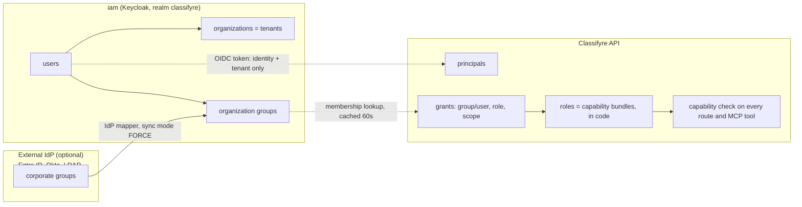
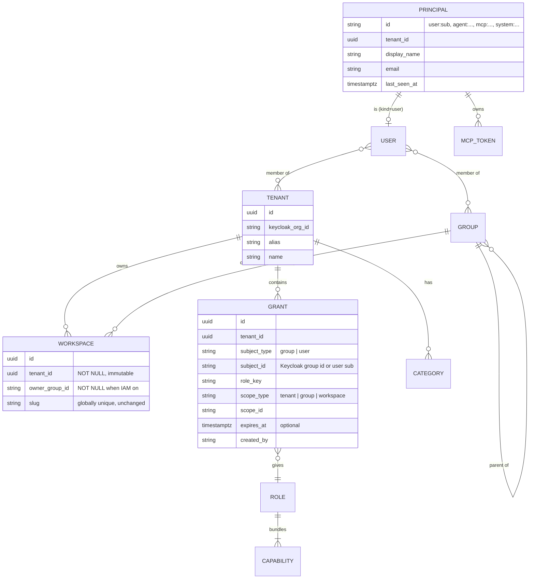
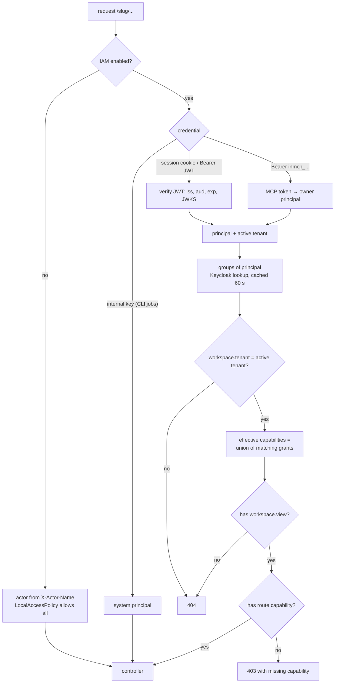
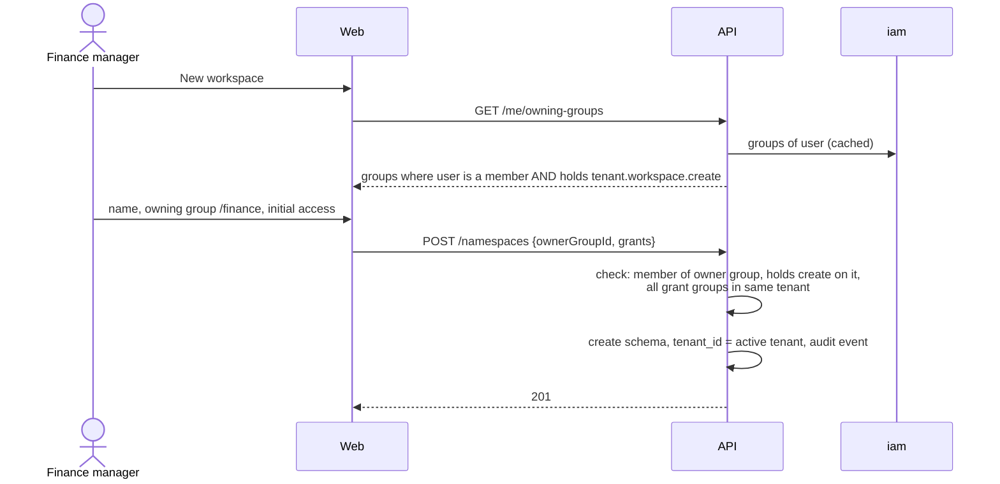
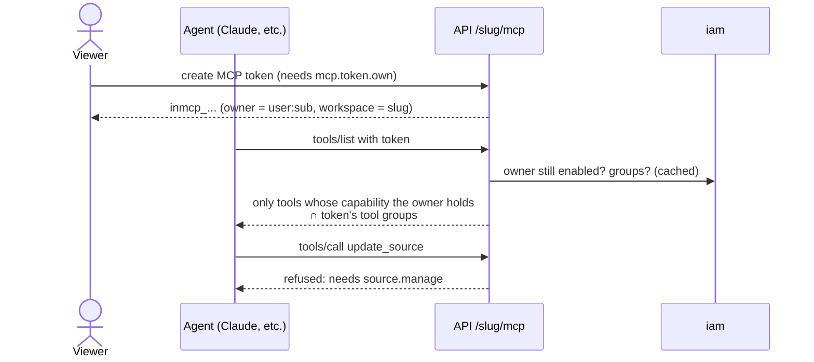
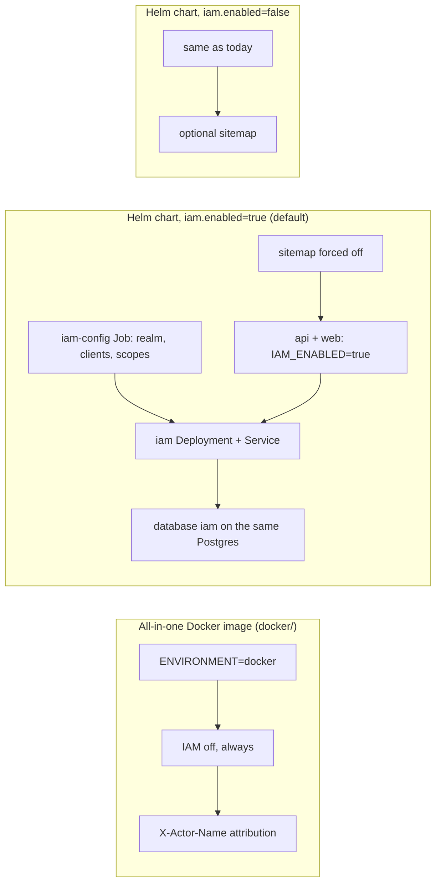
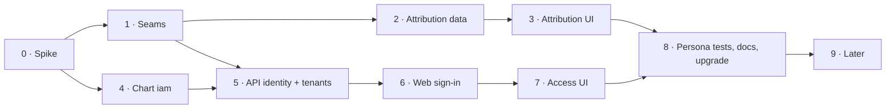

# PRD IAM · Identity and access management

|                       |                                                                                                                                      |
| --------------------- | ------------------------------------------------------------------------------------------------------------------------------------ |
| **Status**            | In progress: steps 0–1 done 2026-11-04 (§13)                                                                                         |
| **Size**              | L (9 steps, each its own PR)                                                                                                         |
| **Depends on**        | [S1 · Enterprise extension seams](S1-enterprise-extension-seams.md) (step 1 builds S1 R1–R8 and R15)                                 |
| **Identity provider** | Keycloak 26.8.1 (`quay.io/keycloak/keycloak:26.8.1`, released 2026-10-13), Helm chart only                                           |
| **Not in scope**      | the all-in-one Docker image, per-record rules (for example "this case is visible to its team only"), Keycloak Authorization Services |

## 1. Summary

Add sign-in, tenants and role-based access to Classifyre. IAM is **optional**. With IAM off, everything works as it does today. Only the Helm chart can turn it on, and there it is **on by default**.

The split of responsibilities:

- **Keycloak** answers _who is this?_ It holds users, the tenant they belong to (a Keycloak _Organization_), and their groups (business units and teams). It never decides what someone may do in Classifyre.
- **Classifyre** answers _what may they do here?_ It holds **grants**. A grant gives a group (or a single user) a **role** on a **scope**: one workspace, all workspaces owned by a group, or the whole tenant. A role is a fixed bundle of **capabilities** defined in code (`source.manage`, `case.edit`, …).

Capabilities only add up. There are no deny rules, conditions or policies. "Can this person do X in workspace W?" is always answered by a union of grants that can be listed and explained in the UI.

## 2. Hard rules

These come from the request. Each one has a check that fails CI or fails the deployment.

| #   | Rule                                                                                   | How it is enforced                                                                                                                                                                                                                                                                                                         |
| --- | -------------------------------------------------------------------------------------- | -------------------------------------------------------------------------------------------------------------------------------------------------------------------------------------------------------------------------------------------------------------------------------------------------------------------------- |
| H1  | Everything keeps working without IAM                                                   | `IAM_ENABLED` is unset by default. The default `LocalAccessPolicy` allows everything and the actor comes from `X-Actor-Name`, as today. The whole API e2e suite runs in both modes                                                                                                                                         |
| H2  | The all-in-one Docker image never uses IAM                                             | Nothing under `docker/` changes. The API refuses to boot when `ENVIRONMENT=docker` and `IAM_ENABLED=true`, and a spec covers this. No Keycloak artefact goes into any image built by the root `Dockerfile`                                                                                                                 |
| H3  | Keycloak runs from the chart only, optional, on by default, kept current by Dependabot | `iam.enabled: true` in `helm/classifyre/values.yaml`. The image tag is tracked by Dependabot (step 4, §9.3)                                                                                                                                                                                                                |
| H4  | With IAM on, there is no SEO and no sitemap                                            | `templates/validate-values.yaml` fails the install when `iam.enabled` and `frontend.sitemap.enabled` are both true. The web app and the API also ignore `SITEMAP_ENABLED` when `IAM_ENABLED=true`: `robots.txt` serves `Disallow: /`, sitemap routes 404, every page is `noindex`                                          |
| H5  | The chart says `iam`, never `keycloak`                                                 | Values key `iam`, templates `iam-*.yaml`, resources `<fullname>-iam`, env vars `IAM_*`. The only place the word appears is the image repository. A `helm template` test greps the rendered manifests for `keycloak` outside image references and the variable names the images themselves require (`KC_*`, `KEYCLOAK_URL`) |
| H6  | The UI shows who changed what                                                          | Every authored entity records `createdBy` / `updatedBy` as an actor reference, and every workspace has an audit trail (§10, §11). This also works without IAM, with self-declared names                                                                                                                                    |
| H7  | The backend respects the tenant                                                        | A workspace belongs to exactly one tenant, and every request is checked against it in the namespace hook before any controller runs. A workspace in another tenant answers **404**, not 403, so its existence does not leak                                                                                                |

## 3. Vocabulary

| Term                | Meaning                                                                                                                                                                                                                | Lives in                                                |
| ------------------- | ---------------------------------------------------------------------------------------------------------------------------------------------------------------------------------------------------------------------- | ------------------------------------------------------- |
| **Tenant**          | A company, or a department that runs as its own company. Owns workspaces, groups and grants                                                                                                                            | Keycloak Organization + `public.iam_tenants`            |
| **Workspace**       | Today's namespace (`public.namespaces`, schema `ns_<slug>`). Belongs to exactly one tenant and is owned by exactly one group                                                                                           | Classifyre                                              |
| **Group**           | People. A business unit (`/finance`), a team (`/finance/ap-team`) or an access group made only to receive a grant (`/finance/workspace-managers`). Hierarchical: being in a child group counts as being in its parents | Keycloak (organization groups)                          |
| **Capability**      | One thing the API allows, for example `source.manage`. Every REST route and every MCP tool declares exactly one                                                                                                        | Code (`identity/capabilities.ts`)                       |
| **Role**            | A named bundle of capabilities, for example _Investigator_. Built in, versioned with the code                                                                                                                          | Code (`identity/roles.ts`); custom roles later (step 9) |
| **Grant**           | _subject_ (group or user) gets _role_ on _scope_ (tenant, group-owned workspaces, or one workspace)                                                                                                                    | `public.iam_grants`                                     |
| **Principal**       | Anything that acts: a person, an agent, an MCP token, the system                                                                                                                                                       | `public.iam_principals`                                 |
| **Actor reference** | How an action is attributed in the data, for example `user:9f2c…` or `user:9f2c…@mcp:41ab…`                                                                                                                            | Text columns in each workspace schema                   |

### 3.1 "A group is a business unit, but also a set of permissions"

Both readings are useful, so the model keeps them apart instead of mixing them:

- A **group never carries permissions by itself**. It only says who belongs together.
- A **role never names a team**. It only says what can be done.
- A **grant** joins the two, on a scope.

So "finance can see these workspaces" is a grant to `/finance`. "These five people manage finance workspaces" is a grant to an _access group_ `/finance/workspace-managers`. To Keycloak, both are ordinary groups. Classifyre only sees a group that holds a grant. Tenant admins can model either way without new concepts, and the "why can I do this?" view (§12.4) always names the group and the role.

## 4. Who decides what



Why grants are not Keycloak roles: a role per workspace (`ws-finance-q3:viewer`) means one role per workspace per role, which is the "role explosion" the Keycloak guidance warns against. It also puts workspace data in a system that knows nothing about workspaces. Keycloak keeps the stable, coarse facts (who, which tenant, which groups). Classifyre keeps the fast-changing, workspace-specific facts.

## 5. Data model



Notes:

- `public.iam_tenants`, `public.iam_grants` and `public.iam_principals` sit next to `public.namespaces` and are migrated the same way, by idempotent DDL in the registry (`registry/namespace-registry.sql.ts`). They are not in the per-workspace `schema.prisma`.
- `public.namespaces` gains `tenant_id` (NOT NULL, pointing to a `local` tenant row when IAM is off) and `owner_group_id` (NULL only when IAM is off).
- `public.namespace_categories` gains `tenant_id`. Today categories are shared by every workspace on the instance. With tenants they must not be.
- Grants hold Keycloak **group ids**, not paths, so renaming or moving a group in Keycloak does not break access.
- `scope_type = group` means "every workspace owned by this group or by one of its child groups". That covers "finance's steward curates all finance workspaces" without a grant per workspace.
- Slugs stay globally unique, so URLs (`/<slug>/…`) do not change. The cost is that a tenant can learn that a slug is taken. Accepted for now; listed in §15.

## 6. Capabilities and roles

### 6.1 Capabilities

Every REST route declares one with `@Requires('<capability>')`. Every MCP tool declares one in `mcp-catalog.ts`. A completeness spec, in the style of `mcp-catalog.completeness.spec.ts`, fails when a route or tool has none. The existing MCP capability groups (`sources`, `cases`, `glossary`, …) stay as they are: they narrow what a token may use, and they are not permissions.

| Area                | Capabilities                                                                                                                      |
| ------------------- | --------------------------------------------------------------------------------------------------------------------------------- |
| Workspace           | `workspace.view`, `workspace.settings`, `workspace.pause`, `workspace.delete`, `workspace.transfer` (export/import/copy)          |
| Access              | `access.view`, `access.manage` (grants on this workspace)                                                                         |
| Sources and scans   | `source.view`, `source.manage`, `source.run`, `source.purge`                                                                      |
| Findings and assets | `finding.view`, `finding.triage` (status, severity, bulk), `asset.view`, `asset.tag`                                              |
| Detectors           | `detector.view`, `detector.manage`, `detector.train`                                                                              |
| Code                | `code.author` (custom source code, Python detectors, notebooks that run code). Kept apart because it runs code inside the cluster |
| Investigations      | `case.view`, `case.edit`, `case.manage` (close, delete, cleanup), `inquiry.view`, `inquiry.edit`, `lead.review`                   |
| Meaning             | `glossary.view`, `glossary.edit`, `glossary.approve`, `entity.view`, `entity.manage`, `correlation.review`                        |
| Agents              | `agent.view`, `agent.configure` (harness, autopilot, AI providers, chat bots), `agent.use` (assistant, AI completion)             |
| Data out            | `data.export` (CSV, case export, live queries)                                                                                    |
| Tokens              | `mcp.token.own` (create and revoke your own), `mcp.token.admin` (see and revoke everyone's in the workspace)                      |
| Tenant              | `tenant.workspace.create` (scoped to an owning group), `tenant.access.manage`, `tenant.categories.manage`, `tenant.audit.view`    |
| Platform            | `platform.tenants.manage`                                                                                                         |

### 6.2 Built-in roles

| Role                     | Scope              | Adds to the role on its left                                                                                                                   |
| ------------------------ | ------------------ | ---------------------------------------------------------------------------------------------------------------------------------------------- |
| **Viewer**               | workspace or group | every `*.view`, `mcp.token.own`                                                                                                                |
| **Investigator**         | workspace or group | Viewer + `finding.triage`, `case.edit`, `inquiry.edit`, `lead.review`, `asset.tag`                                                             |
| **Curator**              | workspace or group | Viewer + `glossary.edit`, `glossary.approve`, `entity.manage`, `correlation.review`                                                            |
| **Source manager**       | workspace or group | Not built on Viewer: `workspace.view`, `source.*`, `detector.*`, `finding.view`, `asset.view`, `mcp.token.own`. No case or inquiry access (U3) |
| **Workspace admin**      | workspace or group | everything workspace-scoped except `code.author`                                                                                               |
| **Code author** (add-on) | workspace or group | `code.author` only. Combined with another role                                                                                                 |
| **Workspace manager**    | group              | `tenant.workspace.create` for that group, and Workspace admin on every workspace the group owns                                                |
| **Auditor**              | tenant             | `tenant.audit.view`, `access.view` and `workspace.view` (metadata only, no findings content)                                                   |
| **Tenant admin**         | tenant             | everything in the tenant, including `code.author`                                                                                              |
| **Platform operator**    | instance           | `platform.tenants.manage`. Sees no workspace content unless also granted. The one Keycloak realm role (`classifyre-operator`)                  |

Investigator and Curator are side by side, not stacked: a person who needs both gets two grants.

### 6.3 How to add a feature later

1. Add the capability to `identity/capabilities.ts`.
2. Add it to the built-in roles in `identity/roles.ts` (at least Workspace admin; a spec checks this).
3. Put `@Requires(...)` on the routes and set the capability on the MCP tools.

No migration and no Keycloak change. When custom roles exist (step 9), tenant admins can add the new capability to their own bundles.

## 7. Business use cases

These become persona e2e tests in step 8. Each persona is a seeded user in the dev realm.

An example tenant, as the business sees it:


Sales never sees the finance workspaces and finance never sees _Pipeline hygiene_. Legal sees only _Q3 close_. Only the members of `/finance/workspace-managers` can create workspaces, and only workspaces owned by `/finance`.

| #   | Who                                                   | Needs                                                                                                  | Modelled as                                                                                                                                                                            |
| --- | ----------------------------------------------------- | ------------------------------------------------------------------------------------------------------ | -------------------------------------------------------------------------------------------------------------------------------------------------------------------------------------- |
| U1  | Finance controller                                    | Sees finance workspaces, changes nothing, creates a personal MCP token so an agent reads the same data | Viewer on `group:/finance`. The token can never do more than its owner: its tools are cut to read-only (§8.2)                                                                          |
| U2  | Fraud investigator                                    | Works cases and triages findings, cannot change sources or detectors                                   | Investigator on the workspace                                                                                                                                                          |
| U3  | Data engineer                                         | Connects sources, runs scans, tunes detectors, never sees case notes                                   | Source manager, which deliberately leaves out `case.view` and `inquiry.view`                                                                                                           |
| U4  | Finance and sales in one tenant                       | Each sees only its own workspaces                                                                      | Grants on `group:/finance` and `group:/sales`. No grant, no visibility: the workspace directory does not list it and its URL answers 404                                               |
| U5  | Finance workspace manager                             | Creates workspaces, but only for finance                                                               | Workspace manager on `group:/finance`, given to the access group `/finance/workspace-managers`. Creating a workspace requires the owning group to be one the user belongs to (§8.1)    |
| U6  | Legal needs a read-only look at one finance workspace | Shared without moving it                                                                               | A Workspace admin adds Viewer for `/legal` on that workspace. Only groups of the same tenant can be picked                                                                             |
| U7  | Glossary steward                                      | Approves terms in all finance workspaces                                                               | Curator on `group:/finance`                                                                                                                                                            |
| U8  | Detector developer                                    | Writes Python detectors in one workspace                                                               | Source manager + Code author on that workspace                                                                                                                                         |
| U9  | External auditor                                      | Reads the audit trail of the whole tenant, never sees matched content                                  | Auditor on the tenant                                                                                                                                                                  |
| U10 | Contractor for six weeks                              | Investigates one workspace, then loses access automatically                                            | A user grant (Investigator) with `expires_at`                                                                                                                                          |
| U11 | Mover: finance to sales                               | Loses finance access and gains sales access without anyone touching Classifyre                         | Group change in Keycloak or the IdP. Takes effect within the membership cache TTL, MCP tokens included                                                                                 |
| U12 | Leaver                                                | Everything stops                                                                                       | User disabled in Keycloak: the session ends when the access token expires (5 minutes), MCP tokens fail at the next membership lookup                                                   |
| U13 | Autopilot / harness agent                             | Works a workspace autonomously, within limits                                                          | A per-workspace agent principal (`agent:<workspace>:autopilot`) holding a role chosen in harness settings (default Investigator). The existing `OBSERVE_ONLY` modes still apply on top |
| U14 | Tenant admin                                          | Manages grants, categories and workspaces of the tenant                                                | Tenant admin on the tenant                                                                                                                                                             |
| U15 | Platform operator                                     | Creates tenants for new customers, no content access                                                   | Platform operator                                                                                                                                                                      |
| U16 | Analyst exports a CSV                                 | Data leaves the instance                                                                               | `data.export`. Not in Viewer or Investigator by default: a separate grant, or part of Workspace admin                                                                                  |

## 8. Key flows

### 8.1 Every request



The namespace hook (`namespace/namespace-request.hook.ts`) already resolves the workspace before any controller runs. It now also resolves the principal and the effective capabilities and stores them in CLS next to `CLS_NAMESPACE_ID`. The global guard then only compares the route's `@Requires` with what CLS holds. One database round trip per request at most; grants for a principal are cached for the life of the membership cache entry.

### 8.2 Creating a workspace



The rule "can only create a workspace for a group they belong to" is an invariant in code, not a grant. Even a mistaken grant cannot let someone create a workspace for a group they are not in. Tenant admins are the exception: they can pick any group in the tenant.

### 8.3 MCP tokens and agents



- `McpAccessToken` gains `owner_principal_id`. When IAM is on, a token without an owner cannot exist.
- Effective rights are computed on **every call** from the owner's current grants. They are never copied into the token. So a viewer's agent is read-only, a mover's agent follows the move, a leaver's agent stops.
- `tools/list` hides tools the owner cannot use, so agents do not plan with tools they will be refused.
- Attribution reads "Anna Berg via _claude-desktop_" (actor reference `user:<sub>@mcp:<tokenId>`).
- Later (step 9): MCP clients can sign in with OAuth against the `iam` realm instead of pasting a token.

## 9. Deployment

### 9.1 Modes



### 9.2 Chart values (sketch)

```yaml
iam:
  # -- Sign-in and access management. Turning it off restores open access (every visitor can do everything).
  enabled: true
  image:
    repository: quay.io/keycloak/keycloak
    tag: "26.8.1"
  replicas: 1 # 2+ in production: distributed cache over a headless service
  path: /iam # served on ingress.host, so no extra DNS name or certificate
  exposeAdminConsole: false # /iam/admin and /iam/realms/master are blocked at the ingress unless true
  realm: classifyre
  tokenLifespan: 5m
  database:
    mode: shared # shared = new database "iam" on postgres.mode's server; external = below
    external: { host: "", port: 5432, database: iam, existingSecret: "" }
  bootstrap:
    tenant: { alias: default, name: Default }
    adminEmail: "" # first tenant admin; gets a set-password action, nothing else
  config:
    image:
      repository: adorsys/keycloak-config-cli
      tag: "" # pinned to the 26.x line, tracked like the server image
  smtp: {} # password reset and invite mails
  identityProviders: [] # OIDC/SAML brokers, mapper sync mode FORCE
```

New templates: `iam-deployment.yaml`, `iam-service.yaml`, `iam-headless-service.yaml`, `iam-secrets.yaml`, `iam-database.yaml`, `iam-config-job.yaml`, `iam-ingress.yaml`, plus rules in `networkpolicy.yaml`. `deployment-api.yaml` and `deployment-web.yaml` get `IAM_ENABLED`, `IAM_ISSUER_URL` (public, used to check `iss`), `IAM_INTERNAL_URL` (in-cluster, used for JWKS and admin lookups), `IAM_REALM` and client secrets.

Decisions:

- **Own templates, not a sub-chart.** Keycloak is one container. The Bitnami chart's images are no longer freely published, the community `keycloakx` chart lags upstream, and the operator needs cluster-wide CRDs that a workload chart should not install. Our own `Deployment` keeps names under `iam` (H5).
- **Separate database, same server.** Keycloak gets its own database `iam` with its own user, never the `classifyre` database, whose `public` schema holds the registry. For `cnpg` it is a `Database` resource on the existing cluster; for `embedded` an init step; for `external` the operator supplies it.
- **Same host, path `/iam`.** `iam` is added to `RESERVED_PREFIXES` and `RESERVED_WEB_PREFIXES` in `namespace/namespace.constants.ts`, so no workspace can be called `iam`.
- **Upgrades use `strategy: Recreate`.** Keycloak minor upgrades need all nodes stopped. Sign-in is down for about a minute; issued tokens keep working because the API checks them against cached keys. Back up the `iam` database before minor upgrades (documented in `NOTES.txt` and the chart README).
- **Structure as code, membership by people.** The `iam-config` hook Job applies the realm structure (clients, client scopes, mappers, flows, the `classifyre-operator` role) on every install and upgrade. Groups, users and organization membership are left to tenant admins and IdPs: the job never deletes what it does not own, which avoids the known `managed.group=full` deletion trap.
- **Realm settings from the Keycloak guidance:** clients `classifyre-web` (confidential, used by the web server, authorization code + PKCE) and `classifyre-api` (audience; service account allowed to read users and groups only). _Full Scope Allowed_ off on every client. Implicit and password grants off. Access tokens 5 minutes. Brute-force detection on. Admin events with representation on. The master realm is never used by the application.

### 9.3 Keeping Keycloak current

No new Dependabot entry is needed. The existing `helm` entry for `/helm/classifyre` already reads image references in `values.yaml`: Dependabot's Helm parser (`helm/lib/dependabot/helm/file_parser.rb`, `parse_values_yaml_files`) picks up every hash that has a `repository` and a **string** `tag`. So `iam.image` and `iam.config.image` are tracked as long as their tags are quoted strings and never empty or templated. A chart test asserts that.

Majors (27.x) are ignored in `dependabot.yml` and upgraded on purpose, like Node and Python today. Step 4 adds that `ignore` rule for `quay.io/keycloak/keycloak`.

## 10. Backend work

All in `apps/api/src/identity/` unless noted.

1. **Actor context and access seam (S1 R1–R8).** `ActorContextService`, `ACCESS_POLICY` with `LocalAccessPolicy`, `@Requires()` on every route, a capability on every MCP tool, completeness specs. The 11 `@ActorName()` call sites move to `@CurrentActor()` and the decorator is deleted (no adapter kept).
2. **Mode switch.** `IAM_ENABLED` selects `LocalAccessPolicy` or `IamAccessPolicy` at boot. Boot fails on `ENVIRONMENT=docker` with IAM on, and fails when IAM is on but the issuer is unreachable at startup after retries.
3. **Credential verification.** JWT checked with `jose` against the realm's JWKS (`IAM_INTERNAL_URL`), `iss` = `IAM_ISSUER_URL`, `aud` = `classifyre-api`. Accepted from `Authorization: Bearer` (scripts) or the `cf_session` cookie (browser, §12.1). Cookie-authenticated unsafe methods require a matching `Origin`.
4. **Membership lookup.** `MembershipService` asks Keycloak (service account `classifyre-api`, realm-management roles `view-users` and `view-organizations` only) for the user's enabled state (`GET /users/{id}`), their organizations (`GET /organizations/members/{id}/organizations`) and their groups in the active one (`GET /organizations/{org}/members/{id}/groups`). That last call returns direct memberships only, each with its `parentId`, so ancestors come from the organization's group tree (`GET /organizations/{org}/groups`, cached per organization). Results are cached 60 seconds per principal. Tokens carry identity and tenant only, so they stay small and group renames do not matter.
5. **Tenant model.** `public.iam_tenants`, `iam_grants`, `iam_principals`; `tenant_id` and `owner_group_id` on `public.namespaces`; `tenant_id` on categories. The `local` tenant row exists in both modes, so code never branches on "is there a tenant".
6. **Namespace hook.** Resolves principal, checks tenant (404), computes capabilities, requires `workspace.view` (404). `NamespacePausedGuard` and `DemoModeGuard` stay separate and unchanged.
7. **Registry routes** (`/namespaces`, outside any workspace): list only visible workspaces of the active tenant; create enforces §8.2; update/delete need the workspace's own capabilities; thumbnails and categories are tenant-scoped.
8. **WebSockets.** `runner-events`, `notification-events` and `case-board` gateways verify the cookie or token in the handshake and require `workspace.view` for the `namespaceSlug` they join. Case-board writes require `case.edit`.
9. **MCP.** Owner on tokens; per-call capability check in `mcp-tool-executor.service.ts`; filtered `tools/list` (§8.3).
10. **Non-HTTP actors.** CLI jobs keep the internal key and act as `system:runner`, while the run keeps `triggeredBy` of whoever started it. pg-boss jobs and the scheduler run under `runAsActor(system:scheduler, …)`. Autopilot runs as its workspace agent principal (U13). Chat bots act as their own principal, with a role picked when the bot is configured.
11. **Grants API.** CRUD on grants for workspace admins (scope = their workspace) and tenant admins (any scope in the tenant), group search proxied to Keycloak, `GET /me` with the active tenant, groups and per-workspace capabilities, `GET /<ws>/access/explain?capability=` returning the grants that give it.
12. **Sitemap.** `sitemap/` endpoints answer 404 when IAM is on.

## 11. Attribution: who changed what

### 11.1 Data

- **Actor reference**, one text format everywhere: `user:<sub>`, `agent:<workspace>:<kind>`, `mcp:<tokenId>`, `system:<job>`, and in IAM-off mode `name:<display name>`. A delegated action appends the channel: `user:<sub>@mcp:<tokenId>`. Existing free-text columns (`createdBy`, `addedBy`, `decidedBy`, `reviewedBy`, `triggeredBy`, `verifiedBy`, `actor`, `author`) hold this format. One migration per workspace schema rewrites today's plain names to `name:<value>`.
- **Missing columns.** Add `created_by` / `updated_by` where the UI needs them and they do not exist yet: `Source`, `CustomDetector`, `CustomDetectorTestScenario`, `Finding` (`status_changed_by`), `Inquiry` (`updated_by`), `Case` (`updated_by`), `GlossaryTerm` (`updated_by`), `ExploreView`, `NotebookExecution` (`triggered_by`), `AiProviderConfig`, `McpServerConfig`, `AgentConfig`, `CorrelationConfig`, `InstanceSettings`, `ChatBot`, `DataTransferJob`, and `public.namespaces`.
- **Audit trail.** A new append-only `audit_events` table in every workspace schema: actor, capability used, entity type and id, a short change summary (changed field names, never secrets or matched content), timestamp. Fed by the domain events of [00 · F1](00-integration-architecture.md) where they exist, and written directly elsewhere. Tenant-level events (grants, workspace create/delete, token create/revoke) go to `public.iam_audit_events`. The existing `CaseActivity`, `InquiryActivity` and `GlossaryActivity` stay: they are product timelines, not the audit trail.
- **Display names.** `GET /principals/resolve?refs=…` returns name, email, kind and avatar initials. `iam_principals` is refreshed on each sign-in, so names of people who left still resolve.

### 11.2 UI: where it shows

One component set in `@workspace/ui`, built from today's `ai-actor-badge.tsx`:

- `<ActorChip ref>`: initials or kind icon (person, agent, token, system), name, hover card with email, group and channel ("via token _claude-desktop_").
- `<ChangedBy created updated>`: "Created by A · 3 Nov · Last changed by B · 2 h ago", under page titles.
- `<HistoryDrawer entity>`: the audit events of one entity, newest first, with field names.

| Page                                           | What it shows                                                                                                                                                                 |
| ---------------------------------------------- | ----------------------------------------------------------------------------------------------------------------------------------------------------------------------------- |
| Workspace directory (`namespaces`)             | Owning group and `ChangedBy` on each card; filter "owned by my groups"                                                                                                        |
| Workspace settings                             | New **Access** tab (grants, §12.4) and **Activity** tab (workspace audit trail, filter by person, capability, entity)                                                         |
| Sources list and detail                        | "Last changed by" column; `ChangedBy` + `HistoryDrawer` on detail; config edits listed by changed field, secrets never shown                                                  |
| Scans and runs                                 | "Triggered by": person, schedule, agent or token                                                                                                                              |
| Findings list, detail, bulk operations         | Who changed status or severity and when; bulk operations show their author and size                                                                                           |
| Assets                                         | Who tagged, linked or set a term, including augmenting notebooks                                                                                                              |
| Detectors and fingerprints                     | Created, updated, trained by; test scenarios' authors; feedback author; duplicate decisions (`decidedBy`, already stored)                                                     |
| Glossary                                       | Term created, updated, approved by; proposals decided by; bindings approved or disabled by                                                                                    |
| Investigations: cases, inquiries               | Case `ChangedBy`; events, threads, evidence, leads (proposed and reviewed by), hypothesis rules, finding filters each with their `ActorChip` (data exists, names become real) |
| Case board                                     | Item and link authors, snapshot author, presence avatars with real names instead of self-declared ones                                                                        |
| Harness                                        | Config, goals and memory "set by"; undo entries "reverted by"; agent runs labelled with the agent principal                                                                   |
| Notebooks                                      | Executions "run by"                                                                                                                                                           |
| Explore                                        | Saved views "created by"                                                                                                                                                      |
| Settings: MCP tokens                           | Owner column, last used, "acting as"; admins see every token in the workspace and can revoke                                                                                  |
| Settings: AI providers, MCP servers, chat bots | `ChangedBy` on each                                                                                                                                                           |
| Notifications                                  | Who caused the event                                                                                                                                                          |
| Data transfer                                  | Who exported, imported or copied, and when                                                                                                                                    |

Without IAM the same components show the self-declared name with a small "unverified" mark, so H1 and H6 hold together.

## 12. Web work

### 12.1 Sign-in

- The Next.js server (`apps/web`, standalone output) is the OIDC client. `proxy.ts` handles `/auth/login`, `/auth/callback`, `/auth/logout` with authorization code + PKCE against `/iam/realms/classifyre`.
- It sets the access token as an `HttpOnly`, `Secure`, `SameSite=Lax` cookie `cf_session` on the host, and keeps the refresh token in an encrypted `HttpOnly` cookie. It refreshes before expiry.
- Tokens never reach JavaScript. Images (workspace thumbnails), downloads and Socket.IO send the cookie on their own, and the ingress layout (`/api` straight to the API) does not change. Scripts and MCP keep using `Authorization: Bearer`.
- `IAM_ENABLED=false`: no `/auth/*` routes, no cookie, the actor-name prompt stays as today.

### 12.2 Tenant switcher

A user in several organizations picks one at sign-in (the `organization` scope) and can switch from the account menu, which signs in again for the other organization. Opening a link to a workspace of the other tenant offers the switch instead of a bare 404.

### 12.3 Capabilities in the UI

`GET /me` feeds a `useAccess()` hook and a `<Can capability="source.manage">` wrapper (S1 R15). Controls a user cannot use are hidden, or disabled with a tooltip naming the missing capability where hiding would confuse (for example a greyed "Edit source" on a page a Viewer is allowed to see). The server stays the authority.

### 12.4 Access management

- **Workspace → Settings → Access:** grants on this workspace, and the inherited ones (from group scope and tenant) shown read-only with their source. Add a grant: pick a group of the tenant (search via the API), pick a role, optional expiry.
- **Tenant admin area** (`/<locale>/tenant`): tenant-scoped grants, workspace managers per group, categories, tenant audit trail. Groups and members are read-only here, with a link to the group in the identity provider when `iam.exposeAdminConsole` is on. Membership is managed in Keycloak or the corporate IdP, not in Classifyre.
- **"Why can I do this?"**: next to any capability in the Access tab and in the 403 page, lists the grants (group → role → scope) that give or would give it.
- **New workspace:** owning group picker limited to §8.2's groups; initial grants prefilled with "owning group: Viewer".

### 12.5 SEO off

With `IAM_ENABLED=true`: `lib/seo-metadata.ts` returns `NO_INDEX` for every page, `app/robots.txt` returns `Disallow: /`, `app/sitemap*` routes 404, and `generateMetadata` layouts use generic titles instead of fetching entity names on the server.

## 13. Steps

Each step is one PR to `develop`, with its tests and a `changelog.d` fragment (see the release-notes skill). Steps 1–3 change nothing for users of the Docker image except better attribution.



### Step 0 · Spike (1–2 days, throwaway)

- Run Keycloak 26.8.1 in the k3d dev stack by hand. Confirm: organization groups are hierarchical and readable through the Admin API by a service account limited to view rights; the `organization` scope selects the tenant at sign-in; a user in two organizations works.
- Fallback if organization groups fall short: realm groups under `/tenants/<alias>/…`, with the tenant taken from the top-level group. The rest of this plan does not change.
- Measure the token with the planned mappers (target under 2 KB, so it fits a cookie).
- Confirm Dependabot picks up image tags in `helm/classifyre/values.yaml` (§9.3).
- **Done:** a short note appended to this PRD with the answers.

**Result, 2026-11-04** (Keycloak 26.8.1 in a throwaway namespace of the k3d dev cluster, realm with `organizationsEnabled`):

| Question                                       | Answer                                                                                                                                                                                                                                                                                                                                              |
| ---------------------------------------------- | --------------------------------------------------------------------------------------------------------------------------------------------------------------------------------------------------------------------------------------------------------------------------------------------------------------------------------------------------- |
| Organization groups hierarchical?              | Yes. `POST /organizations/{org}/groups` and `…/groups/{id}/children`; paths are relative to the organization (`/finance/workspace-managers`). Two organizations can each have `/finance`                                                                                                                                                            |
| Kept apart from realm groups?                  | Yes, fully. They do not appear in `GET /groups` or `GET /users/{id}/groups`, and the realm API refuses them ("Cannot access organization related group via non Organization API"). Membership is set with `PUT /organizations/{org}/groups/{gid}/members/{uid}`                                                                                     |
| Readable by a least-privilege service account? | Yes, with `view-users` + `view-organizations`. Without `view-organizations` every organization call is 403. Writes are 403 with these roles                                                                                                                                                                                                         |
| Membership read                                | `GET /organizations/{org}/members/{uid}/groups` returns **direct** groups with `parentId`; ancestors must be resolved from the group tree                                                                                                                                                                                                           |
| Tenant at sign-in                              | Scope `organization:<alias>` puts `"organization": ["<alias>"]` in the token. A user who is not a member gets no claim, so a missing claim must be a refusal. Scope `organization` alone: single-org users get their organization; a user in two organizations sees Keycloak's own picker ("Select an organization to proceed") in the browser flow |
| Sign-in shape                                  | With organizations on, the login is identity-first: username, then (picker), then password                                                                                                                                                                                                                                                          |
| Token size                                     | 1.0–1.1 KB with _Full Scope Allowed_ off and the organization claim, so it fits a cookie. No `aud` by default: the `classifyre` client scope needs an audience mapper for `classifyre-api`                                                                                                                                                          |
| Dependabot                                     | Covered by the existing `helm` entry (§9.3)                                                                                                                                                                                                                                                                                                         |

No fallback to realm groups is needed.

### Step 1 · Seams, behaviour unchanged

- S1 R1–R8 and R15: `identity/` module, `ActorContextService`, `ACCESS_POLICY` + `LocalAccessPolicy`, capability catalogue, built-in roles, `@Requires` on every route, a capability on every MCP tool, `GET /<ws>/me`.
- Remove `@ActorName()` after moving its 11 call sites.
- **Tests:** completeness specs for routes and tools; a deny-all policy makes every route 403 and every tool refuse; every capability is in Workspace admin.
- **Done:** e2e suite green, no response shape changed.

**As built, 2026-11-04** (`apps/api/src/identity/`):

- **Declaring access.** `@AccessArea({ view, change })` on each of the 49 controller classes gives the default: `view` for GET/HEAD and for POSTs already marked `@AllowInDemoMode()` (searches, charts, previews), `change` for the rest. `@Requires(capability)` on a route overrides it (run, purge, approve, export, close, …). `@InternalOnly()` routes stay with the internal-key guard. Health and sitemap are `@PublicRoute()`. 428 routes resolve; `route-access.completeness.spec.ts` fails on any route without one. `PRINT_ROUTE_ACCESS=<file> npx jest src/identity/route-access.completeness.spec.ts` writes the whole table for review.
- **Guard.** `AccessGuard` is the last `APP_GUARD` (after internal key, demo mode, paused). It resolves the actor, leaves it in CLS and on the request, and asks `ACCESS_POLICY`. A route that declares nothing is refused (`ACCESS_UNDECLARED`), so a forgotten decorator fails closed.
- **Attribution.** `@ActorName()` is gone. Its ~60 call sites use `@ActorRef()`, which returns `actor.ref`: today the self-declared name, as before. Step 2 changes what `ref` holds in one place.
- **MCP.** Each tool's capability comes from its capability group and its `readOnlyHint` (every tool already declares one), with overrides in `mcp-tool-capabilities.ts`. `createServer({ capabilities })` disables tools the caller lacks, the same way token tool groups are enforced. The MCP handler acts as an `integration` actor named after the token.
- **`GET /<ws>/me`** returns the actor, `iamEnabled` and the capability list.
- **Capability catalogue** grew against §6.1: `agent.use` (assistant and AI completion, separate from configuring agents) and `entity.view`.
- **Verified** on the dev stack: `/me`, reads, POST searches and MCP `tools/list` (185 tools) unchanged under `LocalAccessPolicy`.

Left for later steps:

- **Code detectors over REST** need only `detector.manage` today. The detector type is in the request body, so `code.author` for `CODE_DETECTOR` writes is a resource-level check in the service (step 5). Over MCP, the `custom_source_code` group check already exists.
- **WebSockets and background jobs** have no actor yet: gateways in step 5, `runAs` for workers and autopilot in step 2.
- **Meaning panels** (`/semantic/findings/:id/meaning`, asset meaning) need `finding.view` / `asset.view`, but the rest of `/semantic` needs `glossary.view`, which the Source manager role lacks.

### Step 2 · Attribution data

- Actor reference format, per-schema migration of existing names to `name:…`, missing `created_by`/`updated_by` columns (§11.1), `audit_events` per workspace, `public.iam_principals`, `GET /principals/resolve`.
- **Done:** every mutating route writes its actor; a spec lists authored models without an actor column and fails on new ones.

### Step 3 · Attribution UI

- `ActorChip`, `ChangedBy`, `HistoryDrawer`; every page in §11.2; Settings → Activity tab.
- **Done:** Playwright component tests for the three components; page checks in the dev stack in IAM-off mode.

### Step 4 · Chart: `iam`

- Templates and values of §9.2, database per Postgres mode, `iam-config` Job with realm structure, ingress path `/iam` with admin paths blocked, network policies, `values.schema.json`, `validate-values.yaml` (H4, and `iam.enabled` requires `ingress.host`), `NOTES.txt`, chart README.
- Dependabot `ignore` rule for Keycloak majors (§9.3). `iam` added to the reserved prefixes.
- Dev stack: `skaffold.yaml` / dev values seed a `dev` tenant with groups `/finance`, `/finance/workspace-managers`, `/sales`, `/legal` and one invented user per persona in §7.
- **Tests:** `helm template` with `iam.enabled` on and off for each Postgres mode; the `keycloak`-name grep (H5); the SEO conflict fails; `docker/` has no diff (H2).
- **Done:** `helm install` on k3d brings up a working sign-in page at `/iam`.

### Step 5 · API identity and tenants

- §10 items 2–12: mode switch, verification, membership, tenant tables and columns, namespace hook, registry routes, WebSockets, MCP token ownership, non-HTTP actors, grants API, sitemap off.
- Upgrade path for an existing install turning IAM on: all workspaces move to the bootstrap tenant, owned by its `admins` group; existing MCP tokens are revoked (they have no owner) and the release note says so.
- **Tests:** the full e2e suite in both modes; a tenant-isolation spec in the style of `websocket/namespace-isolation.spec.ts` (tenant A's principal gets 404 on every route of a tenant B workspace, REST, MCP and sockets); boot refusal on `ENVIRONMENT=docker`.
- **Done:** curl with tokens of two dev personas shows different workspace lists and different 403s.

### Step 6 · Web sign-in

- §12.1–12.3 and §12.5.
- **Done:** sign in, refresh, sign out and tenant switch work in the dev stack; with IAM off the web is unchanged.

### Step 7 · Access UI

- §12.4: Access tab, tenant admin area, "why" explainer, new-workspace flow, MCP token owner column and admin view.
- **Done:** U4, U5 and U6 can be set up from the UI alone, with no Keycloak console needed except to add people to groups.

### Step 8 · Persona tests, docs, operations

- One e2e test per use case in §7 against the dev realm.
- Docs (`apps/docs`): "Sign-in and access" for operators (chart values, IdP brokering with FORCE sync, Entra group-claim limits, backups and minor upgrades) and for tenant admins (groups vs grants, roles, examples from §7).
- Runbook: rotating the `classifyre-api` client secret, restoring the `iam` database, off-boarding urgently (disable user + revoke sessions).
- **Done:** a release with IAM on by default in the chart.

### Step 9 · Later

- Custom roles: tenant admins compose capability bundles (still no conditions).
- MCP sign-in with OAuth against the `iam` realm instead of pasted tokens.
- Restricted cases: a case visible only to its members, inside a workspace. Needs record-level checks in services; the `ACCESS_POLICY` seam already takes a resource.
- Redaction by role through S1's content presenter (Auditor sees metadata, never matched content).
- Membership change events from Keycloak to cut the 60-second cache delay.

## 14. Testing summary

| Level        | What                                                                                                                      |
| ------------ | ------------------------------------------------------------------------------------------------------------------------- |
| Unit         | Capability union over grants, group ancestry, expiry, the creation invariant, actor reference parsing                     |
| Completeness | Every route and MCP tool has a capability; every capability is in Workspace admin; every authored model has actor columns |
| Isolation    | Cross-tenant 404 on REST, MCP and sockets; cross-group invisibility inside one tenant                                     |
| Modes        | API e2e in IAM off and IAM on; boot refusal on Docker with IAM                                                            |
| Chart        | `helm template` matrix (iam on/off × Postgres modes), H4 conflict, H5 grep                                                |
| Personas     | §7 U1–U16 against the dev realm                                                                                           |

## 15. Risks and open questions

- **Keycloak outage.** Sign-in stops. Signed-in users keep working until their token expires and the membership cache entry ages out (about 5 minutes), then requests fail closed. Two replicas in production values.
- **Organization groups are young** (added in 26.6). Step 0 found them sufficient; re-check the Admin API calls of §10 item 4 after every Keycloak minor upgrade.
- **Global slugs** let one tenant learn that another tenant's slug exists. Alternative: `/<tenant>/<slug>/…` URLs, a larger change to routing and links. Decide before step 5.
- **Source manager without case access (U3).** Confirm with a real data-engineering user before step 1 fixes the role table.
- **Tenant admin and content.** As specified, a tenant admin can open every workspace in the tenant. Some customers will want admins who manage access without seeing data; that is a role variant without `*.view` content capabilities, easy to add later.
- **Fine-grained admin permissions in Keycloak (FGAP v2)** could let tenant admins manage their own groups inside Keycloak. It had several security fixes in 2026; not used in this plan.
