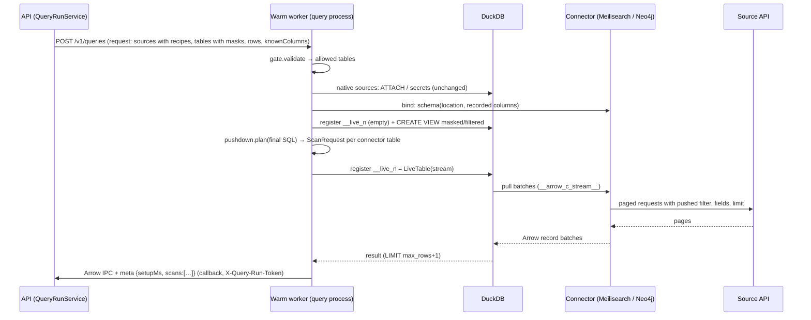

# PRD QC · Query connectors: one read interface for every source

|                  |                                                                                                                                                                                                                                                                 |
| ---------------- | --------------------------------------------------------------------------------------------------------------------------------------------------------------------------------------------------------------------------------------------------------------- |
| **Status**       | QC0–QC3 built 2026-11-21, QC4 built 2026-11-22 (§11): the interface, the connector runtime, Meilisearch and Neo4j, the lab joins on skaffold, custom sources (`tables()`/`scan()`) tried on the live Austrian Firmenbuch; QC5 proposed |
| **Size**         | L (6 phases, QC0–QC5, each its own PR)                                                                                                                                                                                                                          |
| **Depends on**   | [DQ](DQ-data-query.md): the gate (`apps/cli/src/query/gate.py`), masks (§5.8), row filters (§5.10), the session (`session.py`), and the warm query worker (`apps/cli/src/query/worker.py`, `warm.py`; DQ §5.3)                                                   |
| **Replaces**     | DQ phase 5 ("More sources")                                                                                                                                                                                                                                     |
| **Used by**      | [BIC](BIC-bi-client-compatibility.md) (connector tables over SQL connections), MCP `query_data`, exports, shared datasets                                                                                                                                       |
| **Starts from**  | The payload proof of concept `fedsql` (outside this repository: `poc-payload`), commit `6142207` *pluggable Python connectors, Meilisearch, dynamic script sources*, reviewed 2026-11-21                                                                         |
| **Not in scope** | Writing to sources. Caching or materialising connector data. Third-party pip plugins (the microkernel in CLAUDE.md is future work). Semi-join pushdown (§8, later). Search relevance ranking as SQL. Graph path patterns (only nodes and single relationships). |

## 1. Summary

Today a source is queryable only when DuckDB can read it with one of its own extensions. The list of queryable types is written out twice by hand:
- `QUERYABLE_SOURCE_TYPES` in `apps/cli/src/query/bindings.py` has 10 values.
- The same set in `apps/api/src/data-query/sql-names.ts` adds `SHARED_DATASET`.

Each type is a private method on `SourceBinding` (`_postgres`, `_mysql`, `_databricks`, `_odbc`, `_attached_catalog`, `_object_storage`). Meilisearch, Neo4j, Elasticsearch, MongoDB and every SaaS source can be scanned, but their rows cannot be read. Custom (notebook) sources cannot be queried at all.

This PRD gives every source type **one read interface**, a `QueryBinding`, which lives next to the source's scan code. The source type also declares its **tier**, and the API and the CLI both read that declaration from the source schema. There are four tiers:

| Tier | What reads the rows | When |
| --- | --- | --- |
| `native` | A DuckDB core extension (`ATTACH` or a scanner function) | DuckDB can read the source itself. All 10 types built today. |
| `extension` | A DuckDB community or nightly extension, signed, pinned and baked into the image | One exists, is light and passes the QC0 spike (`odbc_scanner` is built; `mssql`, `mongo` and `bigquery` are candidates) |
| `connector` | A Python **Arrow connector** that reuses the source's own client code, fed to DuckDB as an Arrow stream, with SQL-level pushdown | No extension exists, or it is *heavy* (§4.2). **Meilisearch and Neo4j in v1.** |
| `custom` | The CUSTOM notebook's optional `scan()` function, run in the existing sandboxed child process | A user-written source that opts in |

Everything DQ built applies unchanged to connector tables, because a connector table becomes the same `<source>.<schema>.<table>` view as any other:
- the gate, masks, row filters, caps and audit;
- SQL connections, MCP, exports and shared datasets.

The proof of concept showed a join across Parquet × PostgreSQL × Meilisearch × Neo4j in 1.3 s. Pushdown cut the Meilisearch documents read from 20,000 to 632. QC3 repeats this on the skaffold dev stack, through the warm worker.

## 2. What the proof of concept showed

| Finding (POC, DuckDB 1.4.3, macOS arm64) | Taken over as |
| --- | --- |
| A connector answers the three questions of a DuckDB table function: bind → `schema(table)`, init → `ScanRequest(columns, predicates, max_rows)`, scan → Arrow record batches. Pushdown is *advisory*: DuckDB re-applies every predicate, so a connector may ignore any it cannot translate exactly, but must never return fewer rows than it matches | §5.2, unchanged |
| Data reaches DuckDB through the Arrow PyCapsule (`__arrow_c_stream__` on a `LiveTable`), registered with `conn.register(name, obj)`. No table functions, UDFs, replacement scans or community extensions | §5.3. The gate forbids table functions anyway, so the view is the only way in |
| DuckDB 1.4.3 reads a registered Arrow stream **once**: a second scan fails with `ArrowArrayStream was released`. The POC re-registers per query, and materialises tables referenced twice (self-join, CTE, subquery) | §5.3. To be checked again on DuckDB 2.0 (QC0) |
| DuckDB pushes no filters into a Python Arrow stream, so the POC planned pushdown from the SQL with sqlglot (`pushdown.py`) | §5.4, ported, with one Classifyre rule added: never on masked columns |
| Q1 with pushdown: 1 request, 632 documents, 0.22 s. Without: 21 requests, 20,000 documents, 0.69 s. Same result | QC3 acceptance (§9) |
| Benchmark, 1M rows × 5 columns: native Parquet 0.02 s; in-process connector with Python dicts 1.87 s; **with Arrow batches 0.14 s (5–14× faster than dicts)**; child-process script source 0.39 s (Arrow), with about 190 ms fixed cost per scan | Connectors build Arrow batches, not dicts (§5.2 `to_batch`); custom `scan()` may yield either, and the SDK converts |
| In-process connectors are bound by the GIL: 4 concurrent 4-source joins took 7.1 s against 1.3 s each serially | Solved by the warm worker: one forked process per query (§5.10) |
| Timeouts are checked between batches; worst case one source request (2.6 s for a 2 s limit) | Each request's timeout is capped at the time left before the deadline (§5.3) |
| Errors are safe: no keys, no response bodies | `ConnectorError` carries a user-facing message only, and passes the runner's redactor (§5.11) |
| Schemas inferred from 100 rows; `LIMIT` not pushed; no join-key (semi-join) pushdown — in Q4 `orders.order_id = 1` still streamed all 20,000 Meilisearch documents | Schema comes from what the scan recorded (§5.7); LIMIT pushdown in the simple case (§5.4); semi-join later (§8) |
| Script sources: `python -I -m fedsql.sandbox`, empty environment, RLIMITs, JSON request on stdin, Arrow IPC on stdout; "not a security boundary" | §5.8 reuses Classifyre's existing CUSTOM runner (`apps/cli/src/sources/custom/runner.py`, `env.py`), which is already that boundary for scans |
| Verdict: fine for interactive and dashboard queries with up to about 10⁵–10⁶ connector rows per query and tens of concurrent queries; not for bulk analytics over APIs | §8: the row cap per connector table (`connector_limit`) and the docs say so |

The POC did not know the Classifyre split:
- The API decides who reads what; the CLI enforces it on the SQL.
- Masks and row filters live in views.
- Assets, their recorded columns and their classification come from scans.
- The PostgreSQL protocol is PGlite in the API.
- Queries run in a warm worker with a Job as overflow.

This PRD places each POC part into that split.

## 3. Requirements

| # | Requirement |
| --- | --- |
| R1 | Each source type declares once whether and how it can be queried: tier, asset kinds, SQL names, extensions. The CLI and the API read that one declaration, and a test in each fails when a binding and the declaration disagree. |
| R2 | A connector table is read through exactly the same view as a native one: masks, hidden columns, row filters, `knownColumns`, gate, caps, audit, SQL connections, MCP, export, shared datasets. Nothing in `gate.py`, `masks.py` or `rows.py` knows about tiers. |
| R3 | Pushdown never changes a result. A connector may push less than asked, never more. **No predicate on a masked or hidden column is pushed**: a predicate on the raw value would answer a question the view hides. |
| R4 | A connector table has a row cap (`connector_max_rows`, default 1,000,000). Over the cap the query is **refused** (`connector_limit`), never answered on part of the data (DQ R7). |
| R5 | The query's single deadline covers connector setup and every request, as it does for native sources. |
| R6 | Connectors reuse the scan's client code and recipe fields: no second set of credentials, no second configuration form. |
| R7 | A custom source becomes queryable only when its notebook defines `scan()` **and** someone who may edit the source turns on *Allow SQL queries*. That change is audited. Custom code runs only in the sandboxed child process. |
| R8 | A person sees, for each connector table, what reading it cost: requests, rows read, which filters were pushed. |
| R9 | Meilisearch and Neo4j are queryable and joinable with PostgreSQL, Parquet/Delta in buckets and Iceberg, on the skaffold dev stack, through the warm worker. Correctness is checked against an independent calculation, and latency is measured (§9). |

## 4. Tiers per source type

### 4.1 The matrix

The source types come from `packages/schemas/src/schemas/all_input_sources.json`. *Built* means it works today through DQ. *Candidate* means QC0 must confirm the extension: signed, published for `linux_amd64` and `linux_arm64` on the CLI's DuckDB version, size, and pushdown.

| Source type | Asset kinds read | Tier | Reader | Status |
| --- | --- | --- | --- | --- |
| POSTGRESQL | table | native | `postgres` | Built |
| MYSQL | table | native | `mysql` | Built |
| DATABRICKS | table | native | `unity_catalog` + `delta` | Built |
| ICEBERG_REST, DUCKLAKE | table | native | `iceberg`, `ducklake` via `DuckDBAttachedSource._attach` | Built |
| S3_COMPATIBLE_STORAGE, AZURE_BLOB_STORAGE, GOOGLE_CLOUD_STORAGE, LOCAL_FOLDER | table, table files | native | `delta_scan`, `iceberg_scan`, `read_parquet`/`csv`/`json`/`avro`, `ST_Read` | Built |
| ODBC | table | extension | `odbc_scanner` (nightly) | Built (no pushdown) |
| SHARED_DATASET | dataset | (API) | DQ §5.12 | Built |
| **MEILISEARCH** | index | **connector** | `sources/meilisearch/query.py` (*new*), REST | **v1 (QC2)** |
| **NEO4J** | label, **relationship** (*new kind*) | **connector** | `sources/neo4j/query.py` (*new*), official `neo4j` driver | **v1 (QC2)** |
| **CUSTOM** | table (what the notebook extracts) | **custom** | notebook `scan()` | **v1 (QC4)** |
| MSSQL | table | extension → connector | community `mssql` (native TDS, no driver), else the source's client | Candidate (QC5) |
| MONGODB | collection | extension → connector | community `mongo`, else `pymongo` with `find(filter, projection)` | Candidate (QC5) |
| BIGQUERY | table | extension → connector | community `bigquery`, else Storage Read API (Arrow) | Candidate (QC5) |
| SNOWFLAKE | table | connector | Community `snowflake` needs the ADBC Snowflake driver installed separately: heavy. Use the source's connector and `fetch_arrow_batches()` | Later (QC5) |
| ELASTICSEARCH, OPENSEARCH | index | connector | `SearchEngineSourceMixin` client, point-in-time + `search_after`, query DSL pushdown | Later (QC5) |
| ORACLE | table | connector | the source's `oracledb` client (`fetch_df_all` / Arrow) | Later |
| REDSHIFT | table | native? | `postgres` scanner speaks the protocol; try in QC0, else connector | Candidate |
| TRINO, ATHENA, DREMIO, HIVE | table | connector | Trino/Athena clients; Dremio Arrow Flight (`pyarrow.flight`); Hive tables usually read as bucket files | Later |
| HUGGING_FACE | table files | native | `httpfs` `hf://` Parquet | Candidate |
| KAFKA | topic | — | Unbounded streams; a bounded "last N messages" read could be a connector | Out for now |
| JIRA, SERVICEDESK, CONFLUENCE, NOTION, SLACK, EMAIL, MICROSOFT_365, GOOGLE_WORKSPACE, DROPBOX | items | connector | The source's API client (Jira issues as a table is the obvious first one). Files in SharePoint/Drive by materialising (DQ phase 5 text) | Later |
| POWERBI, TABLEAU, GIT, YOUTUBE, REDDIT, WORDPRESS, SANDBOX | — | — | Not tabular | Out |

The row "Neo4j relationship" needs the scan to emit relationship types as assets (§5.6). Today they are only links between label assets.

### 4.2 Extension or connector: the "heavy" rule

Use the community extension when all of these hold. Otherwise write a connector that reuses the source's client.

1. Published for the CLI's DuckDB version on `linux_amd64` **and** `linux_arm64`, and signed (`INSTALL x FROM community` with no `allow_unsigned_extensions`).
2. Needs no native library outside the extension. The Snowflake community extension needs the ADBC driver installed separately, so it fails this rule.
3. Adds at most about 50 MB to `/opt/duckdb-extensions` (the image already carries 356 MB of extensions, DQ §9).
4. Pushes filters and projection to the source, or the source's tables are small.
5. Authenticates with what the source's recipe already holds (R6).
6. Passes the QC0 checks: `LIMIT` returns exactly the limit (the POC's F01 lesson with `pg_use_ctid_scan`), `READ_ONLY` or equivalent, errors without secrets.

Extensions go in `COMMUNITY_EXTENSIONS` (`apps/cli/src/utils/duckdb_engine.py`; `paimon` and `hudi` are there today), in the image's baked extension step, and in `warm.py`'s `DEFAULT_EXTENSIONS` only if most queries need them.

## 5. Design

### 5.1 The declaration: `x-query` in the source schema

Each `*Input` in `packages/schemas/src/schemas/all_input_sources.json` already carries `x-asset-metadata`. A queryable one gains `x-query`:

```json
"x-query": {
  "tier": "connector",
  "assetKinds": ["index"],
  "names": { "schema": "indexes", "table": "asset.name" },
  "extensions": [],
  "pushdown": true
}
```

- `tier`: `native` | `extension` | `connector` | `custom`.
- `assetKinds`: the kinds that are table-shaped for this type. This replaces the hard-coded `kind === 'table'` part of `isTableShaped()`.
- `names`: how `tableAddress` builds `<schema>.<table>`. For native types the current per-type logic in `sql-names.ts` stays as named strategies (`"strategy": "catalog" | "lakehouse" | "file"`). For connectors there is a fixed schema word plus a metadata field.
- `extensions`: what the binding loads (for the image's bake step and the spike).
- `pushdown`: the default for the per-source option `query.pushdown` (§5.4).

Readers:

- **API**: `sql-names.ts` builds `QUERYABLE_SOURCE_TYPES` and the per-type address from the schema at load time. `SHARED_DATASET` stays an API-only entry.
- **CLI**: `apps/cli/src/query/bindings.py` builds its set from the same file. The Python schema package is already installed editable (CLAUDE.md, *CLI Implementation*).
- **Tests**:
  - `apps/cli/tests/test_query_manifest.py` (*new*): every type with `x-query` has a binding class (§5.2), and every binding class has a declaration.
  - `apps/api/src/data-query/sql-names.manifest.spec.ts` (*new*): every declared type gets an address for each of its kinds.

### 5.2 The Python interface

New package `apps/cli/src/query/connectors/`:

```python
# apps/cli/src/query/connectors/base.py
@dataclass(frozen=True)
class Predicate:
    column: str
    op: Literal["=", "!=", "<", "<=", ">", ">=", "in"]
    value: Any                       # a list for "in"

@dataclass
class ScanStats:
    requests: int = 0
    rows: int = 0
    pushed: list[str] = field(default_factory=list)   # human-readable, e.g. "genre = 'Drama'"
    ms: int = 0

@dataclass(frozen=True)
class ScanRequest:
    columns: tuple[str, ...] | None   # None = all
    predicates: tuple[Predicate, ...]
    limit: int | None                 # pushed LIMIT (§5.4), else None
    max_rows: int                     # connector_max_rows; the connector stops at max_rows + 1
    deadline: float                   # time.monotonic() value; every request's timeout <= deadline - now
    stats: ScanStats

class ConnectorError(Exception):
    """A message that is safe to show: never a response body, a key or a DSN."""

class QueryBinding(ABC):
    """How one source of a query is read. One instance per source per query."""
    tier: ClassVar[str]
    def __init__(self, source: BaseSource, alias: str, index: int) -> None: ...
    def attach(self, conn: DuckDBPyConnection) -> None: ...            # ATTACH, secrets; no-op for connectors
    @abstractmethod
    def relation(self, conn: DuckDBPyConnection, location: TableLocation) -> str: ...
    def close(self) -> None: ...

class ArrowConnector(QueryBinding):
    tier = "connector"
    @abstractmethod
    def schema(self, location: TableLocation, recorded: list[dict[str, str]] | None) -> pa.Schema: ...
    @abstractmethod
    def scan(self, location: TableLocation, request: ScanRequest) -> Iterator[pa.RecordBatch]: ...
    def pushable(self, location: TableLocation) -> PushdownSupport: ...   # which columns/ops it can translate
```

Rules:
- **Where the code lives.** *(Changed while building QC1, 2026-11-21.)* Bindings live in `apps/cli/src/query/connectors/<type>.py`, registered by source type in `connectors/__init__.py` (`_BINDINGS`, imported lazily), not in `sources/<type>/query.py` on the source class: importing a source package imports `src.sources` and the scan machinery (0.6 s, about 380 modules, measured), which a query must not pay for a source it reads with DuckDB alone. A binding that needs the source's client asks its context for the instance (`SourceContext.instance()`), which imports it then. The manifest tests check registry and declaration in both directions.
- **No change for today's types.** The existing `SourceBinding` methods move one by one:
  - `_postgres` → `sources/postgresql/query.py` `PostgresBinding`
  - `_mysql` → `sources/mysql/query.py`
  - `_databricks`, `_odbc` → their source folders
  - `_attached_catalog` → `sources/duckdb_attached_base.py`
  - `_object_storage` → `sources/object_storage/query.py`

  `SourceBinding` becomes a thin dispatcher: `type(source).QUERY_BINDING(source, alias, index)`. This is QC1 and changes no behaviour. The whole of `tests/test_query.py` must stay green.
- **Helpers ported from the POC's `connectors/base.py`:**
  - `declared_schema()`: recorded column types → Arrow.
  - `schema_from_rows()`: a null-only column becomes VARCHAR; a nested object becomes JSON text.
  - `to_batch(rows, schema, columns)`: columns that were not asked for come back as NULL, and type drift raises `ConnectorError` naming the column, never the value.
  - Connectors build `pa.RecordBatch` directly where the client gives columns (Neo4j records, Meilisearch JSON pages via `pa.Table.from_pylist`), never one Python dict per cell in a loop.
- **The source's own client.** A connector gets the instantiated `BaseSource` (from `get_source(recipe)`, as the attached-catalog binding does today). It reuses that source's session, auth and TLS (`MeilisearchSource._session()`, `Neo4jSource._driver()`), so R6 holds without new recipe fields.

### 5.3 The runtime in `session.py`

> **Changed while building QC2, 2026-11-21 (QC0 answers, §11).** DuckDB 2.0 hands projection and filters to a registered `pyarrow.dataset.Dataset`, so there is no bind/scan registration pair and no planner of ours: `ArrowConnector.relation()` registers one `LiveTable` (a `Dataset` subclass, `apps/cli/src/query/connectors/arrow.py`) whose `scanner(columns, filter)` DuckDB calls once per scan, after its optimiser has inlined the masked, filtered view. The pushed `filter` (a `pyarrow.compute` expression) is read into `Predicate`s only where rebuilding it gives the same expression (`predicates_of`), and every batch is filtered again locally, because DuckDB drops filters it pushed. A table read twice is simply scanned twice (no materialising). The stats travel as `scans` in the result meta. The rest of this section is the original design, kept for the record.

Two phases for connector tables, on top of the current `_attach_tables_as_views`:

1. **Bind** (when the view is created):
   - `schema = connector.schema(location, recorded_columns)`.
   - `conn.register("__live_<n>", schema.empty_table())`.
   - The view is built exactly as today: `CREATE VIEW "<src>"."<schema>"."<table>" AS SELECT <masked_projection> FROM __live_<n> WHERE <row_predicate>` (`masks.py`, `rows.py`).
   - The relation the view reads is the registered name. Nothing else changes, so R2 holds by construction.
2. **Scan** (just before execution, after `lock_configuration`):
   - `pushdown.plan(final_sql, targets)` gives a `ScanRequest` per referenced connector table (§5.4).
   - `conn.register("__live_<n>", LiveTable(connector, location, request))`. `LiveTable.__arrow_c_stream__` wraps `connector.scan(...)` in a `pa.RecordBatchReader`.
   - The table is materialised (`read_all()`) when the plan says it is read more than once.
   - In `finally`, the empty table is registered again and the connector closed.

   Registering after `lock_configuration` must be checked in QC0: `register` is not a configuration change, but this has to be confirmed on DuckDB 2.0.
3. **Limits**:
   - `LiveTable.batches()` counts rows and raises `ConnectorError("…more than N rows…", code="connector_limit")` at `max_rows + 1`.
   - It checks `request.deadline` before every request. Each HTTP or Bolt call gets `timeout = min(source timeout, deadline - now)`.
   - On a timeout the session's existing `conn.interrupt()` timer fires as before.
4. **Errors**: a `ConnectorError` raised inside DuckDB's scan arrives wrapped. As in the POC's `_live_error()`, the session keeps the last connector error and reports *it* (code `source_unavailable` or `connector_limit`), not DuckDB's wrapper text. `runner.py`'s `_redactor` still runs on the message.
5. **Stats**: each connector table's `ScanStats` goes into the result metadata (`X-Query-Run-Meta`, next to `setupMs`) as `scans: [{table, requests, rows, pushed, ms, materialised}]`.

**QC0 spike on DuckDB 2.0** (the CLI's DuckDB; the POC ran 1.4.3). Write the answers into §11 *As built*:
- Is a registered Arrow stream still single-use?
- Does DuckDB 2.0 push projection or filters into a registered `pyarrow.dataset.Dataset` or a `RecordBatchReader`?
- Is there a Python table-function API that gets filters (a cleaner bind/init/scan)?
- Does `register` work after `lock_configuration`?
- Do DuckDB's dynamic join filters reach a registered stream?

If 2.0 pushes filters into a Python object, prefer that over the sqlglot planner for filters, and keep the planner for `LIMIT` and for the masked-column rule.



### 5.4 Pushdown (`apps/cli/src/query/pushdown.py`, *new*)

> **Not built (2026-11-21): DuckDB does it** (§5.3 note, §11 QC0). What DuckDB pushes into a dataset matches the rules below without a planner: comparisons with a constant, `IN` lists, `BETWEEN`, `IS NOT NULL`, the view's row filter, equivalences carried across a self-join; never `OR` of different columns, `LIKE`, functions, or a condition on a mask's output (a masked column's condition is on `md5(col)` or a constant, which DuckDB keeps). Projection is pushed always; `LIMIT` needs no pushdown, because DuckDB stops pulling batches and the connector's generator stops paging. Not pushed by DuckDB: ranges on `DOUBLE` columns (only equality), join keys. `TableLocation.withheld` (the request's masked columns) is a second guard: no predicate on them reaches a connector even if DuckDB ever pushes one. `query.pushdown: false` is not built.

This is a port of the POC's `pushdown.py`. It runs on the SQL **after** the gate has rewritten names (the gate's output is DuckDB SQL over `"<src>"."<schema>"."<table>"`), with the gate still the authority.

**What is pushed, for a connector table referenced exactly once:**
- AND-ed conjuncts of the `WHERE` of the `SELECT` whose `FROM` reads the view directly, of the form `col op literal` or `col IN (literal, …)`, where:
  - `col` is a column of that table that is **visible and not masked** for this person (from the request's `columns` entries: action `mask` or `hide` excludes it, as do columns not in `knownColumns`);
  - the literal's type matches the column's Arrow type (no implicit casts);
  - the connector's `pushable()` accepts the column and the operator (for example, Meilisearch only for its filterable attributes).
- **Row-filter conditions** of the table's `rows` entry may be pushed as well. They are on raw values and only ever narrower, so pushing them reads less and changes nothing. This is optional in QC2; the planner gets them from the request, not from the SQL.
- **Projection**: the set of column names used anywhere in the query for that table. It is turned off when the query uses `*` (other than `count(*)`), a `NATURAL` or `POSITIONAL` join, or the table as a row value.
- **LIMIT**: only when the statement is a single-table `SELECT` with no aggregate, `DISTINCT`, `ORDER BY`, window or join, and every predicate was pushed. Then `limit = min(LIMIT, max_rows + 1)`.

**What is never pushed:** `OR`, `IS NULL`, `LIKE`, functions, `ON`/`HAVING` conditions, predicates on masked or hidden columns, and anything on a table referenced twice (which is materialised instead).

`query.pushdown: false` on a source turns all of it off. The `x-query.pushdown` default is true. Pushdown is advisory: DuckDB evaluates the view and the query's `WHERE` again on what comes back.

### 5.5 Meilisearch (`apps/cli/src/sources/meilisearch/query.py`, *new*)

| | |
| --- | --- |
| SQL name | `<source>.indexes.<index uid>` (lower-cased and sanitised by DQ §5.2's rules; collisions `_2`) |
| Columns | Top-level document fields. Nested objects become `JSON`; arrays of scalars become `LIST`; mixed arrays become `JSON` |
| Bind | Columns come from what the scan recorded (§5.7). If nothing was recorded, the binding fetches `GET /indexes/{uid}/documents?limit=100` and infers them, but masks then hide everything unrecorded (DQ §5.8), so the scan must record |
| Scan | `POST /indexes/{uid}/documents/fetch` with `{limit, offset, filter, fields}` (Meilisearch ≥ 1.2: no `maxTotalHits` cap, unlike `/search`). Without a filter, `GET /indexes/{uid}/documents?fields=…`. `page_size` is the source's (default 1000, max 10,000). It stops at `max_rows + 1` |
| Pushdown | `=`, `!=`, `IN [...]` on strings, numbers and booleans, plus numeric ranges. Only attributes in `GET /indexes/{uid}/settings/filterable-attributes`, read once per query (≥ 1.14 granular `attributePatterns` handled). String literals escaped (`"` and `\`) |
| Errors | `ConnectorError("Meilisearch source <name> returned HTTP 403")` and `"… is unreachable"`, never the body |
| Reuses | `MeilisearchSource._session()`, `_base_url()`, `_request_timeout()` (`sources/meilisearch/source.py`) |

### 5.6 Neo4j (`apps/cli/src/sources/neo4j/query.py`, *new*)

| | |
| --- | --- |
| SQL names | `<source>.nodes.<label>` and `<source>.relationships.<type>` |
| Node table | One row per node with the label. Columns are the recorded property keys plus `element_id` (`elementId(n)`) |
| Relationship table | One row per relationship of the type. Columns are `source_<key>`, `target_<key>`, the relationship properties, `source_label` and `target_label`. `<key>` defaults to `element_id`; a recipe field `query.relationship_key` (for example `id`) names a node property instead, so `source_id` joins with a node table's `id` |
| Cypher | Built by `build_cypher(location, request)`: `MATCH (n:\`Label\`) WHERE n.\`p\` >= $p0 RETURN n {.a, .b, element_id: elementId(n)} AS row LIMIT $limit`, and for relationships `MATCH (a)-[r:\`TYPE\`]->(b) … RETURN r {.stars, source_id: a.\`id\`, target_id: b.\`id\`} AS row LIMIT $limit`. Every value is a parameter; labels and types are escaped with `_escape_label` (exists in `source.py`) |
| Batches | 10,000 records per Arrow batch, from `session.run(...).fetch(n)` |
| Pushdown | `=`, `!=`, ranges, `IN` on properties of the node or relationship (`source_*`/`target_*` key columns included), `LIMIT` |
| Reuses | `Neo4jSource._driver()`, `_session()`, `_database()` |
| **Scan change** | `Neo4jSource.extract_raw()` today emits labels as assets and relationships only as links (`_resolve_relationship_links`). It must also emit one asset of a new kind **`relationship`** per relationship type, with `metadata.columns` (property keys and types sampled like `_label_stats`), `relationship_type`, `source_labels` and `target_labels`. The new kind goes into `x-asset-metadata` for NEO4J, the web's asset-kind icons and i18n, and `isTableShaped()` via `x-query.assetKinds` |

### 5.7 Recorded columns for connector tables

Masks hide any column the scan did not record (`knownColumns`, DQ §5.8). Classification, and therefore default masking, is per recorded column. So a connector table is useful only when its scan records columns the way tabular sources do: `asset_metadata["columns"] = build_columns(names, types)` (`apps/cli/src/utils/file_metadata.py`, used by `sources/tabular_base.py`).

- **Meilisearch** `_index_to_asset`: records the union of top-level fields over the sample `_sample_documents` already takes, with DuckDB type names.
- **Neo4j** `_label_to_asset` (today `sample_property_keys`) and the new relationship asset: record `columns`.
- The detectors' tabular path (`detectors/tabular_lines.py`) must tag findings with these columns, as it does for tables, so personal data in a Meilisearch field classifies that column. Check this against a Meilisearch index with emails (QC2 acceptance).

### 5.8 Custom sources: `tables()`, `scan()` and the SDK

*As built in QC4 (2026-11-22); the decisions that differ from the first draft are dated at the end of this section.*

A CUSTOM source is a notebook (`apps/cli/src/notebook/`) run by `sources/custom/runner.py` in a child process with a scrubbed environment (`custom/env.py`), over an NDJSON protocol. A notebook that defines two more functions is queryable live, like a Meilisearch index.

**What the notebook writes:**

```python
from classifyre import Table, ctx

def tables():
    return [Table("companies", {"fnr": "VARCHAR", "name": "VARCHAR", "founded": "DATE"},
                  description="Needs WHERE fnr = ... or fnr IN (...).")]

def scan(table, request):
    fns = request.values("fnr")        # values of fnr = x / fnr IN (...); marks the filter used
    if fns is None:
        raise ValueError("companies needs WHERE fnr = '...'")
    for fn in fns:
        request.count_request()
        yield fetch_company(fn, timeout=request.seconds_left())   # dicts or Arrow batches
```

**Contract** (`notebook/contract.py`): `OPTIONAL_FUNCTIONS` gains `tables` and `scan`, mirrored in the API (`notebook.service.ts`) and the editor completions. A new violation `QUERY_CONTRACT`: one of the two without the other, or a `scan` that is async or takes fewer than two positional parameters. Checked before every execution, scan and query, like the rest of the contract (not on save: an autosave must land mid-edit).

**SDK** (`notebook/query.py`, exported by `build_module`): `Table(name, columns, description, schema="main")`; `Filter(column, op, value)`; `ScanRequest` with `columns`, `filters`, `values(column)`, `value(column)`, `use(*filters)`, `count_request(n)`, `max_rows` and `seconds_left()`. Column types are the DuckDB names the connector tier reads (`VARCHAR`, `BIGINT`, `INTEGER`, `DOUBLE`, `BOOLEAN`, `DATE`, `TIMESTAMP`, `TIMESTAMPTZ`, `JSON`, and `T[]`).

**Tables in the catalog.** Each scan first asks the notebook for `tables()` (`runner.py` command `tables`) and records one asset per table before `extract()` runs, so a windowed or stopped run still records them: kind `table`, no content (`extract=False`, *"Read live by SQL queries"*), metadata `{table_name, schema, columns, query: "scan", description}`. `x-query` declares `CUSTOM: {tier: custom, assetKinds: [table], address: notebook}`; the API's `notebook` address names it `<source>.<schema>.<table>` and locates it as a connector table. A `table` asset the notebook yields itself (no `query: scan`) stays listed and locked: *Only tables the notebook declares in tables() and reads in scan() can be queried.*

**Running it** (`query/connectors/custom.py`, `CustomConnector(ArrowConnector)`):

```mermaid
sequenceDiagram
  participant Q as Query Job (DuckDB, LiveTable)
  participant P as CustomSource (query mode)
  participant R as Notebook child (scrubbed env)
  Q->>P: scanner(columns, filter) → ScanRequest
  P->>R: handshake {recipe, mode: "query"}; {command: scan, table, columns, read, filters, maxRows, secondsLeft}
  R->>R: scan(table, request), each page → rows_to_batch (declared schema)
  R-->>P: {type: rows, ipc: base64 Arrow IPC} …
  R-->>P: {type: end, used, requests, rows} | {type: error}
  P-->>Q: RecordBatch es; stats: requests, filters used
```

- Rows travel as Arrow IPC, base64 in the existing NDJSON channel; logs stay on stderr. Each page is converted in the child against the declared columns, so a wrong value is the notebook's error, naming the column: ISO text reads as a date or timestamp, a `Decimal` as a number, anything else of another type fails the query.
- Filters cross as JSON with dates and decimals tagged (`encode_filters`). The filters the notebook used are mapped back to the pushed predicates and recorded with `request.sent`; `count_request` becomes the scan's `requests`.
- Query mode: `ctx.query_assets()`, `ctx.tag()` and every relayed op are refused in the child (`_no_relay`) and again in the parent; no uploaded files are downloaded (`ctx.files` is empty).
- One notebook process per scan running at once (a self-join reads two pipes); a scan DuckDB stops early (a `LIMIT`) stops its process, and the next scan starts a fresh one. The deadline kills the child from a timer rather than timing out a read: frames already in the parent's read buffer are invisible to `select()`.
- Errors: the first line of the notebook's exception (redacted by the runner) is the query's message, *"The notebook of <source>: ValueError: …"*; the full text goes to the Job's log. The row cap and the local re-filter are the connector tier's (§5.3).
- Where it runs: CUSTOM is in `DEFAULT_JOB_ONLY_SOURCES` and `queryWorker.jobOnlySourceTypes`, so a query that reads a custom source always runs as a Job of its own; notebook packages and uv groups are installed in that Job as for a scan.

**Decided 2026-11-22, differing from the first draft:**
- **The tables are declared, not extracted.** `tables()` replaces "the source's own extracted `table` assets": a notebook's data assets (companies, persons) and its SQL tables are different things, and a table needs a schema the notebook states rather than one sampled from records.
- **Defining `scan()` is the opt-in; there is no `query.enabled` switch.** Writing it takes the right to edit the notebook, which is already the right to run code with the source's secrets on every scan; reading the tables still takes the data grants every table takes. A switch would add a second place to forget.
- **Arrow over the NDJSON channel, not fd 3.** Logs already go to stderr, so stdout carries only frames; a second pipe would add a protocol for no separation gained.
- **No rlimits in the child.** CUSTOM queries never run in the shared worker; the Job's pod limits bound the notebook, and `RLIMIT_AS` breaks numpy and pyarrow's virtual reservations.
- **`ctx.filter_value()` became `request.values()`/`value()`,** on the request rather than the context, so it also records which filter was used.

**Docs:** *SQL over the source* in `apps/docs/app/sources/custom-connectors/reference/page.mdx`, *Query it with SQL* in the custom-connectors overview, and *Custom sources* in `data-query/page.mdx`.

Third-party *pip* connectors (the POC's `fedsql.connectors` entry-point group) are **not** taken over. The notebook is Classifyre's extension point for user code. Built-in connectors live in the repository. Revisit this when the plugin system (CLAUDE.md, *Plugin System (Future)*) is built.

### 5.9 API and web

- **Catalog** (`QueryCatalogService`, `sql-names.ts`):
  - Addresses come from `x-query`.
  - New not-queryable reasons: `custom_query_disabled`, `not_tabular_kind`, and `tier_not_built` ("Reading rows of <type> sources is planned").
  - `CatalogTableDto` gains `tier`.
- **Run record**: migration `query_runs.scan_stats jsonb` (*new*), filled from the result meta `scans`. `GET query-runs/:id` returns it.
- **Web**:
  - Below the result: "Meilisearch `movies`: 1 request, 632 documents, filters sent: genre = 'Drama', year ≥ 2015". It is shown when `scan_stats` is present; i18n en/de in the data-query namespace.
  - The explorer marks connector tables with a small *live* tag (tooltip: "Read live through the source's API on every query").
  - The CUSTOM source form gets *Allow SQL queries*.
  - The new asset kind `relationship` gets an icon and a label.
- **MCP** `list_queryable_tables`: includes connector tables. `query_data`'s result adds the same scan stats line.
- **Pre-check** (`sql-precheck.ts`) and `MAX_SOURCES_PER_QUERY` (8) are unchanged.

### 5.10 How it runs in the warm worker

- `warm.py` already runs `src.sources._discover_sources()`, which imports `neo4j`, `requests` and the other client libraries into the fork server. **No driver, session or socket may be created in the fork server.** Connectors create them inside the query process and close them in `close()`. `test_query_worker.py` gets a check that `/proc/self/task` stays single-threaded after warm-up with the connectors imported.
- Each query is its own forked process, so the POC's cross-query GIL contention (§2) does not arise. Within one query, connector streams are pulled by DuckDB's threads; client calls release the GIL during I/O.
- The worker's NetworkPolicy has no egress restriction today (`helm/classifyre/templates/networkpolicy.yaml`). Connectors need egress to the sources' endpoints, exactly as scans do. If egress is ever restricted, the query worker needs the same egress as scan Jobs.
- The worker's environment scrub (`scrub_environment`, `CLASSIFYRE_QUERY_WORKER_ENV_ALLOW`) is unchanged: connectors read credentials from the request's recipe, never from the environment.
- The Job overflow path (`kubernetes-cli-job.service.ts`, mode `query`) runs the same code, so connector tables also work when the worker is busy or turned off.

### 5.11 Security

- **Credentials**: the same rule as native sources — the recipe is decrypted by the API only for sources the SQL names, travels in the request, and is redacted from every error (`runner._redactor`).
- **SSRF**: a connector calls only the endpoint in the source's recipe, which whoever created the source already chose (the same trust as a scan). Connectors never follow URLs found in data.
- **Data**: R3. No pushdown on masked or hidden columns, so neither request counts nor timing answer a question about a raw value the view hides. Row-filter pushdown only narrows.
- **Custom code**: only in the custom runner child (§5.8). A query process never imports a notebook.

## 6. Test bed: lakehouse lab and skaffold

`development/lakehouse-lab/` gains a compose profile `search-graph`, on the k3d network with fixed addresses like the other services:

| Service | Image | Address | Cluster name |
| --- | --- | --- | --- |
| `meilisearch` | `getmeili/meilisearch:v1.13` (pin; ≥ 1.2 needed for `/documents/fetch`) | 172.18.10.50:7700 | `lab-meilisearch.classifyre-dev.svc` |
| `neo4j` | `neo4j:5.26-community` | 172.18.10.51:7687 | `lab-neo4j.classifyre-dev.svc` |
| `shop-pg` | `postgres:16-alpine` (or a `shop` database on `ducklake-pg`) | 172.18.10.52:5432 | `lab-shop-pg.classifyre-dev.svc` |

- `k8s-services.yaml`: selector-less Services + Endpoints for the three.
- `seed/connectors.py` (*new*): a port of the POC's `scripts/connectors_demo.py seed`, with fixed random seed 7:
  - Meilisearch: 20,000 movies, index `movies`, filterable `genre`, `year`, `id`; nested `studio`, array `tags`.
  - PostgreSQL: 5,000 customers, `shop.public.customers` with `email` and `country`.
  - S3: 200,000 orders as Parquet in `s3://lake/connectors/orders/`.
  - Neo4j: 5,000 `Person {id}` and 20,000 `Movie {id}` nodes, 50,000 `RATED {stars}` edges.
  - Wired into `seed.sh` under the profile.
- `sources/meilisearch.json`, `sources/neo4j.json`, `sources/shop-postgres.json` (*new*), created by `workspace.py`. The orders Parquet is found by the existing `lab_s3_tables` bucket source.
- The README gets the profile and fixes the stale `172.19.10.x` addresses (the compose file moved to `172.18.10.x`).

**Join queries** (`development/lakehouse-lab/queries/connectors/*.sql`, *new*). The POC's Q1–Q4 are rewritten with Classifyre names; exact schema and table names follow the scan:

```sql
-- Q1 Meilisearch × Parquet × PostgreSQL
SELECT m.genre, c.country, count(*) AS orders, round(sum(o.amount), 2) AS revenue
FROM lab_s3_tables.connectors.orders o
JOIN lab_meilisearch.indexes.movies m ON m.id = o.movie_id
JOIN lab_shop.public.customers c ON c.id = o.customer_id
WHERE m.genre = 'Drama' AND m.year >= 2015
GROUP BY ALL ORDER BY revenue DESC, c.country LIMIT 5;

-- Q2 Neo4j × Meilisearch × PostgreSQL
SELECT m.title, count(*) AS fans
FROM lab_neo4j.relationships.rated r
JOIN lab_meilisearch.indexes.movies m ON m.id = r.target_id
JOIN lab_shop.public.customers c ON c.id = r.source_id
WHERE c.country = 'DE' AND r.stars >= 4 AND m.genre IN ('Sci-Fi', 'Horror')
GROUP BY ALL ORDER BY fans DESC, m.title LIMIT 5;

-- Q3 all four
SELECT c.country, m.genre, count(*) AS rated_orders, round(avg(r.stars), 3) AS avg_stars
FROM lab_s3_tables.connectors.orders o
JOIN lab_shop.public.customers c ON c.id = o.customer_id
JOIN lab_meilisearch.indexes.movies m ON m.id = o.movie_id
JOIN lab_neo4j.relationships.rated r ON r.source_id = o.customer_id AND r.target_id = o.movie_id
WHERE m.genre IN ('Drama', 'Sci-Fi') AND c.country IN ('AT', 'DE')
GROUP BY ALL ORDER BY ALL;

-- Q4 nested fields and a mask: studio (JSON), tags (LIST), customers.email masked for a Data reader
SELECT o.order_id, m.title, m.studio, m.tags, c.email
FROM lab_s3_tables.connectors.orders o
JOIN lab_meilisearch.indexes.movies m ON m.id = o.movie_id
JOIN lab_shop.public.customers c ON c.id = o.customer_id
WHERE o.order_id = 1;
```

`Q5` is a self-join on Meilisearch (`movies a JOIN movies b ON a.genre = b.genre AND a.id < b.id WHERE a.year = 2020 …`), to exercise materialisation.

**Benchmark** (`development/lakehouse-lab/bench_query.py`, extended):
- `CONNECTOR_MIX` = Q1–Q5, on both transports (REST and `--pg`).
- `--pushdown on|off`: toggles the sources' `query.pushdown` through the API before a run.
- `--verify`: compares every result with an independent calculation from the seed files (`seed/connectors.py --expected` writes `expected.json`), as the POC's `connectors_demo.py verify` did.
- Records `scan_stats` from `GET query-runs/:id` next to the timings.
- Phases `sequential` (repeat 10) and `concurrent` (`--clients 1,2,3`; for more, use two personas, because of `QUERY_MAX_ACTIVE_PER_PERSON`).
- Saved results go to `.bench/connectors-<date>.json`, and the numbers into §11.

## 7. Phases

| Phase | What | Done when |
| --- | --- | --- |
| QC0 | **Spike** on the CLI's DuckDB 2.0: Arrow stream reuse, filter pushdown into Python objects, a table-function API, `register` after `lock_configuration`, join filters into streams. **Extension audit**: `mssql`, `mongo`, `bigquery`, `snowflake` and Redshift-through-`postgres` against §4.2 | Answers written into §11; the §4.1 matrix updated; design §5.3/§5.4 adjusted if 2.0 pushes filters itself |
| QC1 | **Interface and declaration, no behaviour change**: `x-query` for the 10 built types; `QueryBinding`; the `SourceBinding` methods moved to `sources/<type>/query.py`; the CLI and API read the declaration; manifest tests | `tests/test_query.py`, `test_query_worker.py`, the API data-query specs and `apps/e2e` smoke green with no edits to their expectations |
| QC2 | **Connector runtime + Meilisearch + Neo4j**: `ArrowConnector`, `LiveTable`, `pushdown.py`, stats, `connector_limit`, the Neo4j `relationship` asset kind, recorded columns for both sources, catalog reasons, `scan_stats` migration and web line | Unit tests (§9) green; on the dev stack both sources' tables are queryable from the SQL page, the Data tab, a SQL connection and MCP |
| QC3 | **Lab joins and performance on skaffold**: `search-graph` profile, seed, sources, Q1–Q5, the benchmark extended | §9 skaffold targets met and written into §11 with the benchmark JSON |
| QC4 | **Custom sources** (built 2026-11-22, §5.8, §11): `tables()` and `scan()` in the contract, SDK `Table`/`Filter`/`ScanRequest`, runner `tables`/`scan` commands with Arrow over the NDJSON channel, job-only, docs | A CUSTOM source queried live on the dev stack: the Firmenbuch Register notebook (`firmenbuch-test-2`) answers `companies`, `officers` and `changes` from the register's HVD API |
| QC5 | **More sources by tier**, each its own PR in the order of §4.1: candidates that passed QC0 as `extension`, then Elasticsearch/OpenSearch and Snowflake as connectors | Per source: the binding, `x-query`, recorded columns, a lab service or a recorded fixture, and one join query on the dev stack |

## 8. Risks and open questions

- **No join-key pushdown.** `orders.order_id = 1` joined to Meilisearch still streams every movie the other predicates allow (the POC's Q4). Planned later: semi-join pushdown — run the selective side first, then push `id IN (…)` of at most N keys into the connector. DuckDB 2.0's join filters may do part of this (QC0).
- **Big relationship tables.** A Neo4j relationship type with 10⁷ edges and no pushed predicate hits `connector_limit`. That is intended; the refusal says which table and suggests a filter on a key or property.
- **Schema drift.** A field that appears after the last scan is not recorded, so it is hidden (DQ §5.8). A type that changes raises `ConnectorError` naming the column. Both are fixed by a re-scan, and the error says so.
- **Source rate limits.** Every query reads live. Dashboards over SQL connections (BIC) can multiply requests. Per-source concurrency and rate limits, and a short TTL cache, are later work. The docs give the POC's envelope (§2 verdict).
- **Masked columns cannot be filtered at the source.** `WHERE email = 'x'` on a masked column reads the whole table (and matches nothing, by DQ §5.8). Intended (R3); `scan_stats` makes the cost visible.
- **Connector code runs in the query process.** It is built-in, reviewed code with the recipe's credentials, the same trust as `bindings.py` today. Custom code never does (§5.8).
- **Search engines are not tables.** Meilisearch documents read in primary-key order, not by relevance. A relevance search as SQL is out of scope.
- **Open:** should `relationship_key` default to `element_id` (always present, opaque) or to a property named `id` when every sampled node has one? The proposal is `element_id`, plus the recipe field.

## 9. Testing and acceptance

| Level | What |
| --- | --- |
| CLI unit `tests/test_query_connectors.py` (*new*) | `ScanRequest`/`to_batch`/schema helpers. The cap is a refusal at `max_rows + 1` (`connector_limit`), never a cut. The deadline caps the request timeout. A `ConnectorError` reaches the person without a body or key. Stream registration and materialisation for self-join, CTE and subquery. Masked and filtered views over a connector table give the same results as over a Parquet file with the same rows |
| CLI unit `tests/test_query_pushdown.py` (*new*) | Port of the POC's planner cases: conjuncts pushed; `OR`/`LIKE`/functions/`ON`/`HAVING` not; **masked, hidden and unrecorded columns never pushed**; type mismatch not pushed; projection off for `*`; LIMIT only in the simple case; a table read twice not pushed; row-filter conditions pushed and results unchanged |
| CLI unit Meilisearch | `httpx`/`requests` mock transport: filter translation and escaping, filterable attributes (both formats), paging stops at `max_rows + 1`, `/documents/fetch` vs `GET /documents`, HTTP 403 and unreachable messages |
| CLI unit Neo4j | `build_cypher` for nodes and relationships, parameters only, escaped labels, projections, `LIMIT`; a fake driver for batches |
| CLI unit custom | Contract: `scan` signature checks. Runner `op: scan`: rows as dicts and as Arrow, fd 3 stream, `{type, line}` errors, relayed ops refused, deadline kill, `RLIMIT_AS` |
| CLI live `-m connectors` | Against the compose `search-graph` services (skipped without `CLASSIFYRE_CONNECTORS_LIVE=1`): Q1–Q5 results equal `expected.json` |
| CLI worker | `test_query_worker.py`: the fork server stays single-threaded with connector modules imported; a connector query runs in the worker and posts `scans` in the meta |
| API unit | Manifest: every declared type and kind gets an address; reasons `custom_query_disabled`, `not_tabular_kind`, `tier_not_built`; `scan_stats` stored and returned; the CUSTOM `query.enabled` change needs `source.manage` and is audited |
| Web | The scan-stats line, the *live* tag, the CUSTOM switch (component tests); i18n keys en/de |
| Dev stack (skaffold, `lakehouse-lab`, through the warm worker) | Q1–Q5 from the SQL page, a Data tab, a SQL connection (psql) and MCP `query_data`; `--verify` passes; Q4 as a Data reader shows `email` as `****`; a `WHERE` on a masked column pushes nothing (`scan_stats`); the Neo4j `relationships.rated` asset exists with recorded columns; personal data in a Meilisearch field classifies and masks that column |
| **Skaffold targets** | Through the warm worker, REST, p50 over 10 runs: **Q1 ≤ 1.5 s, Q2 ≤ 2.5 s, Q3 ≤ 3 s**. Meilisearch documents read in Q1: **632 with pushdown, 20,000 without**, identical rows. Two personas × 3 concurrent clients on Q1–Q3: no failures other than the per-person cap; worker pod under its memory limit (`kubectl top`). Numbers and the benchmark JSON written into §11 |

## 10. Work breakdown for the developer agent

Work test-first (the repository's `tdd` skill). Each task is one commit; each phase one PR with a `changelog.d` fragment (`release-notes` skill).

1. **QC0 spike.** Write a throwaway script under `development/lakehouse-lab/spikes/duckdb2_arrow.py` that answers the five questions of §5.3 on the CLI's DuckDB (`uv run` in `apps/cli`). Install and try each candidate extension of §4.1 against a lab or docker service. Record the answers and the updated matrix in §11 *As built* of this PRD.
2. **QC1 declaration.** Add `x-query` to the 10 built types in `all_input_sources.json`, then regenerate the Pydantic and TypeScript artefacts as `ADDING_NEW_SOURCE.md` describes. Write `test_query_manifest.py` and `sql-names.manifest.spec.ts` first (red), then make `bindings.py` and `sql-names.ts` read the declaration.
3. **QC1 interface.** Create `apps/cli/src/query/connectors/base.py`. Add `QUERY_BINDING` to `BaseSource`. Move each `SourceBinding._<type>` into `sources/<type>/query.py` one at a time, running `tests/test_query.py` after each move.
4. **QC2 runtime.** Write `test_query_connectors.py` against a fake in-memory connector, then implement `LiveTable`, bind/scan registration in `session.py`, `connector_limit`, deadline handling, error unwrapping and `scans` in the result meta (`runner.py`).
5. **QC2 pushdown.** `test_query_pushdown.py` first (port the POC's cases, add the mask cases), then `pushdown.py`.
6. **QC2 Meilisearch.** Recorded columns in `_index_to_asset` (extend `tests/test_meilisearch*.py`), then `sources/meilisearch/query.py` with mock-transport tests, then `x-query`.
7. **QC2 Neo4j.** The `relationship` asset kind (schema `x-asset-metadata`, the web's kind icon and label, i18n), recorded columns for labels and relationships, `sources/neo4j/query.py` with `build_cypher` tests, then `x-query`.
8. **QC2 API and web.** Migration `query_runs.scan_stats`, DTOs, the catalog reasons and `tier`, the result line, the *live* tag, MCP output. API specs and web component tests.
9. **QC3 lab.** The `search-graph` profile, `k8s-services.yaml`, `seed/connectors.py` (with `--expected`), the source JSONs and `workspace.py`, the queries, the `bench_query.py` extension; the lab README (including the `172.18` fix). Run on skaffold (`scripts/dev/start.sh`, then the lab steps) and write the numbers into §11.
10. **QC4 custom.** Contract and SDK tests first (`test_notebook_*`, `test_custom_source*`), then runner `op: scan` on fd 3, the opt-in field (schema, API audit, web switch), docs and the starter notebook. Then a lab CUSTOM source and a join on the dev stack.
11. **Docs.** `apps/docs` data-query page: a *Sources you can query* table from §4.1 (built rows only), *Live sources* (what pushdown means, the row cap, cost), and the custom section of §5.8.
12. **Update this PRD**: §11 *As built* per phase (code, tests, what was verified on the dev stack and what was not), the status row, and `README.md`'s status table.

## 11. As built

### QC1, declaration and interface, 2026-11-21

- **Code.** `x-query` (top level of `all_input_sources.json`, beside `x-asset-metadata`: `sources.<TYPE>` = tier, assetKinds, address, extensions) for the 10 built types. CLI `src/query/connectors/` (`base.py`: `QueryBinding`, `SourceContext`, `TableLocation`, `BindingError`; `postgres.py`, `mysql.py`, `databricks.py`, `odbc.py`, `attached_catalog.py`, `object_storage.py`; `__init__.py`: `declared_sources()`, `binding_class()`), moved unchanged out of `SourceBinding`, which is now the facade the session uses (same constructor, `label`, `relation`, `explain`, `close`; `QUERYABLE_SOURCE_TYPES` from the declaration). `warm.py` preloads every declared binding. API `sql-names.ts`: `queryDeclarations()`, `QUERYABLE_SOURCE_TYPES` (declared + `SHARED_DATASET`), `TABLE_SHAPED_ASSET_KINDS`, `joinsDatabasesInSchema()`, `isTableShaped` and `tableAddress` dispatch on the declared `address` strategy; the catalog's asset query and multi-database rule use them.
- **Tests.** `apps/cli/tests/test_query_manifest.py` (5), `apps/api/src/data-query/sql-names.manifest.spec.ts` (14); `tests/test_query.py` and the data-query specs unchanged in what they expect (four tests patch `load_extension` at its new seam, `connectors.base`). CLI query tests 138, data-query specs 140, ruff and strict mypy clean.
- **Verified on the dev stack**: the catalog after the API reloaded lists the same sources and queryable tables as before (Trino locked, Lance/Paimon not queryable); queries through the restarted query worker ran the new bindings (the BI smoke, BIC §9).
- **Not done**: the QC0 spike, connectors (QC2).

### QC0, spike on DuckDB 2.0, 2026-11-21

`development/lakehouse-lab/spikes/duckdb2_arrow.py` (DuckDB 2.0.0, pyarrow 26.0.1). The answers to §5.3's questions:

- **Is a registered stream single-use?** A `RecordBatchReader` is: the second query fails. An object with `__arrow_c_stream__` is not, because DuckDB reopens it for every bind, describe and scan (4 opens for one `count(*)`). It reads batches only when a scan pulls them, so opens are free if the stream is lazy.
- **Pushdown into Python objects:** yes, into a `pyarrow.dataset.Dataset`, including a Python subclass that DuckDB never constructs through `Dataset.__init__`. DuckDB reads `schema` and calls `scanner(columns=…, filter=<pyarrow.compute.Expression>)` once per scan, after its optimiser has run.
  - **Pushed:** projection, `=`, `!=`, `<`… on integers, strings, dates and timestamps; `IN` (as `is_in` wrapped in `if_else(is_valid(...))`); `BETWEEN`; `IS NOT NULL`; `OR` between conjuncts; the view's own `WHERE`; equivalences across a self-join (`a.id < 3` reaches both scans).
  - **Not pushed:** `LIKE`, functions, ranges on `DOUBLE` (only equality), join keys or dynamic join filters (no semi-join for free), `LIMIT` (DuckDB just stops pulling: one page read for `LIMIT 5`), and any condition on a masked column. A condition on `md5(email)` or on a constant mask stays in DuckDB; with a constant, the optimiser drops the scan altogether.
  - DuckDB trusts the dataset with what it pushed: the connector must apply the filter itself (`arrow.py` filters every batch locally).
- **A Python table-function API:** none in 2.0 (`create_table_function` absent). The dataset protocol is the bind/init/scan.
- **`register` after `lock_configuration`:** works.
- **Literal forms:** a comparison prints strings JSON-escaped; an `is_in` value set prints them raw. `predicates_of` reads both, and keeps a conjunct only when rebuilding it prints the same text.
- **Extension audit** (`mssql`, `mongo`, `bigquery`, `snowflake`): not run. §4.1 is unchanged for those rows.

### QC2, connector runtime, Meilisearch, Neo4j, 2026-11-21

- **Runtime.** `apps/cli/src/query/connectors/arrow.py`:
  - `ArrowConnector(QueryBinding)` (tier `connector`): `schema()` from the recorded columns, `scan()` yields Arrow batches or lists of dicts.
  - `LiveTable`: the `Dataset` subclass.
  - Supporting pieces: `Predicate`, `ScanRequest` (`timeout()` is at most the time left; `value_of()`), `ScanStats`, `ConnectorError(code)`, `to_batch`, `arrow_type`, `predicates_of`.
  - The source is asked for the projection plus the filter's own columns (DuckDB leaves those out), or for every column when the filter was not read whole.
  - A scan reading more than `CLASSIFYRE_QUERY_CONNECTOR_MAX_ROWS` (1,000,000) rows is refused with `connector_limit`.
  - The session names a connector's error for its table instead of DuckDB's wrapper, and passes masked columns as `TableLocation.withheld` (never sent).
  - The result meta carries `scans`.
- **Recorded columns.** `src/utils/document_columns.py`: the top-level fields of a sample, DuckDB-typed (objects and mixed lists `JSON`, lists of one scalar `T[]`, Neo4j temporal values via `to_native()`).
- **Meilisearch.**
  - `connectors/meilisearch.py`: `/documents/fetch` with `fields`, `filter`, offset paging of 1,000 per page, and `GET /documents` before 1.2. Only filterable attributes are filtered at the source (names, or 1.14 patterns with their `equality`/`comparison` features); strings are JSON-escaped.
  - Errors: "returned HTTP n", "is unreachable", "did not answer in time", never the body.
  - The scan records `columns` (`_sample_columns`, 100 documents).
  - `x-query`: `MEILISEARCH`, `search_index`, asset kind `index`.
- **Neo4j.**
  - `connectors/neo4j.py`: `build_cypher` (map projection of the requested columns, `WHERE` with `$pN` parameters only, backtick escaping), `neo4j.Query` with a timeout no longer than the time left, 10,000-row batches.
  - Errors: credentials refused, unreachable, or the `Neo.*` code only.
  - The scan records label `columns` (`element_id` plus the properties of 100 nodes). It also emits every relationship type as an asset of the new kind `relationship` (name `<db>:[TYPE]`, linked to its labels, no node content to scan), with `source_element_id`, `target_element_id`, `source_id`/`target_id` (when every sampled endpoint has `id`; this resolves §8's open question without a recipe field), its properties, `source_label` and `target_label`.
  - `x-query`: `NEO4J`, `graph`, asset kinds `label`, `relationship`.
- **API.**
  - `sql-names.ts`: addresses `search_index` (`<src>.indexes.<uid>`) and `graph` (`<src>.nodes.<label>`, `<src>.relationships.<type>`), a `connector` location carrying the recorded columns; without them, "Scan the source again to record its columns."
  - Migration `20261121120000_query_run_scan_stats` (`query_runs.scan_stats`), `scan-stats.ts`, and `QueryRunDto.scans`.
- **Web.** The toolbar line "live: n tables · requests · rows", with each table and the filters sent in the tooltip (`lib/scan-summary.ts`, i18n en/de), plus kind icons for `index` and `relationship`.
- **Not built:** the "live" tag in the explorer; the `query.pushdown` switch; the catalog's `tier` field and its `tier_not_built`/`not_tabular_kind` reasons (undeclared types keep the old reason); the MCP output line; tagging findings in Meilisearch fields to their column (§5.7 last bullet: default masking of connector columns still needs a steward's classification).
- **Found on the dev stack and fixed.** The first Neo4j query installed the `neo4j` group from inside the query process, and that `uv sync` removed pyarrow, DuckDB and SQLGlot (shipped in the image, never recorded as synced) from the worker. Every later query failed until a restart. Fixes: `uv_sync.keep_installed` (`runner.ensure_dependencies`), plus `QueryBinding.dependency_groups`, which the worker installs during warm-up.
- **Tests:**
  - CLI: `tests/test_query_connectors.py` (23: fake connector through `run_query`, filter parsing), `test_query_meilisearch.py` (12), `test_query_neo4j.py` (8), `test_uv_sync.py` (+1).
  - API: `sql-names.manifest.spec.ts` (+3), `scan-stats.spec.ts` (2). Web: `scan-summary.spec.ts` (2).
  - CLI query suites 232 passed; data-query specs 147; ruff, mypy, tsc clean.

### QC3, lab joins and performance on skaffold, 2026-11-21

- **Test bed.**
  - Services: `development/lakehouse-lab/compose.search-graph.yaml` (Meilisearch 1.13 at 172.18.10.50, Neo4j 5.26 Community at .51, shop PostgreSQL at .52) and `k8s-services.search-graph.yaml`.
  - Data: `seed/connectors.py` (seed 7; 20,000 films, 5,000 customers, 200,000 orders as Parquet in S3, 50,000 `RATED`) writes `queries/connectors/expected.json`: the five queries run by a plain DuckDB over the same rows.
  - Sources: `sources/meilisearch.json`, `neo4j.json`, `shop-postgres.json`.
  - Queries Q1–Q5: `queries/connectors/`, portable SQL, so they also run through the gateway. Q1 casts instead of `round(double, int)`, which PostgreSQL lacks.
  - Benchmark: `bench_query.py --mix connectors --verify --no-source-filters`.
- **Correctness.** All five answers equal `expected.json`: over REST, with and without source filters, and through the SQL gateway (Q1 checked after the cast).
- **Latency**, through the warm worker (REST, 10 sequential runs; `.bench/connectors-20261121.json`, not committed):

| Query | p50 | p95 | Read from live sources | Target (§9) |
|---|---|---|---|---|
| Q1 Meilisearch × Parquet × PostgreSQL | 1.20 s | 1.72 s | 574 documents, 2 requests | ≤ 1.5 s: met |
| Q2 Neo4j × Meilisearch × PostgreSQL | 2.75 s | 2.93 s | 4,902 documents; 19,898 relationships (`stars >= 4` sent) | ≤ 2.5 s: **missed** |
| Q3 all four | 4.42 s | 4.83 s | 4,968 documents; all 50,000 relationships | ≤ 3 s: **missed** |
| Q4 nested fields | 1.71 s | 1.79 s | 20,000 documents (join key only: no condition to send) | — |
| Q5 self-join | 0.61 s | 0.81 s | 962 documents, two scans | — |

- **Through the SQL gateway** (psycopg, one session, 10 runs): Q1 0.96 s, Q2 2.52 s, Q3 4.14 s, Q4 1.40 s, Q5 0.54 s. Three concurrent clients over REST: 36 of 36 succeeded, p50 2.3 s, p95 5.4 s, 1.08 queries/s.
- **Source filters off** (Meilisearch filterable attributes cleared): identical answers. Q1 read 20,000 documents in 21 requests instead of 574 in 2 (1.70 s against 1.20 s), and Q5 40,000 instead of 962 (1.20 s against 0.61 s). The PRD's "632 vs 20,000" is 574 vs 20,000 on this seed.
- **Why Q2 and Q3 miss.** The Neo4j read: the Python driver decodes about 20,000 to 25,000 records a second from this server (50,000 relationships in about 2 s from the host, measured outside Classifyre; `neo4j-rust-ext` took it to 1.8 s, not adopted). Q3 joins on keys only, so every relationship is read (§8, no semi-join). Semi-join pushdown (`r.source_id IN (…)` from the selective side) is the fix, planned as later work.
- **Also done on the dev stack:** the six lab tables were opened to SQL connections.
- **Not verified on the dev stack:**
  - a Data reader seeing a masked connector column;
  - personal data in a Meilisearch field classifying its column;
  - the Data tab and MCP `query_data` on connector tables;
  - the worker's memory under the concurrent run;
  - two personas.

### QC4, custom sources, 2026-11-22

- **Code.** `apps/cli/src/notebook/query.py` (SDK and wire), `src/query/connectors/custom.py` (`CustomConnector`), `src/sources/custom/runner.py` (`tables`, `scan`, query mode), `src/sources/custom/source.py` (`_table_assets` before `extract()`, `query_scan`), `notebook/contract.py` (`QUERY_CONTRACT`); API `sql-names.ts` (`notebook` address), `notebook.service.ts`; `x-query` `CUSTOM`; `DEFAULT_JOB_ONLY_SOURCES` and `queryWorker.jobOnlySourceTypes` gain CUSTOM. Design and the decisions that differ from the draft: §5.8.
- **Tests.** `tests/test_query_custom.py` (real child process, DuckDB and gate): filters reaching `scan()` as values and dates, a notebook that ignores filters still answering right, wrong types naming the column, a failing scan's message without secrets or traceback, namespace calls refused, a self-join on two processes, `LIMIT` stopping the read, the row cap as a refusal, a scan recording the declared tables, the contract pair and signature. `test_query_worker.py`: CUSTOM is job-only. `sql-names.manifest.spec.ts`: the `notebook` address and the locked undeclared table.
- **Live, on the dev stack** (`firmenbuch-test-2`, *Firmenbuch Register*, notebook revision 29: the existing revision 27 plus one cell `sql-tables` reusing its HVD client and parsers). One scan recorded `companies`, `officers` and `changes`; then, as admin over REST, each query a Job:

| Query | Wall | In the Job | Register calls | Rows read |
|---|---|---|---|---|
| `companies WHERE fnr IN (2)` | 27.5 s (first, cold) | 9.2 s | 2 | 2 |
| `officers WHERE fnr = '606601k'` | 13.2 s | 4.1 s | 1 | 3 |
| `changes WHERE day BETWEEN` 5 days, grouped | 12.5 s | 8.6 s | 5 | 6,212 |
| `companies` ⟕ `officers`, 4 companies each | 22.2 s | 12.8 s | 4 + 4 | 4 + 108 |
| `companies` without a condition | 7.2 s | — | 0 | refused: *"companies is read live from the register, one company at a time: add WHERE fnr = …"* |
| `companies WHERE fnr IN (SELECT … FROM changes …)` | 11.1 s | — | 0 | refused the same way: no semi-join (§8) |

  - Wall time minus time in the Job is the Job starting: 18 s cold, then 4–9 s (pod start, uv sync of the notebook's `custom` group). In the Job, each register call takes about 1–3 s, which is most of the scan time.
  - **The re-filter caught a notebook bug.** The register answers `008316f` as `8316f`; the first `scan()` returned the register's spelling, and the engine dropped those rows because they did not meet `fnr IN ('008316f', …)` (2 of 4 companies returned, none wrong). Revision 29 answers each spelling the query asked for, one call per company.
- **Not verified live:** a Data reader seeing a masked column of a custom table; the tables through the SQL gateway and MCP; the all-in-one image (local subprocess, no Job).
- **Left for later:** a pool of warm notebook processes per source (the Job start dominates); semi-join pushdown would let `fnr IN (SELECT …)` reach `scan()`.

