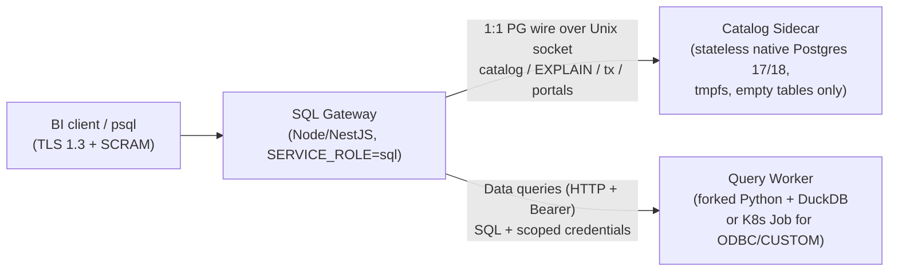

# PRD SG · Native Postgres catalog sidecar and query-path efficiency

|                  |                                                                                                                                                                                                                                                           |
| ---------------- | --------------------------------------------------------------------------------------------------------------------------------------------------------------------------------------------------------------------------------------------------------- |
| **Status**       | Implemented (SG0–SG4 code & local tests), 2026-11-25; live k3d `bi-smoke.sh` & §8.3 benchmarks pending                                                                                                                                                    |
| **Size**         | M–L (5 phases, SG0–SG4, each its own PR)                                                                                                                                                                                                                  |
| **Depends on**   | [DQ](DQ-data-query.md) §5.3 (warm query worker) & §5.7 (SQL gateway), [BIC](BIC-bi-client-compatibility.md) (Metabase/driver smoke harness and client corpus)                                                                                             |
| **Replaces**     | PGlite (`@electric-sql/pglite`, `pglite-host.ts`, `pglite-worker.ts`) in `apps/api/src/sql-gateway/`                                                                                                                                                      |
| **Used by**      | SQL connections (Metabase, Power BI, Excel, Tableau, psql, pgJDBC, psqlODBC, Npgsql), REST SQL page, MCP `query_data`, exports                                                                                                                            |
| **Not in scope** | Running DuckDB or data federation inside Postgres (`pg_duckdb`, `postgres_fdw`). Connection pooling/multiplexing across BI client sessions. Caching source row data. Replacing `queryWorker` process isolation with in-process shared DuckDB.              |

---

## 1. Summary

Classifyre's SQL gateway (`apps/api/src/sql-gateway/`) currently spawns **one PGlite instance (PostgreSQL in WebAssembly) inside its own Node `worker_threads` V8 isolate per open client connection**. That architecture proved BI compatibility quickly (real `pg_catalog`, `information_schema`, prepared statements, portals, transactions, and `EXPLAIN`), but it does not scale for multi-user BI workloads:

- **Gateway memory**: ~150 MB idle and ~450 MB busy per open connection (measured with Metabase, BIC M5). WASM linear memory never shrinks until the worker thread exits, so a 4 GiB gateway pod fits only ~6 busy sessions (`helm/classifyre/values.yaml`). Two BI tools with default 15-connection pools would need >13 GiB just to hold empty catalog tables.
- **Sign-in latency and CPU**: Every new connection copies the workspace data directory, boots WASM (0.8–2 s), and replays all `catalogDdl`. Because PGlite always starts as its bootstrap superuser, `PgSession.raw()` also fires an extra `WHO` (`current_user` / `is_superuser`) query after every `ReadyForQuery`, doubling catalog IPC/WASM CPU during BI schema sync.
- **Gateway heap amplification**: `decodeArrow()` (`sql-gateway.service.ts`) materialises every Arrow result into boxed JS `PlainValue[][]` arrays (stored in `Portal.rows` / `DataCursor.rows`) before encoding PG wire `DataRow` frames.
- **Query worker memory & CPU**: `warm.py` preloads DuckDB, PyArrow, SQLGlot, every source module, and 7 DuckDB extensions into the fork server without `gc.freeze()`, so CPython's cyclic GC breaks Linux Copy-on-Write (CoW) page sharing in forked query processes. Every BI dashboard card also pays a fresh `fork()` + ~0.5 s DuckDB extension verification (`delta`/`iceberg`) + `ATTACH` even when 6–12 cards arrive back-to-back for the same SQL connection.

This PRD does two things cleanly without compromising Classifyre's governance, connector coverage, or tenant isolation:

1. **Remove PGlite completely** and replace it with a **pod-local, stateless, native PostgreSQL catalog-only sidecar** using **one immutable empty database per `(workspace, catalogHash)`** and **one locked-down login role per database**. Data queries continue to run on `queryWorker` (DuckDB + all connectors + masks + row filters + audit) unchanged.
2. **Ship second-lever efficiency wins** on both the gateway hot path (direct Arrow → `DataRow` wire encoding, removing the `WHO` probe) and `queryWorker` (`gc.freeze()` CoW preservation, trimmed extension preloading, and measured short-TTL sticky reuse per `(workspace, connectionId)` for BI dashboard bursts).

---

## 2. Scope boundaries and honest trade-offs

Four architectural facts frame every number and decision in this PRD:

1. **The sidecar saves gateway memory only.** `queryWorker`'s memory per active query is unchanged by replacing PGlite; total cluster memory drops on the `sqlGateway` tier (idle + syncing BI pools), while `queryWorker` efficiency comes separately from §6 (CoW `gc.freeze()`, extension trimming, and sticky reuse).
2. **Expect 10–30 MB per connection on the sidecar for large catalogs, not a flat 5 MB.** Each native PostgreSQL backend maintains its own `relcache`/`syscache` of catalog objects it has read. BI tools scan the whole catalog at connect/sync time, so per-connection RSS scales with catalog size. Keeping each database scoped to only one access view keeps those caches small. Still a **10–30× reduction** from PGlite's 150–450 MB/connection.
3. **"Strong" isolation is not automatic on a shared Postgres server.**
   - *Metadata isolation* comes from the per-`(workspace, catalogHash)` database and role model (§4.2–§4.3).
   - *Failure blast radius* changes: unlike isolated PGlite worker threads, a backend crash (SIGSEGV or OOM kill) inside the sidecar restarts Postgres and drops every session **on that gateway replica**. Mitigations are mandatory: one pod-local sidecar per `sqlGateway` replica (never cluster-wide), strict per-role memory/CPU caps, and clean session teardown on sidecar restart (§4.5).
4. **Lock down what reaches the sidecar.** Any client SQL that reaches Postgres can burn shared CPU (e.g. `SELECT count(*) FROM generate_series(1, 1_000_000_000)`). The gateway must remain the strict gatekeeper of what reaches the sidecar, backed by per-role `statement_timeout`, `CONNECTION LIMIT`, `work_mem`, `temp_file_limit = 0`, and revoked dangerous functions (§4.3).

---

## 3. Requirements

| # | Requirement |
| --- | --- |
| R1 | `@electric-sql/pglite`, `pglite-host.ts`, and `pglite-worker.ts` are removed completely from the repository and `apps/api/package.json`. |
| R2 | Every BI client and driver check in [BIC](BIC-bi-client-compatibility.md) (Metabase, pgJDBC, psqlODBC, Npgsql, psql) and the full CI client statement corpus pass against the native Postgres catalog sidecar with zero regressions. |
| R3 | **Zero metadata leakage across users or tenants.** A connection's catalog database contains strictly the tables, columns, and mask/governance comments visible to that connection's effective access view. Database names are opaque hashes and never contain workspace or tenant names. |
| R4 | **Immutable catalogs per session.** A catalog change produces a new hash and a new database; live sessions never experience half-updated catalogs or DDL races during BI schema sync. |
| R5 | **Locked-down sidecar.** One login role per catalog database, no `SET ROLE`, no `CREATE`, no temp tables, `default_transaction_read_only = on`, per-role `statement_timeout` and `CONNECTION LIMIT`, `temp_file_limit = 0`, and risky functions (`pg_sleep*`, `pg_read_file*`, `lo_*`, `*_to_xml*`, `ts_stat`, `ts_rewrite`, `dblink`) revoked/absent. |
| R6 | **Gateway-only exposure, 1:1 session mapping.** Only the gateway container connects to its pod-local sidecar (Unix domain socket or `127.0.0.1`). Every live client connection owns exactly one dedicated sidecar connection (no pooling across clients). |
| R7 | **Bounded sidecar lifecycle.** Superseded and idle catalog databases + roles are reaped automatically (`DROP DATABASE ... WITH (FORCE)` + `DROP ROLE`), with an upper cap on live catalog databases and monitoring of database count and autovacuum overhead. |
| R8 | **All deployment targets work.** Helm (`deployment-sql-gateway.yaml` sidecar), all-in-one Docker image (`s6-overlay` catalog-only Postgres instance separate from the app DB), local skaffold dev, and CI tests. |
| R9 | **Gateway hot-path efficiency.** Data results are encoded into PG `DataRow` wire frames directly from Arrow column vectors without allocating `PlainValue[][]`, and the per-`ReadyForQuery` `WHO` role probe is removed. |
| R10 | **Query worker efficiency.** `warm.py` calls `gc.collect()` + `gc.freeze()` before forking; preloaded extensions are configurable and trimmed; optional short-TTL sticky reuse per `(workspace, connectionId)` is benchmarked and gated with strict isolation invariants (§6.3). |

---

## 4. Architecture: Native Postgres catalog-only sidecar

### 4.1 High-level flow



`PgSession` (`apps/api/src/sql-gateway/pg-session.ts`) already isolates backend interaction behind three primitives (`raw(bytes)`, `exec(sql)`, `close()`). We extract a `CatalogBackend` / `CatalogSession` interface and replace `PgliteHost` with `PostgresCatalogHost`:

- **Admin pool** (small, 2–4 connections to `postgres` maintenance DB as the sidecar's internal admin user): creates `classifyre_tpl` at startup, provisions new `c_<hash>` databases + `r_<hash>` roles on demand, and runs the sweeper to drop stale ones.
- **Session socket** (1 raw `net.Socket` per signed-in client, connected over Unix domain socket directly to `c_<hash>` as `r_<hash>`): forwards PostgreSQL v3 wire bytes directly (`raw(bytes) -> bytes`) with zero Node `pg` driver re-parsing overhead on the hot path.

### 4.2 Database-per-`(workspace, catalogHash)` model

At sign-in (`SqlGatewayService.openSession`), the gateway builds `CatalogDdl` for the connection's effective access view (already filtered by `canQuery`, hidden columns omitted, masked columns annotated, governance notes attached):

1. **Hash computation**:
   ```
   catalogHash = sha256(
     "v1\0" + workspaceId + "\0" + canonicalCatalogDdlSql
   ).hex().slice(0, 24)
   ```
   - Database name: `c_<24hex>` (26 chars, opaque — reveals no tenant/workspace/user name).
   - Role name: `r_<24hex>` (26 chars, 1:1 with the database).
   - Because `canonicalCatalogDdlSql` already captures the post-access-control schema (tables, columns, types, comments, mask markers), two connections in the same workspace with identical effective views share one tiny database, while users with different access or masks get distinct databases.
2. **Creation (single-flight per hash)**:
   - Concurrent sign-ins for the same `catalogHash` (e.g., a BI tool opening a 15-connection pool at once) coalesce on a single in-flight creation promise.
   - Provisioning sequence on the admin connection:
     1. `CREATE ROLE r_<hash> LOGIN PASSWORD '<ephemeral-random>' NOSUPERUSER NOCREATEDB NOCREATEROLE NOINHERIT NOREPLICATION CONNECTION LIMIT <roleLimit>;`
     2. Apply role-level session defaults (§4.3).
     3. `CREATE DATABASE c_<hash> TEMPLATE classifyre_tpl OWNER <admin>;`
     4. `REVOKE ALL ON DATABASE c_<hash> FROM PUBLIC; GRANT CONNECT ON DATABASE c_<hash> TO r_<hash>;`
     5. Connect to `c_<hash>` as admin, run `catalogDdl.sql` (schemas, empty tables, comments), then `GRANT USAGE ON SCHEMA ... TO r_<hash>` and `GRANT SELECT ON ALL TABLES IN SCHEMA ... TO r_<hash>` (never `ALL` or `CREATE`).
   - Creating from `classifyre_tpl` (which already contains `classifyre.reads()`, `classifyre.fail()`, and revoked built-ins) takes tens to a few hundred milliseconds and a few MB on `tmpfs`.
   - **Immutability**: Once `c_<hash>` is marked ready, no DDL ever runs on it again. If the workspace's catalog or a user's grants change, the next sign-in computes a new `catalogHash` and gets a new database without disturbing active sessions.
3. **Database name visibility (`current_database()` / `table_catalog`)**:
   - Inside `c_<hash>`, PostgreSQL's `current_database()` and `information_schema.tables.table_catalog` return `c_<hash>` (opaque, no tenant name leak).
   - Verified in the captured Metabase 0.65.6.2 and psqlODBC 18 corpora: neither queries `current_database()` or filters on `table_catalog`.
   - **SG0 spike requirement**: verify pgJDBC, psqlODBC, Npgsql, Metabase, and `psql` against an opaque `c_<hash>` database name. If any driver rejects `table_catalog != startup_database`, decide in SG0 whether to document the opaque name or apply a targeted rewrite strictly on `information_schema` views in `classifyre_tpl` (never mutating arbitrary user `DataRow` payloads).

### 4.3 Security lockdown of the sidecar

Every layer is enforced by PostgreSQL itself, not just gateway heuristics:

| Control | Mechanism |
| --- | --- |
| **Role scope** | One login role `r_<hash>` per `c_<hash>`. `REVOKE CONNECT ON DATABASE c_<hash> FROM PUBLIC`. `r_<hash>` has `CONNECT` on `c_<hash>` only and cannot see or connect to any other database's objects. `NOINHERIT`, no `SET ROLE` target memberships. |
| **No writes / no DDL / no temp tables** | `REVOKE CREATE ON SCHEMA public FROM PUBLIC`; `REVOKE TEMP ON DATABASE c_<hash> FROM PUBLIC`; `ALTER ROLE r_<hash> SET default_transaction_read_only = on;`. Gateway also continues rejecting write/DDL verbs before forwarding (`WRITE_VERBS` in `pg-session.ts`). |
| **CPU & memory guards per role** | `ALTER ROLE r_<hash> SET statement_timeout = '<catalogStatementMs>';` (default `15s`, configurable via `SQL_GATEWAY_CATALOG_STATEMENT_SECONDS`); `ALTER ROLE r_<hash> SET lock_timeout = '5s';`; `ALTER ROLE r_<hash> SET work_mem = '4MB';`; `ALTER ROLE r_<hash> SET temp_file_limit = '0';`; `ALTER ROLE r_<hash> CONNECTION LIMIT <maxPerRole>;`. |
| **Risky functions & extensions** | In `classifyre_tpl`: revoke `EXECUTE` from `PUBLIC` on `pg_sleep`, `pg_sleep_for`, `pg_sleep_until`, `pg_read_file*`, `pg_read_binary_file*`, `pg_ls_dir*`, `pg_stat_file*`, `lo_*`, `*_to_xml*`, `ts_stat`, `ts_rewrite`, `query_to_xml_and_xmlschema`. Never install `dblink`, `postgres_fdw`, `file_fdw`, or untrusted PL languages. Keep `classifyre` schema restricted (`REVOKE ALL ON SCHEMA classifyre FROM PUBLIC; GRANT USAGE ON SCHEMA classifyre TO PUBLIC; GRANT EXECUTE ON FUNCTION classifyre.reads(text, text), classifyre.fail(text, text) TO PUBLIC;` — and ensure `classifyre.reads` is `SECURITY INVOKER` so it runs strictly with `r_<hash>`'s privileges). |
| **Network exposure** | Sidecar runs with `listen_addresses = ''` and `unix_socket_directories = '/var/run/sql-catalog-pg'` (shared `emptyDir` mounted only into `sql-gateway` and `catalog-postgres` containers in the same Pod). Zero TCP ports exposed; unreachable from any other pod or client. |
| **Gateway query gatekeeping** | `PgSession` continues classifying every statement via `classifyre.reads()` and `unservedRead()`. Data-table statements never execute on the sidecar; mixed catalog + data queries are refused (`0A000`); `PREPARE`/`EXECUTE`/`EXPLAIN ANALYZE` over data tables are refused. |
| **No `assertRole()` (`WHO`) needed** | Because each session authenticates to Postgres directly as the non-superuser role `r_<hash>` (with no superuser bootstrap session to revert to), `SET SESSION AUTHORIZATION` / `RESET SESSION AUTHORIZATION` cannot elevate privileges. Removing `assertRole()` eliminates ~50% of catalog wire round-trips. |

### 4.4 Sidecar tuning, cleanup, and scaling limits

Because the sidecar stores **zero durable data** (everything is reconstructed from Classifyre's metadata on demand):

- **PostgreSQL configuration** (`postgresql.conf` flags passed on container args):
  - `fsync = off`, `synchronous_commit = off`, `full_page_writes = off`, `wal_level = minimal`, `max_wal_senders = 0` (ephemeral `emptyDir` / `tmpfs` data dir).
  - `shared_buffers = 128MB` (tunable via Helm), `work_mem = 4MB`, `temp_file_limit = 0`, `max_connections = <maxSessions + 16>` (reserving slots for admin/sweeper).
  - `autovacuum_max_workers = 1`, `autovacuum_naptime = 5min` — catalog tables have 0 rows and are immutable after creation, so aggressive autovacuum only wastes CPU when hundreds of databases exist.
  - `jit = off` (catalog queries are tiny; JIT compilation adds latency and memory without helping).
- **Database & role garbage collection (sweeper)**:
  - The gateway tracks `{ hash, workspaceId, connectionId, activeSessions, lastUsedAt, createdAt }` in memory (and reconciles against `pg_database WHERE datname LIKE 'c_%'` at startup so crashed/restarted gateways clean up orphans).
  - Every 60 s, the sweeper drops any `c_<hash>` with `activeSessions === 0` when:
    1. a newer `catalogHash` has been opened for the same `(workspaceId, connectionId)` (immediate grace window, e.g. 2 min), OR
    2. `lastUsedAt` is older than `SQL_GATEWAY_CATALOG_DB_TTL_MINUTES` (default `30`), OR
    3. total catalog databases exceed `SQL_GATEWAY_MAX_CATALOG_DBS` (default `256`, LRU eviction of idle databases).
  - Drop sequence: `DROP DATABASE IF EXISTS c_<hash> WITH (FORCE);` (Postgres 13+) followed by `DROP ROLE IF EXISTS r_<hash>;`.
- **Monitoring & guardrails**:
  - Export metrics from the gateway: `classifyre_sql_gateway_catalog_dbs` (gauge), `classifyre_sql_gateway_catalog_db_create_seconds` (histogram), `classifyre_sql_gateway_catalog_db_drops_total` (counter), `classifyre_sql_gateway_sidecar_restarts_total` (counter), and `classifyre_sql_gateway_sessions_active` (gauge).
  - Document the scaling envelope: into the thousands of live databases on a single sidecar, background vacuum and `pg_database` catalog scans grow noticeably. Keep `SQL_GATEWAY_MAX_CATALOG_DBS` bounded per pod (default 256) and scale horizontally via `sqlGateway.replicaCount`.

### 4.5 Handling shared-sidecar crashes and restarts

Because all sessions on one gateway pod share one Postgres sidecar:
- **Pod-local blast radius**: each `sqlGateway` replica has its own sidecar container. Scaling `sqlGateway.replicaCount` spreads both connections and crash blast radius.
- **Crash recovery**: if the sidecar exits/restarts, every active `PostgresCatalogSession` detects socket EOF/error, sends `57P01` (`The SQL gateway lost this session`) to the client, closes the client socket cleanly, clears the gateway's in-memory database registry, and re-runs `classifyre_tpl` initialisation on reconnect.
- **Liveness/readiness**: the `sql-gateway` readiness probe verifies both the gateway listener and sidecar socket health so Kubernetes stops routing new connections while a sidecar is recovering.
- **Admission & memory guard**: update `memory-guard.ts` and `values.yaml` defaults:
  - `sqlGateway.maxSessions`: raise default from `16` → `64` (configurable).
  - `sqlGateway.maxSessionsPerConnection`: raise default from `4` → `16` (matches Metabase's default 15-connection pool out of the box!).
  - `sqlGateway.sessionMemoryMb`: change gateway-side reservation from `450` (PGlite WASM) to `32` (Node socket + Arrow stream headroom), while the sidecar container carries its own explicit Kubernetes memory request/limit (e.g., `requests: 256Mi`, `limits: 1Gi–2Gi`, sized for ~10–30 MB/connection × `maxSessions`).

### 4.6 Deployment targets

| Target | How the catalog sidecar runs |
| --- | --- |
| **Helm (`deployment-sql-gateway.yaml`)** | Native Kubernetes sidecar container `catalog-postgres` (`postgres:17-alpine`, `readOnlyRootFilesystem: true`, non-root uid 70/10001, `emptyDir` on `/var/lib/postgresql/data` and `/var/run/sql-catalog-pg`, `drop: [ALL]`, `allowPrivilegeEscalation: false`). No PVC, no Service. |
| **All-in-one Docker (`docker/`)** | Separate `s6-overlay` service (`sql-catalog-pg`) using the `postgresql-${PG_MAJOR}` binary already installed in `docker/Dockerfile`, with its own ephemeral data dir (`/tmp/sql-catalog-pg`) and Unix socket — **strictly isolated** from Classifyre's main Postgres cluster (`PGDATA`). |
| **Local dev & CI tests** | Skaffold deploys the Helm sidecar directly. For `apps/api` integration/corpus tests (`pg-session.integration.spec.ts`), `PostgresCatalogHost` connects to a local ephemeral `initdb` + `postgres` process (or `SQL_GATEWAY_CATALOG_PG_SOCKET` in CI service container). Zero dependency on `@electric-sql/pglite`. |

---

## 5. Second-lever wins: Gateway hot path

Even after replacing PGlite, the gateway's Node process still touches every data row returned to BI clients:

### 5.1 Direct Arrow → PG wire `DataRow` encoding (drop `decodeArrow()`)
Currently, `sql-gateway.service.ts:1196-1207` calls `decodeArrow(result.arrow)`, which iterates every row and column of the Apache Arrow `Table` and allocates a boxed JavaScript `PlainValue[][]` array-of-arrays. That array is held in `Portal.rows` and `DataCursor.rows` (`pg-session.ts:121-130`) until the portal/cursor closes.

**Change**:
- Keep the parsed Apache Arrow `Table` (columnar typed arrays backed by the IPC `Buffer`) directly in `DataResult`, `Portal`, and `DataCursor` instead of `PlainValue[][]`.
- Encode PG wire `DataRow` frames on demand for `[offset, offset + fetchCount)` directly from `table.getChildAt(colIndex).get(rowIndex)` → `encodeValue(...)`.
- For portal paging (`Execute` with `maxRows > 0`, e.g., pgJDBC `fetchSize` and Metabase downloads M13) and `FETCH N` cursors (psqlODBC `UseDeclareFetch=1`), only the requested slice is ever converted to wire bytes, and the Arrow IPC buffer is freed as soon as the portal/cursor closes.
- **Expected impact**: ~2–4× lower gateway V8 heap peak and significantly less GC pause CPU on 10k–100k row BI exports/downloads.

### 5.2 Remove `assertRole()` (`WHO`) round-trip
Once the gateway connects to the sidecar as the non-superuser role `r_<hash>`, remove `assertRole()`, `WHO`, `WHO_PORTAL`, and `SessionEscape` checks after `ReadyForQuery` in `pg-session.ts`.
- **Expected impact**: ~50% fewer wire round-trips during Metabase schema sync and driver introspection.

### 5.3 Slimmer gateway V8 heap budget
With PGlite worker threads and `PlainValue[][]` removed, lower `sqlGateway.maxOldSpaceSizeMb` default from `1024` → `512` (and `sqlGateway` Node container limit from `4Gi` → `1Gi`, allocating `1Gi–2Gi` to the `catalog-postgres` sidecar container — net pod memory limit drops from `4Gi` for ~6 busy sessions to `2Gi–3Gi` for 64+ sessions).

---

## 6. Second-lever wins: `queryWorker` memory & CPU

The native sidecar does not reduce `queryWorker` memory or CPU. Three targeted improvements address `queryWorker` (`apps/cli/src/query/`):

### 6.1 Preserve Linux Copy-on-Write with `gc.freeze()` (`warm.py`)
`warm_up()` (`apps/cli/src/query/warm.py:112-179`) imports DuckDB, PyArrow, SQLGlot, all query bindings, and every source module into the fork server, then forks one child process per query. Because `gc.freeze()` is never called, CPython's cyclic GC walks and mutates GC headers on preloaded objects inside every forked child, triggering CoW page faults that duplicate tens of MB of shared forkserver memory per concurrent query.

**Change**:
- At the end of `warm_up()` (after closing the warm-up DuckDB connection and confirming single-threaded state), call:
  ```python
  gc.collect()
  gc.freeze()
  ```
- Measure private dirty RSS (`Pss` / `Private_Dirty` in `/proc/<pid>/smaps_rollup`) before and after under 8 concurrent queries on Linux.

### 6.2 Trim preloaded DuckDB extensions (`warm.py`)
`DEFAULT_EXTENSIONS` (`warm.py:38-46`) preloads all 7 extensions (`httpfs`, `azure`, `delta`, `iceberg`, `ducklake`, `postgres`, `mysql`) regardless of what sources exist in the deployment.
- Measure RSS and startup-time impact per extension.
- Expose `queryWorker.preloadExtensions` cleanly in `helm/classifyre/values.yaml` (mapping to `CLASSIFYRE_QUERY_WORKER_EXTENSIONS`) so operators can limit preloading to their active connectors.

### 6.3 Short-TTL sticky worker reuse per `(workspace, connectionId)` (Phase SG4, benchmark-gated)
Currently, every BI dashboard card (e.g., 6–12 cards firing simultaneously from Metabase for the same SQL connection) forks a brand-new process, opens a fresh DuckDB database, re-verifies extensions (~0.5 s for `delta` + `iceberg`, `warm.py:12-14`), and re-runs `ATTACH` against remote catalogs.

**Design (strictly isolated, bounded memory)**:
- Allow `queryWorker` to keep a **warm child process** alive for a short idle TTL (default `60s`, configurable; `0` disables reuse) keyed strictly by `(workspaceId, connectionId, sourceCredsDigest)`:
  - **Zero cross-tenant or cross-role sharing**: a sticky process is *only* eligible for subsequent queries carrying the exact same workspace, SQL connection, and credential/source digest.
  - **Single-query concurrency per sticky process**: if 2 cards arrive simultaneously for the same connection, slot 1 uses the sticky process and slot 2 forks a fresh process (no shared GIL, no concurrent DuckDB session state collision).
  - **Hard isolation preserved**: `ODBC` and `CUSTOM` remain `job_only` (never run in `queryWorker`). Sticky processes remain `PR_SET_DUMPABLE=0`, keep their private `TMPDIR` (cleaned between queries), reset DuckDB views/temp state between queries, and are immediately killed on timeout, cancel, crash, per-query memory cap, or pod memory guard (evicting idle sticky workers *first* before touching active queries when the memory guard approaches its threshold).
  - **Memory bound**: cap total idle sticky workers per pod (e.g., `maxIdleSticky = min(4, slots // 2)`), so idle BI connections do not accumulate memory indefinitely.
- **Gate**: SG4 ships behind a flag (`queryWorker.stickySessionTtlSeconds`, default `0` until benchmarked on `bi-smoke` M12 dashboard bursts) and is enabled by default only if it measurably cuts dashboard CPU/p95 latency without regressing pod memory headroom.

---

## 7. Phased plan

| Phase | Scope | Key deliverables |
| --- | --- | --- |
| **SG0 · Spike & quick wins** | Validate native sidecar assumptions + land zero-risk efficiency wins | 1. Spike `postgres:17-alpine` on `tmpfs` with `c_<hash>` DBs: measure DB creation time, per-connection RSS on small vs large catalogs (50 vs 1,000 tables), and driver compatibility (`current_database()` / `table_catalog`) across Metabase, pgJDBC, psqlODBC, Npgsql, psql.<br>2. Land `gc.collect()` + `gc.freeze()` in `warm.py` and `queryWorker.preloadExtensions` in Helm.<br>3. Land direct Arrow → `DataRow` encoding in `sql-gateway` (remove `decodeArrow()` `PlainValue[][]`). |
| **SG1 · `PostgresCatalogHost` + lock-down** | Replace PGlite behind `CatalogBackend` | 1. Implement `PostgresCatalogHost` / `PostgresCatalogSession` (raw PG wire over Unix socket, 1:1 per client, single-flight `c_<hash>` + `r_<hash>` provisioning from `classifyre_tpl`).<br>2. Enforce full role/function/timeout/connection-limit lockdown (§4.3).<br>3. Implement database/role sweeper (`DROP DATABASE ... WITH (FORCE)` + `DROP ROLE`) and metrics (§4.4).<br>4. Remove `assertRole()` (`WHO`) round-trips from `pg-session.ts`. |
| **SG2 · Packaging & PGlite removal** | Wire Helm, Docker, CI, and delete PGlite | 1. Add `catalog-postgres` sidecar to `helm/classifyre/templates/deployment-sql-gateway.yaml` and values/resources/defaults (`maxSessions: 64`, `maxSessionsPerConnection: 16`).<br>2. Add ephemeral `sql-catalog-pg` s6 service to `docker/` (all-in-one image).<br>3. Switch `pg-session.integration.spec.ts` and CI client corpus to ephemeral native Postgres.<br>4. Delete `pglite-host.ts`, `pglite-worker.ts`, and `@electric-sql/pglite` from `apps/api/package.json`. |
| **SG3 · Verification & load/chaos testing** | Prove compatibility, isolation, and memory/CPU gains | 1. Run full `scripts/dev/bi-smoke.sh` (Metabase + pgJDBC + psqlODBC + Npgsql + psql).<br>2. Run security/isolation tests (§8.2): cross-DB connect refusal, `SET ROLE` refusal, `CREATE`/`TEMP` refusal, `generate_series` CPU timeout, `pg_sleep`/XML function refusal, sidecar crash recovery.<br>3. Benchmark 30+ concurrent BI connections (two Metabase 15-connection pools) vs baseline and record before/after RSS & CPU. |
| **SG4 · Sticky `queryWorker` reuse** | Cut `queryWorker` CPU & latency on BI dashboard bursts | 1. Implement `(workspaceId, connectionId, sourceCredsDigest)` short-TTL sticky worker reuse in `worker.py` with LRU eviction under memory pressure.<br>2. Benchmark `bi-smoke` dashboard burst (M12) CPU, p95 latency, and pod RSS; enable by default if benchmarks confirm net win. |

---

## 8. Testing and acceptance criteria

### 8.1 Functional & BI compatibility
- All existing unit tests (`pg-protocol`, `pg-types`, `catalog-ddl`, `sql-text`, `sign-in`, `memory-guard`, `query-worker`) pass.
- Full CI client statement corpus (`apps/api/src/sql-gateway/fixtures/client-corpus/`) passes against native Postgres sidecar.
- `scripts/dev/bi-smoke.sh` passes 100% of checks (Metabase sync + cards + downloads, pgJDBC, psqlODBC, Npgsql, psql) with **zero sync errors** and identical results to Classifyre's REST query API.

### 8.2 Isolation, lockdown, and resilience tests (required before SG2 merges)
- **No metadata leak**: User A (access to 2 tables) and User B (access to 10 tables) in the same workspace get different `c_<hash>` DBs; User A cannot see User B's tables in `information_schema` or `pg_class`, and cannot `CONNECT` to User B's `c_<hash>`.
- **Role lockdown**: `SET ROLE`, `RESET SESSION AUTHORIZATION`, `CREATE TABLE`, `CREATE TEMP TABLE`, `SELECT pg_sleep(1)`, `SELECT query_to_xml(...)`, and `SELECT pg_read_file(...)` all fail with permission/read-only errors.
- **CPU / memory abuse**: `SELECT count(*) FROM generate_series(1, 1000000000)` is cancelled at `statement_timeout` without affecting other concurrent sessions on the pod; a query exceeding `work_mem` with `temp_file_limit = 0` fails cleanly instead of filling disk or OOMing the sidecar.
- **Catalog immutability & cleanup**: Granting a new table creates a new `c_<hash>` for new connections while existing sessions continue uninterrupted; once the old session disconnects, the sweeper drops the old `c_<hash>` and `r_<hash>` cleanly.
- **Sidecar crash recovery**: Killing the `catalog-postgres` process cleanly closes live client sockets with `57P01`, recovers `classifyre_tpl`, and serves new connections within seconds without restarting the gateway container.
- **Sticky worker isolation (SG4)**: Queries from two different users or connections in the same workspace never reuse each other's sticky process; a sticky process exceeding memory or timing out is killed alone.

### 8.3 Efficiency targets (measured on skaffold / Linux k3d)
- **Gateway memory**: 30 concurrent open BI connections (two 15-connection Metabase pools, synced) stay under **1.5 GiB total pod RSS** (gateway + sidecar combined), vs OOM on a 4 GiB pod at ~7 connections today.
- **Sign-in latency**: Connection #2..#15 in a BI pool (warm `c_<hash>`) completes sign-in in **< 100 ms** (vs 0.8–2 s with PGlite).
- **Gateway heap on large result**: 50,000-row BI download shows ≥ 50% lower peak Node heap delta vs `decodeArrow()` `PlainValue[][]`.
- **Query worker CoW RSS**: Measurable drop in per-child `Private_Dirty` RSS under 8 concurrent queries after `gc.freeze()`.

---

## 9. Open questions for SG0

1. **Postgres major version for sidecar**: Pin to the same `PG_MAJOR` as `docker/Dockerfile` (e.g., PostgreSQL 17/18) so Helm and the all-in-one image share identical catalog behaviour and `pg_catalog` schema.
2. **Opaque `current_database()` in BI tools**: Confirm in SG0 whether any driver (especially Npgsql or psqlODBC `SQLTables`) compares `table_catalog` to the startup `database` parameter when `current_database()` returns `c_<hash>`.
3. **Gateway container base memory**: Confirm whether `SERVICE_ROLE=sql` can skip loading unused NestJS modules (e.g., scan/autopilot/embedding modules) to bring the gateway Node container's own baseline RSS down further.
