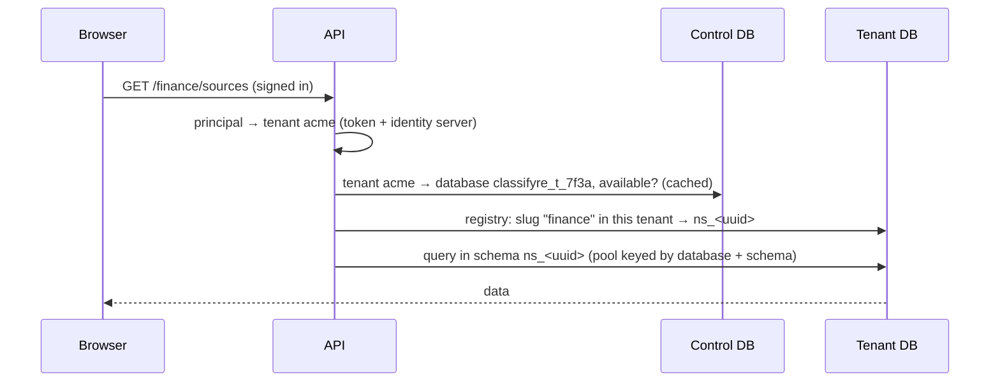
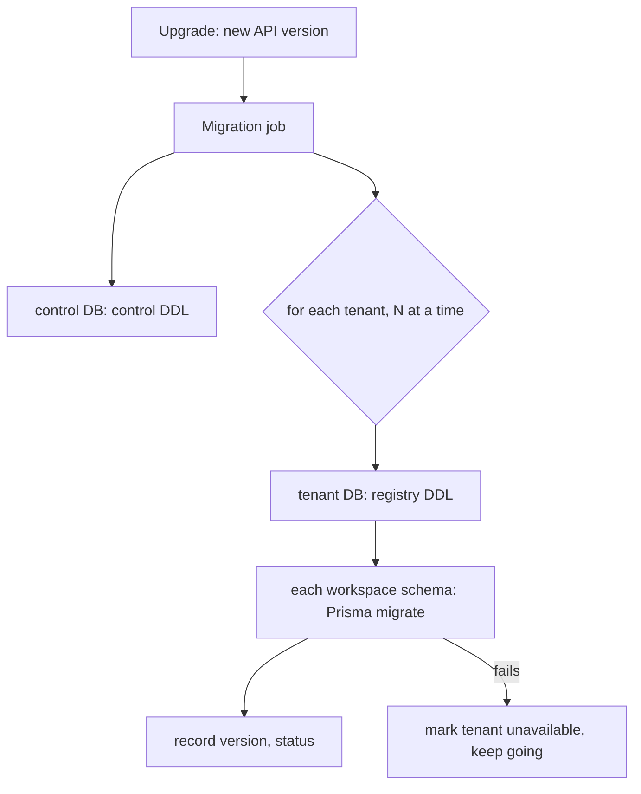

# PRD TEN · Tenant isolation, operators and the cloud playground

|                  |                                                                                                                   |
| ---------------- | ----------------------------------------------------------------------------------------------------------------- |
| **Status**       | Plan, 2026-11-07. Nothing built yet.                                                                              |
| **Size**         | L (5 phases, each its own PR or set of PRs)                                                                       |
| **Depends on**   | [IAM · Identity and access management](IAM-access-management.md) (steps 0–8c: tenants, grants, people and groups) |
| **Not in scope** | billing, per-record rules, a second identity server, moving the all-in-one Docker image off its single database   |

## 1. Summary

Three things are asked for:

1. **Sign-in off and sign-in on must never see each other's data.** Today one database holds every workspace, and tenants are only a column (`namespaces.tenant_id`). With sign-in off the API ignores that column, so anyone who turns `iam.enabled` off, even by mistake, sees every tenant's workspaces. That is a security problem, not a convenience one.
2. **Someone must manage the tenants themselves.** A tenant admin manages one tenant. Creating tenants and giving them their first admins is done today in the identity server's console, which is not tenant-scoped and has no place in Classifyre.
3. **A cloud version later**, where people sign up, get a tenant, and connect their own company sign-in (identity providers). Not built now, but the shape chosen here has to carry it.

The plan: **one open database for sign-in off, and with sign-in on a control database plus one database per tenant.** Which databases an API process may open is decided by the mode it starts in, and every database says what kind it is, so the wrong mode cannot open the wrong data. Operators get a **Platform** page in Classifyre for tenants. The cloud adds self-service sign-up and per-tenant sign-in methods on top of the same provisioning.

```mermaid
flowchart LR
  subgraph off["iam.enabled: false"]
    A1[API] --> O[(classifyre<br/>kind: open)]
  end
  subgraph on["iam.enabled: true"]
    A2[API] --> C[(classifyre_control<br/>kind: control)]
    A2 --> T1[(classifyre_t_acme<br/>kind: tenant)]
    A2 --> T2[(classifyre_t_globex<br/>kind: tenant)]
    C -. "routing: tenant → database" .-> T1
    C -. .-> T2
  end
  A1 -. "never" .- C
  A2 -. "never" .- O
```

## 2. Today (facts this plan builds on)

| Piece                  | Today                                                                                                                                                               |
| ---------------------- | ------------------------------------------------------------------------------------------------------------------------------------------------------------------- |
| Database               | One Postgres database (`DB_NAME`), embedded or CloudNativePG.                                                                                                       |
| Workspace registry     | `public.namespaces` (raw SQL), with `tenant_id` and `owner_group_id` since IAM step 5.                                                                              |
| Workspace data         | One schema per workspace (`ns_<uuid>`), migrated with Prisma.                                                                                                       |
| Connections            | `PrismaClientManager`: a pool per schema (`PRISMA_POOL_MAX`, default 16), at most `PRISMA_MAX_RESIDENT` (20) resident per pod with LRU eviction; pools open lazily. |
| Queues and locks       | pg-boss per workspace; advisory locks for worker leadership; `pg` pools in the registry, tenancy, scheduler, export.                                                |
| CLI jobs and notebooks | CLI jobs get a `DATABASE_URL` for their workspace schema; notebook code never sees it (`cli/src/sources/custom/env.py`).                                            |
| Tenants                | `public.iam_tenants`, `iam_grants`, `iam_audit_events`, `iam_people`, `iam_principals` in the same database.                                                        |
| Turning sign-in on     | Before phase 0: `adoptLocalWorkspaces` moved every workspace without a tenant into the first tenant. Removed in phase 0.                                            |
| Turning sign-in off    | Before phase 0: the API listed and opened **every** workspace, of every tenant. Since phase 0 only `local` ones.                                                    |
| Workspace addresses    | `/<slug>` is one URL space for all tenants, so a taken address shows that it exists somewhere (IAM review M-4, accepted).                                           |

## 3. Requirements

| #   | Requirement                                                                                                                                                              |
| --- | ------------------------------------------------------------------------------------------------------------------------------------------------------------------------ |
| R1  | With sign-in off, the API opens only the open database. No tenant's data is reachable, whatever is in the environment.                                                   |
| R2  | With sign-in on, the API never opens the open database. Workspaces made without sign-in reach a tenant only by an explicit operator action, never by turning sign-in on. |
| R3  | Every database records its kind (`open`, `control`, `tenant`) and, for a tenant database, which tenant. The API refuses to start, or to serve a tenant, on a mismatch.   |
| R4  | A tenant's data is in its own database: it can be backed up, restored, exported, moved to another server and deleted on its own.                                         |
| R5  | An idle tenant costs no connections. The connection budget rule of today still holds, now per server.                                                                    |
| R6  | One upgrade migrates the control database and every tenant database. A tenant whose migration fails is unavailable on its own (503); the others keep working.            |
| R7  | Each tenant database has its own database role. No role can read another tenant's database.                                                                              |
| R8  | Operators create, suspend, resume and delete tenants and give them their first admins from Classifyre, without the identity server's console.                            |
| R9  | Operators see tenants, not their data. Entering a tenant's workspaces needs a grant inside that tenant, and is audited like any other access.                            |
| R10 | Workspace addresses are per tenant: two tenants can both have `/finance`, and nobody learns about another tenant's workspaces.                                           |
| R11 | Cloud (later): sign-up creates a tenant through the same provisioning as R8; a tenant admin connects the tenant's own identity providers; per-tenant limits.             |
| R12 | The all-in-one Docker image keeps one open database and never sees any of this.                                                                                          |

## 4. Design

### 4.1 Databases and what is in them

| Database                | Kind      | Holds                                                                                                                                                                                                                           |
| ----------------------- | --------- | ------------------------------------------------------------------------------------------------------------------------------------------------------------------------------------------------------------------------------- |
| `classifyre` (as today) | `open`    | Everything it holds today, for sign-in off: registry, categories, workspace schemas. No `iam_*` tables are used.                                                                                                                |
| `classifyre_control`    | `control` | Tenants (alias, organization id, status, database name, server, role, schema version, limits), the tenant routing, operators' audit trail, provisioning jobs, `iam_principals` (names for actor references). No workspace data. |
| `classifyre_t_<id>`     | `tenant`  | One tenant: its registry (`namespaces`, categories), grants, tenant audit trail, `iam_people`, and its workspace schemas `ns_<uuid>`.                                                                                           |

A tenant database has **the same layout as the open database** plus the tenant tables. So the registry, the workspace migrations, pg-boss and every service that works on "the database" run unchanged on either; only which database they are pointed at changes. `<id>` is a short, stable id, not the alias, so renaming a tenant never renames a database.

Every database gets a one-row table `classifyre_database (kind, tenant_id, created_at)`, written when it is created. It is the R3 check.

### 4.2 The mode guard (R1–R3)

At boot the API reads `IAM_ENABLED` and opens the database it is configured with:

- **Sign-in off:** that database must be `kind = open`. Anything else and the API refuses to start, with a message that names the kind it found. The open-mode API has no credentials for any other database and no code path that reads the control database.
- **Sign-in on:** the configured database must be `kind = control`. The API opens tenant databases only through the control database's routing, and checks each one's marker (`kind = tenant`, matching `tenant_id`) the first time it opens it. A mismatch marks that tenant unavailable and alerts; it never falls back.
- **A fresh empty database** gets its marker from the mode it is first started in. The chart passes the two modes different database names (`postgres.database` and `iam.controlDatabase`), so switching `iam.enabled` changes which database is used rather than reinterpreting one.

So turning sign-in off by mistake shows the open database, which is empty or holds only what was made without sign-in, and turning it back on shows the tenants exactly as they were.

### 4.3 Routing a request



- The namespace hook already resolves the principal before the workspace. It resolves the slug **in the principal's tenant database**, which gives R10 for free: `/finance` means "finance in my tenant", and another tenant's `/finance` does not exist for me.
- `PrismaClientManager` keys its pools by `(database, schema)` instead of `schema`. LRU eviction, pinning and the interactive/background lanes stay as they are.
- The tenant routing is cached per pod for a minute and dropped when an operator changes a tenant, like the membership cache.
- CLI jobs get the `DATABASE_URL` of their tenant's database and workspace schema, with the tenant's role (R7); the job template already takes it from the API.

### 4.4 Connections and performance (R5)

- Pools stay lazy: a tenant nobody uses holds no connections. The budget rule becomes "pool size × resident `(database, schema)` pairs per pod, summed over replicas, under `max_connections` **of each server**".
- Per-database connection overhead in Postgres is small, but many small pools add up. Past a few dozen active tenants per server, put **PgBouncer** (transaction pooling) in front; the chart gets an optional `pgbouncer` block. Prisma's driver adapter works with it when prepared statements are off; this is verified in phase 1, not assumed.
- pg-boss stays per workspace, so a busy tenant's queues never block another's. Worker leadership uses advisory locks per database.
- The control database is small and hot (routing, principals); it is read through a cache and never on the hot path of a query.
- A large tenant can live on its own Postgres server: the routing stores the server per tenant, so moving a tenant is dump, restore and one row.

### 4.5 Provisioning a tenant

One provisioning routine, used by the operator page (R8), the cloud sign-up (R11) and the first boot:

1. Row in `classifyre_control.tenants` with status `provisioning`.
2. Database and role: `CREATE ROLE ... LOGIN PASSWORD ...; CREATE DATABASE classifyre_t_<id> OWNER ...; REVOKE CONNECT ... FROM PUBLIC` (R7). The API uses a **provisioner role** with `CREATEDB`/`CREATEROLE` and nothing else, kept apart from its data roles. On CloudNativePG the chart can let the operator create databases with `Database` resources instead; a managed cloud database uses its own API. One interface, three implementations, picked by `iam.tenantDatabases.provisioner`.
3. Marker row, tenant tables, registry DDL, default category: the same code that prepares the open database today.
4. Identity server: organization (alias, name), its top-level `admins` group, the first admin (an existing account, or a new one with a temporary password), using the rights the API already has with `iam.peopleManagement`.
5. Status `active`. Every step is idempotent and recorded, so a failed provisioning is resumed or rolled back from the operator page, never left half-made.

**Secrets.** Each tenant's database password is generated at provisioning and stored encrypted in the control database (AES-256-GCM, key from a chart Secret, `iam.tenantDatabases.keySecret`). The open-mode API never has that key. Rotation is an operator action per tenant, or all tenants, that sets a new password and updates the row in one step. Kubernetes Secrets per tenant are not used: they do not scale to many tenants and would need the API to write Secrets.

### 4.6 Migrations (R6)



- The pre-boot migration step that runs today for one database runs for the control database, then for each tenant database with a concurrency limit (`iam.tenantDatabases.migrationConcurrency`, default 4).
- Each tenant row records `schema_version`, `migrated_at` and `migration_error`. An API pod serves a tenant only when its version matches the code; otherwise that tenant answers 503 with "being upgraded" or "upgrade failed", and the others work.
- Workspace schemas inside a tenant are migrated the way they are today; nothing changes there.
- A new tenant is created at the current version, so provisioning never waits for a migration run.

### 4.7 Operators and the Platform page (R8, R9)

- **Who is an operator:** a realm role `classifyre-operator` in the identity server, given by whoever runs the installation (first one from the chart, `iam.bootstrap.operator`). An operator is not a member of any organization. Today such a person gets "not in a tenant"; with this they get the Platform page instead.
- **Capability:** `platform.tenants.manage` (already in the catalogue, role _Platform operator_, unused so far).
- **The Platform page** (`/platform`): tenants with status, size, workspaces count, schema version and last activity; **create tenant** (alias, name, first admin's email); **suspend** (sign-in refused for its members, data kept), **resume**, **delete** (export offered first, then a retention period before the database is dropped); the tenant's admins, with **add admin** and **remove admin**; provisioning and migration errors with **retry**.
- **No data:** the page reads only the control database. An operator who must look inside a tenant asks a tenant admin for a grant, or uses a break-glass grant that expires within hours and is written to both the tenant's and the platform's audit trail.

#### 4.7.1 As built on one database (2026-11-07)

Phase 2 came before phase 1, so the Platform page runs on today's single database. What that changes:

| Planned                                                              | As built                                                                                                                                                                                                                                                                                                                                                                      |
| -------------------------------------------------------------------- | ----------------------------------------------------------------------------------------------------------------------------------------------------------------------------------------------------------------------------------------------------------------------------------------------------------------------------------------------------------------------------- |
| Operator role `classifyre-operator`, first one from the chart        | The realm role existed; `iam.bootstrap.admin.operator` (default on) gives it to the chart's first admin when the setup job creates that account. The API asks the identity server for the person's realm roles (`role-mappings/realm/composite`, `view-users` is enough), cached a minute, instead of trusting a token claim, so taking the role away counts within a minute. |
| Operator in no organization gets the Platform page                   | `AccessGuard` routes every `platform.*` capability to `IdentityService.authenticateOperator`, which needs no tenant. The web's 401 handler sends a `NO_TENANT` person who passes `GET /platform/me` to `/platform`; an operator in a tenant gets **Platform** in the account menu (`TenantDto.operator`).                                                                     |
| Tenants with status, size, workspaces, schema version, last activity | Status (`iam_tenants.suspended_at`, `deleted_at`), workspaces, people, admins, created and last activity (latest tenant audit event). Size and schema version wait for tenant databases. Organizations made in the console are listed too (their tenant row is made on sight). Problems shown: organization deleted or replaced, no `admins` group.                           |
| Create tenant (alias, name, first admin's email)                     | `PlatformService.createTenant`: organization, top-level `admins`, first admin through `PeopleService.addPerson` acting in the new tenant as the operator, `grantAdminsOnce`. Any failure deletes what was made (account, organization, tenant row). Aliases of deleted tenants stay taken.                                                                                    |
| Suspend, resume                                                      | Suspended or deleted tenant: `authenticate` throws `TENANT_SUSPENDED` (web shows a page), `principalForOwner` refuses its MCP agents. Background work keeps running; data untouched.                                                                                                                                                                                          |
| Delete: export, then retention, then drop the database               | Allowed only with no workspaces left (soft-deleted ones are fine) and the alias typed. Deletes the organization and the accounts made for the tenant that are in no other tenant, drops its grants, keeps the row as `deleted` with its activity. The export and retention steps belong to tenant databases (phase 1).                                                        |
| Add admin, remove admin                                              | By email: a member, an account in no tenant, or a new account with a temporary password; removal keeps the last admin. Through `PeopleService`, so the Tenant access rules hold.                                                                                                                                                                                              |
| Retry provisioning and migrations                                    | Nothing to retry until phase 1 provisions databases.                                                                                                                                                                                                                                                                                                                          |
| Import workspaces                                                    | **Bring in workspaces** moves `local` workspaces into the tenant with the same transaction as `workspaces move --to-tenant` (§6.1), recorded as the operator. In phase 1 this becomes a copy.                                                                                                                                                                                 |
| Operators' audit trail in the control database                       | Each operator change is in the affected tenant's activity under the operator's name (`tenant.created`, `tenant.suspended`, `tenant.resumed`, `tenant.deleted`, plus the people, group and workspace events). A separate platform trail comes with the control database.                                                                                                       |
| Break-glass grants                                                   | Not built.                                                                                                                                                                                                                                                                                                                                                                    |

Checks: `platform.spec.ts` (create, roll back, alias rules, delete), `iam.spec.ts` (suspended tenant, MCP agents, operator sign-in), component test `platform-admin.spec.tsx`, persona suite section `P` (operator in no tenant, member refused, create, alias reuse, admins, suspend and resume, import, delete).

### 4.8 The cloud playground (R11, later)

- **Sign-up** creates an account, then a tenant through §4.5 with the new account as its first admin. Abuse limits (verified email, rate limits, a tenant per account) apply before provisioning.
- **Sign-in methods per tenant:** a tenant admin connects their company's identity provider (OpenID Connect, SAML, Microsoft Entra ID, Google) on a **Sign-in** tab of the Tenant access page. The identity server links the provider to the tenant's organization and routes people by email domain, which its organizations support. This needs `manage-identity-providers` for the API's service account, which is realm-wide like the people-management rights, so the same rule applies: the API changes only providers linked to the caller's organization. Claiming an email domain needs a DNS proof, so one tenant cannot route another's people to itself.
- **Limits** per tenant (workspaces, storage, runners, notebook minutes) live in the control database and are checked where workspaces are created and jobs start.
- **One realm for every tenant.** A realm per tenant would give each its own login page and providers, but costs a lot per tenant and splits the people-management code; organizations already give per-tenant providers and branding. Revisit only if a customer needs a fully separate realm.

### 4.9 What happens to today's data

- **Open mode** keeps using today's database unchanged; it gets the marker `open`.
- **Installations that already turned sign-in on** (today: everything is in one database, tenants as a column) are migrated once: a control database is created, each tenant's workspaces, grants and categories are copied into a new tenant database (schemas with `pg_dump`/restore, registry rows by SQL), the copy is checked, and then removed from the old database. Workspaces that were in no tenant stay in the old database, which becomes the open database.
- **Workspaces made without sign-in** reach a tenant only through **Import workspaces** on the Platform page: pick workspaces of the open database and a tenant; they are copied, not moved, and the open copy stays until the operator deletes it. `adoptLocalWorkspaces` is removed.

## 5. Phases

| Phase | What                                                                                                                                                                                                                                                                                      | Size | Ships alone? |
| ----- | ----------------------------------------------------------------------------------------------------------------------------------------------------------------------------------------------------------------------------------------------------------------------------------------- | ---- | ------------ |
| 0     | **Guard in today's single database** (§6): with sign-in off the API lists and opens only workspaces without a tenant; with sign-in on, workspaces without a tenant are no longer adopted automatically; database marker and boot check. Fixes the security problem now, before any split. | S    | yes          |
| 1     | **Control and tenant databases**: provisioner interface (embedded and CloudNativePG), routing, `(database, schema)` pools, mode guard, migrations over tenants, the one-off migration of §4.9, PgBouncer option.                                                                          | L    | yes          |
| 2     | **Operators and the Platform page** (built 2026-11-07 on one database, §4.7.1): `classifyre-operator` role, `/platform`, create, suspend, resume, delete, admins, retry, import workspaces.                                                                                               | M    | yes          |
| 3     | **Per-tenant addresses** (R10), once slugs resolve in the tenant database; removes the M-4 exception.                                                                                                                                                                                     | S    | with 1       |
| 4     | **Cloud playground**: sign-up, per-tenant identity providers with domain proof, limits.                                                                                                                                                                                                   | L    | yes          |

## 6. Phase 0 in detail (built 2026-11-07)

The single database stays, but the two modes stop seeing each other:

- `NamespaceRegistryService.list/resolve` take the mode into account: **sign-in off → only `tenant_id = local`**; sign-in on → only the principal's tenant (as today). A tenant workspace opened by slug with sign-in off answers 404, exactly like one that does not exist.
- Turning sign-in on **no longer adopts** workspaces without a tenant. They stay in `local`, invisible with sign-in on, until an operator moves them explicitly (a CLI command in phase 0, the Platform page's Import from phase 2).
- The categories follow the same rule (they already carry `tenant_id`).
- The database gets its marker (`open` with a list of the tenants it also carries, for the phase 1 migration).
- **Existing installs:** workspaces already adopted into a tenant stay in that tenant. On the dev stack that means all 31 workspaces are in `default`: with sign-in off they would disappear until moved back with the command, so the command comes with a `--to-local` direction.

The operator command, for phase 0: `workspaces move --to-tenant <alias> | --to-local <slug>...`, run in the API pod, recorded in the tenant audit trail.

### 6.1 As built

| Piece                        | Where                                                          | What it does                                                                                                                                                                                                                                                                                                                                                                                                                                                                                                                                                                                                                                    |
| ---------------------------- | -------------------------------------------------------------- | ----------------------------------------------------------------------------------------------------------------------------------------------------------------------------------------------------------------------------------------------------------------------------------------------------------------------------------------------------------------------------------------------------------------------------------------------------------------------------------------------------------------------------------------------------------------------------------------------------------------------------------------------- |
| Scope rule                   | `apps/api/src/registry/workspace-scope.ts`                     | `tenant_id = local` with sign-in off, `tenant_id <> local` with it on. Every registry read and write carries it (`resolve`, `list`, `get`, `isPaused`, thumbnail, update, delete, purge), so the request hook, lists, workers, exports and MCP follow it. Schema migrations stay unscoped, so every schema keeps up with upgrades in either mode.                                                                                                                                                                                                                                                                                               |
| No creation outside a tenant | `NamespaceRegistryService.create`                              | With sign-in on, a workspace without a tenant is refused (it would land in `local`, which sign-in never shows).                                                                                                                                                                                                                                                                                                                                                                                                                                                                                                                                 |
| Categories                   | `tenancy.sql.ts`, registry                                     | Categories made without sign-in now belong to `local` (backfilled once); NULL is only the shared default. Each mode lists, changes and files under only its own categories plus the default; the open mode can no longer rename the shared default.                                                                                                                                                                                                                                                                                                                                                                                             |
| No adoption                  | `IdentityService.bootstrap`                                    | `adoptLocalWorkspaces` is removed.                                                                                                                                                                                                                                                                                                                                                                                                                                                                                                                                                                                                              |
| Marker                       | `apps/api/src/database-kind.ts`                                | `public.classifyre_database (kind, tenant_id, created_at)`, written `open` at boot. The API refuses to start on any other kind, and logs how many workspaces the current mode hides. The planned "list of tenants it also carries" was not needed: `iam_tenants` already is that list.                                                                                                                                                                                                                                                                                                                                                          |
| Operator command             | `apps/api/src/admin.ts`                                        | `node dist/src/admin.js workspaces list` and `workspaces move --to-tenant <alias> (--all \| <slug>...) [--owner-group <id>]` / `--to-local (--from <alias> --all \| <slug>...)`, run with `kubectl exec` (builds `DATABASE_URL` from the chart's `DB_*`). One transaction: tenant and owner change, workspace-scoped grants are deleted, memberships in another tenant's categories are dropped (falling back to the default), and `workspace.moved_out` / `workspace.moved_in` go into each tenant's activity as `system:operator`. Into a tenant only from `local`; the owner defaults to the group holding the bootstrap Tenant admin grant. |
| Checks                       | `workspace-scope.spec.ts`, `admin.spec.ts`, persona suite `T0` | Unit: the predicate in both modes on every read, creation refused. Persona suite: move out hides the workspace and its address, a move between tenants is refused, moving back restores it without the workspace grant, both moves in the activity, then the release is upgraded with sign-in off: only the `local` workspace is listed, a tenant workspace's address is 404, and the hidden count is logged.                                                                                                                                                                                                                                   |

The dev stack's 31 workspaces stay in `default`, so they keep working with sign-in on; with sign-in off the open side starts empty.

## 7. Alternatives considered

| Option                                         | Why not                                                                                                                                                                                             |
| ---------------------------------------------- | --------------------------------------------------------------------------------------------------------------------------------------------------------------------------------------------------- |
| Keep one database, isolate by `tenant_id` only | Phase 0 makes it safe across modes, but a tenant cannot be backed up, moved or deleted on its own, one tenant's load and bloat hit all, and every new query is one missed `WHERE` away from a leak. |
| Row-level security in one database             | Strong if right, but every Prisma query runs through roles and settings per request, and one policy mistake leaks across tenants. Debugging and migrations get much harder.                         |
| A schema prefix per tenant in one database     | Workspaces are already schemas; tenants as name prefixes give no per-tenant role, backup or server placement, and the catalog grows with every workspace of every tenant.                           |
| A Postgres server per tenant                   | Strongest isolation, highest cost and operations load. Kept as an option per tenant (§4.4: the routing stores the server), not the default.                                                         |
| A realm per tenant in the identity server      | See §4.8: heavy per tenant, splits the code; organizations already give per-tenant providers.                                                                                                       |

## 8. Risks and open questions

- **Provisioning rights.** `CREATEDB`/`CREATEROLE` for the API's provisioner role is powerful. It is a separate role, used only by provisioning, and on CloudNativePG can be avoided entirely with `Database` resources created by a small controller. Which one the chart defaults to is decided in phase 1.
- **Many databases on one server.** Autovacuum, `max_connections` and backup time grow with the number of databases. The budget check of `PrismaClientManager` gets a per-server view, and the operator page shows per-server totals.
- **Cross-tenant features.** Anything that would read across tenants (global search for operators, shared detector libraries) must go through the control database or an explicit export, never a direct query.
- **PgBouncer and Prisma.** Transaction pooling breaks session state (advisory locks, `SET search_path`). Advisory locks for leadership must use a direct connection; this is verified in phase 1.
- **The identity server stays shared.** One identity server, one realm, organizations per tenant. Its own database is per installation, not per tenant.
