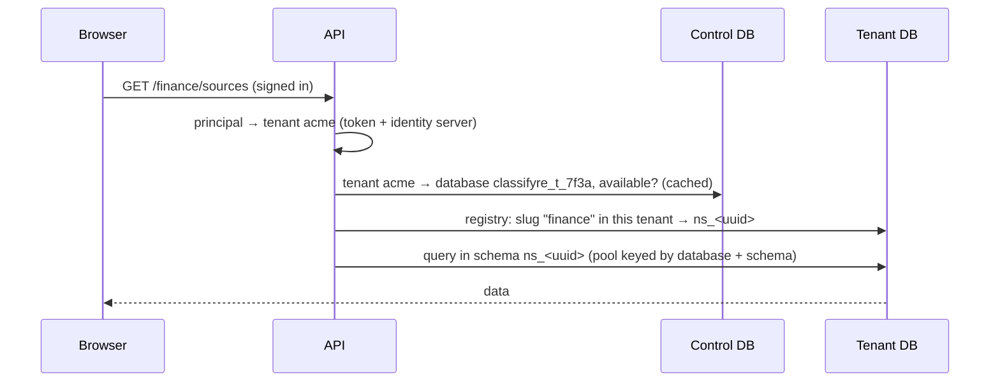
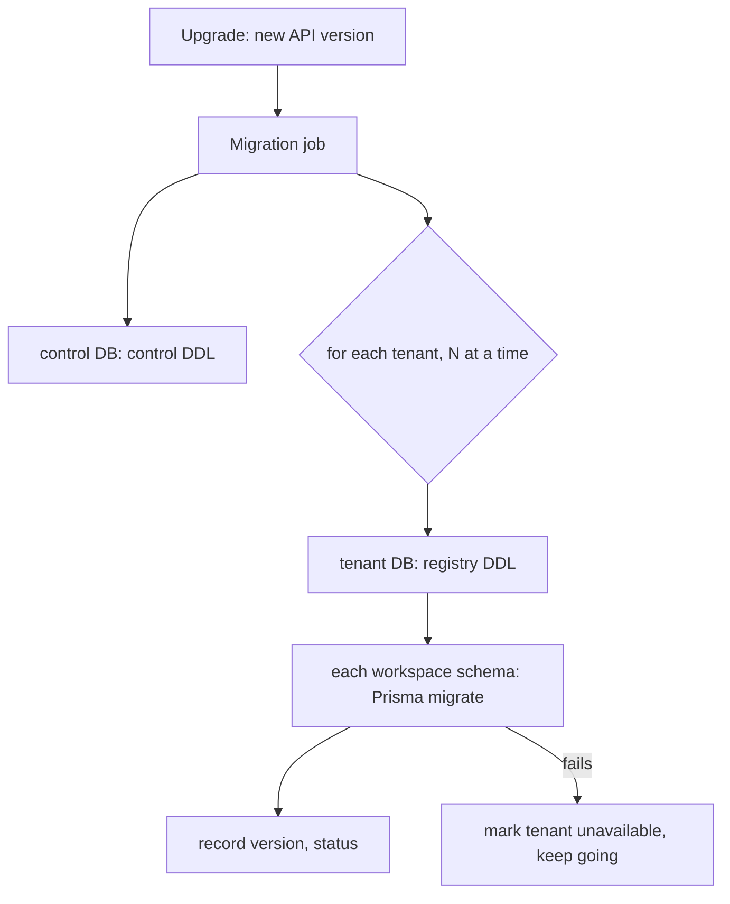

# PRD TEN · Tenant isolation, operators and the cloud playground

|                  |                                                                                                                   |
| ---------------- | ----------------------------------------------------------------------------------------------------------------- |
| **Status**       | Phases 0, 1 and 2 built 2026-11-07 (§6, §5.1, §4.7.1). Phases 3 and 4 wait until they are needed. Since 2026-11-09 sign-in is always on (IAM §13 Step 8g): the open database is only a copy source, and the all-in-one image runs the control and tenant databases too. |
| **Size**         | L (5 phases, each its own PR or set of PRs)                                                                       |
| **Depends on**   | [IAM · Identity and access management](IAM-access-management.md) (steps 0–8c: tenants, grants, people and groups) |
| **Not in scope** | billing, per-record rules, a second identity server                                                               |

## 1. Summary

Three things are asked for:

1. *(Since 2026-11-09 there is no sign-in off; the open database survives only as a copy source.)* **Sign-in off and sign-in on must never see each other's data.** Today one database holds every workspace, and tenants are only a column (`namespaces.tenant_id`). With sign-in off the API ignores that column, so anyone who turns `iam.enabled` off, even by mistake, sees every tenant's workspaces. That is a security problem, not a convenience one.
2. **Someone must manage the tenants themselves.** A tenant admin manages one tenant. Creating tenants and giving them their first admins is done today in the identity server's console, which is not tenant-scoped and has no place in Classifyre.
3. **A cloud version later**, where people sign up, get a tenant, and connect their own company sign-in (identity providers). Not built now, but the shape chosen here has to carry it.

The plan: **one open database for sign-in off, and with sign-in on a control database plus one database per tenant.** Which databases an API process may open is decided by the mode it starts in, and every database says what kind it is, so the wrong mode cannot open the wrong data. Operators get a **Platform** page in Classifyre for tenants. The cloud adds self-service sign-up and per-tenant sign-in methods on top of the same provisioning.

```mermaid
flowchart LR
  subgraph off["iam.enabled: false"]
    A1[API] --> O[(classifyre<br/>kind: open)]
  end
  subgraph on["iam.enabled: true"]
    A2[API] --> C[(classifyre_control<br/>kind: control)]
    A2 --> T1[(classifyre_t_acme<br/>kind: tenant)]
    A2 --> T2[(classifyre_t_globex<br/>kind: tenant)]
    C -. "routing: tenant → database" .-> T1
    C -. .-> T2
  end
  A1 -. "never" .- C
  A2 -. "never" .- O
```

## 2. Today (facts this plan builds on)

| Piece                  | Today                                                                                                                                                               |
| ---------------------- | ------------------------------------------------------------------------------------------------------------------------------------------------------------------- |
| Database               | One Postgres database (`DB_NAME`), embedded or CloudNativePG.                                                                                                       |
| Workspace registry     | `public.namespaces` (raw SQL), with `tenant_id` and `owner_group_id` since IAM step 5.                                                                              |
| Workspace data         | One schema per workspace (`ns_<uuid>`), migrated with Prisma.                                                                                                       |
| Connections            | `PrismaClientManager`: a pool per schema (`PRISMA_POOL_MAX`, default 16), at most `PRISMA_MAX_RESIDENT` (20) resident per pod with LRU eviction; pools open lazily. |
| Queues and locks       | pg-boss per workspace; advisory locks for worker leadership; `pg` pools in the registry, tenancy, scheduler, export.                                                |
| CLI jobs and notebooks | CLI jobs get a `DATABASE_URL` for their workspace schema; notebook code never sees it (`cli/src/sources/custom/env.py`).                                            |
| Tenants                | `public.iam_tenants`, `iam_grants`, `iam_audit_events`, `iam_people`, `iam_principals` in the same database.                                                        |
| Turning sign-in on     | Before phase 0: `adoptLocalWorkspaces` moved every workspace without a tenant into the first tenant. Removed in phase 0.                                            |
| Turning sign-in off    | Before phase 0: the API listed and opened **every** workspace, of every tenant. Since phase 0 only `local` ones.                                                    |
| Workspace addresses    | `/<slug>` is one URL space for all tenants, so a taken address shows that it exists somewhere (IAM review M-4, accepted).                                           |

## 3. Requirements

| #   | Requirement                                                                                                                                                              |
| --- | ------------------------------------------------------------------------------------------------------------------------------------------------------------------------ |
| R1  | With sign-in off, the API opens only the open database. No tenant's data is reachable, whatever is in the environment.                                                   |
| R2  | With sign-in on, the API never opens the open database. Workspaces made without sign-in reach a tenant only by an explicit operator action, never by turning sign-in on. |
| R3  | Every database records its kind (`open`, `control`, `tenant`) and, for a tenant database, which tenant. The API refuses to start, or to serve a tenant, on a mismatch.   |
| R4  | A tenant's data is in its own database: it can be backed up, restored, exported, moved to another server and deleted on its own.                                         |
| R5  | An idle tenant costs no connections. The connection budget rule of today still holds, now per server.                                                                    |
| R6  | One upgrade migrates the control database and every tenant database. A tenant whose migration fails is unavailable on its own (503); the others keep working.            |
| R7  | Each tenant database has its own database role. No role can read another tenant's database.                                                                              |
| R8  | Operators create, suspend, resume and delete tenants and give them their first admins from Classifyre, without the identity server's console.                            |
| R9  | Operators see tenants, not their data. Entering a tenant's workspaces needs a grant inside that tenant, and is audited like any other access.                            |
| R10 | Workspace addresses are per tenant: two tenants can both have `/finance`, and nobody learns about another tenant's workspaces.                                           |
| R11 | Cloud (later): sign-up creates a tenant through the same provisioning as R8; a tenant admin connects the tenant's own identity providers; per-tenant limits.             |
| R12 | *(Replaced 2026-11-09.)* The all-in-one Docker image runs like the chart: control database, one database per tenant, identity server beside them. Its open database from older versions is read only by `admin workspaces copy --to-tenant`. |

## 4. Design

### 4.1 Databases and what is in them

| Database                | Kind      | Holds                                                                                                                                                                                                                           |
| ----------------------- | --------- | ------------------------------------------------------------------------------------------------------------------------------------------------------------------------------------------------------------------------------- |
| `classifyre` (as today) | `open`    | Everything it holds today, for sign-in off: registry, categories, workspace schemas. No `iam_*` tables are used.                                                                                                                |
| `classifyre_control`    | `control` | Tenants (alias, organization id, status, database name, server, role, schema version, limits), the tenant routing, operators' audit trail, provisioning jobs, `iam_principals` (names for actor references). No workspace data. |
| `classifyre_t_<id>`     | `tenant`  | One tenant: its registry (`namespaces`, categories), grants, tenant audit trail, `iam_people`, and its workspace schemas `ns_<uuid>`.                                                                                           |

A tenant database has **the same layout as the open database** plus the tenant tables. So the registry, the workspace migrations, pg-boss and every service that works on "the database" run unchanged on either; only which database they are pointed at changes. `<id>` is a short, stable id, not the alias, so renaming a tenant never renames a database.

Every database gets a one-row table `classifyre_database (kind, tenant_id, created_at)`, written when it is created. It is the R3 check.

### 4.2 The mode guard (R1–R3)

At boot the API reads `IAM_ENABLED` and opens the database it is configured with:

- **Sign-in off:** that database must be `kind = open`. Anything else and the API refuses to start, with a message that names the kind it found. The open-mode API has no credentials for any other database and no code path that reads the control database.
- **Sign-in on:** the configured database must be `kind = control`. The API opens tenant databases only through the control database's routing, and checks each one's marker (`kind = tenant`, matching `tenant_id`) the first time it opens it. A mismatch marks that tenant unavailable and alerts; it never falls back.
- **A fresh empty database** gets its marker from the mode it is first started in. The chart passes the two modes different database names (`postgres.database` and `iam.controlDatabase`), so switching `iam.enabled` changes which database is used rather than reinterpreting one.

So turning sign-in off by mistake shows the open database, which is empty or holds only what was made without sign-in, and turning it back on shows the tenants exactly as they were.

### 4.3 Routing a request



- The namespace hook already resolves the principal before the workspace. It resolves the slug **in the principal's tenant database**, which gives R10 for free: `/finance` means "finance in my tenant", and another tenant's `/finance` does not exist for me.
- `PrismaClientManager` keys its pools by `(database, schema)` instead of `schema`. LRU eviction, pinning and the interactive/background lanes stay as they are.
- The tenant routing is cached per pod for a minute and dropped when an operator changes a tenant, like the membership cache.
- CLI jobs get the `DATABASE_URL` of their tenant's database and workspace schema, with the tenant's role (R7); the job template already takes it from the API.

### 4.4 Connections and performance (R5)

- Pools stay lazy: a tenant nobody uses holds no connections. The budget rule becomes "pool size × resident `(database, schema)` pairs per pod, summed over replicas, under `max_connections` **of each server**".
- Per-database connection overhead in Postgres is small, but many small pools add up. Past a few dozen active tenants per server, put **PgBouncer** (transaction pooling) in front; the chart gets an optional `pgbouncer` block. Prisma's driver adapter works with it when prepared statements are off; this is verified in phase 1, not assumed.
- pg-boss stays per workspace, so a busy tenant's queues never block another's. Worker leadership uses advisory locks per database.
- The control database is small and hot (routing, principals); it is read through a cache and never on the hot path of a query.
- A large tenant can live on its own Postgres server: the routing stores the server per tenant, so moving a tenant is dump, restore and one row.

### 4.5 Provisioning a tenant

One provisioning routine, used by the operator page (R8), the cloud sign-up (R11) and the first boot:

1. Row in `classifyre_control.tenants` with status `provisioning`.
2. Database and role: `CREATE ROLE ... LOGIN PASSWORD ...; CREATE DATABASE classifyre_t_<id> OWNER ...; REVOKE CONNECT ... FROM PUBLIC` (R7). The API uses a **provisioner role** with `CREATEDB`/`CREATEROLE` and nothing else, kept apart from its data roles. On CloudNativePG the chart can let the operator create databases with `Database` resources instead; a managed cloud database uses its own API. One interface, three implementations, picked by `iam.tenantDatabases.provisioner`.
3. Marker row, tenant tables, registry DDL, default category: the same code that prepares the open database today.
4. Identity server: organization (alias, name), its top-level `admins` group, the first admin (an existing account, or a new one with a temporary password), using the rights the API already has with `iam.peopleManagement`.
5. Status `active`. Every step is idempotent and recorded, so a failed provisioning is resumed or rolled back from the operator page, never left half-made.

**Secrets.** Each tenant's database password is generated at provisioning and stored encrypted in the control database (AES-256-GCM, key from a chart Secret, `iam.tenantDatabases.keySecret`). The open-mode API never has that key. Rotation is an operator action per tenant, or all tenants, that sets a new password and updates the row in one step. Kubernetes Secrets per tenant are not used: they do not scale to many tenants and would need the API to write Secrets.

### 4.6 Migrations (R6)



- The pre-boot migration step that runs today for one database runs for the control database, then for each tenant database with a concurrency limit (`iam.tenantDatabases.migrationConcurrency`, default 4).
- Each tenant row records `schema_version`, `migrated_at` and `migration_error`. An API pod serves a tenant only when its version matches the code; otherwise that tenant answers 503 with "being upgraded" or "upgrade failed", and the others work.
- Workspace schemas inside a tenant are migrated the way they are today; nothing changes there.
- A new tenant is created at the current version, so provisioning never waits for a migration run.

### 4.7 Operators and the Platform page (R8, R9)

- **Who is an operator:** a realm role `classifyre-operator` in the identity server, given by whoever runs the installation (first one from the chart, `iam.bootstrap.operator`). An operator is not a member of any organization. Today such a person gets "not in a tenant"; with this they get the Platform page instead.
- **Capability:** `platform.tenants.manage` (already in the catalogue, role _Platform operator_, unused so far).
- **The Platform page** (`/platform`): tenants with status, size, workspaces count, schema version and last activity; **create tenant** (alias, name, first admin's email); **suspend** (sign-in refused for its members, data kept), **resume**, **delete** (export offered first, then a retention period before the database is dropped); the tenant's admins, with **add admin** and **remove admin**; provisioning and migration errors with **retry**.
- **No data:** the page reads only the control database. An operator who must look inside a tenant asks a tenant admin for a grant, or uses a break-glass grant that expires within hours and is written to both the tenant's and the platform's audit trail.

#### 4.7.1 As built on one database (2026-11-07)

Phase 2 came before phase 1, so the Platform page runs on today's single database. What that changes:

| Planned                                                              | As built                                                                                                                                                                                                                                                                                                                                                                      |
| -------------------------------------------------------------------- | ----------------------------------------------------------------------------------------------------------------------------------------------------------------------------------------------------------------------------------------------------------------------------------------------------------------------------------------------------------------------------- |
| Operator role `classifyre-operator`, first one from the chart        | The realm role existed; `iam.bootstrap.admin.operator` (default on) gives it to the chart's first admin when the setup job creates that account. The API asks the identity server for the person's realm roles (`role-mappings/realm/composite`, `view-users` is enough), cached a minute, instead of trusting a token claim, so taking the role away counts within a minute. |
| Operator in no organization gets the Platform page                   | `AccessGuard` routes every `platform.*` capability to `IdentityService.authenticateOperator`, which needs no tenant. The web's 401 handler sends a `NO_TENANT` person who passes `GET /platform/me` to `/platform`; an operator in a tenant gets **Platform** in the account menu (`TenantDto.operator`).                                                                     |
| Tenants with status, size, workspaces, schema version, last activity | Status (`iam_tenants.suspended_at`, `deleted_at`), workspaces, people, admins, created and last activity (latest tenant audit event). Size and schema version wait for tenant databases. Organizations made in the console are listed too (their tenant row is made on sight). Problems shown: organization deleted or replaced, no `admins` group.                           |
| Create tenant (alias, name, first admin's email)                     | Built, then removed (IAM step 8d): tenants are organizations made in the identity server with a top-level `admins` group; the page lists them on sight. The API's service account only reads the identity server. |
| Suspend, resume                                                      | Suspended or deleted tenant: `authenticate` throws `TENANT_SUSPENDED` (web shows a page), `principalForOwner` refuses its MCP agents. Background work keeps running; data untouched.                                                                                                                                                                                          |
| Delete: export, then retention, then drop the database               | **Remove tenant data**, only once its organization was deleted in the identity server and its alias is typed: its workspaces, grants and database go; the row stays as `deleted` with its activity. No export step. |
| Add admin, remove admin                                              | Built, then removed (IAM step 8d): admins are the members of the organization's `admins` group, changed in the identity server. The page shows them. |
| Retry provisioning and migrations                                    | Nothing to retry until phase 1 provisions databases.                                                                                                                                                                                                                                                                                                                          |
| Import workspaces                                                    | **Bring in workspaces** moves `local` workspaces into the tenant with the same transaction as `workspaces move --to-tenant` (§6.1), recorded as the operator. In phase 1 this becomes a copy.                                                                                                                                                                                 |
| Operators' audit trail in the control database                       | Each operator change is in the affected tenant's activity under the operator's name (`tenant.created`, `tenant.suspended`, `tenant.resumed`, `tenant.deleted`, plus the people, group and workspace events). A separate platform trail comes with the control database.                                                                                                       |
| Break-glass grants                                                   | Not built.                                                                                                                                                                                                                                                                                                                                                                    |

Checks: `platform.spec.ts` (create, roll back, alias rules, delete), `iam.spec.ts` (suspended tenant, MCP agents, operator sign-in), component test `platform-admin.spec.tsx`, persona suite section `P` (operator in no tenant, member refused, create, alias reuse, admins, suspend and resume, import, delete).

### 4.8 The cloud playground (R11, later)

- **Sign-up** creates an account, then a tenant through §4.5 with the new account as its first admin. Abuse limits (verified email, rate limits, a tenant per account) apply before provisioning.
- **Sign-in methods per tenant:** a tenant admin connects their company's identity provider (OpenID Connect, SAML, Microsoft Entra ID, Google) on a **Sign-in** tab of the Tenant access page. The identity server links the provider to the tenant's organization and routes people by email domain, which its organizations support. This needs `manage-identity-providers` for the API's service account, which is realm-wide like the people-management rights, so the same rule applies: the API changes only providers linked to the caller's organization. Claiming an email domain needs a DNS proof, so one tenant cannot route another's people to itself.
- **Limits** per tenant (workspaces, storage, runners, notebook minutes) live in the control database and are checked where workspaces are created and jobs start.
- **One realm for every tenant.** A realm per tenant would give each its own login page and providers, but costs a lot per tenant and splits the people-management code; organizations already give per-tenant providers and branding. Revisit only if a customer needs a fully separate realm.

### 4.9 What happens to today's data

- **Open mode** keeps using today's database unchanged; it gets the marker `open`.
- **Installations that already turned sign-in on** (today: everything is in one database, tenants as a column) are migrated once: a control database is created, each tenant's workspaces, grants and categories are copied into a new tenant database (schemas with `pg_dump`/restore, registry rows by SQL), the copy is checked, and then removed from the old database. Workspaces that were in no tenant stay in the old database, which becomes the open database.
- **Workspaces made without sign-in** reach a tenant only through **Import workspaces** on the Platform page: pick workspaces of the open database and a tenant; they are copied, not moved, and the open copy stays until the operator deletes it. `adoptLocalWorkspaces` is removed.

## 5. Phases

| Phase | What                                                                                                                                                                                                                                                                                      | Size | Ships alone? |
| ----- | ----------------------------------------------------------------------------------------------------------------------------------------------------------------------------------------------------------------------------------------------------------------------------------------- | ---- | ------------ |
| 0     | **Guard in today's single database** (§6): with sign-in off the API lists and opens only workspaces without a tenant; with sign-in on, workspaces without a tenant are no longer adopted automatically; database marker and boot check. Fixes the security problem now, before any split. | S    | yes          |
| 1     | **Control and tenant databases** (built 2026-11-07, §5.1): provisioning, routing, mode guard, migrations over tenants, the one-off migration of §4.9. PgBouncer option and a CloudNativePG `Database` provisioner left out.                                                                | L    | yes          |
| 2     | **Operators and the Platform page** (built 2026-11-07 on one database, §4.7.1): `classifyre-operator` role, `/platform`, create, suspend, resume, delete, admins, retry, import workspaces.                                                                                               | M    | yes          |
| 3     | **Per-tenant addresses** (R10), once slugs resolve in the tenant database; removes the M-4 exception.                                                                                                                                                                                     | S    | with 1       |
| 4     | **Cloud playground**: sign-up, per-tenant identity providers with domain proof, limits.                                                                                                                                                                                                   | L    | yes          |

### 5.1 Phase 1 as built (2026-11-07)

Built to make installations tenant-ready, not because many tenants exist: the VPS demo runs without sign-in, so only the dev stack had tenants to move. Where it differs from §4:

| Planned (§4)                                                                 | As built                                                                                                                                                                                                                                                                                                                                                                                                                                                                                      |
| ---------------------------------------------------------------------------- | --------------------------------------------------------------------------------------------------------------------------------------------------------------------------------------------------------------------------------------------------------------------------------------------------------------------------------------------------------------------------------------------------------------------------------------------------------------------------------------------- |
| Tenant database holds its registry, categories, grants, people, audit trail | The **registry stays in the control database**, with the tenants, grants, people, categories and tenant audit trail. Tenant databases hold only workspace data: the `ns_<uuid>` schemas and their pg-boss schemas. Every process (API, worker, scheduler, purge) keeps reading one list of workspaces; nothing fans out over tenant databases to find one. Restoring a tenant restores its workspace data; its registry rows come from the control database's backup. |
| Pools keyed by `(database, schema)`                                          | Pools stay keyed by schema: schema names are made from workspace ids and unique across databases. `tenant-databases.ts` maps each schema to its tenant as the registry reads it (`rememberWorkspace` in `toNamespace` and `resolve`) and builds the tenant URL from it (`workspaceDatabaseUrl`), used by `PrismaClientManager`, pg-boss, the CSV export, the scan subprocess and the registry's cross-schema queries. A schema the registry has not shown is an error, never a fallback to the control database. |
| Mode guard by database name per mode (§4.2)                                  | `database-mode.ts`: with sign-in, every entry point (API, migration init container, operator command) points `DATABASE_URL` at `CLASSIFYRE_CONTROL_DATABASE` (chart `iam.controlDatabase`, default `classifyre_control`) on the same server, creating it on first start. The marker is checked as before: `open` without sign-in, `control` with it, `tenant` + tenant id for each tenant database, at provisioning and at every boot's migration (not per pod on first open).          |
| Passwords stored encrypted in the control database                          | **Derived**: `HMAC-SHA256(CLASSIFYRE_TENANT_DATABASE_KEY, name)`, key in the `classifyre-iam` Secret (`tenant-database-key`, generated and kept). Provisioning runs at every boot and sets the password again, so a new key rotates all of them. Nothing secret is stored. The open-mode API has no key.                                                                                                                                                                                |
| Provisioner interface, three implementations                                 | One: SQL as the chart's database user (`CREATE ROLE`, `CREATE DATABASE … OWNER`, `REVOKE CONNECT … FROM PUBLIC`, `vector` extension, marker), made before a tenant's first workspace and checked at each boot. With sign-in, `CONNECT` is also revoked from `PUBLIC` on the control and open databases. CloudNativePG: the chart gives the application role `createdb`/`createrole` through managed roles and installs `vector` in `template1` (`postInitTemplateSQL`, new clusters only). **Not run against a live CloudNativePG cluster.** A `Database`-resource provisioner and managed-cloud APIs are left out. |
| Schema version per tenant, 503 while upgrading                              | `iam_tenants.migrated_at` and `migration_error`. Boot migrates up to `TENANT_MIGRATION_CONCURRENCY` (4) tenants at a time; a failure is recorded and logged and the boot goes on; that tenant's workspaces answer 503 from `resolve` until a later boot succeeds. The Platform page shows `UPGRADE_FAILED` with the error and each tenant's database.                                                                                                                                             |
| Copy with `pg_dump`/restore                                                  | The API image has no `pg_dump` for PostgreSQL 18, so `workspace-copy.ts` streams each table with binary `COPY` (`pg-copy-streams`): both sides migrated to this version first, seeded rows truncated, foreign keys dropped and added back, user triggers off, sequences set, row counts compared per table. The pg-boss schema is not copied: queues and schedules are made again when the workspace's workers start. A failed copy drops what it made.                                     |
| One-off migration (§4.9)                                                     | `node dist/src/admin.js tenants split [--keep-source]`, run once with sign-in on: tenants (replacing a same-alias tenant the bootstrap made in the empty control database), grants, people, principals, activity and categories to the control database; every tenant workspace, soft-deleted ones too, to its tenant's database. Re-runnable. Without `--keep-source` it then removes the originals and the tenant rows from the old database, which stays the open one.                   |
| Import workspaces is a copy                                                  | `workspaces copy --to-tenant <alias>` / `--to-local <slug>…` replace `workspaces move`; **Bring in workspaces** on the Platform page calls the same copy. Both keep the source, and the copy is a new workspace with a new id and schema (the original may still be in the target's registry after a copy out and back); the split keeps ids, so grants and activity stay attached. Addresses are still one space (phase 3), so a copy needs a free slug. With sign-in on, the open database's tables are made on first use (`prepareOpenDatabase`, which refuses a database not marked `open`); the Platform service opens it only to list and copy these. |
| Delete: export, retention, drop                                              | The tenant's database is dropped with the tenant when it has no workspace rows left, or by the purge of its last soft-deleted workspace. No export step yet.                                                                                                                                                                                                                                                                                                                                |
| PgBouncer option                                                             | Not built; pools stay lazy and per schema, as before.                                                                                                                                                                                                                                                                                                                                                                                                                                          |

Checks: `tenant-databases.spec.ts` (mode selection, names, derived passwords, routing never guesses), `admin.spec.ts`, `platform.spec.ts` (`UPGRADE_FAILED`), `iam.spec.ts` (boot refuses sign-in without the key), component test for the database and upgrade error, persona suite sections `T1` (control database has no workspace schemas, the tenant's has its three, marker, its role cannot connect to the open or control database, the open database has no tenant workspace), `T0` (copies out and in, row counts, taken address refused, activity), `P` (copy into a new tenant creates its database, the database stays while a soft-deleted workspace does) and the sign-in-off run (only the open database's workspace listed, tenants untouched).

Verified 2026-11-07: API unit tests, persona suite 76 checks. Dev stack: `tenants split --keep-source` moved `default` and its 31 workspaces (17 GB with pg-boss backlog and bloat in the old database, 8.9 GB copied) into `classifyre_t_…`, every table's row count matching; the first run stopped on rows a migration seeds (`finding_stats_state`), which the copy now truncates first, and the re-run picked up cleanly. Workspaces, categories, stats and a workspace's pages load from the tenant database for a member of `default`. The originals are still in `classifyre`; rerunning without `--keep-source` removes them.

## 6. Phase 0 in detail (built 2026-11-07)

The single database stays, but the two modes stop seeing each other:

- `NamespaceRegistryService.list/resolve` take the mode into account: **sign-in off → only `tenant_id = local`**; sign-in on → only the principal's tenant (as today). A tenant workspace opened by slug with sign-in off answers 404, exactly like one that does not exist.
- Turning sign-in on **no longer adopts** workspaces without a tenant. They stay in `local`, invisible with sign-in on, until an operator moves them explicitly (a CLI command in phase 0, the Platform page's Import from phase 2).
- The categories follow the same rule (they already carry `tenant_id`).
- The database gets its marker (`open` with a list of the tenants it also carries, for the phase 1 migration).
- **Existing installs:** workspaces already adopted into a tenant stay in that tenant. On the dev stack that means all 31 workspaces are in `default`: with sign-in off they would disappear until moved back with the command, so the command comes with a `--to-local` direction.

The operator command, for phase 0: `workspaces move --to-tenant <alias> | --to-local <slug>...`, run in the API pod, recorded in the tenant audit trail.

### 6.1 As built

| Piece                        | Where                                                          | What it does                                                                                                                                                                                                                                                                                                                                                                                                                                                                                                                                                                                                                                    |
| ---------------------------- | -------------------------------------------------------------- | ----------------------------------------------------------------------------------------------------------------------------------------------------------------------------------------------------------------------------------------------------------------------------------------------------------------------------------------------------------------------------------------------------------------------------------------------------------------------------------------------------------------------------------------------------------------------------------------------------------------------------------------------- |
| Scope rule                   | `apps/api/src/registry/workspace-scope.ts`                     | `tenant_id = local` with sign-in off, `tenant_id <> local` with it on. Every registry read and write carries it (`resolve`, `list`, `get`, `isPaused`, thumbnail, update, delete, purge), so the request hook, lists, workers, exports and MCP follow it. Schema migrations stay unscoped, so every schema keeps up with upgrades in either mode.                                                                                                                                                                                                                                                                                               |
| No creation outside a tenant | `NamespaceRegistryService.create`                              | With sign-in on, a workspace without a tenant is refused (it would land in `local`, which sign-in never shows).                                                                                                                                                                                                                                                                                                                                                                                                                                                                                                                                 |
| Categories                   | `tenancy.sql.ts`, registry                                     | Categories made without sign-in now belong to `local` (backfilled once); NULL is only the shared default. Each mode lists, changes and files under only its own categories plus the default; the open mode can no longer rename the shared default.                                                                                                                                                                                                                                                                                                                                                                                             |
| No adoption                  | `IdentityService.bootstrap`                                    | `adoptLocalWorkspaces` is removed.                                                                                                                                                                                                                                                                                                                                                                                                                                                                                                                                                                                                              |
| Marker                       | `apps/api/src/database-kind.ts`                                | `public.classifyre_database (kind, tenant_id, created_at)`, written `open` at boot. The API refuses to start on any other kind, and logs how many workspaces the current mode hides. The planned "list of tenants it also carries" was not needed: `iam_tenants` already is that list.                                                                                                                                                                                                                                                                                                                                                          |
| Operator command             | `apps/api/src/admin.ts`                                        | `node dist/src/admin.js workspaces list` and `workspaces move --to-tenant <alias> (--all \| <slug>...) [--owner-group <id>]` / `--to-local (--from <alias> --all \| <slug>...)`, run with `kubectl exec` (builds `DATABASE_URL` from the chart's `DB_*`). One transaction: tenant and owner change, workspace-scoped grants are deleted, memberships in another tenant's categories are dropped (falling back to the default), and `workspace.moved_out` / `workspace.moved_in` go into each tenant's activity as `system:operator`. Into a tenant only from `local`; the owner defaults to the group holding the bootstrap Tenant admin grant. |
| Checks                       | `workspace-scope.spec.ts`, `admin.spec.ts`, persona suite `T0` | Unit: the predicate in both modes on every read, creation refused. Persona suite: move out hides the workspace and its address, a move between tenants is refused, moving back restores it without the workspace grant, both moves in the activity, then the release is upgraded with sign-in off: only the `local` workspace is listed, a tenant workspace's address is 404, and the hidden count is logged.                                                                                                                                                                                                                                   |

The dev stack's 31 workspaces stay in `default`, so they keep working with sign-in on; with sign-in off the open side starts empty. Phase 1 replaced `workspaces move` with `workspaces copy` (§5.1).

## 7. Alternatives considered

| Option                                         | Why not                                                                                                                                                                                             |
| ---------------------------------------------- | --------------------------------------------------------------------------------------------------------------------------------------------------------------------------------------------------- |
| Keep one database, isolate by `tenant_id` only | Phase 0 makes it safe across modes, but a tenant cannot be backed up, moved or deleted on its own, one tenant's load and bloat hit all, and every new query is one missed `WHERE` away from a leak. |
| Row-level security in one database             | Strong if right, but every Prisma query runs through roles and settings per request, and one policy mistake leaks across tenants. Debugging and migrations get much harder.                         |
| A schema prefix per tenant in one database     | Workspaces are already schemas; tenants as name prefixes give no per-tenant role, backup or server placement, and the catalog grows with every workspace of every tenant.                           |
| A Postgres server per tenant                   | Strongest isolation, highest cost and operations load. Kept as an option per tenant (§4.4: the routing stores the server), not the default.                                                         |
| A realm per tenant in the identity server      | See §4.8: heavy per tenant, splits the code; organizations already give per-tenant providers.                                                                                                       |

## 8. Risks and open questions

- **Provisioning rights.** `CREATEDB`/`CREATEROLE` for the API's provisioner role is powerful. It is a separate role, used only by provisioning, and on CloudNativePG can be avoided entirely with `Database` resources created by a small controller. Which one the chart defaults to is decided in phase 1.
- **Many databases on one server.** Autovacuum, `max_connections` and backup time grow with the number of databases. The budget check of `PrismaClientManager` gets a per-server view, and the operator page shows per-server totals.
- **Cross-tenant features.** Anything that would read across tenants (global search for operators, shared detector libraries) must go through the control database or an explicit export, never a direct query.
- **PgBouncer and Prisma.** Transaction pooling breaks session state (advisory locks, `SET search_path`). Advisory locks for leadership must use a direct connection; this is verified in phase 1.
- **The identity server stays shared.** One identity server, one realm, organizations per tenant. Its own database is per installation, not per tenant.
