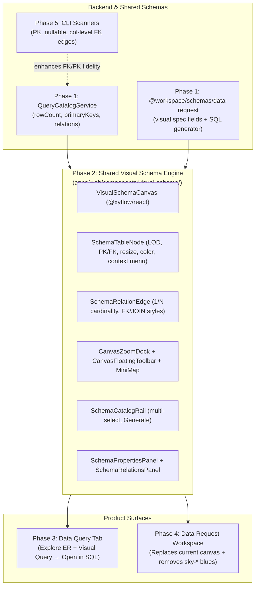

# PRD VS · Visual Schema & Query Canvas (Data Query + Data Requests)

| | |
| --- | --- |
| **Status** | Planned, 2026-11-27 |
| **Size** | L (5 phases, incremental PRs) |
| **Depends on** | [DQ · Data query](../DQ-data-query.md) (`QueryCatalogService`, SQL IDE workbench), [DR · Data requests](../DR-data-requests.md) (`DataRequestSpec`, `generateRequestSql`, `RequestStore`), `@xyflow/react` `^12.12.0`, `elkjs` `^0.12.0`, `html-to-image` `^1.11.13`, `@workspace/ui`, `@workspace/case-board` |
| **Inspired by** | VisuaLeaf Visual Schema / ER Diagram UX (semantic zoom, PK/FK cards, cardinality edges, auto-arrange, find links, floating action toolbar, vertical zoom/pan/select dock, minimap, collapsible Properties/Relations inspector, diagram export) — implemented natively with Classifyre's libraries and brutalist design tokens |
| **Not in scope** | DDL materialization (`CREATE TABLE` / `ALTER TABLE` against live sources — Classifyre is strictly read-only on sources per DQ R3), copying any third-party code or theme colors |

---

## 1. Summary & Architectural Decision

Classifyre has two surfaces that need an interactive, database-grade visual schema & join canvas:

1. **Data Query (`/query` SQL IDE & Source → Data tab)** — today has no ER diagram or visual schema view. Adding **Visual Schema** here first lets analysts explore tables, primary/foreign keys, and governance masks visually, auto-arrange large schemas, and generate starter `SELECT ... JOIN ... WHERE` SQL directly into the SQL editor tab.
2. **Data Requests (`/cases/:id` for `DATA_REQUEST`)** — today has an initial `@xyflow/react` canvas (`apps/web/components/data-request/`) that lacks semantic zoom, minimap, pan/select modes, auto-layout, PK/FK awareness, relation inspection, card resize/grouping, export, and uses ad-hoc hardcoded `sky-*` / `#0284c7` blues that do not belong to Classifyre's design system.

### Decision: One Shared Engine, Two Thin Adapters

Build a single reusable visual schema engine under `apps/web/components/visual-schema/` powered by **`@xyflow/react`**, **`elkjs`**, and **`@workspace/ui`**, driven by a clean `VisualSchemaAdapter` interface:

Shipping **Data Query first (Phase 3)** validates the engine on real multi-table catalogs (including read-only exploration and "Open in SQL" generation) before swapping out the stateful, collaborative **Data Request canvas (Phase 4)** with its optimistic concurrency, comment pins, and approval workflow.

---

## 2. Phase Index & Build Order

| Phase | Document | Goal | Deliverable |
| --- | --- | --- | --- |
| **Phase 1** | [phase-1-catalog-and-schema-contracts.md](./phase-1-catalog-and-schema-contracts.md) | Extend `DataRequestSpec` & `QueryCatalogDto` with visual fields, `rowCount`, `primaryKeys`, `nullable`, and governance-filtered `FOREIGN_KEY` relations | Shared schema + API DTOs + regenerated `@workspace/api-client` |
| **Phase 2** | [phase-2-shared-visual-schema-engine.md](./phase-2-shared-visual-schema-engine.md) | Build the shared `@xyflow/react` Visual Schema engine, LOD table cards, cardinality edges, ELK/Grid auto-layout, Find Links, floating toolbar, vertical zoom/pan/select dock, minimap, export, and Properties/Relations panels | Reusable `apps/web/components/visual-schema/` package |
| **Phase 3** | [phase-3-data-query-integration.md](./phase-3-data-query-integration.md) | Ship Visual Schema in **Data Query** (`QuerySourceTab` subtab + `/query` IDE tab) with Explore ER mode and "Open in SQL" / "New Data Request" bridge | First live product integration + Playwright CT tests |
| **Phase 4** | [phase-4-data-request-replacement.md](./phase-4-data-request-replacement.md) | Replace the current Data Request canvas with the shared engine, add Properties & Relations tabs to `RequestSqlPanel`, and **eliminate all ad-hoc `sky-*` / `#0284c7` blues** across Data Requests | Full Data Request upgrade + zero non-token blues |
| **Phase 5** | [phase-5-cli-pk-fk-extraction-and-groups.md](./phase-5-cli-pk-fk-extraction-and-groups.md) | Persist `primary_keys` / `nullable` and column-level FK pairs (`constraint_name`, `from_column`, `to_column`) in CLI SQL connectors; add optional Group Frames & DBML export | Exact column-level ER diagrams from scans + optional polish |

---

## 3. Design System & Color Token Contract (Mandatory Across All Phases)

Classifyre uses a **brutalist, high-contrast light/dark theme** defined in [`packages/ui/src/styles/globals.css`](../../../packages/ui/src/styles/globals.css) and canvas swatch tokens in [`packages/case-board/src/board.css`](../../../packages/case-board/src/board.css).

### Hard Rule: No Ad-Hoc `sky-*` or Hardcoded Hex Blues

The initial Data Request implementation introduced `sky-500` / `sky-600` / `sky-700` / `#0284c7` / `#0369a1` across 9 files — a blue palette that is **not used as a product accent anywhere else in Classifyre**. All new Visual Schema components AND all migrated Data Request components MUST strictly use semantic CSS custom properties:

| Visual Role | Token / Tailwind Utility | Light Value | Dark Value | Notes |
| --- | --- | --- | --- | --- |
| **Canvas background** | `bg-background` (`--background`) | `#f5f5f5` | `#0a0a0a` | Grid pattern uses `color-mix(in oklab, var(--foreground) 18%, transparent)` |
| **Card / floating toolbar / dock surface** | `bg-card text-card-foreground` (`--card`) | `#ffffff` | `#121212` | Sharp corners (`--radius: 0.25rem`, `rounded-xs` / `rounded-[4px]`) |
| **Structural borders** | `border-border` (`--border`) | `#0a0a0a` | `#f5f5f5` | `border` on inner dividers; `border-2 border-border` on floating docks/toolbars (matching `ToolDock` & `ZoomControls`) |
| **Active tool button / primary pill** | `bg-foreground text-background` | `#0a0a0a` / `#f5f5f5` | `#f5f5f5` / `#0a0a0a` | Inverted high-contrast active state (same as `ZoomControls` / `ToolDock`) |
| **Product accent (surface/badge/selection)** | `bg-accent text-accent-foreground` (`--accent`) | `#b7ff00` | `#b7ff00` | Use for active selection accents, placed indicators, active step fill, minimap active frame |
| **Product accent (readable text/icon ink)** | `text-[var(--accent-ink)]` / `text-accent-ink` (`--accent-ink`) | `#4d6b00` | `#b7ff00` | **Never** paint `--accent` (`#b7ff00`) text on white cards (1.21:1 contrast); always use `--accent-ink` (6.1:1 in light mode) |
| **Default table card accent bar** | `border-t-foreground` or `border-l-foreground` | `#0a0a0a` | `#f5f5f5` | Neutral monochrome by default; switches to chosen `--cb-*` token when user color-codes a table |
| **Default join / FK edge stroke** | `var(--cb-edge)` | `#78716c` | `#8a8a8a` | Clean neutral lines that never compete with selected paths |
| **Highlighted / selected edge & join column** | `var(--cb-select)` | `#4d7c0f` | `#b7ff00` | Matches case-board's lime selection language; readable in both themes |
| **Primary Key (`PK`) marker** | `var(--cb-amber)` / `var(--cb-amber-soft)` | `#d97706` | `#fbbf24` | Distinct from selection lime and destructive red |
| **Foreign Key (`FK`) marker** | `var(--cb-violet)` / `var(--cb-violet-soft)` | `#7c3aed` | `#a78bfa` | Or `var(--muted-foreground)` badge; clearly distinct from PK and errors |
| **Locked / masked governance indicator** | `var(--cb-amber)` + existing `ColumnAccessChip` | `#d97706` | `#fbbf24` | Preserves existing governance chip styling |
| **Errors / missing table / destructive** | `text-destructive` / `border-destructive` (`--destructive`) | `#ff2b2b` | `#ff2b2b` | Missing tables, broken joins, SQL diagnostics |
| **Optional user table-group swatches (8)** | `--cb-gray`, `--cb-green`, `--cb-amber`, `--cb-blue`, `--cb-violet`, `--cb-pink`, `--cb-yellow`, `--cb-red` | from `board.css` | from `board.css` | User-assigned color coding on cards & minimap nodes only — never hardcoded hex |
| **Unrelated node/edge dimming** | `.vs-dim { opacity: 0.2 }` | — | — | Mirrors `.cb-dim` from `board.css` when inspecting a selected table/edge |

### Performance & Styling Rules (Inherited from `packages/case-board/src/board.css`)

- Hover and selection use **borders/outlines only** — no `box-shadow` glow stacks, no `backdrop-blur`, and no CSS keyframe animations on React Flow nodes.
- All `@xyflow/react` CSS variable overrides (`--xy-*`) live inside `.visual-schema .react-flow` so light/dark mode switches automatically with zero JS re-renders.
- Respect `prefers-reduced-motion: reduce` for `fitView` / fly-to durations (`duration = reduced ? 0 : 200`).

---

## 4. Library & Component Reuse Inventory

Everything required is **already installed** in `apps/web/package.json` — **zero new npm dependencies**:

- **Graph & Canvas:** `@xyflow/react` (`^12.12.0`) — `ReactFlow`, `ReactFlowProvider`, `Background`, `Panel`, `MiniMap`, `NodeResizer`, `Handle`, `BaseEdge`, `getSmoothStepPath`, `SelectionMode`, `useReactFlow`, `useStore`.
- **Auto-Layout:** `elkjs` (`^0.12.0`) via existing Web Worker wrapper [`apps/web/components/case-board/hooks/elk-layout.ts`](../../../apps/web/components/case-board/hooks/elk-layout.ts) and [`elk.worker.ts`](../../../apps/web/components/case-board/hooks/elk.worker.ts) (keeps ELK off the main thread with automatic timeout fallback to `layeredLayout`).
- **Diagram Export:** `html-to-image` (`^1.11.13`) — PNG (`1x` / `2x` / B&W), SVG.
- **State:** `zustand` (`^5.0.14`) — vanilla stores + React context.
- **UI Primitives (`@workspace/ui`):** `Button`, `Badge`, `Checkbox`, `Input`, `Select`, `Popover`, `Tooltip`, `Tabs`, `ScrollArea`, `ResizablePanelGroup/Panel/Handle`, `ContextMenu`, `DropdownMenu`, `Dialog`, `AlertDialog`, `Separator`, `Switch`.
- **Shared Board Helpers (`@workspace/case-board`):** `EdgeLabel`, `PresenceChips`, `CommentComposerPopover`, `CommentThreadPanel`, `FrameNode` (Phase 5).

---

## 5. Cross-Phase Engineering Invariants

1. **Governance fail-closed:** `QueryCatalogService` must never expose hidden column names inside FK `relations` or `primaryKeys`. If a column is hidden for the current principal (`columnsAsSeen`), any FK referencing that column is dropped before the response leaves the API.
2. **Backward-compatible `DataRequestSpec`:** Every new visual field in `packages/schemas/src/data-request.ts` is optional with safe defaults; existing persisted `DataRequest.spec` JSON rows load and save cleanly with zero DB migration.
3. **Deterministic SQL:** Visual metadata (`color`, `height`, `collapsed`, `hidden`, `cardinality`, `groups`) must never alter `generateRequestSql()` output.
4. **Full i18n parity:** Every new user-visible string is added to both `apps/web/i18n/en.json` and `apps/web/i18n/de.json` and verified via `bun run --filter @classifyre/web test:i18n`.
5. **Verification per phase:** Each phase lands with passing typecheck, unit tests (`jest` / `pytest`), and Playwright component tests (`bun run --filter @classifyre/web test:component`).
